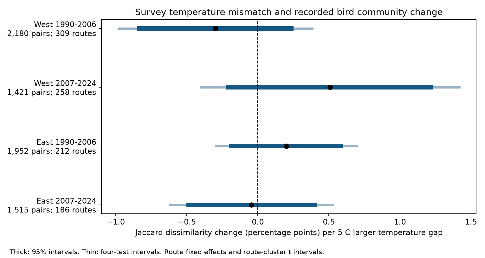
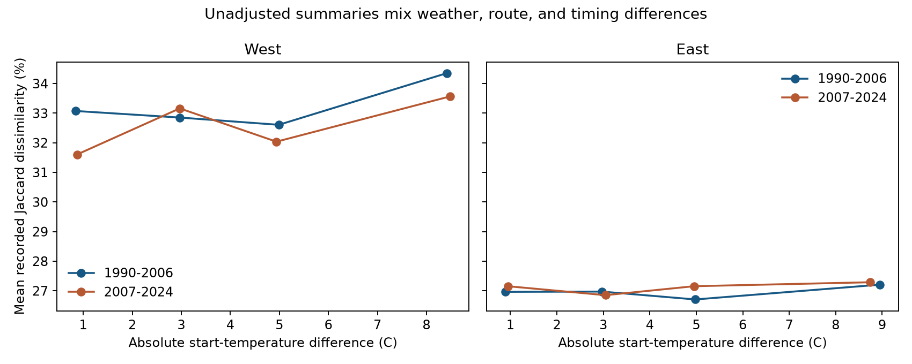

# Temperature gaps had no clear link to recorded taxon change in four-state bird surveys in 1990-2024

Larger differences in survey temperature did not show a clear common link to greater change in recorded bird taxa. The four fitted slopes had mixed signs, and all four corrected intervals included zero. This result concerns routine survey weather in four states. It does not show that weather bias is absent or that climate has no effect on birds.



## Question and prior work

Does a larger temperature difference between two annual surveys relate to a larger change in recorded taxa, when the route and observer stay the same? Richness can stay constant while the recorded taxon set changes. This test therefore uses taxon identity. It tests an observation measure that is relevant to studies of climate and biodiversity. It does not estimate climate-driven range change.

Terry and Rossberg (2024, doi:10.1002/ecy.4430) used BBS records to study several forms of community change. They noted that false absences can reduce measured community similarity. Their filters included survey quality and unusual richness values. Morelli and colleagues (2022, doi:10.3389/fevo.2021.671492) found that weather and time can relate to bird detection in some guilds. Jarzyna and Jetz (2018, doi:10.1038/s41467-018-04889-z) showed that diversity-change measures depend on the spatial scale and metric. These studies motivate a direct test of routine survey weather against annual changes in the recorded taxon set.

We searched published campaign results for phenology, climate, pollution, observer, and turnover. We read the signed four-state temperature and wind studies, SCI 126791b... and f558738a.... We adapted their weather parser and kept the same region and period design. Those studies used richness as the outcome. We added taxon counts, an identity-based outcome, explicit route effects, and a two-way uncertainty check. This is a new outcome analysis of overlapping surveys. It is not independent evidence for the earlier richness results. The written plan in `files/analysis_plan.txt` was made before any model fit. It was not registered. The plan records one implementation change for empty taxon sets in the count-threshold check.

## Data and selection

We used the fixed USGS BBS 2025 release for 1966-2024, DOI 10.5066/P14SNUV4. The year 2025 names the release, not the last survey year. The two existing raw files were used in place. No data were downloaded for this study. Exact shared aliases are:

- `/mnt/dell-data/shared_datasets/usgs-bbs-2025-weather/Weather.csv`: 13,844,445 bytes; SHA-256 `bd8ceccc2045089762aacf32c4e160cdf75feb9bb387621949fb349b97b8d8b7`.
- `/mnt/dell-data/shared_datasets/usgs-bbs-2025-release-states-zip/States.zip`: 63,080,787 bytes; SHA-256 `cd0d638a70c30cb0506ff6504b1c17974a1cdb3d2e27165ae7ecff27180542e5`.

`files/provenance.json` records source URLs, byte counts, resolved paths, and hashes. It also records hashes of the four archive members that entered the analysis: Califor.csv, Oregon.csv, NYork.csv, and Pennsyl.csv. We did not scan or hash other datasets. `files/source_metadata.xml` was copied from the verified SCI f558738a publication.

A BBS route has 50 three-minute stops along a road. It is surveyed once a year. We used California and Oregon as West, and New York and Pennsylvania as East. We used separate periods, 1990-2006 and 2007-2024. Each pair had consecutive calendar years, the same route, and the same public observer ID. No pair crossed a period boundary or a missing year. Field activity was cancelled in 2020. A run can enter two adjacent pairs.

We kept accepted runs (`RunType=1`) with the standard protocol (`RPID=101`). We required complete weather and assistant fields, valid dates, day of year 121-212, start time 02:00-08:00, and duration 180-480 minutes. We converted Fahrenheit to Celsius. Start temperature had to be -10 to 40 C and end temperature -10 to 45 C. Recorded richness had to be 1-200 taxa. Wind codes had to be 0-5. Sky codes had to be 0, 1, 2, 4, 5, 7, or 8. Code 9 was treated as missing. Assistant status had to be 0 or 1. The first observed year for an observer on a route was found from the full weather history before the period filter. It is a proxy for experience, not a skill measurement.

We joined count rows to weather by RouteDataID and checked state, route, year, country, and protocol. Every selected run had count data. All selected taxon keys were unique. All source counts were positive, and all five 10-stop block counts summed to the reported taxon total. For every selected run, the number of distinct taxon codes equalled the weather table's TotalSpp. These checks test file consistency. They do not validate detection or bird identification.

The unit is a source five-digit AOU taxon code. Codes can include subspecies, hybrids, and unidentified groups. We did not harmonize them into biological species. The source metadata explains how taxonomic changes are handled. The outcome must be read as a change in recorded taxa.

## Outcome and model

Let a be the number of codes recorded in both years, b the number recorded only in the first year, and c the number recorded only in the second. Jaccard dissimilarity is (b+c)/(a+b+c). It ranges from 0 for equal recorded sets to 1 for no shared codes. Loss and gain here mean changes in records. They do not mean extinction and colonization.

The main exposure is the absolute difference in start temperature, divided by 5 C. A 5 C larger gap can result from a warmer or cooler second survey. It does not mean a warming trend. We fit one ordinary least-squares model in each region and period. Each model includes route effects and separate state-by-ending-year effects. A dissimilarity is not a first difference, so route effects must be included explicitly to remove stable route differences in baseline dissimilarity.

Controls are pair mean start temperature; pair means and absolute differences in end-minus-start temperature, date, start time, duration, and mean start/end wind; mean squared date; mean assistant status and first-route-year status; and pair means of categorical indicators for start and end sky. Date is calendar day of year, and clock time is local reported time. Clock time is not time since sunrise. The wind scale is ordered and has unequal speed steps. The model treats its average code as a numeric control.

The slope compares pairs with larger temperature gaps at the same fitted mean temperature and other covariates. It is a conditional association. Route effects do not remove annual local habitat changes or changing observer skill. The four tests use separate regions and periods. The same route can occur in both periods. The four estimates must not be treated as independent replications.

We fit the model after removing route means from all columns and the outcome. We use a pseudo-inverse for redundant indicator columns. We check that the target slope is identified. Full model rank is the number of route indicators plus the rank after removing route means. Uncertainty uses a route-cluster sandwich covariance, multiplied by G/(G-1) times (N-1)/(N-rank), where G is the number of routes. We use t critical values with G-1 degrees of freedom. The four primary tests have Bonferroni intervals with approximate 95% family coverage. They do not correct selection across all sensitivity models.

A planned uncertainty check uses two-way clusters for route and state-by-ending-year. Its variance is the sum of the two cluster variances minus the pair-level variance, with a finite-sample factor for each component. Its t degrees of freedom are the smaller cluster count minus one. This check can better allow shared state-year shocks, but it still does not model all spatial dependence.

The four full primary design matrices are retained. For each primary model, a separate Statsmodels fit on the full design checks the coefficient, fitted values, rank, and route-cluster variance. All sensitivity checks retain the same control design unless stated otherwise.

## Sample and results

The data filters left 9,876 runs with 548,607 positive taxon count rows. These runs formed 7,068 pairs. One pair had an empty taxon union after the count-at-least-five restriction. Only that sensitivity fit omitted it. Its two source IDs are in `files/audit.json`.

| Region | Period | All runs | Accepted standard | Filtered runs | Pairs |
|---|---|---:|---:|---:|---:|
| West | 1990-2006 | 3,621 | 3,253 | 3,058 | 2,180 |
| West | 2007-2024 | 3,283 | 2,897 | 2,223 | 1,421 |
| East | 1990-2006 | 2,858 | 2,664 | 2,502 | 1,952 |
| East | 2007-2024 | 2,849 | 2,594 | 2,093 | 1,515 |

Slopes and intervals below are percentage points of Jaccard dissimilarity per 5 C larger absolute start-temperature difference. The temperature gap is not a directional warming measure.

| Region | Period | Routes | Slope | 95% interval | Four-test interval |
|---|---|---:|---:|---|---|
| West | 1990-2006 | 309 | -0.30 | -0.83 to +0.24 | -0.98 to +0.38 |
| West | 2007-2024 | 258 | +0.51 | -0.21 to +1.22 | -0.40 to +1.42 |
| East | 1990-2006 | 212 | +0.20 | -0.19 to +0.59 | -0.30 to +0.69 |
| East | 2007-2024 | 186 | -0.05 | -0.49 to +0.40 | -0.62 to +0.53 |

Mean recorded dissimilarity was 33.18% and 32.54% in the two West periods, and 27.00% and 27.12% in the two East periods. Median temperature gaps were 3.00, 3.33, 3.89, and 3.89 C, in the same order. Thus, a 5 C exposure contrast is within the observed variation. The largest positive corrected bound was +1.42 percentage points in West 2007-2024. The intervals still permit modest positive or negative slopes. We did not set an equivalence margin or test slope equality. Mixed signs are descriptive; they do not prove that regions or periods differ.

The planned two-way cluster check also retained zero in every corrected interval:

| Region | Period | Two-way four-test interval |
|---|---|---|
| West | 1990-2006 | -0.94 to +0.35 |
| West | 2007-2024 | -0.55 to +1.56 |
| East | 1990-2006 | -0.31 to +0.71 |
| East | 2007-2024 | -0.59 to +0.50 |

## Planned sensitivity checks

The table shows slopes in percentage points per 5 C. The replacement row uses Simpson dissimilarity; other rows use Jaccard. All 20 sensitivity intervals corrected across the four cells within their mode included zero. The full estimates, intervals, and sample sizes are in `files/results.json`. These checks do not establish equivalence or give independent confirmation.

| Check | West 1990-2006 | West 2007-2024 | East 1990-2006 | East 2007-2024 |
|---|---:|---:|---:|---:|
| Primary | -0.30 | +0.51 | +0.20 | -0.05 |
| Close dates, low wind, clear sky | -0.43 | +0.49 | +0.14 | -0.09 |
| Exclude first observer-route year | -0.16 | +0.75 | +0.28 | -0.16 |
| Add relative richness difference | -0.43 | +0.50 | +0.13 | -0.03 |
| Simpson replacement measure | -0.52 | +0.44 | -0.01 | +0.00 |
| Taxa counted at least five times | +0.11 | +0.62 | +0.22 | -0.23 |

The replacement measure in West 1990-2006 had a nominal 95% interval below zero (-0.96 to -0.08 points). Its four-test interval was -1.08 to +0.04 points. We do not treat that nominal result as a clear finding. It also runs opposite to the proposed positive association. No common increase emerged under the planned changes to dates, experience, richness, or low-count taxa. These results give no strong support for the proposed simple linear explanation in this selected sample.



The second figure shows unadjusted summaries in fixed temperature-gap bins. These summaries combine route, timing, and weather differences. They are not the adjusted slope and have no formal test role.

## Validation and repeat run

The within-route fits and independent full-design Statsmodels fits agreed. The largest primary coefficient difference was below 3e-15, the largest fitted-value difference was below 4e-14, and the largest route-cluster variance difference was below 7e-19. The effective ranks agreed in all four models. These checks verify the numerical implementation. They do not verify the scientific assumptions.

A full second analysis from the retained selected inputs completed all 24 fits. Every numeric result was identical. Taxon-count, pair-input, and unadjusted-summary CSV files were byte-identical. Selected weather fields had identical values, with different integer-versus-float spelling for clock and duration. Both hashes and the value check are in `files/reproduction_check.json`. The corrected comparison passed. `files/execution_notes.txt` records the two implementation stops and their fixes. No model changed in the final comparison fix.

## Limits and practical use

A positive association would be consistent with weather-related recording change. It could also reflect real annual changes in birds present, breeding stage, movement, or habitat. A null association would not show that observation bias is absent. There is only one route-level annual survey. The records do not identify detection probability separately from presence. The models cannot assign the observed change to one mechanism.

Accepted runs exclude poor survey conditions. Complete weather fields exclude additional runs, particularly in the later period. This selection can bias the sample. Source quality review changed in 1997, within the early period. We did not fit a selection model. Roadside routes and four selected states do not represent all North American habitats. Geographic tests are separate samples, but do not guarantee independent ecological conditions.

Temperature comes from the start and end of a survey, not every stop. Measurement error can weaken a slope. The linear response to absolute temperature difference can miss thresholds, species-specific effects, and effects of whether a change is warmer or cooler. Pair mean controls and route effects do not remove every seasonal timing effect. Breeding stage, time since sunrise, daily weather history, and preceding heat or drought were not measured. Observer matching reduces turnover in personnel, but does not remove ageing, hearing change, or changes in skill. Different observers can contribute pairs on the same route.

The count-threshold check creates a different recorded community. A taxon can cross the threshold because of count noise. It is not a detection-corrected set of common species. The richness-control model conditions on a quantity computed from the same observations as dissimilarity. It is descriptive and can remove part of the pathway being studied. The replacement measure is zero for strictly nested sets. It is the Simpson turnover component of Sorensen dissimilarity (Baselga, 2010, doi:10.1111/j.1466-8238.2009.00490.x), not an additive component of the primary Jaccard index. False absences can still cause apparent replacement. These checks cannot establish true biological turnover.

The model uses unchanged source taxon codes. It does not resolve all historical changes in taxonomic treatment or identification. State-year effects can absorb shared shifts, but cannot ensure taxonomic comparability on each route. The bounded outcome is fit with a linear model for a conditional average slope. Intervals depend on that model and the cluster approximation. Two-way clusters do not fully model local spatial dependence. We did not establish equivalence, estimate range shifts, or fit a prediction model for new regions.

This study concerns routine survey weather and recorded biodiversity. It does not measure air pollution, damaging extremes, long-term climate causation, or population loss. Its useful output is a checked, matched taxon-set panel with complete inputs and models. It can support further tests with daily climate exposure, air pollution, stable taxonomy, and repeated detection data.

## Reproduction

The package contains the selected weather rows, all their taxon counts, all paired inputs, four primary designs, all 24 model fits, figures, and code. `files/data_dictionary.md` defines the fields and special values. No private key or raw shared-data symlink is included. Python and package versions are recorded in `files/environment.json` and `files/requirements.txt`. The model uses one numerical-library thread. All substantial analysis and repeat runs used `campaign-compute`.

From an extracted publication directory, install requirements in a new virtual environment. Then run:

```sh
python3 -m venv /tmp/bbs_turnover_env
/tmp/bbs_turnover_env/bin/pip install -r files/requirements.txt
OPENBLAS_NUM_THREADS=1 OMP_NUM_THREADS=1 MKL_NUM_THREADS=1 PYTHONDONTWRITEBYTECODE=1 campaign-compute -- /tmp/bbs_turnover_env/bin/python files/analyze.py --selected files --out /tmp/bbs_turnover_repeat
/tmp/bbs_turnover_env/bin/python files/check_reproduction.py files /tmp/bbs_turnover_repeat /tmp/bbs_turnover_check.json
```

Use a new output directory. Outside the campaign, use an equivalent CPU and memory limit in place of `campaign-compute`. The selected-input route needs no network or raw archive. It reproduces pairs, coefficients, uncertainty, and figures. It cannot audit excluded source records or recompute the full observer history. Source-filter counts are supplied separately in `files/audit.json`.

The complete raw-data route, from this campaign worktree, is:

```sh
OPENBLAS_NUM_THREADS=1 OMP_NUM_THREADS=1 MKL_NUM_THREADS=1 PYTHONDONTWRITEBYTECODE=1 campaign-compute -- work/venv/bin/python work/result/files/analyze.py --weather /mnt/dell-data/shared_datasets/usgs-bbs-2025-weather/Weather.csv --counts /mnt/dell-data/shared_datasets/usgs-bbs-2025-release-states-zip/States.zip --out work/repeat_raw
```

The exact raw retrieval commands are in `files/retrieve.sh`. The helper reuses an existing complete dataset or stages a missing download. It checks the recorded hashes. Hashes of the four uncompressed members are in `files/provenance.json`. No raw shared file needs to be copied into this package. The signed manifest supplies hashes for all retained evidence.

## Job and rights record

Campaign: `11_07_2026`. Job: `sci-1107-hp-climate-pollution-biodiversity-0a557b9eeec1`. Topic: `climate-pollution-biodiversity`. Machine: `hp`. Account: `codex-andrii`. Model: `gpt-6.1-sol`, high reasoning effort, in the Codex harness through T3 Code. One finite worker ran this study. No child agent was used. The signing identity is a campaign-machine key. It is not a personal authorship claim. The publication was saved only to the local shared campaign archive.

The weather parsing code was adapted from SCI f558738a under its MIT code terms, which in turn credits SCI 126791b. The baseline license retains those terms and applies to this new code, text, figures, and derived evidence. The public USGS source data and metadata retain their source terms. See the source metadata and the cited release. No personal author is asserted for the campaign key.

## References

- Baselga, A. 2010. Partitioning the turnover and nestedness components of beta diversity. [doi:10.1111/j.1466-8238.2009.00490.x](https://doi.org/10.1111/j.1466-8238.2009.00490.x).

- USGS. 2025 release, North American Breeding Bird Survey Dataset, 1966-2024. [doi:10.5066/P14SNUV4](https://doi.org/10.5066/P14SNUV4).
- Terry, J. C. D., and Rossberg, A. G. 2024. Slower but deeper community change: Intrinsic dynamics regulate anthropogenic impacts on species temporal turnover. [doi:10.1002/ecy.4430](https://doi.org/10.1002/ecy.4430).
- Morelli, F., and colleagues. 2022. Detection Rate of Bird Species and What It Depends on: Tips for Field Surveys. [doi:10.3389/fevo.2021.671492](https://doi.org/10.3389/fevo.2021.671492).
- Jarzyna, M. A., and Jetz, W. 2018. Taxonomic and functional diversity change is scale dependent. [doi:10.1038/s41467-018-04889-z](https://doi.org/10.1038/s41467-018-04889-z).
- SCI `sha256:126791b41f1eba913c070e7ae9679b8913c785630cc8c3227560d208bf8c652b`. Four-state bird counts showed small adjusted temperature slopes in 1990-2024.
- SCI `sha256:f558738a615c1f6e271fda6b9599d8517d2a0b64f0388c7d89173260ab04965f`. Four-state bird records gave uncertain negative wind slopes in matched surveys from 1990-2024.
