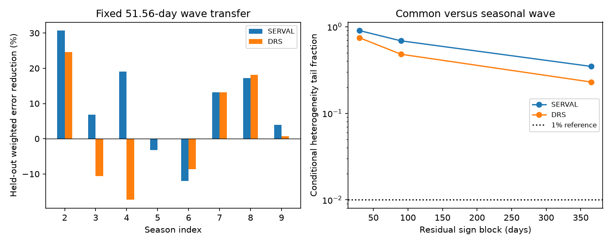

# A fixed 51.56-day wave reduces pooled held-out error in eight HD 40307 HARPS seasons

A fixed 51.56-day velocity wave reduces pooled held-out weighted error by 13.8 percent in SERVAL and 7.0 percent in DRS. The test uses 211 nights in eight seasons. Other seasons supply training data. Six of eight SERVAL seasons and four of eight DRS seasons give positive gains. The result supports transfer of part of the known signal across seasons. It does not prove a planet or a fixed phase at all times.



## Question and prior work

Can the known signal near 51.6 days keep a common phase and amplitude across observing seasons? A planet on a nearly circular orbit can produce such a wave. Stellar rotation can also produce a velocity wave. Active regions can change its phase and amplitude. Errors shared by the two reductions can produce a common signal.

Tuomi et al. (2013, DOI 10.1051/0004-6361/201220268) reported the candidate. Diaz et al. (2016, DOI 10.1051/0004-6361/201526729) retained a signal near 51.56 days. It is not a new signal. Campaign publication sci:sha256:44a9021a00214feebfd14ddb6f5e674cedc512d5445361268de7409c08d99e47 tested a fixed 40.208-day rotation alias. It found a better fit at 51.56 days, but stated that its time-split fits did not test phase stability. Campaign publication sci:sha256:d614861f746dda336a382dcaa83b34efae9e00e40db54ce52943f539e355a02c included a short two-epoch control at 51.56 days in a study of the 197.8-day candidate.

We add a test of seasonal changes, a test that allows period uncertainty, and transfer to eight held-out seasons. We use the public source identified by those studies. We wrote new code. We do not reuse their computed tables or code. This is an exploratory analysis after a campaign and literature search. No data were hidden during question selection. Published periods are fixed in the primary tests.

## Data and rights

The input is the GJ2046 (HD 40307) CSV from HARPS RVBank Ver.02. Trifonov et al. (2020, DOI 10.1051/0004-6361/201936686) and Perdelwitz et al. (2024, DOI 10.1051/0004-6361/202348263) describe the database. Both reductions use the same spectra. They are not independent observations.

Source URL: https://exo-restart.com/wp-content/uploads/Stellar_parameters/Ver_02/GJ2046_RVs/GJ2046_HARPS_RVBank_ver02.csv

Exact shared file: `/mnt/dell-data/shared_datasets/hd40307-gj2046-harps-rvbank-v02-9f4a5774/gj2046_rvbank_v02.csv`.

SHA-256: `aa271485d4f5cbf3f8de171d88654ee9ebf7600116a793d0accda4e842c5ccf7`. Size: 264448 bytes. The resolved storage path, helper record, and source license hash are in `files/provenance.json`. We reused this file in place. We did not download new observation data or change the shared data.

The source repository has a CC0-1.0 notice. We checked the notice at https://github.com/3fon3fonov/HARPS_RVBank/blob/master/LICENSE. External observations and tables with one row per observation are outside this package. The package contains our code, narrative, figure and aggregate results under the SCI baseline terms. See `files/EXTERNAL_DATA_NOTICE.md`.

We require quality flag `f_RV=0`, mask `K5`, time `BJD<2457163`, finite corrected velocities, and positive corrected errors below 10 m/s in both reductions. We do not cut on residuals. This gives 448 exposures on 232 nights before the fibre change. A night is `floor(BJD-0.5)`. Exposure weights are `1/e_RV_mlc_nzp^2` for both products and for mean times. The night error is the inverse square root of the sum of weights. Each series is centered before fitting to avoid numerical cancellation. The fit weight is `1/(night_error^2+j^2)`, with primary extra noise scale `j=1 m/s`. A check uses `j=2 m/s`. This is a working scale, not an estimated stellar noise amplitude.

## Method

Time is `t=BJD-2454800`, in days. The baseline has a constant, a cubic polynomial in `t/1000`, and sine and cosine terms at 4.3115, 9.6207 and 20.4185 days. All coefficients are fitted together by weighted least squares. A candidate adds sine and cosine terms at its fixed period. These two coefficients encode phase and amplitude.

A season is `floor((BJD-2452800)/365.25)`. We allow separate candidate coefficients only in seasons with at least 14 nights. These are seasons 2 through 9, with 51, 37, 40, 17, 15, 20, 14 and 17 nights. They contain 211 nights. The remaining 21 nights keep one common candidate wave. This choice avoids separate fits to very sparse seasons. The common model has rank 12. The seasonal model has rank 28. The statistic is the common-model weighted squared error minus the seasonal-model error. Larger values favor change. The model tests phase and amplitude jointly; it does not isolate one from the other.

For each noise check, we fit the common model, divide its weighted residuals by `sqrt(1-h)` for fitted leverage `h`, and change their signs within fixed time blocks. We add the signed residuals to the fitted common values and refit both models. Bins are `floor(t/L)` for L=30, 90 or 365.25 days. There are 71, 35 and 13 occupied bins. The tail fraction is `(1+exceedances)/4001`. These are conditional noise checks. They assume independent, symmetric errors between blocks. Fit residuals, block boundaries, shared errors and long memory can invalidate that assumption. They are not planet probabilities or exact randomization p values.

We also search 51.30 to 52.26 days in steps of 0.01 day. Each model has one period shared by all seasons, but the seasonal model has separate coefficients. The statistic compares each model's best grid fit. We simulate from the best common grid fit and repeat both searches in each of 1000 sign trials. The seasonal model has a broad optimum at the lower search edge. That optimum is not a period estimate or a separate discovery.

For transfer, we remove one eligible season and fit the common candidate and baseline to all other nights. We freeze the candidate coefficients. In the held-out season we fit an offset, a linear time trend and the three inner waves. We profile these nuisance terms both without and with the frozen candidate prediction. Thus the test measures transfer of the candidate coefficients; it is not a fully frozen velocity forecast. In weighted coordinates, let R remove these local nuisance terms, r=R*y and v=R*predicted_wave. The error reduction is `G=2*r.T*v-v.T*v`. We sum G and divide by the sum of held-out base errors. Each season is tested once. Training sets overlap, so the eight gains are not independent. We give descriptive gains, not a significance claim or a confidence interval for their sum.

## Results

| Fixed period | SERVAL pooled error reduction | DRS pooled error reduction |
|---|---:|---:|
| 51.56 days | 13.77% | 7.02% |
| 40.208 days, constructed rotation alias | -2.42% | -0.46% |
| 34.62 days | -6.70% | -4.56% |
| 197.8 days | -2.24% | -1.63% |

These periods test different known hypotheses, not a search for the best new period. The 40.208-day period is `1/(1/51.56+2/365.25)`, from the prior alias study. It is not a measured rotation period. At 51.56 days, season 2 supplies 15.13 of the 27.10 SERVAL gain units and 12.12 of the 14.95 DRS units. If that test season is omitted from the pooled score, gains fall to 8.12% and 1.73%. This omission changes the score only; the other training fits are not changed. At the 2 m/s weight scale, pooled gains remain positive at 13.16% and 6.73%. Per-season values and all comparison scores are in `transfer.csv`.

The common-wave amplitudes on all nights are 0.812 m/s and 0.712 m/s. The seasonal change statistics are 24.72 and 29.87, with 16 added coefficients. The fixed-period conditional tail fractions are:

| Block width | SERVAL | DRS |
|---|---:|---:|
| 30 days | 0.902 | 0.745 |
| 90 days | 0.687 | 0.481 |
| 365.25 days | 0.348 | 0.230 |

The period-search common fits select 51.71 and 51.68 days. The seasonal change statistics are 24.50 and 32.19. Their conditional fractions range from 0.187 to 0.904 for SERVAL and 0.105 to 0.675 for DRS. None gives clear evidence of seasonal change at the stated 1% reference. This is a failure to reject one steady-wave model. It is not proof of fixed phase.

A power check adds independent uniform phases in each eligible season at a fixed amplitude. The other seasons have no injected wave. The check uses the fitted base values and the same adjusted block residuals. The reference threshold is the 99th percentile from 2000 common-wave null trials. At 0.8 m/s, recovery ranges from 54.2% to 94.5% across products and blocks. At 2 m/s, it is at least 99.95%. Thus the null can miss seasonal changes near the measured scale. This particular random-phase alternative does not cover slow phase drift, unequal amplitudes or all physical activity models. Longer block signs also constrain the null residuals more strongly. High recovery there is conditional on that model. `power.csv` gives all results. Monte Carlo error near a tail fraction of 0.1 is about 0.005 for 4000 trials, or 0.0095 for 1000 trials; model error is not included.

## Physical scope and next tests

The transfer score is consistent with a repeatable part of the known 51.6-day velocity signal. A steady circular orbital component is one possible explanation. The tests do not exclude changing stellar activity or shared calibration errors. DRS is less consistent by season than SERVAL. No reduction is an independent telescope check. We fit no surface activity model, Gaussian process, eccentric orbit or coupled planet dynamics. Inner periods are fixed. Global cubic trends and local held-out nuisance terms can alter transfer scores. Our period grid and two weight scales do not cover all choices.

We searched for independent observations. Bertaux et al. (2024, DOI 10.1051/0004-6361/202348251) studied an independent ESPRESSO campaign, but its roughly one-week span cannot alone test a 51.6-day seasonal phase. We do not fit those data or claim independent confirmation. A useful next test needs velocities from a second instrument across several 51.6-day cycles, with line-shape and activity measurements. A joint activity model should test phase drift without forcing it into annual bins. This package finds no new planet, source or unique physical cause.

## Reproduction and checks

Job: `sci-1107-dell-astronomy-b3ff2347a57f`. Topic: astronomy. Campaign: `11_07_2026`. Machine: dell. Account: codex-olen. Model: gpt-6.1-sol, high reasoning effort. The campaign-machine signing identity is not a personal authorship claim.

Use Python 3.12 with NumPy, pandas, SciPy, matplotlib and threadpoolctl. Exact numerical package versions and the random seed are in `files/evidence/summary.json`. From the unpacked bundle root, run:

```bash
python files/retrieve.py --existing /mnt/dell-data/shared_datasets/hd40307-gj2046-harps-rvbank-v02-9f4a5774/gj2046_rvbank_v02.csv
OPENBLAS_NUM_THREADS=1 python files/analyze.py --raw /mnt/dell-data/shared_datasets/hd40307-gj2046-harps-rvbank-v02-9f4a5774/gj2046_rvbank_v02.csv --out /tmp/hd40307-season-evidence
```

If the shared file is absent, use `python files/retrieve.py --dest /tmp/hd40307-external/input.csv`, then pass that path as `--raw`. The source URL can change. The script rejects a changed hash and an existing download destination. Both scripts require generated output outside the publication. No raw rows are written by the analysis script.

The bundle includes aggregate evidence and original code. A full rerun requires the external input with the stated hash. The projection statistic agrees with direct weighted regression to 2.7e-12. The earlier large-offset numerical failure was corrected by centering each velocity series before any fit. All final statistics use the centered series. Repeated final runs must give the same tables with the same numerical environment and seed. Small floating-point differences can occur on other systems. No background processes are needed.
