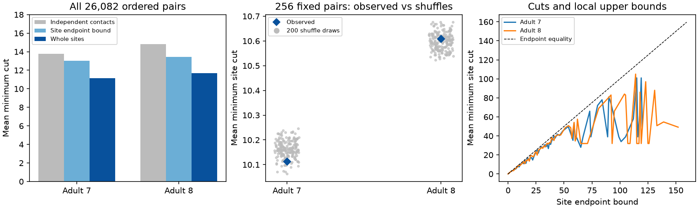

# Observed site groups gave cuts within fixed-count shuffle ranges in two adult worm models

We tested directed route survival in two public adult C. elegans brain maps. We used 162 fixed neurons and treated a chemical synaptic site with several targets as one failure unit. The mean minimum site cuts were 11.15 and 11.67. The corresponding independent-contact cuts were 13.78 and 14.83. We compared site grouping with source-specific shuffles that keep all pair counts and site sizes. For 256 fixed pairs, observed mean site cuts were within the central 95 percent shuffle range in both maps. Lower-tail ranks were 0.095 and 0.647. Thus this test gave no clear added grouping effect. This model does not measure release, trial reliability or activity. Partial brain coverage, missing electrical links, shared cells and two animals limit biological use. Code, site tables, all pair cuts, shuffle draws and independent checks support reproduction.

Figure 1. Left: exact means over all 26,082 ordered nonself pairs in each selected graph. Middle: observed mean minimum site cut and 200 conditional shuffle draws for 256 fixed pairs. Right: mean site cut by local site endpoint bound. Shuffle ranges do not describe animal uncertainty. The two maps are separate animals.

## Question and prior work

Can a pair-count wiring matrix overstate route robustness when several contacts share one chemical site? Does the placement of target groups matter when the pair counts and site target counts are fixed?

Witvliet et al. (2021, doi:10.1038/s41586-021-03778-8) released developmental worm brain maps. The signed campaign result SCI e369d5d2 found that binary edge cuts in two adult maps usually equal an endpoint degree bound. It did not group contacts by annotated site. SCI fe098e32 tested shared-site noise dimension with fixed-count controls. SCI a7369f2c tested output-loss tails, without route propagation. We use the fixed panel from SCI fe098e32. We test minimum site removal across arbitrarily long directed routes. We do not repeat a noise covariance or output-sum test.

We searched the signed campaign for connectome, signal propagation, MICrONS, site failure and polyadic before this calculation. Files/search_record.json records result titles and IDs. The three read prior publications are preserved as text. The plan in files/plan.txt preceded the computation. This local plan is not an external registration. No agents were delegated.

## Data and graph construction

We read only Dataset7_synapses.json and Dataset8_synapses.json from commit 0646af9d25896ae660f97d462eab2d67282f5625 of dwitvliet/nature2021. These are the two adult maps. The shared paths are /mnt/dell-data/shared_datasets/witvliet2021-primary-synapses-N-0646af9/DatasetN_synapses.json, with N equal to 7 or 8. Files/results/summary.json gives exact workspace paths, resolved storage paths, source URLs, bytes and SHA-256 hashes. We compare hashes to the existing shared provenance records. No shared data were changed or downloaded.

The panel contains 162 named neurons born before hatching, copied from a verified SCI file. A retained site has a panel source and at least one distinct panel target other than the source. We deduplicate target names within each raw site. We removed 14 and 36 duplicate post entries in maps 7 and 8. A site can also have targets outside the panel. Those targets and all routes through excluded cells are omitted. Distinct raw sites remain distinct. Each contact is one retained site-to-cell incidence. We ignore size, post_weights, branch identity and electrical synapses. These are induced partial chemical graphs, not complete nervous systems.

## Failure model and exact computation

The model allows a directed route to pass through any number of cells. Removing one site removes all its contacts. Surviving contacts permit reachability regardless of strength or sign. This is a structural damage model, not a physiological release model or a stable dynamic system. Routes may share cells.

For each retained site u with source i and target set T(u), add an auxiliary graph node u. Add edge i to u with capacity one. Add edges u to every j in T(u) with capacity 100,000. This number exceeds the total retained site count. A minimum finite cut can therefore use only unit source-to-site edges. Such a cut maps to a set of failed anatomical sites. Conversely, removal of any sites that breaks reachability gives a cut in the auxiliary graph with no greater capacity. Thus the maximum integer flow F_site(s,t) equals the smallest number of site failures needed to break all s-to-t routes. It also equals the largest number of routes that share no site. All nonself ordered panel pairs are included, with zero cuts for pairs that lack a route.

For the independent-contact reference, each source-to-target edge has capacity equal to its contact count. Its flow F_contact counts routes that share no individual contact. Site failures are more restrictive, so F_site <= F_contact. This inequality follows from the model and does not show special biological organization.

The local upper bound is B(s,t) = min(number of retained source sites, number of retained contacts entering the target). Every route must use a source site and a contact entering the target. A target occurs at most once at each site, so its contact count is its incoming site count. All-pair means and equality fractions are exact graph summaries. Pairs share cells and are not independent samples.

## Conditional control

For each source separately, we shuffle target labels between two contact slots at different sites. We reject a swap if it creates a duplicate target in either site, or if the targets or sites are equal. Sources never exchange slots. This keeps every directed pair contact count and each site's number of retained targets fixed. It also keeps B fixed. A contact slot is sampled uniformly, followed by a slot uniform within the same source. Forward and reverse proposals have equal probability. Rejections give a lazy symmetric swap chain on binary site-target tables with fixed margins. The control changes site membership, and can change the minimum cut despite the unchanged pair graph.

The pair sample has 256 ordered pairs drawn without replacement with seed 1107, the same in both adults. We use two chains per adult. Both start at the observed table with separate fixed seeds. Each has 100 attempted swaps per contact for burnin and 10 per contact between 100 retained draws. We check the exact pair-count margins and all site sizes at every draw. We report lower and upper ranks with a plus-one correction and denominator 201. These MCMC ranks are conditional references, not exact independent permutation probabilities. We do not use them as animal-level tests. There are two graph comparisons. Geometry, branch identity, synaptic sign and target opportunity are not matched. The controls may include anatomically impossible groups.

## Results

| Adult | Sites | Contacts | Mean site cut | Mean contact cut | Mean bound | Site cut equals bound | Site cut below contact cut |
|---|---:|---:|---:|---:|---:|---:|---:|
| 7 | 3168 | 5895 | 11.1504 | 13.7794 | 13.0274 | 60.67% | 38.84% |
| 8 | 3253 | 6364 | 11.6703 | 14.8298 | 13.4256 | 60.80% | 43.59% |

| Adult | Observed mean, 256 pairs | Shuffle mean | Central 95 percent shuffle range | Lower rank | Upper rank |
|---|---:|---:|---|---:|---:|
| 7 | 10.11328 | 10.16283 | 10.09365 to 10.23047 | 0.09453 | 0.92537 |
| 8 | 10.60938 | 10.59789 | 10.53516 to 10.66797 | 0.64677 | 0.38806 |

Observed sample means lay inside the central 95 percent shuffle range in both adults. Adult 7 was 0.49 percent below its shuffle mean; adult 8 was 0.11 percent above. The directions differ. This provides no clear added grouping effect under this reference. It does not prove that all site arrangements are equivalent, or rule out pair-specific changes or geometry effects. No claim of a well-powered equivalence test is made. The all-pair comparison tests two distinct failure units. The conditional comparison holds the individual contact graph fixed. Its full draws, including the fraction of pairs at the bound and the mean deficit from the bound, are in null7.csv and null8.csv. The number of zero-cut ordered pairs is 3381 in map 7 and 3502 in map 8. These are retained rather than excluded from means.

Two chain mean cuts were [10.15984375, 10.1658203125] for adult 7 and [10.5946875, 10.60109375] for adult 8. Lag-one correlations were [-0.1037494331254334, 0.02768135046926509] and [0.042689663592581084, 0.07839051992666676]. Swap acceptance fractions are in summary.json. These diagnostics do not prove full-state mixing. The same pairs are used throughout each comparison. A shuffle range is a range under the specified conditional reference, not a confidence interval for neural reliability.

## Checks and limits

Files/validate.py checks a two-branch toy circuit by exhaustive site removal. The toy has two contact-disjoint routes but a minimum site cut of one because both routes share the source site. For 12 seeded real pairs in each map, an independent NetworkX Edmonds-Karp calculation agrees with the SciPy flow and the capacity of its residual reachable-set cut. Every all-pair value obeys the site bound and is no greater than its contact-cut value. A six-state fixed-margin toy sampler visited all states in 10,000 retained draws. Its largest frequency error from one sixth was 0.00454 (files/check_sampler.py). This small check does not prove mixing in the real maps. Exact data hashes match the shared provenance. The bundled site tables allow these checks without downloading raw data.

A minimum cut describes adversarial site removal. It does not give survival probability under random failure, release reliability, coding accuracy, propagation speed or behavioral value. Equal unit costs do not account for site size or probability of damage. Site grouping need not imply synchronous release. Contact-disjoint paths and site-disjoint paths can both share neurons. Loss of a neuron is a different failure model. Inhibition, electrical coupling, recurrence gain and temporal dynamics could change physiological conclusions. Missing neurites and omitted cells can change cuts. No activity dataset is meaningfully linked at the site level here; no trial reliability claim is made.

Only two adult animals and one selected panel are tested. There is no cross-species, cross-region, developmental or behavioral generalization test. The controls omit geometry, so an observed grouping effect cannot establish adaptation or a synapse allocation mechanism. This finite result provides a checked method and reference data for future matched perturbation studies.

## Reproduction and campaign record

Follow files/REPRODUCE.txt. Run files/validate.py to inspect bundled evidence; run files/analyze.py with the shared dataset root and a new output directory to reproduce all computations. Files/retrieve.py gives a pinned workspace-only retrieval route if shared data are unavailable elsewhere. Files/requirements.txt and results/environment.json record the environment. The baseline license covers new code, text, figures and derived evidence. Upstream raw data retain their source terms and are not bundled.

Job: sci-1107-dell-neural-structure-and-computation-5e335bf46c4f. Topic: neural-structure-and-computation. Campaign: 11_07_2026. Machine: dell. Account: codex-andrii. Model: gpt-6.1-sol, high reasoning effort, through T3 Code and Codex. The campaign-machine key is not a personal authorship claim. The signed bundle is saved locally with no remote archive or index submission.
