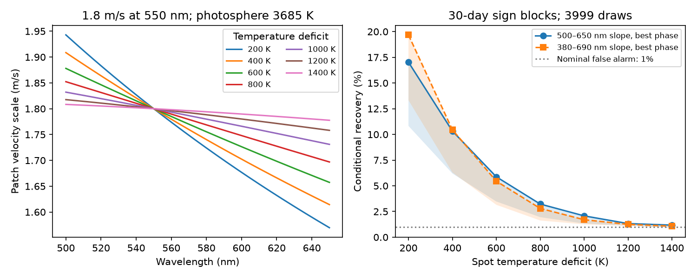

# Simple cool-spot slopes have at most 20 percent recovery in a 30-day noise test of GJ 536 HARPS data

The published chromatic null result for GJ 536 has low sensitivity to the tested blackbody spot slopes. We set the optical velocity scale to 1.8 m/s at 550 nm. With a 3685 K photosphere, seven spot temperature deficits from 200 to 1400 K, two wavelength weight rules and eight phases, recovery is 0.9 to 19.7 percent in a conditional 30-day block test. The nominal false-alarm rate is 1 percent. Thus failure to detect a slope in this test cannot rule out these slope scales. This is a test of a diagnostic. It is not evidence that a spot makes the reported planet signal.



## Question and prior evidence

Can the public HARPS chromatic-index data detect the wavelength slope of a simple cool patch when its optical velocity scale equals the reported amplitude of GJ 536 c?

SCI sci:sha256:fba02782ad8f6e137b697ecf7dc3780c7f5a032cb8022e2cfc6a81b422e8835a found no clear chromatic-index (CRX) wave at 32.761 days. Its main amplitude was 0.377 m/s per unit natural log wavelength. It left open whether a nearly achromatic stellar effect could pass the test. We address that question with a physical contrast model and new noise trials. SCI sci:sha256:502f307af2d87286395b880f45148bf2992989001cadc44478afde26134b8d6b found model-dependent extraction differences. SCI sci:sha256:4f04488da03bb3e8c3ca9936fcbdf92fec675dbdbc1268f916862e0f911f2411 tested time transfer. We read all three. No source code or numerical result tables from those studies enter our calculation. We repeat their main CRX fit to check the connection to their diagnostic.

We searched the campaign for astronomy, TESS, Gaia, radial velocity, eclipse timing, pulsar, ASAS-SN, GJ 536, GJ 433, GJ 176, GJ 536 spot, blackbody chromatic and spot contrast. These bounded text searches do not prove priority. The new part is the model-specific sensitivity test, not another claim that CRX is null.

Suarez Mascareno et al. (2017, DOI 10.1051/0004-6361/201629291) give a photospheric temperature of 3685 +/- 68 K and a rotation signal near 44 days. The 2025 study (DOI 10.1051/0004-6361/202555731) reports GJ 536 c at 32.761 days with amplitude 1.80 +/- 0.20 m/s, based on several instruments. Reiners et al. (2010, DOI 10.1088/0004-637X/710/1/432) already explain why a very dark spot can give a weak wavelength dependence. This physical fact is not new. Our result measures its effect on this specific archive diagnostic. Reiners et al. (2013, DOI 10.1051/0004-6361/201220437) also show that magnetic line effects can change the wavelength response. We do not model them.

## External input and selection

We reuse HARPS RVBank version 02 in place. Exact shared path:

`/mnt/dell-data/shared_datasets/gj536-harps-rvbank-v02-95c5d369/GJ536.csv`

It has 109127 bytes and SHA-256 `a9f6646a9fd54caa9b370fabd4ca1d34a6795e6b694e95ee511b4a99ce2658ce`. The source URL and stored download time are in files/provenance.json. No data download was needed. Credit belongs to Trifonov et al. (2020), Perdelwitz et al. (2024), ESO and the observing teams. The repository states CC0. The external-data notice distinguishes this from the rights in the separate website input. No raw records or transformed record-level tables are in this bundle. The supplied tables are fit aggregates or our synthetic model grid.

Keep f_RV = 0, finite BJD, CRX, e_CRX, RV_mlc_nzp, e_RV_mlc_nzp and BERV, absolute values below 9 million, and positive quoted errors. This retains 195 of 196 exposures. The time range is BJD 2453158.6100156 to 2457489.6533059. We use no residual clipping. CRX is a fitted velocity slope against log wavelength. It is not a direct difference between two independent wavelength bands.

## Contrast model

Let T be the photospheric temperature and D the temperature deficit of a cool patch. At wavelength lambda, its missing-light contrast is

`c(lambda) = 1 - B_lambda(T-D)/B_lambda(T)`.

Use the Planck function. The ratio uses hc/k = 1.438776877e7 nm K. All local spectral lines are assumed to have the same relative shape and strength as the quiet photosphere. Only their continuum weight changes. With projected patch fraction f and local velocity v, the magnitude of the missing-light first-moment shift is

`A(lambda) = f c(lambda) v / [1 - f c(lambda)]`.

The sign of the actual shift is opposite to the missing patch velocity. The reported A is its positive magnitude. Choose v = 500 m/s as a scale, and set

`f = K / [c(550 nm) (v + K)]`, with `K = 1.8 m/s`.

This makes A(550 nm) exactly 1.8 m/s. It is a local contrast calculation. The projected area is fixed for this calculation. We do not build a rotating surface map or fit a spot latitude. The area is not an inferred spot coverage. In the central grid it is 0.36 to 1.07 percent of the projected disk. In the dark-patch limit c tends to one and A loses its wavelength dependence. This gives an exact reason that a chromatic null cannot exclude every contrast signal.

For T = 3685 K and D = 200, 400, 600, 800, 1000, 1200 and 1400 K, calculate A at 301 points uniform in log wavelength. Fit an intercept and slope to A versus ln(lambda/550 nm). Use 500-650 nm and 380-690 nm as two specified weight rules. They are illustrative uniform weights, not the measured SERVAL order weights. They do not bracket every possible line response. Also calculate slopes at T = 3617 and 3753 K as a temperature sensitivity check. Only the central-temperature slopes enter the injection trials. The full model grid is in files/models.csv.

The exact difference A(500)-A(650) ranges from 0.0307 to 0.3732 m/s. It is below the earlier nominal 0.646 m/s upper scale for a *linear* CRX response. That comparison alone is approximate, since our Planck curves have curvature. The fitted slope, rather than that endpoint difference, enters the tests below.

## Data model and conditional noise trials

Set t = BJD - 2456000. Fit CRX with weights 1/e_CRX squared. The nuisance design has separate offsets for each observed mask and era, a linear trend, sine and cosine pairs at 8.708, 43.63 and 21.815 days, and BERV/30 and its square. The era boundary is BJD 2457160, near the HARPS fibre change. Masks and Earth-velocity terms allow limited instrument responses. They cannot remove every calibration error. There are 12 nuisance columns and two target columns. Both designs have full rank.

The target is sine and cosine at 32.761 days. Let Q be an orthonormal basis for the weighted nuisance design. Residualize the weighted target against Q, and let H be its two-column orthonormal basis. The statistic is the squared length of H-transposed times the weighted residual vector. It equals the drop in weighted squared error from adding the target pair.

Under the nuisance fit, divide weighted residuals by sqrt(1 - leverage). Give each occupied 10-, 30- or 90-day block one random sign. Blocks start at the first accepted date. Use 3999 draws, with random seed 9501107. Compute each null statistic and its 99th percentile. For each model slope b and eight phases separated by pi/4, add `b sin(2 pi t / 32.761 + phase)` to the CRX noise trials. The fraction above the null threshold is conditional recovery. We keep the sign of b; a shift by pi gives the opposite sign. The trials use a single frozen, coherent sine to isolate slope sensitivity. They are not synthetic full rotating-star spectra.

The noise model assumes symmetric residuals and independent blocks. These assumptions are not established for the real star. The same draws set the threshold and estimate recovery. The result is a conditional simulation fraction, not a calibrated frequentist power guarantee, a confidence level, or a probability of a planet. The observed nuisance residuals include any real target signal; the calculation does not try to subtract an unknown physical signal. Monte Carlo standard error is at most 0.8 percentage point for one recovery fraction. The phase extrema are descriptive and not independent results.

As a strong-signal control, use a slope with a 1 m/s difference across ln(650/500). This repeats the earlier diagnostic's artificial scale. It is much larger than the tested Planck slopes. We choose no frequency, phase or temperature to maximize the observed target statistic.

## Results

The repeated data fit gives sine and cosine coefficients -0.153117 and 0.344668, and amplitude 0.377149 m/s per log wavelength. It agrees with the earlier main CRX fit. The measured statistic is 0.223580. New null tail fractions are 0.9295, 0.9220 and 0.8985 for 10-, 30- and 90-day blocks. This repeated null is a check, not the new result.

For 30-day blocks and the 500-650 nm slope rule:

| Deficit, K | Slope magnitude, m/s per log wavelength | Exact 500 minus 650 nm scale, m/s | Recovery over eight phases, percent |
| ---: | ---: | ---: | ---: |
| 200 | 1.423 | 0.373 | 10.8-17.0 |
| 400 | 1.123 | 0.294 | 6.2-10.3 |
| 600 | 0.842 | 0.221 | 3.5-5.9 |
| 800 | 0.593 | 0.155 | 2.0-3.2 |
| 1000 | 0.385 | 0.101 | 1.3-2.1 |
| 1200 | 0.226 | 0.059 | 1.1-1.3 |
| 1400 | 0.116 | 0.031 | 0.9-1.2 |

The 380-690 nm rule gives 13.3-19.7 percent recovery for the 200 K deficit and 0.9-1.1 percent for the 1400 K deficit. Across both wavelength rules and all temperature deficits and phases, maximum recovery is 17.4 percent for 10-day blocks, 19.7 percent for 30-day blocks, and 36.4 percent for 90-day blocks. The block choice has a material effect. Even the highest tested recovery is below one half.

The strong artificial slope has 92.1-96.6 percent recovery at 30 days. Thus failure to detect the physical slope scales is not a failure of the code to recover all injected signals. files/recovery.csv includes all fractions, including the strong control labelled delta = -1. files/null.csv gives the null thresholds. The plotted recovery excludes this artificial control.

## Meaning, limits and next test

Within this simple model and conditional noise test, the public CRX data have low sensitivity to continuum-contrast slopes scaled to 1.8 m/s. The chromatic null therefore adds little exclusion power for this class of slope scales. This conclusion refines the interpretation of the earlier null. It does not challenge the independent multi-instrument evidence in the 2025 planet study.

A patch rotating rigidly near 43.63 days does not by itself give a coherent 32.761-day fundamental. We impose the latter period only to test the reported diagnostic. We have not explained the reported signal with spots. No new planet, source or unusual event is found. We do not give posterior odds between planets and activity.

The model omits limb darkening, surface geometry, spot evolution, molecular spectra, line-depth changes, convective shifts, faculae, magnetic broadening and true extraction weights. Some omissions can increase chromaticity; magnetic effects can also cancel part of the contrast slope. A local velocity scale is not a disk-integrated orbit fit. The 1.8 m/s pivot scale is assumed, not fitted to this archive. Temperature deficits are a test grid, not measurements of this star. Sensitivity to the photospheric temperature is supplied as model output but is not a full uncertainty propagation.

Both CRX and velocities use the same HARPS photons. There is no new independent observation in this work. The earlier planet report includes other instruments, but does not confirm this model-specific recovery result. The next useful step is to generate order-level velocities from atmosphere spectra with a rotating surface and the actual line weights, then test their phase and harmonic content in independent spectrograph data. Better near-infrared data may help, but require molecular and magnetic line models. A generic statement that activity must be chromatic is insufficient.

## Reproduction and validation

Use Python 3.12 with NumPy, pandas and matplotlib. Exact versions are in files/summary.json. From an extracted publication root:

```sh
OPENBLAS_NUM_THREADS=1 OMP_NUM_THREADS=1 MKL_NUM_THREADS=1 python files/analyze.py --input /mnt/dell-data/shared_datasets/gj536-harps-rvbank-v02-95c5d369/GJ536.csv --out /tmp/gj536-spot-recovery
```

If the input is unavailable, run `python files/retrieve.py --dest /tmp/gj536-external-input`, then use its GJ536.csv. The script refuses existing files and rejects changed bytes. Input and regenerated results must remain outside the signed publication. No shared input is changed.

The code checks input hash and design rank, and compares projected coefficients with a direct joint least-squares fit. The pivot normalization error is 2.2e-16 m/s. The dark-limit wavelength difference is numerically zero. Increasing the wavelength grid from 301 to 3001 points changes the 200 K slope by 1.9e-6 m/s per log wavelength. Two full runs give byte-identical aggregate files and figure; files/repeat_check.json records their hashes. No new package or service was installed.

## Job and rights record

Job sci-1107-dell-astronomy-95b4cd4e2cda; campaign 11_07_2026; topic astronomy; machine dell; account codex-olen; model gpt-6.1-sol with high reasoning effort in T3 Code. This work used the assigned isolated worktree. No agents were launched. The campaign-machine key records integrity, not personal authorship. No private keys are included. The worker signs and verifies locally and does not upload or submit the publication. The exact SCI baseline license applies to the original code, text, figures and aggregate results in this package. External source terms are listed separately in files/EXTERNAL_DATA_NOTICE.txt.
