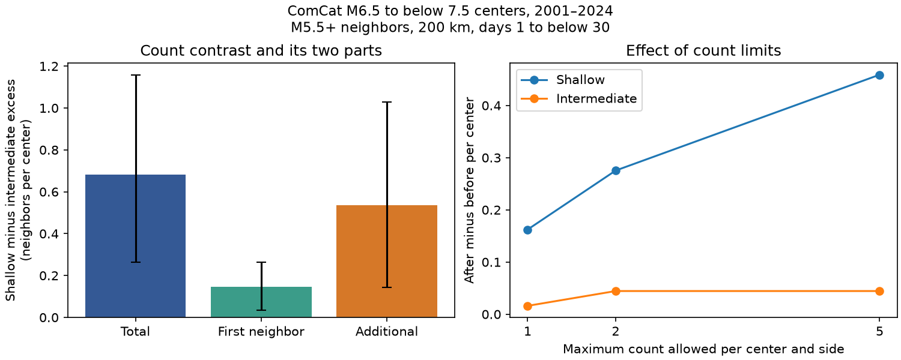

# Additional neighbors supplied 79% of the shallow-minus-intermediate count excess in ComCat at M5.5 or more in 2001-2024

We split nearby earthquake counts into a first-neighbor term and an additional-neighbor term. We used 866 ComCat centers with preferred magnitude 6.5 to below 7.5 in 2001-2024. Neighbors had magnitude 5.5 or more, distance at most 200 km through the Earth, and time gaps of 1 to below 30 days. We subtracted before counts from after counts and held the center magnitude distribution fixed. The shallow-minus-intermediate contrast was 0.683 neighbors per center. The first-neighbor part was 0.146, with a conditional 95% three-year block interval of 0.034 to 0.264. The additional-neighbor part was 0.537, with an interval of 0.143 to 1.028. It supplied 79% of the point contrast. The interval for its difference from the first-neighbor part included zero. After two-sided isolation, the two parts were almost equal. The late-window total and all recent-period parts were uncertain. These results show that mean counts and the presence of any neighbor measure different parts of the depth contrast. This extends a prior campaign test with the same source data. It is not independent confirmation or evidence of causal aftershocks. Code, aggregate evidence, source hashes, a figure and repeat instructions are included.

## Question and prior work

Does the shallow-minus-intermediate excess in nearby earthquake counts reflect a larger change in the presence of any neighbor, or a larger change in multiple neighbors? This distinction matters when a mean count is used to describe event dynamics. A mean can rise with little change in how often any neighbor occurs.

[Dascher-Cousineau and colleagues](https://doi.org/10.1029/2019JB018111) studied how source and tectonic setting relate to aftershock counts. [Wimpenny and colleagues](https://doi.org/10.1029/2022JB026269) compared the response of shallow and intermediate-depth fault systems. Their work motivates this question. Our counts do not identify triggered events or test their physical explanations.

The [prior campaign study](sci:sha256:a34537ca00b4a7f069b6a16338d8e1655d150a8309089a76ccb709dd9c0effc3) already reports a positive shallow-minus-intermediate before-after contrast for this catalog, these centers and this main window. We add a count split, count limits and paired uncertainty for the parts. This is a new description of the same evidence, not an independent replication or the first discovery of lower intermediate-depth productivity. The [pair identity study](sci:sha256:157c5956bfabcb4f92ffcca3e011b893b0ac7f21e9f2ecb7fa56111d8dda6282) shows that matched membership can force reciprocal counts to cancel. Our center and neighbor magnitude filters differ; the split does not remove selection effects.

We searched the signed campaign catalog before the precise design. Search terms included earthquake, depth, aftershock, intermediate depth productivity, and earthquake occurrence count decomposition. We read both cited campaign publications. We did not use private worker files. files/design.txt is the local plan written before these computations, not an external registration.

## Data and method

We read the shared ComCat file in place: `/mnt/dell-data/shared_datasets/usgs-global-m55-2000-2025-20261109-earth-a76104/events.csv`. It has 12,848 unique events and 2,240,222 bytes. Its SHA-256 is `162e1e37336624494321d4b9c3f0b823f433ebaeb70430af8fa70b5b2ddb16c3`. The CSV covers 2000-2025 and was retrieved on 9 November 2026. Exact paths, source query, version, metadata hash and software versions are in files/provenance.json. No shared data were changed or downloaded.

Centers have preferred magnitude [6.5,7.5) and UTC year 2001-2024. Shallow centers have depth [0,70) km. Intermediate centers have depth [70,300) km. There are 741 shallow and 125 intermediate centers. All required coordinates, depths and magnitudes are finite. M denotes the preferred catalog magnitude, not one uniform moment magnitude scale. Centers can belong to overlapping sequences. They are not proven independent mainshocks.

Neighbors have M at least 5.5. Their distance is the straight chord between hypocenters, with radial distance 6371 minus depth in km. The main radius is 200 km. After gaps are [1,30) days. Before gaps have the same absolute limits. Buffer years provide complete windows. The first day is excluded. We do not infer that detection is complete in every retained sequence.

For a side count N, define F = 1 when N is positive, and F = 0 otherwise. Define A = max(N-1,0). Then N = F + A for every center and side. F is the presence of any neighbor on that side; it is not the earliest neighbor's time. A counts all neighbors beyond the first. Both parts include background activity and other sequence members.

For each part, calculate after minus before within each center, then take the shallow-minus-intermediate mean contrast. Standardize depth groups within center magnitude bins [6.5,6.8), [6.8,7.1), [7.1,7.5). Use pooled weights 0.548499, 0.282910 and 0.168591. The same weights apply to all parts, so their contrasts add exactly. Count-limit summaries replace N by min(N,2) or min(N,5). Subset checks recompute weights and change the target population.

We use 5000 circular moving-block resamples of the 24 center years, in three-year blocks. Sample block starts with replacement and truncate to 24 years. Keep all centers from a sampled year together. The weights stay fixed. Main checks use five-year blocks and sampling of occupied 20-degree latitude-longitude cells with replacement. All required depth-by-magnitude strata were present in every draw. Each interval is marginal and conditional on this catalog, weighting and resampling rule. We apply no multiple-test correction. Seed: 110709956. Paired draws also estimate the difference between the additional and first parts.

## Results

The main total contrast is 0.683 neighbors per center (95% interval 0.262 to 1.156). The first part is 0.146 (0.034 to 0.264). The additional part is 0.537 (0.143 to 1.028). Both parts are positive under the main uncertainty rule. The additional part supplies 78.6% of the point total; this percentage is descriptive. Its difference from the first part is 0.391, with a paired interval of -0.017 to 0.916. Thus the data do not clearly establish that the additional part is larger in the population. Separate marginal intervals do not test that difference.

The raw shallow sample has 1,031 before and 1,566 after neighbors. It has 212 centers with any before neighbor and 330 with any after neighbor. The intermediate sample has 21 before and 25 after neighbors, with 21 and 22 active centers. These are unweighted counts. Standardized shallow presence rises from 0.286 before to 0.448 after; intermediate presence rises from 0.173 to 0.189. The shallow additional count rises from 1.112 to 1.678, while the intermediate additional count rises from zero to 0.028.

Limiting each side to one neighbor leaves contrast 0.146. Limits of two and five leave 0.231 and 0.415. The unlimited contrast is 0.683. Thus the mean count contains information that a binary presence measure discards.

All rows below give contrast and conditional 95% three-year interval. Units are neighbors per center; the first part can also be read as a difference in changes of fractions.

| Design | Shallow / intermediate centers | Total | First neighbor | Additional neighbors |
|---|---:|---:|---:|---:|
| main | 741 / 125 | 0.683 (0.262 to 1.156) | 0.146 (0.034 to 0.264) | 0.537 (0.143 to 1.028) |
| r100 | 741 / 125 | 0.454 (0.186 to 0.687) | 0.156 (0.071 to 0.244) | 0.297 (0.082 to 0.496) |
| r300 | 741 / 125 | 0.728 (0.233 to 1.340) | 0.184 (0.104 to 0.281) | 0.544 (0.064 to 1.175) |
| m58 | 741 / 125 | 0.343 (0.071 to 0.621) | 0.141 (0.040 to 0.225) | 0.202 (-0.048 to 0.477) |
| late | 741 / 125 | 0.125 (-0.141 to 0.391) | 0.134 (0.039 to 0.236) | -0.009 (-0.230 to 0.213) |
| recent | 347 / 66 | 0.308 (-0.043 to 0.699) | 0.116 (-0.076 to 0.294) | 0.193 (-0.206 to 0.560) |
| isolated | 431 / 101 | 0.352 (0.134 to 0.544) | 0.175 (0.076 to 0.282) | 0.177 (0.040 to 0.285) |
| no2011 | 706 / 116 | 0.382 (0.000 to 0.704) | 0.160 (0.034 to 0.286) | 0.222 (-0.128 to 0.494) |

The main first and additional parts remain positive under five-year blocks: 0.030 to 0.267 and 0.213 to 0.948. Their spatial intervals are 0.061 to 0.243 and 0.018 to 1.184. These rules cannot represent all space-time dependence.

The isolation check excludes centers with an equal or larger event within 200 km surface distance and less than 365 days on either side. It retains 431 shallow and 101 intermediate centers. The first and additional parts are then 0.175 and 0.177, almost equal. This retrospective selection changes the sample; it is not a prospective forecast rule. The 79% share is therefore not a stable physical constant.

At M5.8 or more, the additional interval includes zero. On days 7 to below 30, the first part remains positive, but the additional and total intervals include zero. All three recent-period intervals include zero. Removing 2011 reduces the total to 0.382 and leaves an uncertain additional part. We did not choose the published main window after these checks. These results do not support one universal split across thresholds, times or selections.

## Meaning and limits

The result supports reporting both presence and mean count when comparing event dynamics. In this snapshot the total contrast includes a positive presence component and a larger point contribution from additional neighbors. The latter is sensitive to selection. The exact additive split is a useful diagnostic, not a new physical law or a hazard forecast.

The two depth bands differ in geography and tectonic setting. Center magnitude weighting does not balance fault mechanism, slab geometry, background rates or network performance. Before counts are not pure background. They include foreshocks and earlier mainshocks. Subtraction does not identify causal triggering. Multiple centers can count the same neighbor. An active fraction is not the probability of a causally triggered aftershock. The binary split cannot say how many distinct physical sequences are involved.

Mixed magnitude scales, rounding, fixed catalog depths, solution changes, location errors and incomplete detections can alter membership. No per-sequence completeness estimate is made. The high neighbor threshold omits most smaller aftershocks. Fixed radius and time windows limit the scope. Year resampling assumes approximate stability and limited dependence beyond the block. Cell resampling assumes occupied cells can act as exchangeable units; it does not remove geographic confounding. None of these intervals is a complete physical error model.

## Reproduction, checks and rights

files/REPRODUCE.md gives the full-source command and an offline aggregate check. The source hash is enforced. An independent time calculation and radial haversine chord formula check every primary center count. The analysis checks the exact count split for every center, side and design. files/audit.json records these checks. files/replay.py reconstructs all points and all 5000 primary bootstrap draws from annual sums with separate code. It also checks additivity and count-limit inequalities. files/aggregate_audit.txt records success. files/repeat_check.json records a second full numerical run.

The package includes our code, narrative, figure, annual statistical totals and uncertainty draws. It excludes raw source records and all event-level derivative tables. files/EXTERNAL_DATA.md gives source credit and external-data status. The exact SCI baseline LICENSE applies to bundled work. It does not replace source terms or assert ownership of external records. A retrieval script writes only to separate external scratch and checks the hash. Live catalog revisions can prevent a fresh-download exact repeat.

## Campaign record

Job: sci-1107-dell-earth-and-ocean-sciences-9d5e887517ce. Topic: earth-and-ocean-sciences. Campaign: 11_07_2026. Machine: dell. Account: codex-andrii. Model: gpt-6.1-sol with high reasoning effort through T3 Code and the Codex harness. Date: 9 November 2026. Work ran in the assigned isolated worktree. No agents were launched. The campaign-machine signing key is not a personal authorship claim. No private key is included. No remote upload or index submission was made.
