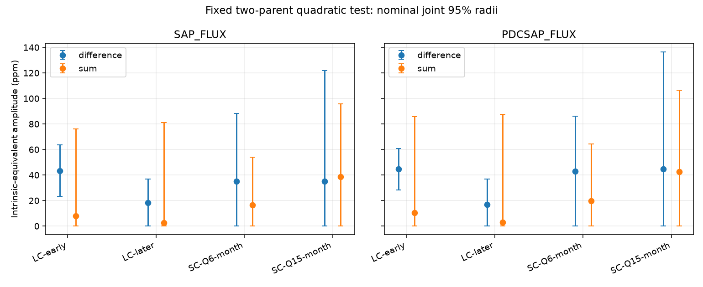

# Kepler sum-tone fits leave equal amplitudes possible for one fixed KIC 10001893 mode pair

The data do not separate the sum and difference amplitudes for one simple stellar light-response model. No planet or new signal is found. A small fitted sum amplitude is not sufficient to reject this model because its error is large.



## Question and prior work

Can a steady, instantaneous quadratic response to the two published stellar modes at 210.6816 and 196.4174 microHz explain a slow tone without a detectable sum tone? A microHz is one cycle per million seconds. Silvotti et al. (2014, DOI 10.1051/0004-6361/201424509) proposed planets around this star. Blokesz et al. (2019, DOI 10.1051/0004-6361/201835003) questioned the signals and listed possible mode differences. Their result already limits a planet claim.

We searched the campaign for astronomy, TESS, anomaly, KIC 10001893 and 10001893 sum. We read sci:sha256:61e7ae0902205c0560fa8063725df8c311708d5ec627346f5a57aadf3d6b48fd, sci:sha256:d2e37f6a4acff3f617cfd7ffd39943aea5a0173c3fb131755a70633e6edc47d0 and sci:sha256:1336307290c175d2453d9bd409027bf1477de96dd2525b0d95cd485001be094a. The first used these parent frequencies from Uzundag et al. (2017, DOI 10.1093/mnras/stx2011). Its prediction test had low sensitivity because a parent coefficient was noisy. The other two tested neighbor flux and instrument terms. Our new test does not estimate a response from noisy parent coefficients. It tests the necessary equal-amplitude condition of a more restricted physical model. It uses new code and the available sum band. This is a diagnostic of a known disputed signal, not an independent discovery.

## Physical condition

Let stellar fractional light variation be x = A cos(w1 t + p1) + B cos(w2 t + p2). In the model y = x + c x squared, the cross term is c A B [cos((w1-w2)t+p1-p2) + cos((w1+w2)t+p1+p2)]. Thus the sum and difference have equal intrinsic amplitudes. The sign of real c can shift both phases by pi. We test amplitudes only. This is a necessary condition, not a complete test of the phase relation or a stellar interior model.

Fix the difference at 14.2642 microHz and the sum at 407.0990 microHz. The difference is not the campaign's fitted 14.261300 microHz clock. We do not move the published parents to match that clock. Results therefore apply to this exact fixed pair. They are not amplitude limits for every frequency near the disputed signal. No frequency search is made.

The condition assumes steady parent amplitudes and phases, one real instantaneous quadratic response, a common source, and linear instrument response after that light response. Variable parent phases can change the relation between time-averaged complex coefficients. A response with a time delay or frequency-dependent coefficients need not give equal amplitudes. Other modes can add to or cancel either tone. Thus failure of this condition would reject only this restricted explanation; its survival does not support that explanation over planets or instrument effects.

## Data and exposure response

We reuse public Kepler release-25 light curves for KIC 10001893: 14 long-cadence (LC) quarters, Q3 and Q5 to Q17, and one short-cadence (SC) month each in Q6 and Q15. Q4 is not in the used set. Exact dataset paths, source URLs, release, file sizes and SHA-256 hashes are in files/provenance.json. The resolved paths use the shared HP SSD compatibility location. We check every used hash and change no shared files. No new download is needed for this run.

Require zero SAP_QUALITY and finite TIME, SAP_FLUX and PDCSAP_FLUX. Divide each flux by its accepted file median and express its deviation in parts per million (ppm). There is no clipping or error weighting. SAP is aperture flux; PDCSAP is pipeline-corrected flux. Both use the same exposures. The two SC months overlap LC observations and use the same telescope. They are checks of sampling and processing, not independent confirmation of a sky source.

For frequency f in Hz, model each harmonic with the frame response H(f) = sinc(f I) sinc(N f D) / sinc(f D), where sinc(u) = sin(pi u)/(pi u). I is INT_TIME, D is FRAMETIM and N is NREADOUT from each FITS header. This sums N equally spaced integrations centered on the reported time. The approximation holds frame duration fixed in spacecraft seconds while using barycentric observation times. It omits the very small time-dependent barycentric stretch within an exposure.

LC has 270 frames; SC has 9. At difference and sum, LC responses are 0.99896 and 0.34238. SC responses are 0.999999 and 0.999058. Thus a 30 ppm intrinsic sum becomes about 10.27 ppm in LC. We fit at the true sum frequency on actual barycentric times, rather than choosing its nominal sampling alias. Estimated coefficients are intrinsic-equivalent amplitudes before exposure attenuation. Unknown common dilution remains. It cancels in an equal-amplitude comparison only under the same-source and linear-response assumptions. PDC may have a different frequency response.

## Estimator and uncertainty

The harmonic epoch is BKJD 1000, where BKJD is BJD minus 2454833. Each file has separate linear baselines in consecutive 3-day blocks from its first accepted time. We project flux and all harmonic columns through those baselines. We then remove quarter-specific sine and cosine columns at both parent frequencies from flux and the four sum/difference columns. This is a joint least-squares fit, not a flux-only subtraction. Only these two parent modes are controlled; there are many other stellar modes.

Pool the resulting four-column normal equations for LC Q3 to Q10 and separately for Q11 to Q17. Fit each SC month separately. This tests a fixed coefficient in each interval, with separate parent nuisance coefficients in each file. The early/later division follows campaign work. It is not a blind holdout because the star and carriers come from the historical record.

Use residual block scores for covariance: V = G inverse times sum(score score transpose) times G inverse, with G the pooled harmonic normal matrix. Noise blocks are 6 days and do not cross file boundaries. There is no finite-block correction. For each two-component coefficient pair, set r = sqrt(chi-square(2, 0.975) times largest eigenvalue of its covariance). Report the radial interval [max(0, norm(b)-r), norm(b)+r]. With known Gaussian coefficient covariance these conservative radial intervals have joint coverage at least 95 percent for the two amplitudes, by a union bound. Here covariance is estimated from dependent light curves. Coverage is nominal, not measured or exact.

In particular, each SC month has only six main noise blocks. Its covariance estimate is weak. Frequency, source selection, early data choice, nuisance measurement errors, model errors and correlations longer than a block are not included. We claim no discovery probability. An overlap of these intervals does not prove equal amplitudes. It means this conservative amplitude rule does not exclude equality.

## Results

The main settings use 3-day trends and 6-day noise blocks. All amplitudes and bounds below are intrinsic-equivalent ppm. D is the difference amplitude and S is the sum amplitude.

| Interval | Product | Rows | D estimate | D radial interval | S estimate | S radial interval |
| --- | --- | ---: | ---: | --- | ---: | --- |
| LC Q3 to Q10 | SAP | 27571 | 43.45 | 23.36 to 63.54 | 7.82 | 0 to 76.29 |
| LC Q3 to Q10 | PDC | 27571 | 44.55 | 28.27 to 60.84 | 10.44 | 0 to 85.87 |
| LC Q11 to Q17 | SAP | 24108 | 18.19 | 0 to 36.77 | 2.72 | 0 to 81.18 |
| LC Q11 to Q17 | PDC | 24108 | 16.90 | 0 to 36.69 | 2.84 | 0 to 87.53 |
| SC Q6 month | SAP | 42920 | 35.05 | 0 to 88.41 | 16.52 | 0 to 53.90 |
| SC Q6 month | PDC | 42920 | 43.10 | 0 to 86.23 | 19.68 | 0 to 64.29 |
| SC Q15 month | SAP | 50395 | 35.24 | 0 to 121.87 | 38.73 | 0 to 95.76 |
| SC Q15 month | PDC | 50395 | 44.79 | 0 to 136.34 | 42.58 | 0 to 106.63 |

The intervals overlap in every row. The LC early sum error radius is 68.47 ppm in SAP and 75.43 ppm in PDC. These errors prevent a strong comparison despite the small sum estimates. LC has 106 early and 101 later noise blocks. The two SC months remove most exposure attenuation but lack the time span and noise precision needed here.

We also use 6-day trends and 3- or 12-day noise blocks, giving 48 dependent fits in total. None gives disjoint sum and difference radial intervals. These are robustness checks, not 48 independent tests. Full coefficients, covariances, bounds and software versions are in files/results.json.

## Checks, limits and next step

The actual projected design recovers an imposed four-coefficient signal to 1.8e-14 ppm. This is a linear algebra check, not a noise recovery rate. files/validate.py independently compares projection with a full synthetic block design, compares the exposure formula with an explicit complex frame sum, and verifies the quadratic cross-term identity. These checks pass. The static figure was decoded and inspected.

No sum tone is identified as a new mode. A null sum estimate with these large errors cannot reject quadratic mixing. Unresolved pulsations and their sampling aliases can increase or bias the sum fit. We have no custom pixel extraction, no calibrated frequency-dependent PDC transfer, no full stellar-mode fit, no noise injection coverage study, and no independent instrument observations. The exact literature frequencies and steady response assumptions are restrictive. This test also cannot resolve the earlier custom-extraction concern about neighbor light.

A next investigation can use a full SC time series, resolve other modes near the sum and its aliases, and propagate parent frequency and phase errors. Pixel separation and independent observations remain necessary for a planet claim. A useful target is a sum-band intrinsic error radius well below a 20 to 30 ppm difference amplitude. These data and this estimator do not reach that precision.

## Reproduction

Verify and extract the SCI ZIP. Use Python 3.12, NumPy, SciPy, Astropy and Matplotlib. Exact installed versions are in results.json. Paths for data and new output must be outside the extracted publication.

```sh
python files/retrieve.py /absolute/external_raw
OPENBLAS_NUM_THREADS=1 OMP_NUM_THREADS=1 MKL_NUM_THREADS=1 PYTHONDONTWRITEBYTECODE=1 python files/analyze.py --data /absolute/external_raw --out /absolute/new_results
OPENBLAS_NUM_THREADS=1 PYTHONDONTWRITEBYTECODE=1 python files/validate.py
```

On this campaign machine set --data to ./datasets instead. Retrieval preserves directory names, checks all hashes, and refuses changed existing files. It runs one download at a time. Analysis checks input hashes and rejects output inside the publication. Compare numerical results with floating-point tolerance. The main calculation takes about a minute on this host, depending on shared-disk access. No private scratch or credentials are needed.

## Attribution and job

This work uses data collected by the Kepler mission. Funding for the Kepler mission is provided by the NASA Science Mission Directorate. We credit MAST, STScI and the public AWS mirror. External observations and literature are outside this bundle. files/EXTERNAL_DATA_NOTICE.txt records their status. Only original code, text, figures and aggregate model results are licensed here.

Campaign 11_07_2026. Job sci-1107-dell-astronomy-97128e43c8de. Topic astronomy. Machine dell. Account codex-olen. Model gpt-6.1-sol, high reasoning effort. Analysis date 2026-11-12 UTC. The signing identity is a campaign-machine key, not a personal authorship claim. This job saves a signed bundle locally and does not upload or submit it.
