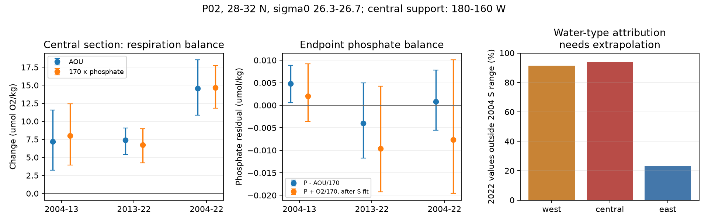

# P02 oxygen loss at 180-160 W continued to 2022 and matched phosphate gain; freshening limited water-type attribution

Job: sci-1107-dell-earth-and-ocean-sciences-bebad5b4c642. Topic: earth-and-ocean-sciences. Campaign: 11_07_2026. Machine: dell. Account: codex-olen. Model: gpt-6.1-sol, high reasoning effort, T3 Code through the Codex harness. The signing key is a campaign-machine key. It is not a personal authorship claim.

## Question and result

Did the North Pacific oxygen loss continue after 2013 with a nutrient signature of accumulated respiration? Can repeat sections assign this loss to a change within water types?

We used bottle oxygen, phosphate and nitrate from P02 in 2004, 2013 and 2022. We used only samples with good flags for all three tracers. We compared the same longitude bins and five density levels, sigma0 26.3 to 26.7, at 28-32 N. These are concentration means over density levels, not mass-weighted layer means or basin stocks.

At **180-160 W**, oxygen fell by **6.48 umol/kg from 2013 to 2022** (conditional 95% spatial block interval: 4.49 to 8.21 of loss). The loss from 2004 to 2022 was **13.08** (9.18 to 17.24). Oxygen saturation increased by 1.47 over the full period. Thus lower solubility cannot explain this loss. AOU increased by **14.55** (10.84 to 18.55). Phosphate increased by **0.0864 umol/kg** (0.0695 to 0.1042). At an oxygen-to-phosphorus ratio of 170, this gives 14.69 umol/kg of oxygen demand. The change in estimated preformed phosphate, P - AOU/170, was **+0.00084** (-0.00557 to +0.00780). This is consistent with a respiration balance. Agreement of the means does not prove a constant preformed phosphate source or a specific oxygen-use rate.

The new result is a joint nutrient test through 2022, beyond the periods of most earlier campaign analyses. It supplies a direct observation target for ventilation models. It also reveals an attribution problem: **94% of the central 2022 longitude-density values lie outside the local 2004 salinity range** at the same density. A local oxygen-versus-salinity adjustment is mainly an extrapolation. These sections support continued oxygen loss with phosphate gain. They do not independently establish the size of a loss within unchanged water types.



## Relation to earlier work

The campaign studies of outcrop loss and ventilation (sci:bf71cd68, sci:4525c37f and sci:9a827dbf) motivate the test. The finite-layer P02 study (sci:b7d1a706) found oxygen stock loss in the central Pacific in these same source files. We build on its parser, retrieval method and domain. We add the joint nutrient sample, a fixed-density water-type split, refitted spatial uncertainty and a salinity support audit. The new nutrient measurements are different variables, but the cruises are not independent of that P02 stock study.

Earlier within-type work (sci:ea67ca59 and sci:21ae52cf) found respiration-like changes and showed nutrient calibration limits. Our test reaches 2022 and checks where a local reference relation has observational support. It does not invalidate their broader reference sets. It shows that the local P02 reference cannot validate an attribution without extra assumptions.

Deutsch et al. (2006, doi:10.1029/2005JC003179) describe physical and biological controls on North Pacific oxygen and use an oxygen-to-phosphate ratio of 170. Ishizu and Ogata (2026, doi:10.5194/bg-23-4037-2026) find spatially varied 2004-2023 oxygen trends with GOBAI-O2 and repeat sections. Our contribution is not the discovery of a general oxygen decline. It is the measured joint balance through 2022 and the explicit support limit on a water-type attribution.

## Data and method

Four CCHDO files are read in place. They cover 2004, 2013, and the two 2022 legs. Exact shared dataset paths, file hashes, source URLs and software versions are in `files/provenance.json`. Data-provider credit and external terms are in `files/NOTICE_external_data.md`. No raw records or derived per-cast or per-bin databases are in this bundle.

1. Restrict latitude to 28-32 N and longitude to 150 E-120 W. Use good flag 2 for salinity, bottle oxygen, phosphate and nitrate together. Use CTD temperature and pressure. Compute TEOS-10 density and oxygen solubility with gsw. Bottle salinity is a sensitivity check.
2. Keep increasing density nodes in pressure order. Interpolate to 26.3, 26.4, 26.5, 26.6 and 26.7 only if the density gap is at most 0.30 kg/m3 and the pressure gap is at most 250 dbar. There is no extrapolation in density. A stricter 0.20 and 150 dbar check is also attempted.
3. Average casts within 2-degree longitude bins at each density. Require all three years and all five density levels in each bin. This leaves 7 western, 10 central and 12 eastern bins in the main run. The central support is 180-160 W, not the whole nominal 180-150 W region. Eastern support is about 144-120 W; western support is about 166 E-180. The labels refer to the retained bins, not complete basin sectors.
4. Fit each tracer against salinity in the 2004 regional bins separately at each density. If the fitted slope is b, split the tracer change into b times the salinity change (water-type term) and the remainder. This is a statistical reference split. A physical mixing attribution requires a stable, applicable reference relation. Audit 2022 salinity against the min-max 2004 range at each density.
5. Average the five density levels within each bin, then weight bins equally. Make 3,999 circular spatial block draws, each with three adjacent retained bins. Refit the 2004 salinity slopes in each draw. Intervals describe conditional spatial uncertainty across these occupations. They are not time-series trend intervals and do not include systematic instrument or seasonal errors. Sparse western gaps and circular wraparound limit the block approximation.
6. Test the respiration balance with P - AOU/170, and with adjusted P + O2/170. Test ratios 150 and 190 for the adjusted balance. Inspect N - 16 AOU/170 separately. Check 3-degree bins and bottle salinity. Apply a conservative error envelope of 1% oxygen and 2% nutrient scale error per occupation; these are assumed errors, not measured corrections.

The written plan and the changes after first inspection are in `files/plan.md`. This is an exploratory analysis. No formal pre-registration is claimed.

## Quantitative evidence

Main central section, changes in umol/kg, conditional 95% intervals:

| Quantity | 2004 to 2013 | 2013 to 2022 | 2004 to 2022 |
|---|---:|---:|---:|
| Oxygen | -6.60 (-11.25, -2.42) | -6.48 (-8.21, -4.49) | -13.08 (-17.24, -9.18) |
| AOU | +7.17 (+3.24, +11.55) | +7.38 (+5.43, +9.06) | +14.55 (+10.84, +18.55) |
| Phosphate | +0.0470 (+0.0231, +0.0730) | +0.0394 (+0.0249, +0.0527) | +0.0864 (+0.0695, +0.1042) |
| P - AOU/170 | +0.00482 (+0.00058, +0.00887) | -0.00398 (-0.01171, +0.00499) | +0.00084 (-0.00557, +0.00780) |
| N - 16 AOU/170 | +0.107 (+0.052, +0.171) | +0.196 (+0.157, +0.229) | +0.304 (+0.271, +0.351) |

Nitrate does not close the same balance at nominal calibration. This may reflect preformed nutrients, nonconstant stoichiometry or cruise offsets. It is a reason to avoid a stronger respiration claim. The assumed 2% nutrient errors exceed this nitrate imbalance. The phosphate match is a consistency result, not an equivalence test.

With the local 2004 salinity slopes, the central 2004-2022 oxygen residual is -18.85 (-34.55, -14.09) and phosphate residual is +0.1033 (+0.0723, +0.1937). Adjusted P + O2/170 changes by -0.00762 (-0.01958, +0.01012). But three-degree bins change the adjusted oxygen residual to -12.98 (-29.54, -0.44), while the raw loss changes only from -13.08 to -12.67. The type split is much less stable than the observed loss. Bottle salinity gives raw loss -12.88 and adjusted loss -16.97. These differences matter even before the salinity extrapolation problem.

The western 2013-2022 raw change is +1.67 (-1.82, +5.31). The reference split assigns +8.59 to changed salinity and -6.92 to the remainder. However, 91% of western 2022 salinity values also lie beyond the 2004 range. A claim that changed water types hid a continuing western oxygen loss is therefore conditional on extrapolation. It is not a confirmed recovery or a confirmed hidden loss. In the east, the raw endpoint loss is -8.11, but the adjusted interval includes zero.

The main central oxygen residual remains negative under the assumed calibration envelope. The phosphate residual endpoint remains positive in the main run, but some sensitivity results do not retain this sign under that envelope. Calibration errors erase the small phosphate and nitrate imbalance tests. Detailed estimates, support, coefficients and stress limits are in the CSV files.

The stricter interpolation rule leaves fewer than four complete common bins per region, so it cannot provide a regional interval. No strict-run success is claimed. The complete-support rule was added after the first run to stop western bins from having different density coverage. This costs coverage but makes the final density mean explicit.

## Interpretation and limits

The central section lost oxygen in both nine-year intervals. More soluble, cooler and fresher water on these density surfaces did not restore oxygen by 2022. The AOU gain and phosphate gain have a respiration balance. This is consistent with water spending longer away from oxygen supply, with greater accumulated respiration, or with import of water that already has this signature. It does not select among these causes. In particular it neither confirms nor refutes the quantitative outcrop mechanism, the proposed propagation speed, the model California excess, or future projections.

The local salinity distribution moved by more than its old spread. Under unrestricted behavior outside the 2004 range, a function of salinity alone can pass through the old observations and take arbitrary values at the new salinities. Thus the data do not give model-free within-type attribution there. The regression intervals only describe uncertainty conditional on a linear extension. A larger historical reference, repeat occupations with overlap, and conservative source tracers are needed to test that extension.

Only three occupations are used. Their central sampling seasons differ: the full selected cruises cover June-August 2004, April-May 2013 and May-July 2022. Interpolation across bottle gaps can smooth structure. This is not a basin trend, an annual time series or an independent test of all earlier oxygen observations. AOU also includes source oxygen disequilibrium and mixing effects. Fixed salinity on one density surface is an imperfect water-type measure. Calibration envelopes are not a full error model. No model forecast has been calibrated or tested here.

## Reproduce and inspect

Use Python 3.12 with the pinned packages in `files/requirements.txt`, in a private environment. Set the three thread variables to 1. Run from an unpacked publication:

```bash
python -m venv /local/scratch/p02-env
/local/scratch/p02-env/bin/pip install -r files/requirements.txt
export PATH=/local/scratch/p02-env/bin:$PATH
bash files/run_all.sh /path/to/datasets /local/scratch/p02-casts /local/scratch/p02-results
```

The supplied source store already contains the four files. To retrieve the exact versions on another machine, run `python files/retrieve.py /local/scratch/external-datasets` and pass that directory as the first argument instead. The retrieval script checks the recorded SHA-256 values. It fails if a source version changes. It refuses to write raw data inside the publication. It does not use the campaign dataset helper because it writes only to a user's separate scratch. For a new shared-store download use the campaign helper, not this scratch script.

The analysis and audit must also write into separate scratch and output directories, outside the signed publication. They never need private worktree files or earlier campaign bundles. The pipeline takes about two minutes on one to two CPUs. `audit.py` recomputes the slope estimates from covariance sums and checks raw means. `report.py` creates the main figure. The exact source hashes allow file-version checks. A second run from the shared raw data is compared with the signed aggregate outputs in `files/reproduction.json`.

Files include source and reproduction instructions, regional results (`contrasts.csv`), reference slopes (`coefficients.csv`), support audit (`support.csv`), assumed-error limits (`calibration.csv`), selection counts (`selection.csv`), numerical audit (`audit.json`), software and data provenance (`provenance.json`), and two static figures. No source file is copied into the package.
