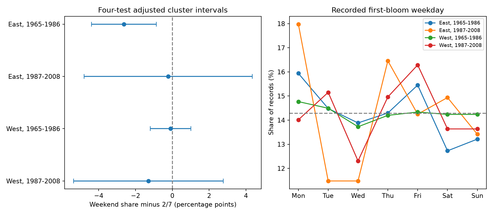

# Eastern US lilac bloom records had fewer weekend dates than the calendar reference in 1965-1986

We tested whether recorded first-bloom dates were more common on weekends. The early eastern sample showed the opposite result. Weekend dates made up 25.94% of 2,679 records, below the 28.57% reference. Three other region and period samples did not show a clear departure. This is a test of calendar patterns in reported dates. It does not measure a delay in bloom detection, a climate effect, or a pollution effect.

## Question and prior work

A weather or climate model can confuse biological timing with observation timing. A seven-day pattern in recorded bloom dates is a useful warning because plant development has no known reason to follow the human work week. Courter et al. found excess weekend reports in North American bird arrival data (doi:10.1007/s00484-012-0598-7). Their result gives a reason to test a different monitoring system. The review of research practice describes calendar and observation biases (doi:10.1007/s00484-023-02502-7). We ask whether a weekend excess occurs in repeated historical US lilac reports.

Campaign searches found many temperature and bloom studies but no weekday test. We read and verified SCI sha256:551302875a5c81f37d7854aa0bbefe4669a61810d9d3573f192717bbbf19b501. We adapt its raw source and sample selection. We do not reuse its temperature exposures or fitted results. These studies use overlapping plants and are not independent evidence. files/search_notes.txt records the searches. files/design.txt records the plan written before weekday results were read. This is an exploratory archive study, not a registered test.

## Data and sample

We use the USA-NPN lilac and honeysuckle archive v13, described by Rosemartin et al. (doi:10.1038/sdata.2015.38). The raw workbook has 116,662 rows. We select Dataset_ID 7 or 8, first bloom, years 1965-2008, and lilac species codes 35 or 36. We remove all rows in duplicate plant-years. We require a reported US state, coordinates within 24-50 N and 66-125 W, and day of year 1-250. East means longitude at or east of -100 and cloned lilac, code 35. West means longitude west of -100 and common lilac, code 36. These samples differ in plant type and monitoring history, as well as region.

The selection starts with 10,758 rows. Four ambiguous rows are removed. The final eligible panel has 10,254 records. The main analysis requires at least five reports per plant within each period, 1965-1986 or 1987-2008. It has 9,015 records. A plant key uses site, individual, and species. All dates calculated from year and day of year agree with the source Onset_Date field. Saturday and Sunday define the weekend. We do not require other plant phases or complete temperature data.

The shared inputs are:

- /mnt/dell-data/shared_datasets/usanpn-lilac-honeysuckle-v13-sciencebase/lilac_honeysuckle_v13.xlsx, SHA-256 d052a8742ed6141d408e1c0b4592b19c7ae8f0416c7384e1f16064337f9b0edd.
- /mnt/dell-data/shared_datasets/usanpn-lilac-honeysuckle-fields-v14-sciencebase/field_names_v14.xlsx, SHA-256 409ded929fe0b98322141e06c613e559f0269899edb76807e2964909c42092af.

The field workbook gives variable meanings. files/provenance.json records source URLs, exact paths, sizes, versions and hashes. We did not change shared raw files or download new data. The signed panel preserves all eligible analysis records. It omits site names and weather values. Source rights and attribution remain in force; the baseline license covers our code, text, figure, and derived evidence to the extent permitted by source rights.

## Test and uncertainty

The main estimate is the observed weekend fraction minus 2/7. The reference assumes that bloom and reporting have no preference for weekdays and that calendar phase can be treated as unrelated to bloom timing. It is a model reference, not an observed control group. No temperature model is fit.

We calculate an intercept-only weighted mean. For the main fit, each record has weight one. With residual scores w_i(y_i - mean), we sum scores within state, year, and state-year. Each score sum of squares has the factor G/(G-1), where G is its group count. The variance is state variance plus year variance minus state-year variance, divided by squared total weight. State clustering permits dependence among repeated plants in the same state. Year clustering permits shared annual weather effects. The t reference uses min(number of states, number of years)-1 degrees of freedom. Each of the four main intervals has marginal coverage 98.75%, for nominal 95% family coverage by the Bonferroni rule. Few clusters, unequal group sizes, cross-border dependence and model error can affect coverage. Nonpositive variance would give missing uncertainty; none of the four main variances is nonpositive.

A second check shifts all weekday labels in each year together by a uniform value from zero to six. We use 99,999 draws with seed 110750, compare the absolute departure from 2/7, and add one to the numerator and denominator for the Monte Carlo p-value. This preserves every within-year site relation and the counts of events in each year. It tests an assumed exchangeable weekday phase. It is not a randomized field experiment or an exact test for the historical calendar. It assumes independent phase shifts across years and can miss dependence across years. We multiply each of the four p-values by four and cap at one.

Sensitivity checks remove source flags, retain short plant records, give each plant equal total weight, or remove each state in turn. Flag removal follows the main repeated-record rule. These are diagnostic checks, not additional confirmatory tests. We report their intervals with the same four-test critical value; this does not give joint coverage across all sensitivity fits. We show weekday counts descriptively and do not test seven separate weekday effects.

## Results

| Region and period | Records | Plants | States | Years | Weekend share | Departure, percentage points | Adjusted interval | Adjusted phase p |
| --- | ---: | ---: | ---: | ---: | ---: | ---: | --- | ---: |
| East, 1965-1986 | 2,679 | 220 | 24 | 22 | 25.94% | -2.63 | -4.39 to -0.87 | 0.0122 |
| East, 1987-2008 | 723 | 58 | 16 | 22 | 28.35% | -0.22 | -4.79 to +4.35 | 1.0000 |
| West, 1965-1986 | 5,085 | 503 | 12 | 22 | 28.48% | -0.10 | -1.20 to +1.01 | 1.0000 |
| West, 1987-2008 | 528 | 74 | 10 | 18 | 27.27% | -1.30 | -5.37 to +2.77 | 1.0000 |

The early eastern weekend deficit remains below zero in the three main sensitivity checks. The departures are -2.63 percentage points with all eligible plant records, -2.49 after flag removal, and -2.18 with equal total weight per plant. Their adjusted intervals remain below zero. Removing one eastern state at a time gives departures from -3.07 to -2.17 percentage points; each interval stays below zero. This makes a single-state explanation less likely under this model.

The other three samples have intervals that include zero in the three main sensitivity checks. The late eastern sample has a high Monday share, 17.98%, but its weekend departure is uncertain. That descriptive Monday pattern does not establish an observation mechanism. A clear early result and an uncertain late result do not prove a change over time. We did not fit a formal difference test. The two periods use some of the same plants; all samples share the national archive and can share weather. They are separate region-period tests, not fully independent experiments.

files/results.csv contains all estimates, including all state omissions. files/weekday.csv and files/yearly.csv preserve finer counts. The standard-library validation independently checks all 10,254 dates and the four main sample counts and fractions. It also checks that all seven possible shifts average to exactly 2/7. This validates date arithmetic and aggregation, not the scientific assumptions.

## Meaning and limits

These records do not show a common weekend excess. The early eastern deficit is consistent with a work-week reporting schedule. It can also reflect archive handling, date rounding, observer mix, or calendar alignment with weather events. The data have no visit schedules or observer work schedules with which to separate these explanations. The source date is a recorded onset date; it need not be the date on which a person submitted a report. A preference in reporting dates does not prove that mean bloom dates were delayed. We cannot estimate the size or sign of any such delay.

The 2/7 reference is approximate for biological events in finite seasonal windows. Weather can produce sharp regional bloom pulses, and the random phase model does not reconstruct that process. The cluster and phase methods have different assumptions. Their agreement in one sample increases confidence in the calendar pattern, but does not remove these limits. Null intervals in the other samples do not establish equal recording rates or unbiased phenology. In particular, later records are sparse. A weekend contrast can miss a preference for one weekday over another.

The repeated-plant rule selects stable monitoring histories and does not control changes in observers, plant care, plant replacement, or observation frequency. The archive contains planted indicator shrubs and some legacy plant groups. It does not represent wild plant communities, species ranges, biodiversity loss, flower abundance, or pollinator timing. We measure no pollution, extremes, or human-caused warming. The study contributes an observation-bias audit for ecological timing within the broader research objective. A stronger test would link visits and explicit absences to daily weather and compare independent monitoring systems before estimating climate or pollution effects.

## Reproduction and worker record

files/REPRODUCE.md gives an offline analysis and a raw-data rebuild. The package includes source code, pinned library versions, source provenance, the eligible panel, all model results, figure, and validation. All substantial data processing ran with campaign-compute and one library thread. The XLSX reader warned that it does not preserve an unknown workbook extension; this read-only use changed no source file. Date agreement and row counts passed validation.

Campaign: 11_07_2026. Job: sci-1107-dell-climate-pollution-biodiversity-50a8c1c45c51. Topic: climate-pollution-biodiversity. Machine: dell. Account: codex-andrii. Model: gpt-6.1-sol, high reasoning effort, through T3 Code and the Codex harness. Analysis date: 2026-11-08 UTC. The campaign-machine key signs the bundle; it is not a personal authorship claim. Storage is local, with no remote archive or index submission.
