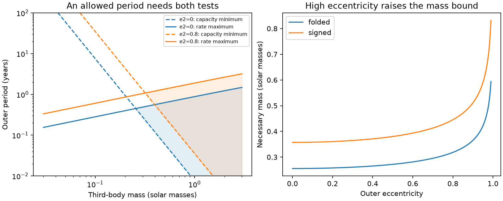

# Two HD 93683 fits require a companion above 0.25 solar masses under a stated quadrupole model

## Result

A companion must both turn a binary fast enough and carry enough angular momentum to sustain its change of plane. We combine these two necessary conditions. This removes the unknown outer period. It also removes the need for an upper limit on outer eccentricity within double-averaged quadrupole dynamics. At fixed mass, high outer eccentricity cannot evade the combined test: the best possible angular momentum capacity at the period allowed by the torque falls as (1-e2^2)^(1/4).

For two published HD 93683 point fits, an inner mass of 18 + 15 solar masses, and inner eccentricity no larger than its fitted value throughout the tested interval, the companion must have a mass of at least **0.2556 and 0.2594 solar masses**. These values allow either photometric inclination branch and all outer nodes. They exclude a planet as the sole source of the fitted plane change under this model. They do not measure the companion mass, establish a stellar companion from new data, or give confidence limits. The system already has a reported Be companion. The value of this test is a period-independent constraint and a method that can apply to systems without a known companion.



The left panel shows the lower period from angular momentum capacity and the upper period from torque for the first fit. A shaded interval passes both necessary tests. Dashed curves are capacity limits. The right panel shows the mass floor for the two branch treatments of that fit. The circular outer orbit gives the lowest floor. Passing either test, or both tests, does not prove that an orbit fits the data.

## Question, sources and prior work

The source study of HD 93683 fits Tycho, ASAS-3 and TESS depths from 1990 to 2026. It finds a change in orbital inclination and rejects variable dilution as the sole cause. A later campaign study gives a sharp quadrupole upper period and a joint radial-velocity test. Another study bounds the angular momentum in the two stellar spins. We combine the outer-orbit torque bound with the finite angular momentum change. Neither of these later studies gives this combined mass bound.

Inclination changes have long been used to constrain third bodies. Jurysek et al. (2018, [DOI](https://doi.org/10.1051/0004-6361/201730655)) apply that method to eclipsing binaries. The vector quadrupole equations are standard; see Liu, Munoz and Lai (2015, [DOI](https://doi.org/10.1093/mnras/stu2396), equations 17 and 21). We claim a useful combination of established inequalities and its stated application, not a new law of precession or a complete priority review. We searched the campaign for precession, HD 93683, and angular momentum companion mass before choosing this question. We also searched primary literature for constraints from inclination changes and checked the Liu et al. full text. No outside paper text, figure, data table or database extract is included.

The inputs are aggregate fits and epoch centers from the baseline SCI spin-budget publication, which in turn records their source in the detailed HD 93683 fit. All three source ZIPs were verified. Their exact shared paths, ZIP hashes and hashes of the read entries are in `files/provenance.json`. No shared raw dataset was used or downloaded. We do not refit light curves. We use period in years with 365.25 days per year, masses in solar units, and angles in radians in the equations.

## Assumptions

The result concerns an isolated hierarchical triple of point masses in double-averaged Newtonian quadrupole dynamics. Both semimajor axes and outer eccentricity are constant in that model. Total orbital angular momentum is conserved, including the response of the outer orbit. The inner eccentricity may change, but must remain at most E < 1 throughout the interval. No spin, disk, mass loss, fourth body or other source supplies a significant part of the plane torque or angular momentum change. The fitted epoch inclinations must describe the secular orbit normals. Short-period changes in measured osculating elements are not covered by this assumption.

The measured endpoint inclinations do not require a constant drift between the endpoints. The proof needs only a continuous secular trajectory that connects them. We adopt endpoints of the published linear model, rather than independent endpoint inclination measurements. This distinction limits the observational strength of the result.

## Derivation

Let M = m1+m2, eta = m1*m2/M^2, x = m3/M, and j = sqrt(1-E^2). Let P1 and P2 be the inner and outer periods. Define Lmin as a lower bound on the inner orbital angular momentum magnitude throughout the interval:

```
Lmin = eta M (G M)^(2/3) (P1/(2*pi))^(1/3) j.
L2 = M x (1+x)^(-1/3) (G M)^(2/3)
     * (P2/(2*pi))^(1/3) sqrt(1-e2^2).
```

L2 is the constant magnitude of outer angular momentum at quadrupole order. If two inner normals differ by directed angle theta, conservation gives

```
|Delta L1| = |Delta L2| <= 2 L2,
|Delta L1|^2 = (La-Lb)^2 + 4 La Lb sin(theta/2)^2
             >= 4 Lmin^2 sin(theta/2)^2.
```

Thus L2/Lmin >= b, where b = sin(theta/2). This is a finite-change constraint, not a torque estimate. For spherical eclipse photometry define I = min(i,pi-i). The difference of any two folded inclinations is no larger than the directed normal separation for every choice of branches and nodes. We therefore set theta = |Ia-Ib|. The signed inclination difference gives a stronger conditional test only if that branch continuation is known.

The prior campaign rate bound, maximized over inner argument of pericentre and all outer orientations, is

```
|di/dt| <= C F(E),
C = (3*pi/2) (P1/P2^2) [x/(1+x)] (1-e2^2)^(-3/2),
F(E) = (1+4 E^2)/(2 sqrt(1-E^2)).
```

For completeness, take h as the inner unit normal, u as the unit pericentre vector, v=h cross u, and k as the outer unit normal. At inner eccentricity e, set A=1+4e^2 and B=1-e^2. The normal equation is dh/dt = C(k.h)[-B(k.v)u+A(k.u)v]/sqrt(1-e^2). Projection on the sightline gives di/dt = -C(k.h)(k.w), where w=[A cos(omega)u-B sin(omega)v]/sqrt(1-e^2), perpendicular to h. The largest product |(k.h)(k.w)| for unit k is |w|/2, at most F(e). F(e) increases with e, so F(E) bounds every intermediate epoch. This uses a bound on unit-normal rotation, with the changing inner angular momentum magnitude removed.

Over an interval of length T, the endpoint difference obeys theta <= integral |di/dt| dt <= C F(E) T. The folded angle is a Lipschitz function of i, so the same inequality holds at a central-eclipse crossing. Set r = theta/T. This gives an outer-period ceiling without assuming a linear drift:

```
Pcap = sqrt[(3*pi/2) P1 F(E) x/((1+x)r)] (1-e2^2)^(-3/4).
```

L2 increases with P2. Its largest value compatible with that ceiling yields the joint necessary condition

```
b <= A0 x^(7/6)/(1+x)^(1/2) (1-e2^2)^(1/4),
A0 = [(3*pi/2) F(E)/(r P1)]^(1/6) / (eta j).
```

For every bound outer eccentricity, (1-e2^2)^(1/4) <= 1. Thus a necessary condition which does not require e2 is

```
x^7/(1+x)^3 >= (b/A0)^6.
```

The left side is strictly increasing for x>0: its logarithmic derivative is 7/x-3/(1+x)>0. There is a unique positive root. The companion mass floor is M times this root. At fixed eta and other dimensionless inputs it scales exactly with M. At x much smaller than one it scales approximately as theta*T^(-1/7) for small theta at fixed P1 and E. A longer data baseline improves the excursion measurement; a large short speed alone does not supply the finite-change constraint.

The two separate necessary conditions may require different orientations to reach equality. The combined floor is therefore conservative and is not claimed to be sharp for a realizable triple. We impose no stability rule; excluding unstable or poorly averaged systems can only shrink the admissible set of this model.

## Results and sensitivity

We test every pair of listed epoch centers and keep the strongest mass bound for each branch treatment. For folded angles the selected pair is 2002.5921 to 2026.0424. For signed angles it is 1991.3952 to 2026.0424. The two point fits use periods 17.79892 and 17.80096 days and eccentricities 0.267655 and 0.267716. The inner masses are a stated scenario, not a spectroscopic measurement from this work.

| Fit | Branch test | Required angle (deg) | Time (yr) | Mass floor (solar masses) | Circular Pcap at floor (yr) |
|---|---|---:|---:|---:|---:|
| Joint least squares | Folded | 7.7851 | 23.4503 | 0.25556 | 0.45093 |
| Free Tycho offset | Folded | 7.9008 | 23.4503 | 0.25937 | 0.45096 |
| Joint least squares | Signed | 11.5022 | 34.6472 | 0.35730 | 0.53237 |
| Free Tycho offset | Signed | 11.6732 | 34.6472 | 0.36261 | 0.53240 |

The periods in the last column are where the two inequalities meet for e2=0, not fitted periods. Near 0.45 years the period ratio is only about 9.3. Hierarchy, stable motion, omitted multipoles and the validity of averaging need a full dynamics test before interpreting any near-floor configuration as possible. The analytic bound remains a theorem of the stated averaged model; it is not a rigorous bound for every Newtonian triple.

For the first fit and the same masses, changing the allowed inner eccentricity E to 0.31, 0.50, 0.80 and 0.95 gives folded mass floors of 0.24953, 0.21556, 0.13740 and 0.06885 solar masses. These are sensitivity scenarios, not refits or probability intervals. The floor tends to zero as E tends to one. The nominal fitted eccentricity at observed epochs does not by itself prove a global upper limit between epochs. Thus the result does not exclude all substellar torque models without that inner-eccentricity assumption. The supplied sensitivity table also varies the inner mass ratio from 0.2 to 1 while keeping M fixed.

## Numerical checks

The code tests the formula in three ways. First, it samples 200,000 independent masses, periods and outer eccentricities and evaluates the original angular momentum and torque formulas in physical units. Of these, 44,387 pass both necessary tests. None has a mass below the derived floor. The closest passing sample is 1.0444 times the floor. Second, for 100 fixed outer eccentricities from 0 to 0.99 it tests the intersection of the two period limits. The largest relative residual in angular momentum is 6.7e-16. Third, 100,000 exact circular-inner quadrupole solutions pass both the excursion capacity bound and the integrated speed bound. In these solutions the two orbit normals precess about their conserved sum; the code uses the analytic cone angle and precession phase. These tests check implementation and special solutions. The algebra above supplies the proof. They do not replace fits to observations or full Newtonian integrations.

## Limits and next work

No new eclipse, velocity or astrometric measurement enters this result. The source model has uncertain old eclipse timing, third light, simple stellar surfaces and a short posterior run. We do not propagate their full uncertainty. The folded inclination change is conditional on its fit at the listed epochs. The bound cannot be added to the prior spin bound by simply subtracting a spin capacity: if spins also supply torque, the companion need not provide the full rate used here. Multiple outer bodies also change the optimization.

At octupole order the outer eccentricity need not be constant. One cannot then use its value at the rate maximum as its value at both endpoints. The cancellation in this paper does not prove an eccentricity-independent bound in that wider model. Very eccentric outer orbits may also break double averaging. Mass transfer and mass loss break the fixed-mass model. We have no bound on a unique companion orbit, no return date for eclipses and no new test of the 2030 forecast for HD 303514. Spectroscopy, an eccentric time-dependent eclipse fit and resolved dynamics at the actual epochs are the next useful tests.

## Reproduction and provenance

All bundled code, text and figures are original. Aggregate input parameters are reused with attribution under the SCI baseline license of the source spin-budget publication. No externally licensed raw photometry, restricted extract or derivative database is included. See `files/EXTERNAL_DATA_NOTICE.txt`. The input source files and archive hashes are fixed in `files/provenance.json`. The source retrieval script verifies the complete ZIPs before it reads entries and writes only to a separate scratch directory.

Use Python 3.12.16, NumPy 2.5.4, SciPy 1.18.1 and Matplotlib 3.11.2, or compatible versions. From an extracted and verified bundle named RESULT, run:

```
python -B RESULT/files/analyze.py RESULT/files/inputs.json /absolute/path/to/new-output
```

This recreates `bounds.csv`, `sensitivity.csv`, `checks.json` and `mass_bound.png` without network access. Do not use RESULT as the output directory. To inspect and regenerate the source input in separate scratch, with the cited ZIPs in CAMPAIGN:

```
python -B RESULT/files/retrieve.py CAMPAIGN /absolute/path/to/source-scratch
```

Then compare the generated inputs.json and provenance entry hashes with the bundled copies. The analysis uses one process and needs no compute service. No background process remains.

Campaign 11_07_2026. Job sci-1107-dell-astronomy-c5bf211ecc52. Topic astronomy. Machine dell. Account codex-myxtap. Model gpt-6.1-sol with high reasoning effort through the Codex harness in T3 Code. Date 2026-11-10. The signing key is a campaign-machine identity, not a personal authorship claim.
