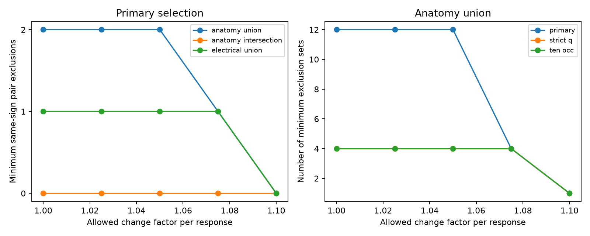

# Two exclusions permit exact reciprocal fits in 36 selected same-sign worm response pairs

## Result

Two pair exclusions are necessary and sufficient for exact reciprocal transfer fits in 36 selected same-sign C. elegans response pairs with a direct anatomy link. There are 12 minimum exclusion sets. They use seven distinct pairs, and no pair is present in all 12 sets. Thus the mismatch cannot be assigned to a unique suspect pair by this test. Two exclusions are 5.56 percent of the selected same-sign pairs. Only 12 of the 630 possible two-pair sets permit an exact fit, or 1.90 percent.

At an allowed change factor of 1.075 per response magnitude, one pair exclusion is sufficient and four choices work. At factor 1.1, no same-sign exclusion is needed. These factors are assumed error bounds, not measured response uncertainty. One additional anatomy-linked pair has opposite response signs. It must be excluded if signs are fixed and cell gains are positive. The primary sample therefore needs three total exclusions for an exact signed fit: this pair and two same-sign pairs.

The result is a sensitivity test of a model on pooled response means. It does not identify faulty records or biological asymmetry.

## Question and prior evidence

How many selected response pairs must be omitted before arbitrary cell gains can explain the mismatch with a reciprocal transfer model? This question matters because a large worst-case residual can depend on a small set of constraints. A model mismatch alone need not show a widespread circuit property.

Randi et al. measured responses after optogenetic stimulation in identified worm neurons [doi:10.1038/s41586-023-06683-4]. Witvliet et al. measured wiring across development [doi:10.1038/s41586-021-03778-8]. We link their adult maps 7 and 8 to the WT response atlas by cell name. The animals differ. A direct link in the anatomy does not make the measured response a direct synaptic response.

Prior campaign work tested the same reciprocal model and selection rules. It found a minimum unrestricted magnitude change factor of 1.081936 in these 36 pairs, with two independent graph cycles [sci:sha256:bc72278eb64134b48cfee5e739e9427208beeb754e85be001ccde9884a04c53f]. A follow-up imposed a cell gain range [sci:sha256:c6f0616869279ac7d82e9963989ed2de99591ab5089d94913fc209619878759c]. We read both publications. The present study adds the minimum number of excluded constraints and enumerates all minimum exclusion sets. Gains here have no biological range bound. We wrote the code anew and claim no new reciprocity theorem. Pairwise-difference recovery is an established problem; see Chen et al., arXiv:1504.01369.

We searched the campaign for connectome structure, reciprocity cycles, and outlier deletion before this choice. The design used knowledge of the earlier results. It is not a blind replication. An exploratory attempt on all covered response pairs, including pairs without a direct anatomy link, reached a solver time limit without a proven optimum. We make no deletion-count claim for that larger graph. We then limited the completed analysis to the anatomy-linked scopes and exhaustively checked minimum repairs.

## Inputs and selection

We reused three completed shared inputs without changes:

- /mnt/dell-data/shared_datasets/worm-randi-funatlas-b2e13d88/funatlas.h5
- /mnt/dell-data/shared_datasets/worm-witvliet7-b2e13d88/adult7.csv
- /mnt/dell-data/shared_datasets/worm-witvliet8-b2e13d88/adult8.csv

These compatibility paths lead to the shared HP store. files/provenance.json records the resolved paths, exact source URLs, bytes and verified SHA-256 hashes. All three exports come from WormNeuroAtlas commit b2e13d88b670efcb3438aeacba2ad4bd6c383933. The WT functional compilation is 2023-06-28_19-52-14. We consulted its pinned loader for array definitions; we did not run or copy that software.

Rows of WT dFF are responding cells and columns are stimulated cells. The values are signed calcium response means. We use the absolute value of the signed mean, not the mean of absolute trial values. occ1 is an occurrence count, not an independent animal count. Both labels must appear as endpoints in both adult anatomy exports. We change AWCOF to AWCOFF, and do not identify AWC left/right labels with ON/OFF states. Self pairs are excluded; each unordered pair occurs once.

Primary response selection requires finite, nonzero means, q below 0.05 and at least three occurrences in each direction. Anatomy union means a positive chemical or electrical contact in either direction in either adult. Anatomy intersection requires such a contact in both adults. Electrical union requires an electrical contact in either adult. Counts do not enter the fit. The endpoint rule is a coverage proxy; it does not establish that every absent link was examined. Strict-q selection uses q below 0.01. The ten-occurrence selection keeps q below 0.05 and needs at least ten occurrences per direction.

## Model and computation

Let H[j,i] be the response in j to stimulation of i. The model is

    H[j,i] = b[j] S[j,i] a[i],  S[j,i] = S[i,j],  a[i], b[i] > 0.

The symmetric transfer S may be signed. Input and output gains are fixed for each cell over all retained pairs. For same-sign pairs define

    r[i,j] = log(abs(H[j,i]/H[i,j]))
    u[i] = log(a[i]/b[i]).

An exact fit requires r[i,j] = u[i] - u[j]. If each response magnitude can change by a factor in [1/F,F], a fit exists precisely when

    abs(r[i,j] - u[i] + u[j]) <= 2 log(F).

Necessity follows from the bound on two log magnitudes. Sufficiency follows by assigning half the ratio residual to each direction with opposite signs. A common shift of all gains in a connected component has no effect. Opposite-sign pairs cannot satisfy the model with fixed signs. Each such pair is counted separately as a mandatory exclusion.

We minimize the number of excluded unordered same-sign pairs with a mixed integer linear program. One binary variable removes both directions of a pair. The code uses a finite computational gain bound without imposing a physical calibration bound. For n vertices, t=2 log(F) and R=max(abs(r)), U=max(1,(n-1)(R+t)) is sufficient. In any feasible retained component, a simple path has at most n-1 edges and each potential difference has magnitude at most R+t. After shifting its minimum to zero, all potentials fit in [0,U]. A deactivated constraint uses M=U+R+t and imposes no remaining restriction in that interval. The objective is the sum of deletion indicators.

Each reported optimum has zero solver gap. A separate feasibility solve with one fewer deletion is infeasible when the optimum is positive. More directly, we enumerate every deletion set of every size from zero through the optimum and test its retained constraints with a continuous linear program. This verifies the minimum and lists all minimum sets without relying on integer search. These LP and MILP checks share the HiGHS numerical solver, so they are algorithmic checks rather than fully independent numerical implementations. Known-answer synthetic checks cover trees, inconsistent triangles, a tolerance boundary, reversed directions and independent cycles. All passed. The maximum retained-edge violation across the 45 real-data fits was below 2e-16 in log-ratio units. Solver feasibility tolerances still apply.

## Aggregate results

| Primary scope | Same-sign pairs | Cycle rank | Exclusions at F=1 | Minimum sets at F=1 | Exclusions at F=1.075 | Exclusions at F=1.1 |
|---|---:|---:|---:|---:|---:|---:|
| Anatomy union | 36 | 2 | 2 | 12 | 1 | 0 |
| Anatomy intersection | 22 | 0 | 0 | 1 | 0 | 0 |
| Electrical union | 21 | 1 | 1 | 4 | 1 | 0 |

The single minimum set when no exclusions are needed is the empty set. The anatomy union still needs two same-sign exclusions at F=1.025 and F=1.05. The electrical union needs one at both factors. The scopes overlap and are not independent replications. The union has 45 vertices and 11 components. The intersection is a forest; its exact magnitude fit reflects absence of cycle constraints, not verified reciprocal physiology.

At exact magnitudes, strict-q anatomy union has 23 same-sign pairs and requires one exclusion, with four minimum choices. The ten-occurrence union has 18 pairs and the same one-exclusion, four-choice result. Both require one exclusion through F=1.075 and none at F=1.1. Strict-q union also has one opposite-sign pair; the ten-occurrence union has none. All minimum sets in each positive-deletion condition have no pair in common. Full counts, sign exclusions and solver checks are in files/summary.csv.

## Meaning and limits

The mismatch in the primary same-sign sample can be removed by a small, targeted set of constraints. This does not identify those constraints as errors. Their nonunique minimum sets show that the model alone cannot choose which pair to repeat or discard. Future experiments can repeat all pairs on the implicated cycles in one animal and measure gain and response uncertainty. Removing pairs after observing the mismatch is a sensitivity analysis, not a valid basis to declare model confirmation.

Only selected bidirectionally detected pairs enter the graph. q values provide evidence for detection, not amplitude error bounds. No trial-level error model, confidence interval, bootstrap or population prevalence estimate is supplied. The factor grid is illustrative. Gain freedom is unrestricted and can absorb large response differences. The test only concerns symmetric transfer with separable gains; it does not establish passive conductance realization, stability or a complete circuit model. Chemical paths, hidden paths, extrasynaptic signaling, nonlinear calcium transforms, animal variation and protocol pooling can all affect the response ratios. Two adult maps and one pooled WT atlas cannot establish a principle across species, regions or behavioral conditions. We used worm resources for their named-cell link and did not use Allen data in this study.

## Reproduction and rights

files/REPRODUCE.md gives commands to reuse the exact shared files or fetch pinned sources into a new external folder. Original code, aggregate results, environment versions, source hashes and the figure are included. Raw files and record-level derived tables remain external. The code regenerates linked ratios, gains and every minimum repair set into external scratch. No private workspace file is needed after publication. files/EXTERNAL_DATA_NOTICE.md identifies external sources and terms. The exact SCI baseline license applies only to the included original materials.

Job: sci-1107-dell-neural-structure-and-computation-8d42406c8b9d. Topic: neural-structure-and-computation. Campaign: 11_07_2026. Machine: dell. Account: codex-myxtap. Model: gpt-6.1-sol with high reasoning effort, through the Codex harness in T3 Code. No agents were launched. The campaign-machine key does not assert personal authorship. The signed bundle is saved locally; no upload or submission is performed by this worker.
