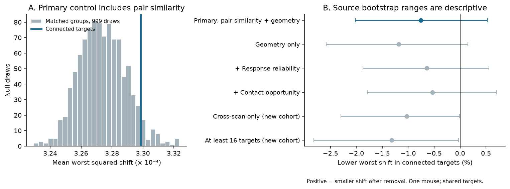
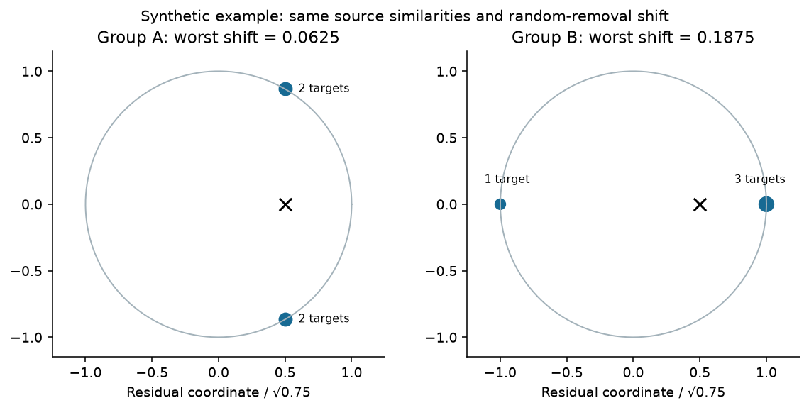
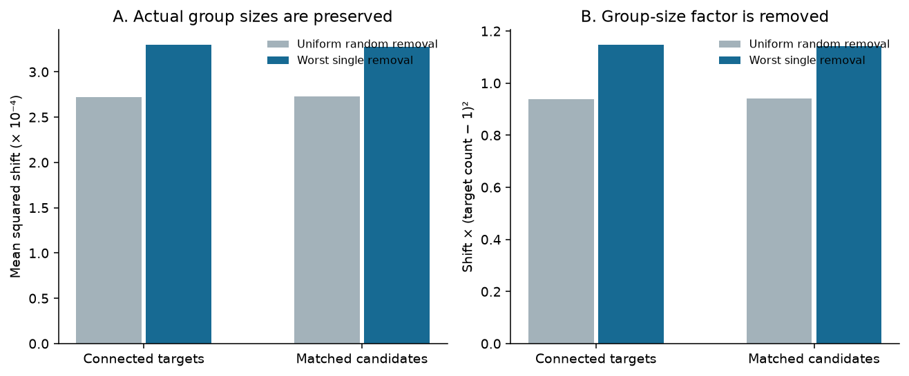

# Selected MICrONS target averages showed no clear stability gain under worst single-target removal

We tested whether connected target groups keep their mean movie response more stable after single-target removal than matched groups. We used public MICrONS v1 wiring and 120-entry response vectors from one mouse. We centered each vector and set its length to one. The primary sample had 81 axons with at least 32 targets. We matched target count, area, layer, soma distance, imaging scan and source-target response correlation decile. Mean worst squared shift was 0.000329856 for connected targets and 0.000327385 for matched candidates. The benefit was -0.755 percent, with a descriptive source-bootstrap range of -2.019 to +0.524 percent. This gives no clear stability gain in the tested panel. Uniform random removal gave a small benefit of 0.365 percent. An exact calculation separates average target agreement from the most distant target. A synthetic example has equal source similarities and equal random-removal shift, but a threefold difference in worst shift. Added reliability and contact opportunity controls also gave no clear benefit. One animal, selected axons, coarse matching, shared targets and response error limit the result. The test measures a fixed response average; it does not measure a live circuit after cell loss. Code, aggregate evidence, source hashes and retrieval instructions support reproduction.



## Question and prior work

Does the wiring of an axon give a target response average that is stable when its most influential target is removed? Ding et al. (2025) found links between cortical responses and connection patterns. The MICrONS Consortium (2025) released linked anatomy and function from the same tissue. We use their tables. These are source data, not new measurements.

Campaign study sci:sha256:3e5fef923a07bb94d498dc9eb6b0af96089dd32ec2149a31a20966cb3e71b937 tested target-group similarity beyond source-target similarity. Study sci:sha256:5d8021d8491fb57862ebfc4911bbb9611c8d34ebf8474b6cf4587fa6ccbf80da tested how well target averages reconstruct their source response with no targeted loss. Those studies motivate this separate test of worst single-target removal. We wrote new code and did not copy their data extracts or code. The method uses standard identities. We do not claim a new general theorem or a new wiring rule.

## Data and scope

We used node_and_edge_properties/v1 from Ding et al. Both files were already in the shared dataset store. No download was needed. We checked their SHA-256 values before use. See files/provenance.json for exact shared paths, resolved paths, URLs, sizes, hashes and software versions. The /mnt/dell-data names are compatibility paths on HP. We did not read the failed disk at /data.

The node table has 12,894 rows. Each in_vivo_mean_resp vector has 120 entries. We subtract its mean and divide by its length. All vectors were finite with nonzero centered length. Their dot products reproduce in_vivo_sig_corr within 2.64e-7. The entries are movie response bins, not independent trials. We do not estimate trial noise.

We keep ordered pairs with population Connected or ADP and positive axon_len and dend_len. This leaves 295,371 pairs and 148 source cells. Each ordered pair occurs once. A target is connected if n_synapses is positive. We do not apply a new functional-quality threshold.

The primary sample has 81 sources and 7,226 target links to 4,486 distinct targets. Group size ranges from 32 to 281, with median 77. A target occurs in up to 11 source groups. The sources are in RL (35), V1 (31) and AL (15). These are not independent animals or independent regional replications. The recovered targets are not a complete output census.

## Method and exact identities

Let x_i be the unit response vector of target i, m the target count and c their mean. Remove target i and give equal weight to the remaining targets. The new mean is c_-i. Its squared displacement is

    D_i = ||c_-i - c||^2 = ||x_i - c||^2 / (m-1)^2.

For one source, D_max is the largest D_i across its targets. Smaller means less change in the fixed average. Our primary score is the mean of D_max across sources, with equal source weight. Each matched group has the same m as its real source group.

Write C = ||c||^2. Each target vector has length one, so

    D_random = mean_i D_i = (1-C) / (m-1)^2,
    D_max = [1 + C - 2 min_i(x_i dot c)] / (m-1)^2.

Average target agreement sets the random-removal score. The least central target also sets the worst score. High mean agreement alone does not fix worst-removal stability. We also report count-scaled worst shift, D_max times (m-1)^2, and the worst/random ratio.

When D_random is positive, the ratio lies from 1 to m-1. To prove the upper bound, put y_i=x_i-c. The y_i sum to zero. Cauchy's inequality gives ||y_i||^2 at most (m-1) times the sum of the other squared lengths. The largest squared length is thus at most (m-1) times their mean. Also D_max is at most 4/m^2: c_-i-c=(c_-i-x_i)/m and both x_i and c_-i have length at most one. One target opposite all other targets attains both bounds. These are standard norm bounds, applied here as audit checks.

The secondary source reconstruction error is ||u-c||^2 = 1+C-2u dot c, where u is the unit source response. This is not a trained decoder. No response entry is held out. A stable small mean is not proof of useful stimulus information.

### Synthetic example

Two groups of four unit vectors have source u=(0,0,1). Every source-target dot product is 0.5 in both groups. Both groups have the same mean and C=0.4375. Random-removal shift is 0.0625 in each group. But worst shift is 0.0625 for group A and 0.1875 for group B. This gives a threefold difference without any change in source similarities, mean vector, random-removal shift or intact source error. This is a mathematical example, not a MICrONS measurement. Exact vectors are in files/synthetic_example.json.



### Matched groups and uncertainty

The plan in files/PLAN.md was fixed before outcome calculation. For each source, the primary strata combine target area, layer, same scan as the source, soma-distance quintile and source-target correlation decile. Distance uses the three released nucleus coordinates. A scan is the tuple animal_id, scan_session and scan_idx. Quantile cuts use the source candidate set. Ties can give fewer distinct bins. Missing area or layer forms its own group.

Each draw keeps the real target count in each stratum. It samples uniformly without replacement from that stratum, including real targets. Strata with no alternative are fixed. Independent random ranks implement sampling. In the primary test, the mean share of target positions in selectable strata is 96.75 percent; the minimum across sources is 84.21 percent.

Correlation-decile matching is approximate. Real mean source-target correlation is 0.066278 and its exact matched expectation is 0.065023. Mean absolute imbalance across sources is 0.003993. We do not claim exact control of pairwise function.

We make 999 draws per source. One null cohort combines one draw from each source. The lower-tail share is (1 + number of cohort scores at most the real score)/1000. Small values would support lower observed shift under this null. The null does not hold target in-degrees or all shared-target structure fixed. It is a conditional group-selection benchmark, not a test of a random sample of mice.

The benefit is matched mean minus real mean. Percent benefit divides by matched mean. We give percentile ranges from 5,000 source bootstrap draws of per-source benefit. These ranges are descriptive. They condition on the measured panel and the estimated matched mean. They ignore shared-target dependence and do not estimate uncertainty across mice. Percent ranges divide the absolute ranges by the fixed matched mean. Seed: 45721107; variant seeds are fixed in the code.

Fixed checks remove correlation from the strata, add target cc_max_cvt quartiles, add axon_len and dend_len tertiles, use cross-scan candidates only, or lower the source threshold to at least 16 targets. The last two checks select new cohorts. Reliability and contact opportunity are added separately to the primary strata. We do not use secondary scores for separate confirmatory claims.

## Results

The primary mean worst shift was 0.000329855961, against 0.000327384934 for matched groups. The benefit was -0.000002471027, or -0.755 percent. The descriptive source-bootstrap range was -2.019 to +0.524 percent. The lower-tail share was 0.949. Real groups had lower shift than their matched means for 39 of 81 sources. This test gives no clear stability benefit. It does not establish equivalence or prove that wiring makes worst loss worse.

The table gives worst squared shifts in units of 1e-4. Positive benefit means lower shift for connected targets.

| Control | Sources | Real shift | Matched shift | Benefit | Descriptive 95% range | Lower-tail share |
|---|---:|---:|---:|---:|---|---:|
| Primary | 81 | 3.29856 | 3.27385 | -0.755% | -2.019% to +0.524% | 0.949 |
| Geometry only | 81 | 3.29856 | 3.25991 | -1.186% | -2.584% to +0.152% | 0.988 |
| Added reliability | 81 | 3.29856 | 3.27753 | -0.642% | -1.874% to +0.557% | 0.937 |
| Added contact opportunity | 81 | 3.29856 | 3.28100 | -0.535% | -1.792% to +0.697% | 0.877 |
| Cross-scan only | 75 | 3.25776 | 3.22456 | -1.030% | -2.296% to -0.011% | 0.988 |
| At least 16 targets | 105 | 7.52148 | 7.42354 | -1.319% | -2.822% to -0.030% | 0.981 |

All fixed checks had a negative mean benefit. The cross-scan and lower-threshold ranges were just below zero. These are sensitivity results in one panel, with shared targets and several checks. They do not give a replicated harmful effect.

Uniform random removal gave mean shift 0.000272195366 for real groups and 0.000273191968 for matched groups, a small benefit of 0.365 percent. Mean worst/random ratios were 1.222986 and 1.212034. Count-scaled worst shifts were 1.147107 and 1.141302. Real groups thus had a small random-loss advantage without a worst-loss advantage in this score. These are secondary descriptions.

Mean C was 0.061161 for real groups and 0.057637 for matched groups. Intact source reconstruction errors were 0.928605 and 0.927576. The zero vector has source error 1. These values give context: the average target response has much less squared length than one unit response.



## Meaning and limits

This work gives an exact, reproducible test of fixed response-average stability in linked anatomy and activity data. Mean target agreement and worst-target influence need separate scores. We found no clear added worst-loss stability in this panel under the stated match.

The score keeps response vectors fixed after removal. A live circuit can change its responses through recurrent input, inhibition, gain changes or plasticity. We do not model these changes. We do not measure cell survival, synaptic failure, firing noise or causal recovery. Equal weights and unit response lengths remove physiological amplitude information. A small displacement can preserve a weak or uninformative mean. Synapse counts and cleft sizes do not set response weights here.

One mouse and one stimulus panel cannot establish transfer across animals, conditions or species. Mixed regions within one mouse do not solve this problem. Selection and incomplete proofreading can affect the groups. Coarse matching does not fix target identity, in-degree, receptive fields or all anatomical opportunities. Correlation bins leave imbalance. Response error can affect both matching and loss scores. Shared targets limit bootstrap interpretation. The null result does not rule out a benefit for a different representation or physiological model.

## Inspection and reproduction

This package contains original code, static figures, aggregate scores, null cohort draws, bootstrap draws, synthetic vectors, diagnostics, hashes and text. It contains no external raw data or cell-level derivative database. Cell-level output can be regenerated in separate scratch. Source rights and attribution are in files/EXTERNAL_DATA_NOTICE.md. The source data are CC BY 4.0. We do not replace source rights or claim authorship of the data. The unchanged SCI baseline LICENSE covers our original contributions.

Use Python 3.12 and the package versions in files/requirements.txt. The shared input paths are:

- ./datasets/microns-funconn-ding2025-v1-node-data/node_data_v1.pkl
- ./datasets/microns-funconn-ding2025-v1-edge-data/edge_data_v1.pkl

If the inputs are absent, files/retrieve.py uses the campaign dataset helper to retrieve only absent names and check both hashes. Keep the shared mounts available. Do not put raw data in the signed draft. The exact public URLs and hashes also permit retrieval into separate private scratch outside this campaign.

From the workspace root:

```bash
python -B work/result/files/retrieve.py --datasets ./datasets
python -B work/result/files/analyze.py --datasets ./datasets --out work/reproduced --scratch work/reproduced_cells
python -B work/result/files/plot.py --results work/reproduced
python -B work/result/files/proof_checks.py --out work/reproduced
python -B work/result/files/check_aggregates.py
```

For an extracted bundle, replace work/result with its path. Keep both output directories outside it. The last command reads bundled aggregates and needs no raw data. To audit a full new run, add --results work/reproduced to the last command. Use -B to prevent bytecode files in the signed draft.

Every real group in all six variants was checked by explicit removal of every target. The largest formula error was 1.74e-18. One hundred independent synthetic examples passed formula and bound checks; the largest error was 3.89e-16. The aggregate audit checked all 42 score rows against the 999 null draws and 5,000 bootstrap draws. A separate raw-data replay with nine null draws reproduced all 42 observed score means exactly. It checked the input and CLI route, not the full null precision. These checks verify the implementation; they do not remove study limits.

## References

- Ding, Z., Fahey, P. G., and colleagues (2025). Functional connectomics reveals general wiring rule in mouse visual cortex. https://doi.org/10.1038/s41586-025-08840-3
- The MICrONS Consortium and colleagues (2025). Functional connectomics spanning multiple areas of mouse visual cortex. https://doi.org/10.1038/s41586-025-08790-w
- Source release: https://www.microns-explorer.org/cortical-mm3
- Source terms: https://www.microns-explorer.org/terms-and-conditions and https://creativecommons.org/licenses/by/4.0/
- Source citation policy: https://www.microns-explorer.org/citation-policy

## Worker record

Job: sci-1107-hp-neural-structure-and-computation-4572fc397895. Topic: neural-structure-and-computation. Campaign: 11_07_2026. Machine: hp. Account: codex-myxtap. Model: gpt-6.1-sol, high reasoning effort, through Codex in T3 Code. No subagents were used. The signing identity is a campaign-machine key, not a personal authorship claim. This worker signs locally and does not upload or submit the publication. No private key is included.
