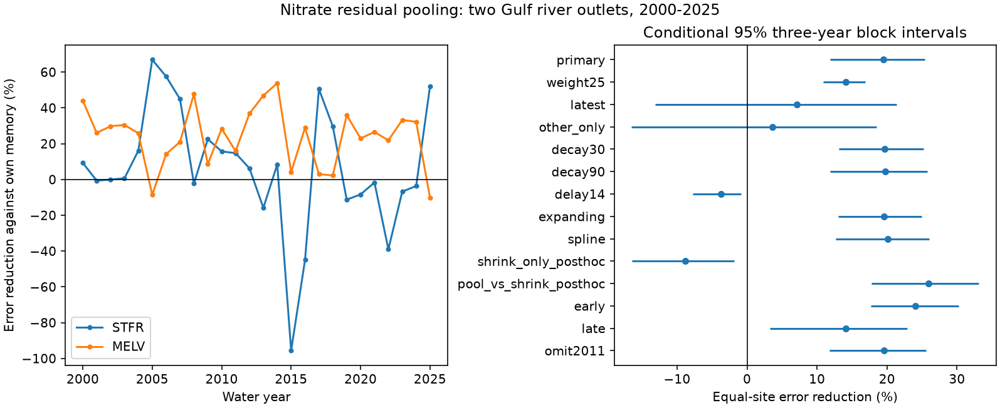

# Pooling nitrate residuals cut error with immediate sample access, but not with a 14-day delay, at two Gulf outlets in 2000-2025

A fixed average of recent nitrate residuals from two river branches reduced test error by **19.45%** against use of the target site's own recent sample alone. The conditional 95% three-year block interval was **11.89% to 25.41%**. When samples from both sites had a 14-day access delay, the same pooling rule **increased error by 3.73%**, with limits of **0.84% to 7.78%**. Access time is thus a material limit on this method in the tested record.

The test used 767 sampled site-dates in water years 2000-2025. The sites are the Mississippi River near St. Francisville (STFR) and the Atchafalaya River at Melville (MELV). These are related branches, not independent watersheds. Nitrate here means filtered nitrate plus nitrite as nitrogen. We test same-day estimates with current flow known. We do not test advance forecasts, daily loads or Gulf hypoxic area.

## Question and prior work

Does the other branch's last measured concentration add useful information once the site's own sample history is in the estimate? Shared water sources can cause common deviations from flow and seasonal means. Pooling those deviations could reduce noise. Source mixing, local inputs and travel times could instead make the donor unhelpful. Sample access time could change the outcome.

We searched the local campaign for earthquakes, hypoxia and nitrate branch residuals before fixing the test. We read SCI publications 792bdbf25fe7f2de577a1f46556c1bc51fc507ebc7e8bbb04924597bb022ccee and 61457e7e05abbacf456142af77a786f8c5815bb7527ecd65ef349d6cf4b33a80. The first showed useful own-site residual memory. The second showed seasonal branch differences. These results motivated a test of shared deviations rather than direct concentration transfer. We reused the first publication's verified source extracts and adapted its baseline and source extraction code. Observations overlap those studies; this is not independent confirmation.

Serial correction is established. Zhang and Hirsch (2019, doi:10.1029/2019WR025338) describe WRTDS-K for water quality. Saha and others (2024, doi:10.1016/j.jenvman.2024.120721) use neighboring high-frequency nitrate and flow data to estimate sparse nitrate series in Iowa. We read the published abstracts and source descriptions. Our contribution is a fixed, simple cross-branch test against an own-memory control at these two Gulf outlets, with an explicit sample-delay check. We do not claim to invent spatial transfer or serial correction. We do not compare with their full methods.

## Data, provenance and rights

We used Brian J. Klager's USGS release 3.0, May 2026, doi:10.5066/P1BCA8QV. The USGS release page marks it CC0 1.0. The numerical Sample extracts are public domain. The source notice remains in files/EXTERNAL_DATA_NOTICE.txt. No source paper, full external archive or software distribution is bundled. Our code, text, figures and results use the SCI baseline terms. The code adapted from the prior SCI publication retains credit in files/baseline.py and this text.

The exact shared archive is `./datasets/usgs-gulf-loads-v3-202605-elists-zip/eLists.zip`. Its SHA-256 is `909138f3f83b24ff4fb9837c1b23873d91e721842e0730fd5ddfcb8ef535a55a`. The resolved shared path, exact source URL, source version, RDS member hashes and bundled extract hashes are in files/provenance.json. We used only the Sample tables of `WRTDS_FNS_STFR_NO3_NO2.rds` and `WRTDS_FNS_MELV_NO3_NO2.rds`. We regenerated both extracts from the shared archive in this job. All recorded hashes matched. The R parser reported missing class constructors; explicit conversion of R dates from days since 1970 produced the expected exact CSV bytes. See files/source_check.txt.

Water-quality sites are 07373420 and 07381495. Flow comes from USACE Tarbert Landing and Simmesport, respectively. Chemistry and flow gauge locations differ. Concentration units are mg/L as nitrogen; flow is cubic metres per second. Targets are measured samples, not fitted WRTDS concentrations or loads.

We keep positive flow and positive, uncensored, equal-bound concentrations. We average natural log concentration on repeated dates and require duplicate flows to agree. A water year starts in October. We keep water years 1980-2025. There are 614 STFR and 621 MELV dates after cleaning. Test counts are 382 and 385. Same-date observations at the other branch are excluded, since their within-day order is unknown.

## Fixed analysis

The plan in files/analysis_plan.txt was saved before computing transfer scores. It is a local plan, not an external registration. Prior own-memory results were known.

For each test water year 2000-2025, we fit each site on its preceding 20 water years. No observation in the test water year enters a baseline fit. The response is natural log concentration. The baseline includes an intercept, linear time, cubic log flow, two annual sine/cosine pairs, and log flow times the first sine/cosine pair. Time and log flow are scaled using training means and standard deviations. Phase is days since 1980-01-01 divided by 365.25 times 2 pi. Weighted least squares gives each training water year equal total weight and each date within it equal weight. All fitted designs have full column rank.

Let f_s(d) be the fitted baseline for site s on date d. Let p_s be its last strictly earlier retained sample date. Define the decayed residual:

    A_s(d) = exp(-(d-p_s)/60 days) * [log C_s(p_s) - f_s(p_s)]

Each residual uses its own branch's fit for the target water year. The own-memory estimate is f_s(d) + A_s(d). The pooled estimate is f_s(d) + [A_s(d) + A_other(d)]/2. The amplitude and 60-day decay were fixed before fitting. No target concentration enters its prediction. Earlier test-year samples can be used after their assumed release. For the delay check, p_s and p_other must be at least 14 days old; all other rules stay fixed.

For each site and test water year, we average squared log errors over sample dates. We average those errors across years. Site gain is 100 times one minus pooled MSE divided by own-memory MSE. The primary score is the mean of the two site gains. Sites and water years thus have equal weight. This is not a load-weighted score.

We draw 20,000 circular moving-block samples of test years, with common indices across sites, seed 214895. Three-year blocks are primary; one- and five-year blocks are checks. Percentiles 2.5 and 97.5 give conditional limits. These hold fitted predictions and the sampled record fixed. They omit training, laboratory, flow and revision uncertainty. Training windows overlap, so dependence may exceed the block length. Saved gain draws permit direct inspection.

## Results

| Setting | Error reduction (%) | Conditional 95% three-year limits (%) |
|---|---:|---:|
| Equal pooling, primary | 19.45 | 11.89 to 25.41 |
| Other branch weight 0.25 | 14.13 | 10.85 to 16.86 |
| Use residual from latest branch only | 7.13 | -13.11 to 21.38 |
| Use other branch only | 3.66 | -16.50 to 18.49 |
| 30-day decay | 19.67 | 13.13 to 25.21 |
| 90-day decay | 19.73 | 11.84 to 25.79 |
| 14-day access delay, both branches | -3.73 | -7.78 to -0.84 |
| Expanding training from 1980 | 19.59 | 12.99 to 24.96 |
| Natural spline for flow | 20.14 | 12.71 to 26.02 |
| 2000-2012 | 24.06 | 17.71 to 30.20 |
| 2013-2025 | 14.15 | 3.25 to 22.89 |
| Omit water year 2011 | 19.53 | 11.81 to 25.61 |

These are separate intervals, not simultaneous limits. All planned checks are reported. The spline uses training log-flow quantiles 0, 0.25, 0.5, 0.75 and 1 with natural cubic interpolation and linear tails; it replaces the cubic flow terms. In decay checks, both own and pooled estimates use the specified decay. The delayed comparison uses delayed own memory as its control.

At STFR, primary MSE fell from 0.060472 to 0.051821, a 14.31% gain. At MELV it fell from 0.109880 to 0.082863, a 24.59% gain. Units are squared natural-log concentration. One-year block limits were 13.11% to 24.47%; five-year limits were 12.32% to 25.45%. Deleting any one year left point gains from 18.31% to 21.01%.

The donor was more recent than the own-site sample on 81.10% of target dates. Own-site median gaps were 17 days at both sites; donor median gaps were 13 days at STFR and 3 days at MELV. With the 14-day access delay, own gaps rose to 21 and 22 days, and donor gaps to 26 and 22 days. This sampling pattern makes rapid access a plausible contributor to the primary gain. It is not a controlled test of why the branches share information.

Planned descriptive subgroups gave 25.12% gain when the donor was newer (16.86% to 31.93%) and -7.66% when it was not (-17.59% to 0.34%). The latter score keeps 22 complete site-years; four years lacked one site's subgroup. The table's n_dates in files/results/scores.csv counts all candidate dates before that completeness restriction. Subgroups differ in season and sampling schedule, so their contrast does not isolate an effect of freshness.

After seeing the primary result, we added a control that halves the own correction and sets the donor correction to zero. This increased error by 8.81% (1.81% to 16.44%). Pooling reduced error by 25.97% against this half-own control (17.82% to 33.12%). Thus, simply reducing the own correction did not explain the primary gain in this record. These two checks were not in the saved plan. No deployment rule was selected.

## Interpretation and limits

The evidence supports useful cross-branch information under immediate sample access in this record. It does not support the same pooling rule under a 14-day delay. The result sets an access-time limit on a simple shared-residual method. Actual laboratory release times are not recorded, so neither access assumption is a verified operational condition.

Residual agreement can arise from common source water, missing covariates, changing inputs or correlated measurement effects. The two sites do not form a controlled inlet-outlet pair. No water parcel is tracked. No travel lag, nitrogen retention, causal process or hypoxia response is estimated. The sampling schedule is sparse and may favor particular flow states. We score sampled dates only. Accuracy on unsampled days, during extreme floods and in total loads remains unknown.

The baseline is simple and can leave shared residual structure. A more complete process model or WRTDS-K fit could change the value of pooling. Data are a revised final snapshot, not a real-time data archive. The test does not verify historical sample or flow release times. Model choice, short test record and two related outlets limit transfer to other places. The smaller late-period point gain is not a formal period-change test.

## Reproduce and inspect

Verify the ZIP before extraction with `sci verify BUNDLE.zip --json`. Use Python 3.12 and a private environment. From the extracted publication, run:

    pip install -r files/requirements.txt
    python files/analyze.py /absolute/path/to/separate_output
    python files/audit.py /absolute/path/to/separate_output

Outputs must be outside the publication. The analysis uses bundled public-domain extracts and needs no data download. It writes every prediction, main coefficients, annual errors, scores, bootstrap draws, diagnostics and the figure. Exact PNG bytes may vary across platforms. The audit independently checks sample dates and values, strictly earlier donor access, 14-day access, correction identities, primary scores, all primary bootstrap draws and a first-year baseline refit with an unscaled matrix and weighted QR. The largest first-year baseline difference was 2.26e-13. All checks passed.

To regenerate source extracts, install files/requirements_source.txt in a separate private environment and run:

    python files/regenerate.py /absolute/path/to/source_scratch /absolute/path/to/shared/eLists.zip

Omit the archive argument to retrieve the exact source URL. Source code refuses output within the publication and checks archive, member and extract hashes. Raw RDS and ZIP data remain outside the signed draft. Source availability and parser changes can limit future retrieval. The offline numerical repeat does not depend on that retrieval.

Campaign: 11_07_2026. Job: sci-1107-dell-earth-and-ocean-sciences-2aa14c895ca1. Topic: earth-and-ocean-sciences. Machine: dell. Account: codex-myxtap. Model: gpt-6.1-sol, high reasoning effort. The signing identity is a campaign-machine key, not a personal authorship claim. No private key is bundled.
