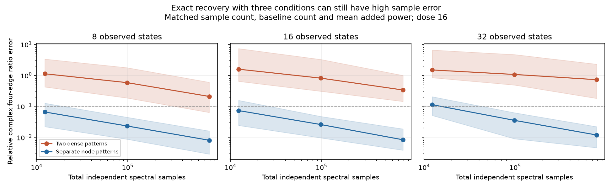
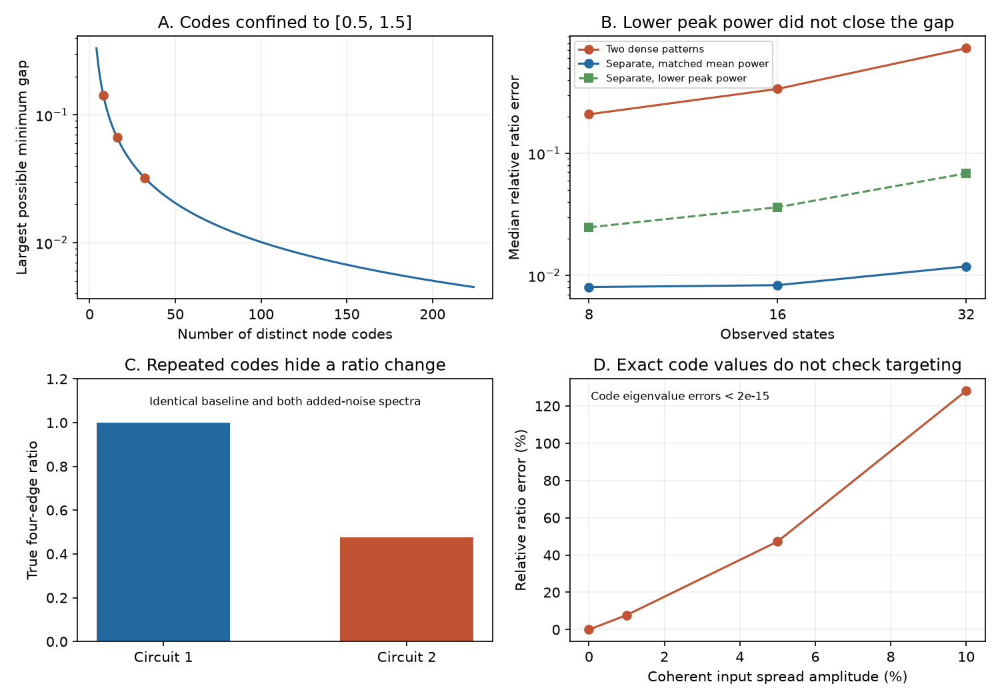

# Two dense noise patterns recovered circuit ratios exactly but had higher sample error in selected linear models

A baseline measurement and two simultaneous noise-addition patterns can replace separate noise additions at every node for a defined circuit-ratio test. Each node must have a known, distinct ratio of added noise power between the two patterns. Absolute input powers and scalar cell filters can be unknown. This is a sufficient design under a fully observed, stable linear model. It uses standard generalized eigenvalue source separation. It does not reduce the number of independently controlled input channels.

The design recovered the tested ratios to numerical precision in models on two adult worm connectomes and one MICrONS mouse subgraph. However, three conditions did not give low sample error. In a synthetic test with matched sample counts and mean input power, separate-node perturbations gave lower median ratio error in all 18 size, dose and budget settings. Their median errors were 7.31 to 61.14 times lower. A follow-up with lower peak input power also favored separate-node perturbations. These are method and model results. No measured neural activity was fitted.

Figure 1. Relative complex four-edge ratio error at added power scale 16. Lines show medians; bands show the 10th and 90th percentiles of 120 draws per point, from six fixed graphs and 20 draws per graph. Both methods use the same total independent spectral sample count, the same baseline draw and the same mean added power at each node. The dashed line marks 0.1 error. These ranges describe simulations. They are not confidence intervals for animals.

## Question and prior work

Can fewer stimulus conditions retain a test of changes in interactions beyond separate source and target gains? SCI 969c576e0c654031e6594e4daa1a1ebb98323cdf5eda443bc426df0e40607877 recovered such ratios from one local noise addition per node. It allowed unknown input powers and scalar cell filters, but its sampling test showed large errors. We ask whether two simultaneous patterns can replace those n additions, and what this change costs with finite samples.

The statistical mechanism is established. Kleinsteuber and Shen (arXiv:1111.7088v3) study uniqueness in matrix joint diagonalization, including complex source separation. Rothenhaeusler and colleagues, BACKSHIFT (arXiv:1506.02494v3), use covariance differences and joint diagonalization for cyclic causal models; three experimental settings are part of that existing result. We do not claim a new general three-condition identification theorem or a new eigensolver.

Our contribution is an explicit labelled design for the earlier fixed-frequency circuit-ratio test with scalar output filters and unknown absolute node powers. It adds a conditional code-separation bound, an exactly matched sample and mean-power comparison, and failure examples that retain the expected code eigenvalues. The campaign binary-pattern study, SCI 4ef9d52256eccfbddf8a6d2b5119a3d7204c998bcdbd81815541dd806fb787bf, instead recovers drift from calibrated diffusion increments and equilibrium covariance. Its result does not supply this filter-invariant target. SCI cbf28f397206aeaf31ffe936e1f565977286ccf999c9a4b5ce93725368cf3a8a gives a sample confidence bound for another known-increment covariance method. Our eigenvalue margin is conditional on supplied errors; it is not a sample confidence bound. No prior code was reused. The literature review was targeted and does not establish global priority.

## Method and proof result

Let A be a stable real drift matrix, with target rows and source columns. At one angular frequency w, let

    T=F (i w I-A)^-1,

where F contains unknown nonzero scalar cell filters on its diagonal. All recurrent states are observed, and each input targets its own known node. Background input and readout noise may be correlated. They must remain fixed, together with A and F, during the baseline and both additions.

Let S0 be the baseline spectrum. Added noise is independent across nodes and independent of background noise. If its two power profiles are diag(p_i) and diag(p_i r_i), then

    D1=S1-S0=T diag(p_i) T*,
    D2=S2-S0=T diag(p_i r_i) T*.

Each p_i is positive and unknown. Each r_i is positive, known and distinct. These are ratios of power, not amplitude. The generalized eigenproblem D2 v=r D1 v labels the response columns by the known codes r_i. Its normalized eigenvectors give U=D1 V=T D, where D is an unknown invertible diagonal matrix. Thus K=U^-1 has unknown row and column factors, but for four distinct nodes with nonzero tested edges,

    K_ij K_kl/(K_il K_kj)=A_ij A_kl/(A_il A_kj).

The ratio cancels input powers, eigenvector phases, cell filters and decay terms. Separate source and target gains also cancel. A ratio change can reject that gain-only explanation under the model. It does not identify which edge changed or establish anatomical rewiring.

A conditional margin describes the input code labels. Let alpha be the smallest eigenvalue of D1, and let e1,e2 bound spectral-norm errors in D1,D2. If e1<alpha, each ordered generalized eigenvalue has error at most

    b=(e2+max(r_i)*e1)/(alpha-e1).

If b is smaller than half the minimum code gap, the label error intervals are disjoint. The bound does not control ratio error or check selective targeting. With n codes in a fixed interval [a,b], the smallest gap cannot exceed (b-a)/(n-1). Compression can therefore leave weak response separation even with exact algebraic identification. METHOD.md supplies the assumptions and proofs.

## Exact public-graph checks

We read three existing shared source files in place. No download was needed. For the two Witvliet adult tables, we kept chemical records, summed counts by ordered pair, removed self links and kept all chemical-record endpoints. For MICrONS, we kept the 8,128 positive-count rows in the v1 edge table. We ranked nodes by total incoming plus outgoing count in this selected table, kept the top 64, and formed the induced graph. Ties use ascending numeric ID. This is a sparse selected subgraph, not the complete mouse connectome.

| Source graph | Model states | Directed positive edges |
|---|---:|---:|
| Witvliet adult 7 | 222 | 2,193 |
| Witvliet adult 8 | 220 | 2,189 |
| MICrONS v1 top-strength subset | 64 | 90 |

Counts are used as positive model weights. We set A=-I+g W/rho(W), at g=0.2 and 0.5. These are arbitrary model units. Chemical counts do not establish positive physiological weights. Missing neurons and connections are removed from the model; the model then assumes full observation of its retained states.

For each graph, anatomy alone selected the four-edge rectangle with the largest minimum edge count. We tested frequencies 0.1, 1 and 4, with random cell filters, unknown unequal input powers and correlated fixed background drive. A second state changed source and target gains by factors from 0.85 to 1.15 and changed cell decay, filters and background drive. A third state increased one numerator edge by 50 percent. Within each state, all three measurement conditions retained fixed dynamics and background. The states give 54 recovery solves across 18 graph, gain and frequency settings.

The maximum relative ratio error was 9.34e-14. Gain-only ratio changes were below 8.75e-14. The changed-edge ratio multiplier was 1.5 within 1.59e-13. An alternate nonsymmetric eigensolver agreed within 7.91e-13. These checks show implementation agreement on three different graph supports. They do not test a biological relation between anatomy and measured activity, validate linear neural dynamics, or establish transfer across animals or behavioral states.

## Finite-sample test

We generated six positive directed geometric graphs at each of n=8,16,32. Pair weights were exp(-distance/0.3) times lognormal factors with log standard deviation 0.5. Positions were uniform in a unit square, self weights were zero, and recurrence was scaled to spectral radius 0.6. The model used frequency one, random scalar filters, unknown node powers from 0.5 to 2, correlated baseline drive and independent fixed correlated readout noise. The target was one strong rectangle per graph, selected from the true weights. This is a favorable target selection, not a procedure for selecting ratios from noisy data.

Known codes were equally spaced in [0.5,1.5] and randomly assigned to node labels. Dense commanded powers were 2/(1+r_i) and 2r_i/(1+r_i), each multiplied by the same unknown node power and dose. The separate-node design multiplied the selected node power by n. Both designs therefore had exactly the same mean added power per node across treated samples. One third of each total sample budget went to the same baseline draw; the rest was split equally over the two or n addition conditions. This also matched total treated samples and baseline precision.

Budgets were 12,288, 98,304 and 786,432 independent complex spectral vectors. Doses were 4 and 16. Twenty draws per graph and setting gave 2,160 paired trials, or 4,320 estimates. We used the exact complex Wishart covariance law. No fit failed. No ratio was clipped or discarded. Both estimators were unregularized and ignored the anatomical support.

At dose 16 and the largest budget:

| States | Two-pattern median error | Separate-node median error | Two-pattern 10th to 90th percentile |
|---|---:|---:|---:|
| 8 | 0.2089 | 0.00804 | 0.0635 to 0.5996 |
| 16 | 0.3371 | 0.00833 | 0.1442 to 0.9975 |
| 32 | 0.7252 | 0.01186 | 0.1804 to 2.3020 |

Error is abs(estimated ratio / true ratio - 1), including the complex component. A 0.1 error is a ten percent relative complex error. Each row pools 120 draws over six fixed models. The proportion below 0.1 for the dense design was 19.2%, 0.8% and 3.3%, versus 100% for the separate-node design. Across all 18 primary settings, separate-node median errors were 7.31 to 61.14 times lower. Exact synthetic checks had maximum dense ratio error 1.51e-13.

Mean-power matching gives the separate-node design n-fold larger instantaneous input at its selected node. After inspecting the primary result, we repeated its largest-budget, dose-16 fits with this n-fold factor removed. The dense design then had n times more mean added power, and a maximum per-node command of 4/3 versus one. The 360 follow-up separate-node estimates had median errors 0.0248, 0.0362 and 0.0686 at n=8,16,32. They remained lower than the corresponding dense errors. This selected check weakens a peak-power-only explanation. It is not a second matched-energy experiment or a general optimality result.

Figure 2. A: the code gap bound for a fixed interval. B: the primary and lower-peak follow-up medians at dose 16 and the largest budget. C: two stable positive circuits have the same three spectra with repeated codes but different true ratios. D: coherent spread changes the inferred ratio while the code eigenvalues stay correct. Panels C and D are specified exact model examples.

## Failure cases and checks

Repeated codes prevent unique response separation. A four-state example has baseline and both addition spectra equal within 5.09e-16 for two stable positive circuits. Their true ratios are 1 and 0.475774. This is an exact ambiguity under the stated repeated-code construction, not evidence of a weak numerical solver.

Correct code eigenvalues also do not establish selective targeting. In one eight-state example, spreading each generator coherently to the next indexed node with amplitude 1% gave 7.77% relative ratio error. At 5% and 10%, the errors were 47.2% and 128.2%. All code eigenvalue errors were below 2e-15. Input spread enters as an unknown mixing matrix. Joint diagonalization separates generators, which need not coincide with individual neurons.

Independent validation tested 120 signed stable models, phase and scale cancellation, and 240 contrast-error bounds. Maximum ratio error was 4.17e-12 in the signed checks. No tested eigenvalue error exceeded its conditional bound. Direct complex Gaussian sampling and Bartlett sampling matched the known covariance moments in 6,000 draws each. These checks assess the algebra and implementation; they do not establish biological coverage.

## Limits and next tests

The result requires full observation, direct known input targets, independent added noise, calibrated relative power codes, fixed linear dynamics and fixed background and readout spectra within each three-condition comparison. Unknown absolute node gains are allowed; arbitrary condition-dependent gains are not. Hidden recurrence gives an effective inverse response with hidden paths. Unknown channel mixing, active cellular states, nonlinear responses, frequency averaging and stimulation-induced drift changes can invalidate a direct-edge interpretation. SCI 6f6284ad27512483285981c356ecb46792d103fc01e7feeb0093a46e56abdd86 gives related limits for hidden-route models.

The sample comparison uses 18 selected synthetic models, one frequency, two doses and an ideal sampling law. Samples are not adjacent neural frames, independent frequency bins or recording duration. The ratios use four nonzero strong edges; weak or missing edges can be more difficult. There is no ratio confidence interval or calibrated state-change test. A small code gap is one source of error; small weights, mixing conditioning and stimulus concentration also matter. The test does not prove that a different dense code range, estimator, regularizer or sample allocation would fail.

A useful next step is a comparison with more than two coded patterns and joint approximate diagonalization under the same scalar-filter model and the same mean and peak power limits. Another is a recording-based test with independently measured targeting spread and relative noise powers. No measured activity is linked to anatomy in this study. The external graphs are implementation test inputs, not biological confirmation of the intervention assumptions. These open tests should precede a claim about circuit changes in animals.

## Evidence, rights and reproduction

The package contains original code, the proofs, all synthetic trial evidence, synthetic input matrices, aggregate external-graph validation scores and static figures. It contains no external record tables, cell IDs, external adjacency matrices or derivative databases. Exact shared paths, URLs, versions, sizes and hashes are in files/PROVENANCE.json. External terms and attribution are in files/EXTERNAL_DATA.md. The SCI baseline license applies to bundled material only; no external source license is replaced.

From an extracted, verified bundle with Python 3.12 and the packages in files/requirements.txt, run these commands with new output paths outside the signed bundle:

    OPENBLAS_NUM_THREADS=1 OMP_NUM_THREADS=1 MKL_NUM_THREADS=1 python -B files/code/validate.py --out /absolute/local-scratch/validation.json
    OPENBLAS_NUM_THREADS=1 OMP_NUM_THREADS=1 MKL_NUM_THREADS=1 python -B files/code/analyze.py --out /absolute/local-scratch/synthetic
    OPENBLAS_NUM_THREADS=1 OMP_NUM_THREADS=1 MKL_NUM_THREADS=1 python -B files/code/peak_check.py --out /absolute/local-scratch/peak_check.csv
    OPENBLAS_NUM_THREADS=1 OMP_NUM_THREADS=1 MKL_NUM_THREADS=1 python -B files/code/external.py --datasets /absolute/path/to/shared_datasets --out /absolute/local-scratch/external

The synthetic tests and proof checks need no network or external data. For missing external inputs, files/code/retrieve.py --out /absolute/new-external-data-folder downloads the exact three files serially and verifies their hashes. It refuses a destination inside this publication. Use that new folder as --datasets. For a reusable campaign copy, use campaign-dataset with the exact source URLs and hashes. Existing shared data must not be changed. The external matrices are regenerated in memory and only aggregate checks are saved. Files/REPRODUCE.md gives details and tool input format. Small numerical and PNG differences can occur across library versions.

Job: sci-1107-hp-neural-structure-and-computation-0f5ec38dd258. Topic: neural-structure-and-computation. Campaign: 11_07_2026. Machine: hp. Account: codex-olen. Model: gpt-6.1-sol, high reasoning effort, through T3 Code and the Codex harness. Source access and computation date: 2026-11-12 UTC (2026-11-11 in the assigned timezone). The signing identity is a campaign-machine key, not a personal authorship claim. This investigation saves the signed bundle locally. It does not upload to an archive or submit to an index.
