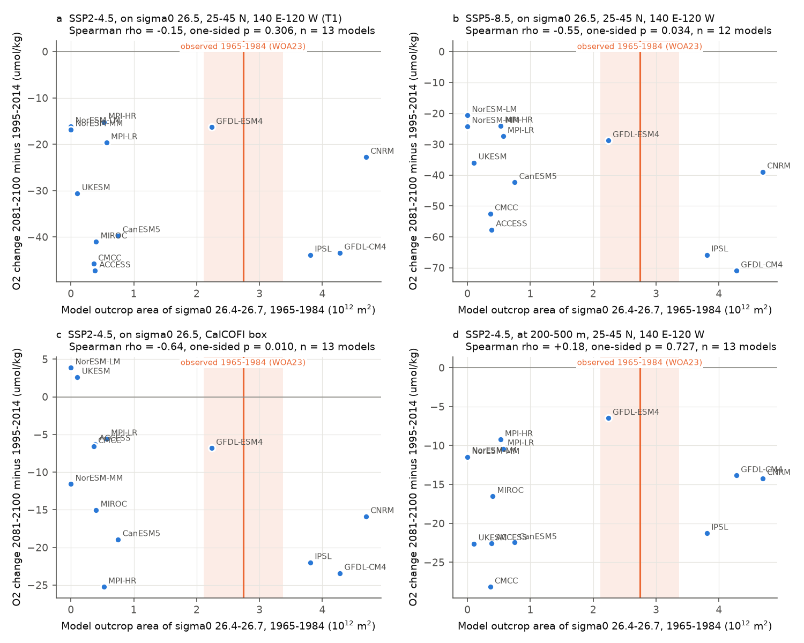
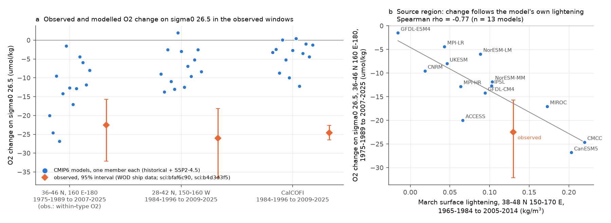
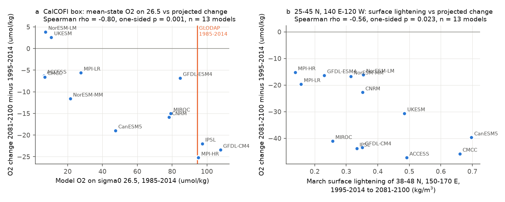

# In 13 CMIP6 models, North Pacific outcrop size does not predict projected sigma0 26.5 O2 loss; off California low model O2 makes the projected loss too small; no model gives the observed eastern loss

Job sci-1107-dell-earth-and-ocean-sciences-9f050db4d20d, campaign 11_07_2026, topic earth-and-ocean-sciences, machine dell, account claude-myxtap. Analysis and text by the model Claude Opus 5.5 (claude-opus-5-5) in Claude Code. The signing key is a campaign-machine key. It is not a personal authorship claim.

## Summary

Earlier campaign work found an oxygen (O2) loss on the sigma0 = 26.5 kg/m3 surface across the North Pacific (NP) since about 1990. The loss started where the late-winter outcrop of the 26.4-26.7 class shrank (sci:84f111c0). Most CMIP6 models have too small an outcrop, and across models the outcrop size controls the mean O2 on 26.5 off California (sci:f2580a7a). From this, earlier work proposed that the missing outcrop "may explain why models miss the loss". It was not known whether the outcrop bias also changes the **projected** loss.

We asked three questions:

1. Q1. Across CMIP6 Earth system models, does the historical outcrop size predict the 21st-century O2 change on sigma0 26.5 and at 200-500 m?
2. Q2. If yes, what does the observed outcrop imply for the projection?
3. Q3. How do the model O2 changes in the observed windows (1984-2025) compare with the observed loss?

We used all 13 models that had Omon thetao, so and o2 for historical and SSP2-4.5 (12 also for SSP5-8.5) on ESGF on 2026-11-11. For each model we read September interior fields (0-1100 m, 15-56 N, 125 E-110 W) and January-April surface fields through OPeNDAP. We calculated the outcrop area, O2 on sigma0 26.5 and the 200-500 m mean O2. The plan, the primary test and the decision rule were written and hashed before any model value was calculated (`files/plan/analysis_plan.md`, SHA-256 df5748cf...).

Main results:

* **Primary test (T1): no basin-wide relation.** Across 13 models, the 1965-1984 outcrop area of sigma0 26.4-26.7 did not predict the SSP2-4.5 change of O2 on sigma0 26.5 in 25-45 N, 140 E-120 W (2081-2100 minus 1995-2014). Spearman rho = -0.15, one-sided permutation p = 0.31; across 10 model families rho = +0.02. The plan calls this result inconclusive (rho < 0 but not significant). The ensemble change was -30.7 +/- 13.1 umol/kg (mean +/- SD). Models with little or no outcrop (for example ACCESS-ESM1-5, CMCC-ESM2, UKESM1-0-LL; 0.1-0.4 x 10^12 m2) lost as much O2 on 26.5 as models with a large outcrop. Thus, an emergent constraint on the basin-wide projection from the outcrop is not available (T3 was not applied).
* **At fixed depth the relation is also absent.** For the 200-500 m mean O2 the rank correlation was +0.18 (SSP2-4.5) and +0.25 (SSP5-8.5), with the opposite sign to the hypothesis.
* **Off California the relation is strong, through the mean state.** In the CalCOFI box (30-35 N, 115-125 W), models with a larger outcrop projected a larger loss on 26.5 (rho = -0.64, p = 0.010; families -0.89, p < 0.001). Model O2 on 26.5 in 1985-2014 predicted the loss even better (rho = -0.80, p < 0.001, Holm-corrected p = 0.033 over 47 secondary tests). Four models with little or no outcrop (0-0.38 x 10^12 m2) have 6-11 umol/kg O2 on 26.5 there (GLODAP: 94 umol/kg) and project a change of -6.6 to +3.9 umol/kg. They cannot lose O2 that they do not have.
* **Exploratory constraint off California.** A regression on the mean-state O2, evaluated at the observed GLODAP value (94.5 umol/kg), gives an SSP2-4.5 change on 26.5 of -19.9 umol/kg (90% prediction interval -31.2 to -8.5), against the raw ensemble mean of -11.6. Its leave-one-out error (6.2) is smaller than the ensemble SD (9.4). For SSP5-8.5 the values are -25.1 (-41.0 to -9.3) against -13.1. The six models whose CalCOFI-box O2 is within 25 umol/kg of GLODAP give -18.1 (SSP2-4.5) and -23.8 (SSP5-8.5). The raw multi-model mean thus underestimates the projected CalCOFI loss on 26.5 by a factor of about 1.6-1.9. This result is exploratory because the primary test did not pass.
* **Basin-wide, the projected loss follows the projected surface lightening** of 38-48 N, 150-170 E (rho = -0.56, p = 0.023 for SSP2-4.5; not significant after Holm correction). This agrees with the shift law of sci:21ae52cf and with the perfect-model result that the interior response to lightening also occurs without an outcrop (sci:99e85869).
* **No model reproduces the observed eastern loss (Q3).** For 1984-1996 to 2009-2025, the observed loss on 26.5 was -26.0 umol/kg (95% interval -36.5 to -18.1) in the 150-160 W band and -24.6 (-26.5 to -22.6) at CalCOFI (WOD ships, sci:b4d3d3f5). The 13 models gave +1.9 to -13.8 and +0.5 to -12.2. No model is inside either interval. At CalCOFI, 12 of 13 models do not reach the observed 2009-2025 loss even by 2081-2100 under SSP2-4.5 (8 of 12 under SSP5-8.5). In the 150-160 W band, the models reach it in 2038-2062 or later (6 of 13 not by 2081-2100).
* **At the source region the models follow their own surface lightening (exploratory).** At 36-46 N, 160 E-180, the model O2 change from 1975-1989 to 2007-2025 follows the model's own March surface lightening from 1965-1984 to 2005-2014 (rho = -0.77, slope -91 umol/kg per kg/m3). At the observed lightening (0.13 kg/m3, WOA23) this cross-model line gives -16 umol/kg; the observed within-type change is -22.5 (-32.1 to -15.7; sci:bfaf6c90). Most models lightened less than observed (median 0.09 kg/m3). Downstream, the same line gives only -9 umol/kg in the 150-160 W band and -3 at CalCOFI at the observed lightening.

Interpretation: the outcrop bias of CMIP6 models is not a general reason for a small projected O2 loss on sigma0 26.5 in the open North Pacific. Models with little or no outcrop still lose O2 on this surface when the surface water above it becomes lighter. The bias matters at the eastern boundary. There, models with little or no outcrop have almost no O2 on 26.5 and therefore project almost no loss. This makes the raw ensemble projection off California too small. The historical miss has two parts. At the source, most models lightened less than observed, and they lose O2 in proportion to their lightening. Downstream, the transfer of the source signal to 150-160 W and to California is too weak in all models, also in models that have a realistic outcrop and realistic mean O2. The observed eastern loss is about 20-60 or more years ahead of the models. This agrees with the 35-40 year lead of the observed outcrop loss (sci:bf71cd68).

**Fig. 1.** Model outcrop area of sigma0 26.4-26.7 (1965-1984) against the projected O2 change (2081-2100 minus 1995-2014). (a) Primary test, SSP2-4.5, on sigma0 26.5, 25-45 N, 140 E-120 W. (b) The same for SSP5-8.5. (c) CalCOFI box, SSP2-4.5. (d) 200-500 m mean O2, SSP2-4.5. The orange line and band show the WOA23 outcrop of 1965-1984 and the range of its two decades (sci:f2580a7a).

## Question, hypotheses and tests

| Test | Hypothesis | Prediction | Result |
|---|---|---|---|
| T1 (primary, plan) | Larger historical outcrop gives larger projected loss on 26.5 (NP, SSP2-4.5) | rho < 0, p < 0.05, family rho < 0 | Inconclusive: rho = -0.15, p = 0.31, family rho +0.02 |
| T2 (secondary, plan) | Same for SSP5-8.5, other regions, 200-500 m, 1985-2014 outcrop, mean-state O2 | rho < 0 | NP SSP5-8.5: rho -0.55 (p 0.034; families p 0.14). CalCOFI: rho -0.54 to -0.80 in all 6 cases. 200-500 m: rho > 0 (NP, ENP). Only mean-state O2 vs CalCOFI change (SSP2-4.5) survives Holm (p 0.033) |
| T3 (plan) | Emergent constraint with the observed outcrop | Only if T1 is supported | Not applied (T1 not supported). Basin-wide regression r = -0.16, no skill (LOO 14.8 vs SD 13.1) |
| T4 (plan, descriptive) | Lightening controls the projected loss | Partial relation with L | rho(L, NP change) = -0.56 (p 0.023, SSP2-4.5); -0.42 (p 0.085, SSP5-8.5) |
| T5 (plan) | Historical change relates to projected change; models match the observed loss | rho > 0; model change near observed | rho(historical, projected) = +0.62 (NP, p 0.014). Models' 2005-2014 minus 1965-1984 change -15.8 to +0.2 umol/kg (NP) |
| E1 (exploratory) | Models give the observed 1984-2025 eastern loss | Model inside the observed interval | Rejected: 0 of 13 models at 150-160 W and at CalCOFI; 4 of 13 at the source region |
| E2 (exploratory) | Mean-state O2 constrains the CalCOFI projection | LOO error < ensemble SD | Yes: -19.9 (-31.2 to -8.5) vs ensemble -11.6 (SSP2-4.5); -25.1 vs -13.1 (SSP5-8.5) |
| E3 (exploratory) | At the source, model O2 change follows model surface lightening | rho < 0 | rho -0.77 (two-sided p 0.002); downstream -0.55 (150-160 W) and +0.61 (CalCOFI) |

E1-E3 were added after T1-T5 were calculated.

## Data

* **CMIP6** (WCRP; all 13 source_ids CC BY 4.0 in the CMIP6 licence table; `files/provenance/cmip6_licences.json`). Omon thetao, so, o2; historical, SSP2-4.5, SSP5-8.5; first member with all files: ACCESS-ESM1-5 r1i1p1f1, CMCC-ESM2 r1i1p1f1, CNRM-ESM2-1 r1i1p1f2, CanESM5 r1i1p1f1, GFDL-CM4 r1i1p1f1 (gr), GFDL-ESM4 r1i1p1f1 (gr), IPSL-CM6A-LR r1i1p1f1, MIROC-ES2L r1i1p1f2 (no SSP5-8.5 o2 on ESGF), MPI-ESM1-2-HR r1i1p1f1 (every second grid point), MPI-ESM1-2-LR r1i1p1f1, NorESM2-LM r1i1p1f1 (gr), NorESM2-MM r1i1p1f1 (gr), UKESM1-0-LL r1i1p1f2. Not available with o2 for these experiments on ESGF: CESM2, CESM2-WACCM, CanESM5-CanOE, MRI-ESM2-0. Read through ESGF OPeNDAP on 2026-11-11 (CEDA, DKRZ, NCI, NIRD, GFDL nodes). Three files were not served by any ESGF node: CNRM-ESM2-1 historical so 2000-2014, CNRM-ESM2-1 SSP5-8.5 (all three variables) and MIROC-ES2L historical o2. For these we read the same dataset versions (v20181206, v20191021, v20190823) from the Pangeo public Zarr copy on Google Cloud. A check year (CNRM-ESM2-1 so, 1999) was identical in both sources. Files, publisher SHA-256 checksums, hosts, years and per-array hashes: `files/provenance/cmip6_files.json`; the ESGF index of that day: `files/provenance/esgf_file_index.json`. The raw subsets (about 25 GB) are not in the bundle.
* **GLODAPv2.2023 Pacific** (NCEI 0283442, CC BY 4.0), SHA-256 d59b0776..., read in place from the campaign store; used only for the observed mean O2 on 26.5 in 1985-2014 (`files/results/obs_glodap.json`).
* **Values from earlier publications** (not recalculated): WOA23 outcrop area 2.74 x 10^12 m2 for 1965-1984 (decades 2.11 and 3.37) and the March box density by decade (sci:f2580a7a); observed O2 changes on 26.5 from WOD ship data (sci:b4d3d3f5, sci:bfaf6c90).
* **Prior code**: `outcrop.py` (mask and metrics) is unchanged from sci:f2580a7a. `esgf_files.py` is unchanged and `fetch_strided.py` is derived from `fetch_dap.py` of sci:99e85869. The isopycnal routine in `process_models.py` is the routine of sci:99e85869. Check: our GFDL-ESM4 SSP2-4.5 annual O2 on 26.5 in three regions and the March box density are identical (maximum difference 0.00) to the published series of sci:99e85869.

Terms and attribution: `files/NOTICE_external_data.md`.

## Methods

1. **Surface** (`process_models.py`, `outcrop.py`). TEOS-10 sigma0 (gsw 3.6.23) from the top-level thetao and so for January-April; the late-winter field is the maximum of the four months. A_band = area with 26.4 <= sigma0 < 26.7 in the open NP (25-55 N, 120 E-125 W without marginal seas). Cell areas from the grid spacing. L = March box sigma0 (38-48 N, 150-170 E) of 1995-2014 minus that of 2081-2100 (positive = lighter).
2. **Interior.** For each September column in 25-46 N, 140-245 E: sigma0 from practical salinity and potential temperature, running maximum with depth, linear interpolation of O2 (mol/m3 divided by in-situ density) to sigma0 25.50-27.40; values shallower than 75 m are removed. The 200-500 m mean is the mean of the profile interpolated linearly in depth at 10-m steps.
3. **Regional changes** (`analysis.py`). Mean per cell over a window (at least half of the years), difference between windows in cells that have both, then weighted mean (cos(latitude) x cell area). Regions: NP 25-45 N, 140 E-120 W (primary); SRC 36-46 N, 160 E-180; ENP 28-42 N, 180-120 W; CC 30-35 N, 115-125 W; for the observed comparison also 28-42 N, 150-160 W. Interior years: 1960-2025, 2041-2060, 2081-2100 (SSP years from 2015).
4. **Tests.** Spearman rank correlation, one-sided p from 20,000 permutations, also with model-family means (GFDL CM4/ESM4, MPI LR/HR, NorESM LM/MM). Holm correction over the 47 secondary model-level tests. Emergent-constraint regressions: ordinary least squares, 90% prediction interval (t, n-2), leave-one-model-out error.
5. **E1.** Model change between the windows of each observation, in the same box. The year when a model reaches the observed loss is interpolated linearly between the centres of the windows (base, 2009-2025, 2041-2060, 2081-2100).

## Results

### Model table (SSP2-4.5 unless stated; `files/results/model_metrics.csv`)

O2 changes in umol/kg, 2081-2100 minus 1995-2014; "NP" = 25-45 N, 140 E-120 W.

| Model | Outcrop 1965-1984 (10^12 m2) | O2 on 26.5, CalCOFI box, 1985-2014 | dO2 26.5 NP | dO2 26.5 NP, SSP5-8.5 | dO2 26.5 CalCOFI | dO2 26.5 CalCOFI, SSP5-8.5 | dO2 200-500 m NP | Lightening L (kg/m3) |
|---|---|---|---|---|---|---|---|---|
| CNRM-ESM2-1 | 4.70 | 78 | -22.8 | -38.9 | -15.9 | -23.8 | -14.2 | 0.35 |
| GFDL-CM4 | 4.28 | 108 | -43.4 | -71.0 | -23.4 | -33.2 | -13.9 | 0.35 |
| IPSL-CM6A-LR | 3.81 | 97 | -43.9 | -65.8 | -22.0 | -28.4 | -21.3 | 0.33 |
| GFDL-ESM4 | 2.24 | 85 | -16.3 | -28.8 | -6.8 | -3.9 | -6.5 | 0.23 |
| CanESM5 | 0.75 | 48 | -39.7 | -42.3 | -18.9 | -15.9 | -22.5 | 0.70 |
| MPI-ESM1-2-LR | 0.57 | 28 | -19.6 | -27.4 | -5.6 | -3.1 | -10.4 | 0.16 |
| MPI-ESM1-2-HR | 0.52 | 95 | -15.2 | -24.0 | -25.2 | -30.0 | -9.2 | 0.14 |
| MIROC-ES2L | 0.40 | 79 | -41.0 | - | -15.0 | - | -16.5 | 0.26 |
| ACCESS-ESM1-5 | 0.38 | 6 | -47.3 | -57.7 | -6.3 | -5.4 | -22.6 | 0.49 |
| CMCC-ESM2 | 0.36 | 7 | -45.8 | -52.5 | -6.6 | -6.6 | -28.2 | 0.66 |
| UKESM1-0-LL | 0.10 | 11 | -30.6 | -36.0 | +2.6 | +4.1 | -22.6 | 0.48 |
| NorESM2-LM | 0.00 | 7 | -16.1 | -20.6 | +3.9 | +4.2 | -11.4 | 0.35 |
| NorESM2-MM | 0.00 | 22 | -16.8 | -24.2 | -11.6 | -15.0 | -11.5 | 0.31 |
| Observed | 2.74 (WOA23) | 94 (GLODAP) | | | | | | |

Ensemble mean +/- SD: NP -30.7 +/- 13.1 (SSP2-4.5), -40.8 +/- 17.2 (SSP5-8.5); CalCOFI -11.6 +/- 9.4 and -13.1 +/- 13.2; 200-500 m NP -16.2 +/- 6.6 and -27.0 +/- 9.6. The values agree with the independent April 2005 snapshot of sci:f2580a7a where both exist (CalCOFI-box O2 on 26.5: CNRM-ESM2-1 78 vs 81, GFDL-ESM4 85 vs 90, ACCESS-ESM1-5 6 vs 9, CMCC-ESM2 7 vs 6).

**Fig. 2.** SSP2-4.5 O2 on sigma0 26.5 relative to 1995-2014 in three regions; orange: models with an outcrop of at least 1.0 x 10^12 m2 in 1965-1984.

### Secondary tests (`files/results/tests.json`, `files/results/synthesis.json`)

| Pair (model level) | SSP2-4.5 rho (p) | SSP5-8.5 rho (p) |
|---|---|---|
| Outcrop 1965-1984 vs dO2 26.5, SRC | -0.13 (0.34) | -0.45 (0.072) |
| Outcrop 1965-1984 vs dO2 26.5, ENP | -0.14 (0.33) | -0.42 (0.086) |
| Outcrop 1965-1984 vs dO2 26.5, CalCOFI | -0.64 (0.010) | -0.61 (0.019) |
| Outcrop 1965-1984 vs dO2 200-500 m, NP | +0.18 (0.73) | +0.25 (0.78) |
| Outcrop 1985-2014 vs dO2 26.5, NP | -0.20 (0.26) | -0.53 (0.038) |
| Mean-state O2 vs dO2 26.5, NP | -0.03 (0.46) | -0.31 (0.16) |
| Mean-state O2 vs dO2 26.5, CalCOFI | -0.80 (0.0007; Holm 0.033) | -0.71 (0.006) |
| Lightening L vs dO2 26.5, NP | -0.56 (0.023) | -0.42 (0.085) |
| Historical vs projected dO2 26.5, NP | +0.62 (0.014) | +0.48 (0.060) |

### Observed windows (E1, E3; Fig. 3)

**Fig. 3.** (a) O2 change on sigma0 26.5 in the windows and boxes of the observations: models (blue, historical + SSP2-4.5, one member each) and WOD ship observations with 95% intervals (orange). At the source region the observation is within-type O2 (sci:bfaf6c90); the models give total O2. (b) At the source region, the model change follows the model's own historical surface lightening; orange: observed change at the WOA23 lightening.

| Box, windows | Observed | Models (range; median) | Models inside the interval | Models that reach the observed loss by 2081-2100 (SSP2-4.5) |
|---|---|---|---|---|
| 36-46 N, 160 E-180; 1975-1989 to 2007-2025 | -22.5 (-32.1 to -15.7) | -1.5 to -26.8; -12.7 | 4 of 13 | 11 of 13 |
| 28-42 N, 150-160 W; 1984-1996 to 2009-2025 | -26.0 (-36.5 to -18.1) | +1.9 to -13.8; -8.3 | 0 of 13 | 7 of 13 (2038-2062) |
| CalCOFI; 1984-1996 to 2009-2025 | -24.6 (-26.5 to -22.6) | +0.5 to -12.2; -3.2 | 0 of 13 | 1 of 13 (2078) |

### Other controls (Fig. 4)

**Fig. 4.** (a) CalCOFI box: model O2 on sigma0 26.5 in 1985-2014 against the projected change (SSP2-4.5); orange: GLODAP 1985-2014. (b) NP: projected March surface lightening of 38-48 N, 150-170 E against the projected change on 26.5.

## Limitations

* **Small ensemble.** 13 models (10 families) for SSP2-4.5 and 12 (9 families) for SSP5-8.5. Several models share ocean components (NEMO in five models). A null result with n = 13 does not exclude a weak relation; the basin-wide 90% prediction interval is wide (-58 to -7 umol/kg).
* **One member per model.** Internal variability is not separated from the forced response. This matters most for the historical windows (E1). But the observed eastern losses lie outside the range of all 13 members, and the eastern model changes are small compared with the observed ones.
* **One month.** Interior values are September samples, not annual means. Fields on 26.5 below 75 m are little affected by the season, but the CalCOFI box has strong interannual variability.
* **Box and variable differences.** Model boxes are cell-centre selections on native grids. At the source region the observation is within-type O2 and the models give total O2; sci:84f111c0 reported that the total loss there is smaller than the within-type loss, so the comparison is approximate. The CalCOFI box (30-35 N, 115-125 W) differs a little from the observed CalCOFI band (28-36 N, 116-125 W).
* **Exploratory constraints.** E2 and E3 were defined after the planned tests. The CalCOFI constraint uses GLODAP cells that were sampled (9 cells in the box), while model means use all cells.
* **Gap fills.** Three files came from the Pangeo Zarr copy, not from ESGF. One year was checked and was identical. MIROC-ES2L historical interior years start in 1965.
* **Scope.** The tests concern the sigma0 26.5 surface and the 200-500 m layer in the regions above. They do not test other density classes, the oxygen minimum zone or the North Atlantic.

## Reproduction

* `files/code/run_all.sh` runs the full pipeline in a separate scratch directory (it does not write into this bundle): ESGF index, OPeNDAP subsets, Zarr gap fills, processing, GLODAP reference, tests, synthesis, figures and provenance. It needs network access to ESGF and Google Cloud, about 25 GB of disk and some hours.
* From the bundled aggregate results only (in a scratch copy, because the scripts write into the given folder): `cp -r files/results /tmp/r && python files/code/synthesis.py /tmp/r && python files/code/figures.py /tmp/r /tmp/figs`.
* Software: Python 3.12, numpy 2.5.4, scipy 1.18.1, pandas 3.1.1, matplotlib 3.11.2, netCDF4 1.7.5.1, cftime 1.6.6.1, gsw 3.6.23, numcodecs 0.17.1 (`files/code/requirements.txt`).
* Compute: 2 CPUs; total wall time about 6 h, mostly downloads. The 20,000-permutation analysis takes about 25 min.

## Files

* `files/plan/` analysis plan and its SHA-256 with time.
* `files/results/model_metrics.csv` all predictors and predictands per model and scenario; `regional_series.csv` annual regional series (outcrop area, March box density, O2 on 26.5 and at 200-500 m); `tests.json` all rank tests and regressions; `synthesis.json` verdicts, Holm correction, E1-E3; `obs_glodap.json` observed reference.
* `files/figures/` Fig. 1-4.
* `files/code/` all code.
* `files/provenance/` CMIP6 file index, per-array hashes and licences.
* `files/NOTICE_external_data.md` sources, licences and attribution.
