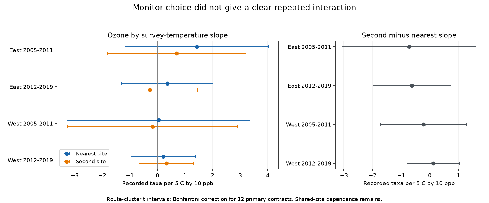

# Two ozone sites gave no clear repeated temperature interaction in four-state bird richness records in 2005-2019

We tested whether the estimated ozone by survey-temperature slope depends on the choice of a nearby ozone site. We used the same 1,599 survey records and the same exposure dates for both sites. Neither site gave a clear negative interaction across four region and period samples. All four paired slope-difference intervals included zero. The data do not establish that the sites give equivalent slopes. They also do not establish that heat or ozone is safe for birds.



## Question and prior evidence

Can the choice between the nearest two ozone sites change a weather-pollution interaction estimate in recorded bird richness? A negative interaction would mean that the temperature slope becomes more negative as ozone increases. Exposure error can affect this product term, as well as the main ozone slope. This is a test of model sensitivity to an exposure proxy. It is not a test of instrument accuracy.

Liang et al. (2020; doi:10.1073/pnas.2013568117) studied ozone, bird abundance and pollution regulation. Their policy design differs from this study. Their work motivates care with bird exposure measures. EPA's AirData documentation explains the daily ozone summaries and the site-device structure. A site mean is not a measured bird dose.

We searched the campaign with `phenology climate pollution`, `ozone`, and `ozone site slope` before choosing this question. SCI publication 87a455ff1a82f79a12d74a6328ba8e808be5a22ab7110156d2ff58e0c3a16874 showed incomplete high-day agreement between these sites. We reuse its verified published files. SCI publication 1b56c1c12699c05ce96a987aceaf2acba780ea5eeedaa3744c5c35f4d38c1853 found uncertain prior-month ozone interactions in same-site consecutive-year pairs. We use a different two-site sample and fit paired exposure models on exactly the same records. The new result is the paired coefficient contrast. These records overlap those studies. This work is not independent ecological confirmation of them. We read no sibling private workspace.

The local plan in `files/analysis_plan.txt` was written before the new model fits. It is an exploratory plan, not an externally registered protocol. The site-network dependence audit was added after the fits. No agents were launched.

## Data and sample

The original bird source is the USGS North American Breeding Bird Survey (BBS), release for 1966-2024, doi:10.5066/P14SNUV4. The original pollution sources are EPA `daily_44201_YEAR.zip` files for 2005-2019. Exact historical source URLs, versions, paths and SHA-256 values are in `files/upstream/provenance.json` and `parent_provenance.json`. We used published derived evidence, not shared raw files. `files/provenance.json` gives the exact shared campaign ZIP path, its hash, the parent publication ID, and hashes of the files actually used. Historical raw ozone aliases are absent from the restored shared dataset store. No raw file was downloaded, changed, or read for this study. A retrieval recipe remains in `files/upstream/retrieve.py`. It requires the recorded hashes and must stop if a mutable source changes.

The parent base has 9,876 accepted four-state runs from 1990-2024. Its filters require standard protocol (RPID 101), RunType 1, complete weather and assistant fields, day of year 121-212, start time 02:00-08:00, duration 180-480 minutes, recorded taxa 1-200, plausible temperatures, and valid wind and sky codes. The parent code is retained. TotalSpp is a recorded taxon count that can include taxon groups. We call it recorded richness for brevity. It is not a census of species or abundance.

There are 3,607 filtered runs with coordinates in 2005-2019. East is New York and Pennsylvania. West is California and Oregon. The periods are 2005-2011 and 2012-2019. For each route-year, the parent selected the nearest two sites with valid April-July readings. Both sites must be within 50 km of the route start. The exposure window is the 30 calendar dates before the survey. Each retained window has at least 24 dates valid at both sites. The two common-day mean daily maximum 8-hour ozone values use identical dates. We retain 1,599 windows. Selection retained 31-55% of the original four regional-period samples. The parent found warmer starts among retained runs. Thus, the sample does not represent all BBS routes or weather conditions.

EPA readings use `Ozone 8-hour 2015`, `8-HR RUN AVG BEGIN HOUR`, parts per million, at least 75% daily observation coverage, values from 0 to 0.3 ppm, and event labels None or Included. The parent removed duplicate site-device-date-value records and averaged devices within site-date. Values were converted to ppb. This is not the regulatory compliance statistic. Some 8-hour windows from the last prior date can extend into the survey morning.

## Model and uncertainty

For each of the four samples, we fit two least-squares models. The outcome is TotalSpp. Define T = (start temperature in C - 15)/5 and O = (common-day mean ozone in ppb - 45)/10. The target is the coefficient on T times O. Its unit is recorded taxa per 5 C by 10 ppb. A positive value means that a 10 ppb ozone increase raises the temperature slope for a 5 C contrast. This interpretation assumes the specified linear interaction and quadratic temperature form within the observed range. It does not justify extrapolation to joint extremes.

Both models include T, T squared, O, route-observer fixed effects, year fixed effects, day of year and its square, start time, elapsed duration, assistant and first-year indicators, and categorical start/end wind and sky controls. The nearest-site and second-site models differ only in O and its product with T. Survey conditions and observer groups address some observation bias. They cannot separate ecological abundance from detection or control habitat change. Conditioning on elapsed duration can also change the target; we therefore give a model without it.

We remove the common nuisance design by singular-value decomposition. Both ozone columns remain linearly independent in every fit. Redundant nuisance columns can have nonunique coefficients; the two ozone coefficients are identified. Full-design least squares and a separate QR-based statsmodels calculation verify the primary interaction coefficients. Small-sample corrections use full design rank, not the number of redundant columns.

We compute route-cluster score standard errors. Paired site differences use the difference between the two row influence vectors, so their uncertainty keeps the covariance between estimates. The correction is G/(G-1) times (n-1)/(n-rank). Student t critical values use G-1 degrees of freedom. The primary family has 12 contrasts: two site slopes and one paired difference in each of four samples. Intervals use a Bonferroni correction for this family (each interval has nominal coverage 99.5833%). Coverage remains conditional on the cluster and model assumptions.

We also report intervals with scores clustered by year, with only seven or eight clusters. This checks a different dependence pattern; it does not solve joint spatial and temporal dependence. Routes share ozone sites and weather. Separate periods share routes and sites. Thus, the four samples are not fully independent replications. The planned repeated-negative rule requires negative family intervals at both sites in every sample. It was not met.

## Results

All entries below have units of recorded taxa per 5 C by 10 ppb. Brackets give route-cluster family intervals.

| Sample | Windows / routes | Nearest site | Second site | Second minus nearest |
|---|---:|---:|---:|---:|
| East 2005-2011 | 341 / 102 | 1.43 [-1.17, 4.02] | 0.70 [-1.81, 3.21] | -0.72 [-3.06, 1.61] |
| East 2012-2019 | 629 / 113 | 0.36 [-1.30, 2.02] | -0.27 [-2.00, 1.46] | -0.63 [-1.99, 0.74] |
| West 2005-2011 | 174 / 67 | 0.04 [-3.28, 3.35] | -0.18 [-3.26, 2.90] | -0.22 [-1.71, 1.28] |
| West 2012-2019 | 455 / 113 | 0.21 [-0.96, 1.38] | 0.32 [-0.66, 1.31] | 0.12 [-0.80, 1.04] |

Both monitors gave uncertain interaction estimates. Monitor choice reversed the point-estimate sign in the later East and early West samples. Neither reversal was a clear paired difference. A sign reversal close to zero is not evidence that one monitor detects an ecological response that the other misses. All 12 primary year-cluster intervals also included zero. Wide intervals permit changes that could matter in a biological model; this is not an equivalence test.

Requiring at least 28 common days retained 282, 524, 151 and 391 windows, in table order. All interaction and paired-difference family intervals included zero. Removing duration gave the same broad result. Requiring both sites within 25 km retained only 72, 165, 61 and 164 windows. The early eastern second-site estimate was positive with its within-mode family interval above zero (5.51 [1.19, 9.83]). This selected subset did not give a repeated effect or a clear site difference. The early western subset was poorly constrained: the second-site estimate was 6.81 [-73.73, 87.34]. These checks change the sample. The reported correction is within each sensitivity mode, not across all sensitivity tests. Full results are in `files/estimates.csv`.

The residual interaction standard deviations in the primary fits were 0.25-0.62 in the scaled product units. A single route supplied 7-37% of the squared score sum for a site slope. In the later western paired contrast, one route supplied 49%. These are score-variance shares, not causal contributions. They warn against interpreting point estimates alone.

The added site-network audit joins sites that share a window. It found 18, 15, 30 and 45 connected components. The largest component held 47%, 53%, 14% and 18% of windows. In particular, the eastern sample does not supply hundreds of independent ozone records. Route-cluster intervals can miss shared-site dependence, and year-cluster intervals can miss dependence across years. We do not claim unconditional confidence coverage.

## Scope and limits

This study shows that adding a second nearby exposure proxy did not resolve a repeated negative interaction in these selected records. It also gives no clear paired coefficient difference. It does not establish monitor interchangeability, explain earlier ecological null results, or estimate ozone attenuation bias. Neither site is a reference truth. Both can miss bird exposure in the same way. A route start can be far from later stops, and annual coordinates may miss historical route changes. Daily device averaging can smooth peaks. Missing dates and the two-site rule select the sample.

Start temperature is one survey-morning reading. It is not seasonal climate, cumulative heat stress, a heat wave, or long-term climate change. Ozone can share causes with temperature and with unmeasured land use. The prior-month ozone mean is not a mechanistic dose. No independent regional or temporal dataset was added. The test concerns a weather-pollution model relevant to biodiversity research; it does not test species distributions, phenological change or climate damage directly. True richness, detectability and survival cannot be separated here.

## Inspection and reproduction

The signed package contains all evidence needed for the main analysis. It needs no network access and no shared raw data. Python versions are in `files/environment.json` and `files/requirements.txt`. From the publication root, run:

```sh
OPENBLAS_NUM_THREADS=1 python files/analyze.py files /tmp/bird-site-rebuild
OPENBLAS_NUM_THREADS=1 python files/validate.py files /tmp/bird-site-validation
python files/audit.py files
```

Use a new output directory for the first command. It writes the analysis panel, all models, design matrices, numerical checks and figure. Compare its CSV values with the packaged results. The validation command reconstructs all 1,599 common-day means from published site-day evidence and checks 24 coefficient/standard-error combinations with separate full-rank QR selection and statsmodels. It writes `files/validation.json` after successful checks; the second argument creates a scratch directory. The audit command reproduces the added network summary. These commands operate on a copied or extracted bundle; do not alter an archive that must retain its signature.

`files/upstream/` contains the inherited raw build, base-run parser, daily ozone evidence, historical raw provenance and immutable-hash retrieval recipe. To rebuild metrics from the published daily evidence, copy `files/window_panel.csv` and `files/upstream/site_days.csv` into a fresh input directory, then run `python files/upstream/analyze.py INPUT OUTPUT`. To attempt a raw rebuild, use `retrieve.py` to print campaign-dataset commands, obtain exact source hashes, rebuild base runs with `build_base.py`, and run `build.py SHARED_ROOT OUTPUT`. Some historical snapshots are no longer in the shared store. A changed download must not silently replace the recorded version. Offline reproduction from the preserved evidence remains available.

Validation passed for every common-day mean and all 24 primary coefficient/SE checks. A second new-model run matched the analysis-panel and estimate CSV files byte for byte. Full design matrices and source hashes permit further checks.

## Job and license

Job: sci-1107-dell-climate-pollution-biodiversity-ebf7f2348721. Topic: climate-pollution-biodiversity. Campaign: 11_07_2026. Machine: dell. Account: codex-andrii. Model: gpt-6.1-sol, high reasoning effort, through Codex in T3 Code. The campaign-machine signature is not a personal authorship claim. This is a finite worker investigation with no child agents. Baseline license terms cover this text, figures, derived evidence and code; original source attribution is retained. Private keys are outside this package. The bundle is saved locally only.
