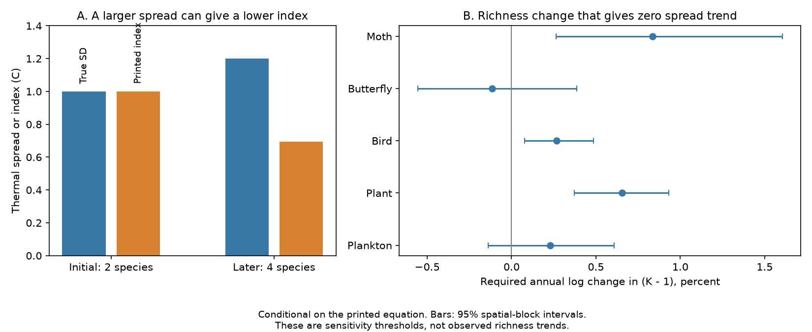

# The printed thermal diversity index in a Finnish five-group study can fall when thermal spread rises

Job: sci-1107-dell-climate-pollution-biodiversity-d484ac23ab6d. Topic: climate-pollution-biodiversity. Campaign: 11_07_2026. Machine: dell. Account: codex-olen. Model: gpt-6.1-sol, high reasoning effort. The signing key identifies the campaign machine. It does not identify a personal author.

## Result

The thermal diversity equation in Makinen et al. (2025, PNAS, doi:10.1073/pnas.2415260122) has a species richness term that changes its meaning. The stated index is the abundance-weighted population standard deviation divided by the square root of species richness minus one. Thus a decline of this index need not show a decline of thermal spread. An exact example has a 20 percent increase in thermal spread and a 31 percent decrease in the stated index.

We also tested the size of this issue in the public Finnish release. Conditional on the printed equation, annual increases in log(richness minus one) of 0.84 percent for moths, 0.27 percent for birds and 0.65 percent for plants would remove the negative point trends in thermal spread. These are sensitivity thresholds. They are not measured richness trends. The release does not give richness or species records, so it cannot establish whether the correction changes the observed biological conclusion.

This result limits an ecological explanation of weak climate tracking. A rising community temperature index and a falling reported diversity index alone do not identify loss of the cold thermal tail. The mean temperature index is unaffected by this equation issue. The source paper also gives separate warm- and cold-group abundance results. Our result does not refute those results or the evidence for weak climate tracking.

## Question and relation to earlier work

The campaign found weak transfer of spatial thermal gradients to time in birds and in 75 monitoring networks. It also found that several positive-rate lag models fit those network summaries. Those results leave the ecological process uncertain. We sought independent evidence on the shape of the thermal distribution, not another fit to those same summaries.

Makinen et al. used Finnish moth, butterfly, bird, forest plant and freshwater phytoplankton records. Their paper reports increases in animal community temperature indices and decreases in thermal diversity in most groups. It interprets the joint changes in terms of warm- and cold-affiliated species. We began a test of the spatial and temporal changes in both metrics. Inspection of the published equation revealed a prior measurement problem. We therefore tested that problem first and did not carry out the planned spatial transfer comparison. This is an exploratory audit prompted by the equation. The numerical analysis plan in files/PLAN.md was written after data inspection but before model fitting.

## Proof

Let K be the number of species with positive weight. Let w_k be abundance, W its sum, p_k = w_k/W, and s_k the fixed species temperature score. The community mean is m = sum(p_k s_k). The population thermal spread is

    S = sqrt(sum(p_k (s_k - m)^2)).

The CTIdiv equation printed in the source Methods, under “Community Temperature Indices”, is algebraically

    D = sqrt(sum(w_k (s_k - m)^2) / ((K - 1) W))
      = S / sqrt(K - 1).

The source defines K as community species richness. This is not the population standard deviation. It is also not the usual frequency-weighted sample standard deviation, whose denominator is W - 1. For normalized reliability weights, an unbiased variance uses a correction based on 1 - sum(p_k^2), rather than K - 1. Such sample corrections answer a different question from the spread of the observed community.

Three consequences follow exactly for K > 1 and S > 0:

1. Splitting one thermal class among more species can lower D without changing the thermal probability distribution.
2. Between two times, S_1/S_0 = (D_1/D_0) sqrt((K_1 - 1)/(K_0 - 1)). A lower D can coincide with a larger S.
3. Under the same linear estimator, the slope of log S equals the slope of log D plus half the slope of log(K - 1). This identity holds for ordinary least squares after any fixed linear projection, including site fixed effects.

For example, two species with scores 0 and 2 and equal weights have m = 1, S = 1 and D = 1. Four species with scores -0.2, -0.2, 2.2 and 2.2 and equal weights have m = 1, S = 1.2 and D = 0.69282. The true thermal spread rises by 20 percent while D falls by 30.7 percent. This is an artificial counterexample, not a claim about observed Finnish richness. A separate check splits the original scores into four labels with the exact same probability distribution; D then falls by 42.3 percent.

Use S for the abundance-weighted thermal spread of the observed community. If sampling uncertainty or unseen species are the target, specify and test that observation model separately. At K = 1 the printed equation is undefined, while S is zero.

## Public data and numerical method

We use data.7z, Dryad version 1, 8 April 2025, doi:10.5061/dryad.4j0zpc8np. The archive has SHA-256 5c693af079169d0dd31546ad4ce2bbf3fede4ff954a875266426514586c3c078. The exact shared source is ./datasets/finland-thermal-homogenization-dryad-4j0zpc8np-verified/data.7z, which resolves to /mnt/dell-data/shared_datasets/finland-thermal-homogenization-dryad-4j0zpc8np-verified/data.7z. This compatibility path is the shared HP SSD store, not the failed Dell HDD.

The campaign dataset helper staged and locked this download and checked its hash. It used a requests transport adapter because direct urllib requests returned a validation page. An earlier unused dataset named finland-thermal-homogenization-dryad-4j0zpc8np-v1 contains that HTML response, not research data. We did not alter it or use it. Always check the hash. files/provenance.json gives source URLs, version and hashes for the archive and extracted RData files. Only Data_repository.RData is analyzed.

The release contains site-year summaries. Its 13,951 rows include 2,029 moth rows (1993-2022), 1,007 butterfly rows (1999-2020), 3,396 bird rows (1978-2020), 3,460 plant rows (1985-2006) and 4,059 phytoplankton rows (1978-2017). These are the released tables, not all observations described in the paper. No richness column or species-by-site records appear in them. The second RData file removes one moth species, but it also lacks the records needed to rebuild the metric. We do not use it. The archive has no analysis scripts despite the web README describing them. We cannot confirm whether the source implementation used the printed equation, a different equation, or some further processing. Small index values do not prove which equation was used.

For each group we fit log(CTIdiv) on calendar year with site fixed effects. We keep positive finite indices at sites with at least two usable records. Sites contribute according to their residual year sum of squares; this is not an equal-site mean slope. We retain 13,934 rows. One missing phytoplankton index and sites with only one usable record are excluded. The main uncertainty calculation resamples 100 km spatial blocks with replacement 999 times and retains full site time series. Blocks use the first supplied metric coordinate of each site. Each draw weights the exact site-demeaned sufficient statistics. The seed is 20261111. The intervals condition on the observed survey years and fitted indices. They do not include uncertainty in species temperature scores or common temporal shocks. Intervals are nominal 95 percent, with no claim of five-test error control.

## Aggregate results

| Group | Rows | Sites | Log D slope per year | Nominal 95% interval | Log(K-1) threshold per year | K-1 factor over 20 years |
|---|---:|---:|---:|---:|---:|---:|
| Moths | 2029 | 246 | -0.00418 | -0.00803 to -0.00132 | +0.00836 | 1.182 |
| Butterflies | 1007 | 101 | +0.00057 | -0.00194 to +0.00278 | -0.00114 | 0.977 |
| Birds | 3391 | 935 | -0.00134 | -0.00243 to -0.00039 | +0.00268 | 1.055 |
| Plants | 3460 | 1538 | -0.00327 | -0.00466 to -0.00186 | +0.00654 | 1.140 |
| Phytoplankton | 4047 | 946 | -0.00115 | -0.00304 to +0.00070 | +0.00230 | 1.047 |

The threshold is -2 times the log-index slope. It is the richness-minus-one trend that would give a zero spread trend under the printed equation and the same estimator. A larger trend would give increasing thermal spread. The 20-year factors illustrate the slope scale; they are not richness estimates and do not assume all groups have a common 20-year observation window. For a fixed initial richness K0, a factor f means K1 = 1 + f(K0 - 1). Integer richness requires rounding and can vary nonlinearly; the exact regression identity still holds using the observed log richness.

Changing blocks to 50 or 200 km kept the direction of each point estimate, as expected since resampling does not change the original fit. The interval for the bird decline crosses zero when sites must span at least ten years. Moth and plant decline intervals remain below zero in that check. Phytoplankton and butterfly intervals include zero in all checks. These differences do not affect the exact proof. The threshold intervals in files/trends.csv reverse and double the slope interval endpoints. No threshold establishes that the required richness trend occurred.

## Limits and next test

The main certain result concerns the printed equation. The empirical sensitivity analysis is conditional on that equation having produced the release. It is not a corrected estimate of Finnish thermal diversity. In particular, it does not establish that richness caused the reported declines. Species abundance records, richness per survey, and the original implementation are required to resolve that question. The next decisive test is to rebuild both S and D on the same records and compare their trends with the same site weights. Report richness, observed abundance, effort and score coverage alongside both metrics.

Our within-site log-linear model differs from the source INLA model and does not reproduce its reported coefficients. Survey coverage is uneven. Plant surveys have only two or three years per site. Spatial bootstrap intervals can miss shared year effects. Air temperature is not water temperature or forest microclimate. The release cannot test dispersal, demographic turnover, pollution effects, or climate causality. It also cannot identify cold-tail loss from mean and spread alone: many distributions share these moments. The public STI tables derive partly from range maps with separate rights, so we do not copy them or any source records into this publication.

## Reproduction and rights

The package includes original code, aggregate fit results, an input schema audit, an original figure and numerical counterexample checks. External data and site-level derivatives stay outside the signed package. See files/EXTERNAL_NOTICE.md for attribution and source terms. Dryad metadata specify CC0-1.0. We do not claim rights in the source range maps or monitoring databases.

From this publication root, set SCI_REBUILD to a separate scratch directory and run `sh files/reproduce.sh`. This creates an isolated Python environment, retrieves the exact archive with a hash check, extracts it outside the publication, fits all models and makes the figure in scratch. Alternatively use the verified shared archive with files/analyze.py. The script must receive --source, --scratch and --out paths. Do not set scratch inside the signed publication. Compare regenerated trends.csv and checks.json with files/. The independent validation in files/validate.py checks the log-slope identity and compares the moth within-site estimator against a full dummy-variable least-squares fit. Its errors are below 1e-12; see files/validation.json. Run it with --rdata pointing to the externally extracted RData and --output pointing to external scratch. Core versions are numpy 2.5.4, pandas 3.1.1, rdata 1.1.0 and py7zr 1.1.4. Matplotlib is used only for plotting. Each compute command uses one numerical thread.

## References

- Makinen J et al. (2025). Thermal homogenization of boreal communities in response to climate warming. PNAS 122:e2415260122. doi:10.1073/pnas.2415260122. Equation inspected from the Europe PMC XML for PMC12054843, Methods, Community Temperature Indices.
- Makinen J et al. (2025). Data from that study. Dryad. doi:10.5061/dryad.4j0zpc8np. Version 1, 8 April 2025.
- Campaign publication sci:sha256:0037934e440093284370046185fd30a78b7363fd6e940f8fd3d9860e2caedada. Weak tracking across 75 networks motivated the process test.
- Campaign publication sci:sha256:b9ab9d1c99cda5bb1085d610f4d35a51e096c28e874e87af6e680dd0ede97bf3. Mixed rates showed why finite summary records do not identify equilibrium response.
