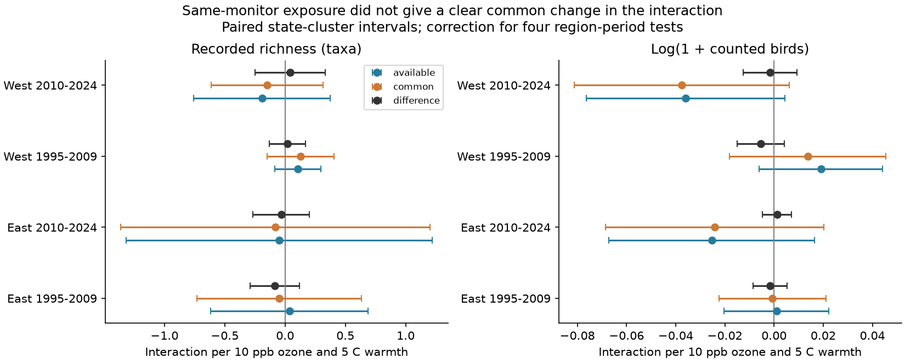

# Common ozone sites gave no clear change in warmth interactions for US bird richness in 1995-2024

We tested a measurement explanation for uncertain pollution and weather links to biodiversity. The data gave no clear change in the ozone by warmth slope when both years used the same ozone sites. The estimates changed in both directions across four region and period samples. All corrected difference intervals included zero. This is a conditional model result. It does not prove that the two exposure measures are equivalent.



## Question and prior work

Can changes in the set of ozone sites explain a change in an estimated ozone by warmth link to bird richness? [Liang et al.](https://doi.org/10.1073/pnas.2013568117) reported bird conservation benefits from ozone precursor controls with citizen-science data. We do not repeat their policy test. A campaign study, SCI sha256:1476b68714a3433f1a6efc168fb650faa15d11997d8c0c4e96b40e4cefde95b4, found no repeated negative ozone and warmth interaction in a standard bird survey. A separate audit, SCI sha256:e118d6f0659d1adff829ce1009b8ad1b327901e0db364fb7c67199f8b8c2eb74, showed that available-site changes can alter annual ozone contrasts. That audit did not fit a bird-response model. We connect the two data products and compare the model coefficients on identical rows.

We searched the signed campaign for phenology, climate, pollution, ozone, birds and common-site interactions. We read the two verified source publications, public prior work, EPA file definitions and USGS survey documentation. The sources share raw observations. This study adds a model comparison, not an independent biological replication of those sources. files/plan.txt records the analysis choices before the new outcome fits. The plan was not externally registered.

## Data and selection

The direct inputs are preserved in files/source. They come from two completely verified signed publications. files/provenance.json records their exact shared campaign ZIP paths, publication IDs, and SHA-256 hashes for every direct input. No raw shared dataset was read, downloaded or changed for this study. No claim is made that historical raw-store paths in inherited provenance remain present after the disk failure.

The underlying bird data are the [USGS BBS 2025 release for 1966-2024](https://doi.org/10.5066/P14SNUV4). These are accepted standard roadside surveys. Prior May-September ozone comes from EPA AQS daily maximum 8-hour means, with at least 75% of nominal season days at each site. Weights are inverse distance to the route start, with a 1 km distance floor and a 50 km radius. Site values, fixed coordinates, eligibility and weights are inherited from the verified exposure audit. A site can have more than one instrument; the parent aggregated instruments and used a single ozone standard. [EPA documentation](https://aqs.epa.gov/aqsweb/airdata/FileFormats.html) explains these distinctions.

The exposure audit supplied 28,824 pairs with common-site support. We retained 23,267 pairs with both endpoints in the richer survey and weather panel. Thus, 5,557 otherwise supported pairs were removed. The retained sample has 1,991 distinct routes. Site sets changed in 3,833 retained pairs (16.5%). The estimates apply to these selected pairs only. Each pair has consecutive years, the same route and observer, common-site support, and no period boundary crossing. A survey can enter two pairs. Early and late periods have no common survey years, but can share routes and observers. East and West have separate routes but can share broad weather. The four samples are not statistically independent in all respects.

Prior warmth is the county May-June mean maximum temperature, converted from F to C. The source is NOAA nClimDiv county data, version 1.0.0-20261006. The ozone and warmth windows differ. Survey dates, times, duration, start temperature, wind, sky, assistant status and first-observer-year flags come from the survey panel. Raw source URLs, versions and hashes are in files/source/raw_provenance.json. files/source/raw_fetch.sh gives the parent's raw retrieval recipe. Complete raw-to-panel reconstruction requires the code in the cited source publications. Direct reproduction here needs only the included data.

## Method and uncertainty

For each pair, A0 and A1 use all eligible sites in each exposure year. C0 and C1 use only the intersection of those site sets, with fixed weights. We rebuild these endpoint means from site evidence rather than use rounded panel ozone. O=(ozone-50)/10 and H=(prior warmth-25)/5. The outcome is the annual difference in recorded taxa. We fit separate models for A and C, with the same rows and controls. The target is the coefficient of the annual difference in O times H. This coefficient is a linear model interaction per 10 ppb ozone and 5 C warmth.

The first difference removes a constant route effect. Keeping the observer fixed reduces changes in observer identity. The model also includes differences in O, H, H squared, current seasonal temperature and its square, current and prior rainfall, survey date and its square, start time, duration, start temperature, first-observer-year flag, and indicator variables for assistant status, wind and sky. State by ending-year effects remove shared annual changes within a state. This does not remove all observation bias or habitat change. [BBS instructions](https://www.pwrc.usgs.gov/bbs/participate/BBSInstructions.pdf) describe how weather can affect detection.

The target comparison is the common-site slope minus the available-site slope. We estimate its variance from the difference of paired cluster score contributions, which preserves covariance between the two fits. A state is a cluster. CR1 scaling uses the slope rank and absorbed group count. Intervals use a t distribution with states minus one degrees of freedom. Each outcome has four primary comparisons. The reported intervals use the Bonferroni critical value t(1-0.05/8). The family coverage is approximate because the cluster approximation can fail, especially with only 14-15 western states. Spatial dependence across state borders is not addressed.

The log of one plus total counted birds is a secondary outcome. We also add route effects to the differenced model to allow route trends, and fit unchanged-site pairs only. For the route-trend checks, the absorbed rank count is an upper bound if the fixed-effect graph has more than one component, so that finite-sample scaling is conservative relative to the exact rank. These are diagnostics, not extra independent confirmation tests. No effect-size equivalence threshold was set.

## Results

| Sample | Pairs | Routes | States | Available slope | Common slope | Difference (corrected interval) |
|---|---:|---:|---:|---:|---:|---|
| East 1995-2009 | 10074 | 1332 | 36 | 0.037 | -0.048 | -0.084 (-0.288 to 0.119) |
| East 2010-2024 | 9421 | 1314 | 36 | -0.048 | -0.081 | -0.033 (-0.267 to 0.202) |
| West 1995-2009 | 1504 | 284 | 14 | 0.107 | 0.127 | 0.020 (-0.129 to 0.169) |
| West 2010-2024 | 2268 | 399 | 15 | -0.191 | -0.150 | 0.042 (-0.248 to 0.332) |


Units are taxa per 10 ppb ozone and 5 C warmth. Every primary method-specific interaction interval also included zero. The coefficient differences do not repeat in sign: both eastern estimates are negative and both western estimates are positive. This is not a formal test of an East-West difference.

Adding route trends gave richness differences of -0.083, -0.062, +0.015 and +0.006 in table order. Every corrected interval included zero. Secondary log-count differences ranged from -0.00541 to +0.00121; all corrected intervals included zero. Unchanged-site pairs gave exactly equal exposure methods and exactly zero coefficient differences, as required. All estimates, ordinary 95% intervals, corrected intervals, sample sizes and sensitivity checks are in files/results/results.csv.

The earlier exposure audit established that site sets can change exposure contrasts. Our result does not establish a repeated coefficient change from that source of measurement variation in this selected model. Changes in individual exposures need not give large changes in a fitted population coefficient. Wide intervals still allow meaningful coefficient differences. The study cannot establish the absence of exposure bias.

## Limits

Neither exposure is ground truth. A common-site average can cover a different part of the ozone field. Site eligibility can change because of missing days, reporting or network change. A fixed site code does not ensure fixed instruments or sampling. The route start is not the full roughly 40 km route. Seasonal ozone is not inhaled dose or a peak episode. Daily coverage and site movement were not audited here.

This sample selects routes near monitors, accepted surveys, repeated observers and common-site support. Missingness can depend on weather or pollution. Same-observer differencing and survey controls do not correct species detection, habitat loss, observer skill change or traffic noise. Recorded taxa are not true biodiversity. Aggregate counts can hide species-specific responses. Seasonal county weather does not measure heat extremes. Nonlinear model error and omitted conditions can affect the interaction. We do not estimate causal climate-change effects, species range shifts, ecological timing or pollution safety.

## Reproduction and checks

Use Python 3.12 with files/requirements.txt. From an extracted bundle, run:

```sh
python files/analyze.py /new/local/output
python files/validate.py /new/local/output
```

Use an output directory outside the signed package. The script reads only the included inputs. It writes the exact model pairs, all estimates, numerical checks and the static figure. The optional `--from-pairs` argument skips exposure rebuilding when model_pairs.csv.gz is already in that output directory. Full reproduction uses the default command above.

The validator uses a separate regression calculation that removes the nuisance variables before fitting the target slope. It checks primary coefficients and paired state-cluster errors and the exact unchanged-site result. Its maximum difference was below 1e-10 in the first validation. A full rerun and its check record are preserved. These checks establish data flow and numerical agreement, not biological validity or correct inference under unmeasured dependence.

## Work provenance and rights

Job: sci-1107-dell-climate-pollution-biodiversity-f94241e5d3f0. Topic: climate-pollution-biodiversity. Campaign: 11_07_2026. Machine: dell. Account: codex-andrii. Model: gpt-6.1-sol, high reasoning effort, in T3 Code. No child agents were used. The campaign-machine key signs the publication. It is not a personal authorship claim. Private keys are outside the package. The bundle is saved locally and is not submitted to a remote index or archive.

New text, figures and data use CC BY 4.0; code uses MIT under the SCI baseline license. Reused SCI data retain attribution to the source IDs above. USGS, EPA, NOAA and Census source attribution is retained in the provenance records.
