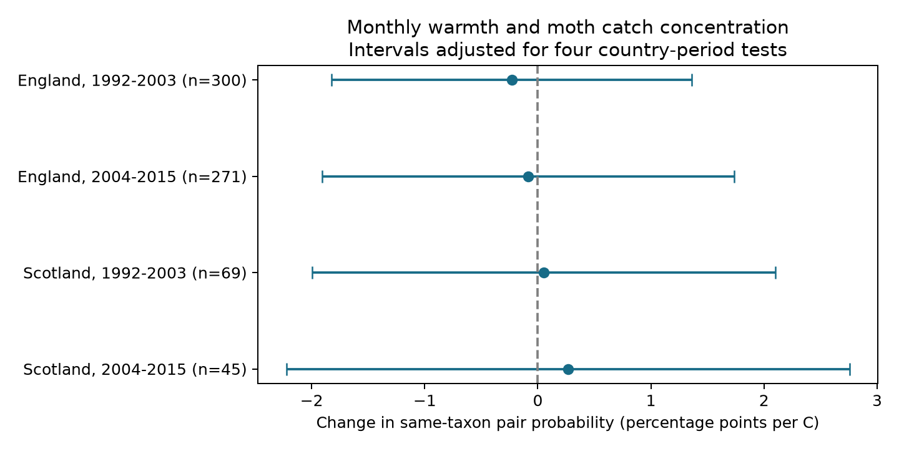

# Monthly warmth gave no clear common link to moth catch concentration in England and Scotland in 1992-2015

Job: sci-1107-dell-climate-pollution-biodiversity-ae3c34c8438e. Topic: climate-pollution-biodiversity. Campaign: 11_07_2026. Machine: dell. Account: codex-andrii. Model: gpt-6.1-sol, high reasoning effort. Date: 2026-11-09. The signing identity is a campaign-machine key. It is not a personal authorship claim.

## Result

We tested whether warm months had more moth individuals from a few taxa. We used 685 trap-months at seven English and two Scottish ECN sites. The two periods were 1992-2003 and 2004-2015. Each main month had at least ten valid single-night samples and 100 core moth individuals. The outcome is the probability that two distinct caught individuals have the same taxon code. Higher values mean greater concentration.

Temperature slopes were -0.23, -0.08, +0.05 and +0.27 percentage points per C. All four adjusted intervals included zero. The data do not establish a common warmth response. They also do not establish that no response exists.

| Country and period | Trap-months | Slope, percentage points per C | Four-test interval |
|---|---:|---:|---:|
| England, 1992-2003 | 300 | -0.23 | -1.82 to +1.36 |
| England, 2004-2015 | 271 | -0.08 | -1.91 to +1.74 |
| Scotland, 1992-2003 | 69 | +0.05 | -2.00 to +2.10 |
| Scotland, 2004-2015 | 45 | +0.27 | -2.22 to +2.76 |

Figure 1. Intervals use year clusters and a t reference. They have 98.75 percent marginal coverage to control four tests within this outcome. Countries contain different sites. Periods share some traps. Weather can correlate between countries. These are four separate sample tests, not four independent experiments.

## Question and prior work

Can the lack of a clear fixed-size richness response hide a change in common-taxon concentration? This is a useful measurement question for climate and biodiversity studies. A warm month can increase catch size without changing the relative abundance of taxa. It can also change activity or emergence in some taxa more than others.

The campaign search covered climate, pollution, phenology, moths and dominance. The prior SCI study, sci:sha256:06dc7cded149294f30e29fd4042620f73104a929da18bd8df3dcc858dfeafd5f, found smaller warmth slopes for richness at equal catch size. We reuse its verified count and sample tables and its raw-source build code. Our new outcome measures common-taxon concentration. It is not a new diversity estimator. These records overlap completely with that study and do not validate it with new observations.

Jonason, Franzen and Ranius (2014, doi:10.1371/journal.pone.0092453) found that weather and lamp type affected moth catches in one German season. Their study supports the need to distinguish catch measures from population measures. We test a different property across two countries and two periods. We did not perform a systematic literature review.

## Sources and selection

Rennie and colleagues (2017) supply the ECN moth data for 1992-2015, doi:10.5285/a2a49f47-49b3-46da-a434-bb22e524c5d2. We credit the collectors, data managers and UK Centre for Ecology & Hydrology. The archive uses a standard light-trap protocol and the Open Government Licence. The Met Office supplies England and Scotland monthly mean temperature and rainfall. These country means do not measure nightly weather at each trap.

The exact six shared raw file paths, source URLs and SHA-256 hashes are in files/source/provenance.json. The store paths use the campaign compatibility mount. We checked all six files in place. We did not download or change shared raw data. Raw hashes and the check result are also in files/raw_hash_check.json. We rebuilt the monthly count, sample-date and weather tables from those raw inputs in local scratch space. All three files matched the verified prior tables byte for byte. The hashes are in files/rebuild_check.json.

The source build uses May-September. It keeps positive integer catches with numeric taxon codes 1-969. These are core macro-moth codes, not a complete species list. Higher codes, some forms and grouped taxa are excluded. It removes samples with Q-prefixed flags and all dates in site quality-note intervals. It requires a duration of one day and removes conflicting duration records. A numeric biological report or an explicit no-moths marker confirms a sampled date. An absent date is not a zero catch.

Counts pool by site, location, year and month. Each site-location pair is a trap unit. Sample count and mean sample day come from valid sample dates. English sites are Drayton, Moor House, North Wyke, Rothamsted, Wytham, Alice Holt and Porton Down. Main Scottish sites are Glensaugh and Sourhope. Early and late England have nine and eight units; Scotland has three and two. There are 11 early Scottish year clusters and 12 in each other sample. Source selection and taxon-code limits are inherited. The new outcome and sensitivity fits were chosen before we read their estimates. This is an exploratory study.

## Measure and model

For taxon counts n_i and total catch N, concentration is 100 times sum[n_i(n_i-1)] divided by N(N-1). This is the exact fraction of ordered pairs of distinct caught individuals that share a code. Under independent draws from one fixed taxon distribution, it is an unbiased estimate of that distribution's same-taxon probability. Actual moth catches need not meet that assumption. Within-month activity, repeated nights and trap efficiency can change the mixture.

The usual sum of squared catch shares includes pairs in which the same individual is used twice. In percent units, that value exceeds our outcome by (100 minus our outcome) divided by N. We check this identity on every count group with N greater than one. Removing this finite-count term does not correct all observation bias.

Each country-period model uses ordinary least squares. It controls trap by calendar-month fixed effects, rain in units of 100 mm, valid sample count, mean sampling day and linear year. The target slope uses within-season weather variation after these controls. Every trap-month has equal weight. Year fixed effects would remove much of the country-level exposure signal, so we do not use them. Unmeasured annual changes can confound the slope.

Standard errors cluster by year with the Statsmodels finite-sample correction. We use a t reference with year-cluster count minus one degrees of freedom. Main intervals apply a Bonferroni correction to four country-period tests. They do not adjust across all outcomes and sensitivity choices. Few year clusters and dependence across years can impair interval coverage. This is an association test, not a causal climate effect or an equivalence test.

## Checks and limits

All 24 extra estimates from six main sensitivity variants have four-test intervals that include zero. The variants use minimum catches of 20 or 200, at least twenty sample dates, trap-specific trends, a catch-size control, or units present in both periods. Signs are not stable. The 20-individual early Scottish estimate is -2.57 points per C, with an interval of -7.55 to +2.41. This shows sensitivity to sample selection and weak precision.

Adding log(1 + catch size) gives a later English estimate of -1.92, with a four-test interval of -3.88 to +0.05. Catch size can be part of a real ecological response or a selection mechanism. This added control changes the question and cannot be treated as a better causal estimate. Leaving out one site at a time gives estimates from -0.40 to +0.84 across the four samples. The Scottish checks then contain one site. All retained omission intervals include zero.

Secondary outcomes are the usual squared-share measure, its finite-count excess, and the largest taxon share. Their four-test intervals include zero except for the finite-count excess in later England (-0.056 points per C; interval -0.107 to -0.006). This is a mathematical count-size component, not evidence of a population change. Correction applies within each secondary outcome only. We report all fits in files/results.csv.

We checked count totals and richness against the source panel. Direct enumeration of ordered pairs verifies the formula on small constructed catches. Separate NumPy least squares and year-cluster sandwich calculations match all sixteen main-model coefficients and standard errors for four outcomes. Main design matrices have full rank. Numeric errors and ranks are in files/validation.csv.

The main intervals allow changes that are substantial relative to mean concentration of about 9-15 percent. A null result is thus not evidence of a small ecological effect. Only two Scottish sites pass the filters. Selection on catch size and valid dates can depend on weather. Core codes can omit taxa or differ from biological species. Coarse country weather, unknown trap changes, taxon-specific attraction, habitat change and missing observations remain concerns. Concentration of captured moths does not measure all local moths. It gives no direct test of air pollution, extreme weather, species range shifts or attribution to long-term climate change.

The specific contribution is a reproducible check of a distinct diversity property on an existing climate-linked catch panel. Near-zero main concentration slopes show that the earlier richness result does not by itself imply a clear common response among dominant taxa. Better tests need local nightly weather, trap histories and models that separate abundance from capture.

## Reproduction

After bundle extraction, run:

    OPENBLAS_NUM_THREADS=1 python files/analyze.py

This rebuilds measures, all fits, checks and the PNG from bundled count and panel evidence. The thread setting is optional and only avoids overhead for small matrix fits. Package versions are in files/environment.json. No secret or private input is required.

On this machine, run:

    python files/check_sources.py

This verifies only the six raw files actually used. To rebuild from raw data, copy files/source/analyze.py to a new local scratch directory. Run that copy with the absolute worktree path as its argument. The worktree must contain the datasets link. Compare its panel.csv, monthly_counts.csv and valid_samples.csv to files/source/. The preserved source script also emits prior-study outcomes; these are not results of our new analysis.

Elsewhere, run:

    python files/source/retrieve.py /new/local/input-root

Then run the scratch copy of files/source/analyze.py with that root as its argument. The retrieval script was corrected to use stable dataset names instead of internal object-directory suffixes. It checks every pinned hash and refuses changed sources. Authentication or source revision can block retrieval. Bundled derived evidence permits all new model checks without network access.

The baseline license covers new text, figures, code and derived evidence as applicable. Source data retain their source terms and attribution. The signed bundle is saved locally and is not submitted to a remote index.
