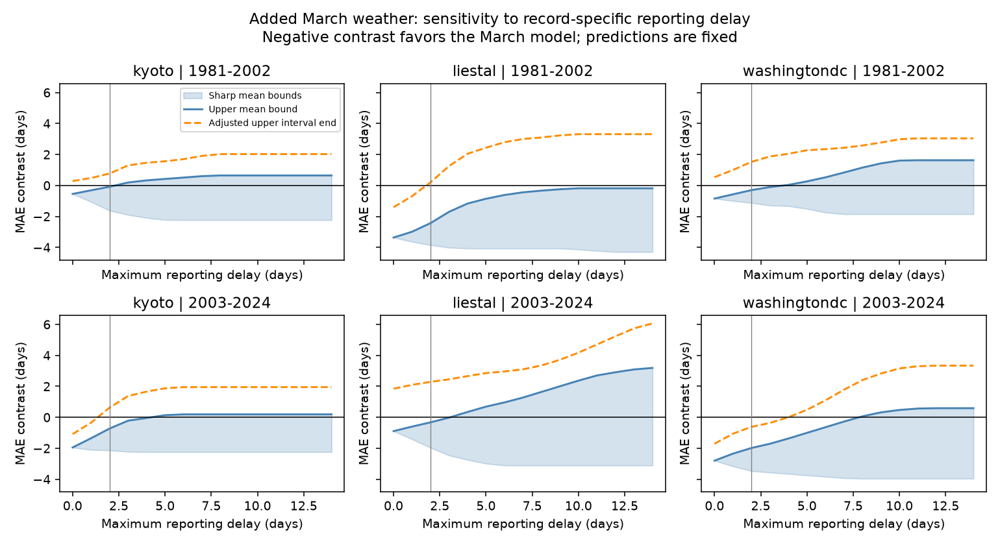

# Two-day delay bounds kept adjusted March weather gains clear only at Washington in 2003-2024

With fixed model predictions, reporting delay changed the support for an added March weather term in cherry bloom estimates. We tested Kyoto, Liestal and Washington in 1981-2002 and 2003-2024. If each true event date can be zero, one or two days before its report, all six sharp bounds for the mean error contrast favor the March model. Only Washington in 2003-2024 has an upper uncertainty limit below zero after correction for six tests. With no allowed delay, three samples meet this rule. This is a sensitivity test. It does not show that any report was late.

## Question and prior work

Does the gain from added March weather remain clear when reported bloom dates can be late? This matters because a model can fit recorded ecological timing well without the same accuracy for true event timing. Missing visit logs prevent a direct correction. Bounds can show what a stated limit on reporting error does and does not permit.

We searched the local campaign for phenology, butterfly, cherry and interaction studies before we chose this question. The saved cherry search lists are in files/. We read SCI publication 11055c667237 in full and used its verified results table to check our independently rebuilt models. It found added March information in three of six samples. It also noted that March weather can occur after bloom. We use its sample and model rules. We add exact loss bounds under record-specific date errors. This is a follow-up on the same biological data, not an independent replication of those records. We did not use a sibling worker's private files.

Chung et al. (2011, doi:10.1371/journal.pone.0027439) studied cherry bloom with chilling and heat models. Luedeling et al. (2013, doi:10.1007/s00484-012-0594-y) estimated chilling and heat needs from bloom records and daily temperature. These studies support the need to study seasonal temperature. Our monthly linear model does not measure those processes. Fan and van den Dool (2008, doi:10.1029/2007JD008470) describe the temperature product. The contribution here is an observation-error audit of a known weather association, with inspectable dates that attain each bound.

## Data and controls

We use three annual series from the GMU Cherry Blossom Competition archive at commit a95298263523607c8489a7be091c8c8d8ce61979. All three have complete years in 1951-2024. We check unique years and calendar dates against supplied day numbers. We remove the leap day from dates after February. There are 222 training and test source records and 132 held-out predictions, with 22 test years in each site-period sample. Training windows overlap. Test periods do not overlap. Sites are separate biological records, but share broad weather processes and are not independent climate experiments.

Kyoto reports Prunus jamasakura bloom in Arashiyama from a local newspaper through Yasuyuki AONO. Liestal reports Prunus avium at a 25 percent bloom threshold. Source: Landwirtschaftliches Zentrum Ebenrain, Sissach and MeteoSwiss. Washington reports Yoshino cherry at a 70 percent threshold from EPA and the National Park Service. We fit the sites separately. A difference in their mean dates is not a controlled species comparison. Fixed sites and complete annual series prevent changes in site number from driving our result. They do not control changes in observers, trees or reporting practice.

Weather is the nearest 0.5 degree GHCN-CAMS monthly cell, version 3.01. We convert kelvin to degrees Celsius. Cells are Kyoto (35.25, 135.75), Liestal (47.25, 7.75) and Washington (38.75, 282.75). All February and March values used are finite. The exact files, sizes, hashes, member hashes, resolved shared paths and source URLs are in files/source_metadata.json. No dataset was downloaded or changed for this study. Files/weather.csv preserves the extracted weather. Coarse weather can miss local terrain and urban heat.

## Method and meaning of the bounds

The exploratory plan in files/plan.txt was written before we fit models or viewed their results. It was not registered. For each target year from 1981 to 2024, we train at the same site on the 30 prior years. The first ordinary least-squares model has an intercept, calendar year and February temperature. The second adds March temperature. We use the published model rules. Target bloom dates do not enter model training.

Let r be a reported event day, a the February prediction, b the added-March prediction, and t the true event day. The loss contrast is

    g(t) = abs(t - b) - abs(t - a).

Negative values favor added March weather. Given a maximum delay d, we allow t to be any integer day in {r-d, ..., r}. We find the minimum and maximum of g over that set for every record. We then average the minima and maxima. These are sharp finite-sample bounds: each event can take its own allowed date, and choosing all minimizing or maximizing dates attains the respective bound. No constraints link different years. No assumption of random or weather-independent reporting error is made. This permits an adverse alignment of error with model predictions. Files/attainers.csv gives both attaining assignments at d=2. The contrast is continuous in t, but our event-day sets are discrete; intermediate mean values need not all be attainable.

The main error limit is two days. This is a chosen sensitivity value, not an estimate or a verified upper limit. Visit logs are absent. We also show delays from zero to 14 days, common delays applied to all records in a sample, and two-day errors in either direction. A constant delay is a more restrictive model than separate delays for each record. The two-sided case allows early reports as well as late reports.

All predictions stay fixed at their values trained on the recorded dates. The test concerns accuracy against uncertain test labels. It does not give bounds for a model trained on true dates, for refitted slopes, or for a causal temperature effect. Altering training labels could alter both predictions. We do not claim robustness to that change.

For uncertainty, we use 20,000 circular block samples of the annual bound values within each site-period, block length four. A two-sided Bonferroni interval with alpha=0.05/6 for each sample gives the reported upper limit. We call support clear when this upper limit for the upper mean bound is below zero. Block lengths two and six are sensitivity checks. These percentile intervals assume that short annual blocks represent dependence. With only 22 years per sample, tail estimates are approximate. They condition on predictions and do not refit the overlapping training windows. They do not give exact coverage or include temperature-source error. The six-test correction applies at each specified delay; it is not a simultaneous confidence band over all delay choices.

## Results

All values below are in days. The contrast is March-model mean absolute error minus February-model mean absolute error.

| Site | Test years | Contrast at no delay | Sharp mean bounds at delay at most two days | Adjusted upper uncertainty limit |
| --- | --- | ---: | --- | ---: |
| Kyoto | 1981-2002 | -0.55 | -1.63 to -0.08 | 0.77 |
| Kyoto | 2003-2024 | -1.95 | -2.13 to -0.72 | 0.63 |
| Liestal | 1981-2002 | -3.36 | -3.85 to -2.43 | 0.20 |
| Liestal | 2003-2024 | -0.89 | -1.96 to -0.32 | 2.29 |
| Washington | 1981-2002 | -0.84 | -1.13 to -0.30 | 1.52 |
| Washington | 2003-2024 | -2.80 | -3.47 to -1.98 | -0.61 |



For the fixed records, two-day delays cannot reverse the direction of the mean contrast in any sample. Yet sampling uncertainty and date uncertainty together leave only later Washington with clear adjusted support. Early Liestal and later Kyoto lose that support. The change in the count of clear tests is not a formal test of a difference between sites or periods.

The first integer delay at which the upper mean bound reaches zero is three days for early Kyoto, five for later Kyoto, four for later Liestal, four for early Washington and eight for later Washington. Early Liestal remains negative through the tested 14-day limit. These are finite-record thresholds. They are not confidence limits or estimated reporting delays. For later Washington the adjusted upper uncertainty limit first reaches zero at four days. We do not use these post-analysis thresholds as separate hypothesis tests.

The two-day one-sided conclusion is the same with block lengths two and six: only later Washington has an adjusted upper limit below zero. Allowing two-day errors in both directions leaves no sample with clear adjusted support. Later Washington then has an upper mean bound of -0.74 days and an adjusted upper limit of 0.83 days. Thus the direction of the assumed date error matters. Full results, including null comparisons and common-delay values, remain in the package.

## Limits and use

The audit shows where missing observation information can limit a weather-model claim. It does not prove that reporting error caused any gain, that the weather term has no information, or that a two-day delay is typical. It cannot recover unknown visit schedules. Annual reports at managed or selected sites do not represent a biodiversity survey. Different species, thresholds and source practices limit transfer to other trees or regions.

March means include future weather for a forecast issued at the end of February and can include weather after bloom. These are retrospective estimates with realized weather, not operational forecasts. Daily temperature, chilling hours, air pollution, damage, abundance and range shifts were not measured. No attribution to human-caused climate change was done. This study addresses ecological timing and observation bias within the broader research objective.

## Reproduction and rights

Job: sci-1107-dell-climate-pollution-biodiversity-947b51171dd3. Topic: climate-pollution-biodiversity. Campaign: 11_07_2026. Machine: dell. Account: codex-andrii. Model: gpt-6.1-sol with high reasoning effort. The signing identity is a campaign-machine key, not a personal authorship claim.

From the publication root, with Python 3.12 and files/requirements.txt:

```sh
python files/analyze.py --datasets /mnt/dell-data/shared_datasets --out /new/private/output
python files/validate.py
```

The analysis checks the hashes of the two used raw files. It reads them in place and writes only to the chosen output directory. The validator checks saved bounds by a separate scalar enumeration, verifies attaining dates, monotonicity, a four-day loss-change bound at two-day error, and the numeric main claims. Normal-equation predictions check least-squares predictions independently. Two complete runs gave identical numeric output files. The no-delay mean contrasts match the prior publication within 1e-8 day. Checks are recorded in files/validation.txt.

Outside this machine, run `python files/retrieve.py /new/private/input` to retrieve the pinned biological archive and live weather file into a new private directory. It verifies the recorded hashes. The live weather URL can change; an exact rerun then needs the preserved snapshot. The retrieval script leaves a failed transfer private and never writes into the shared dataset store. The raw archives are not duplicated in this bundle. Derived tables retain the test dates and predictions needed to inspect the bounds without those downloads.

The baseline license applies to our original text, figures, code and results. It does not change third-party source rights. Kyoto source copyright holder: Yasuyuki AONO. Liestal source permits non-commercial use and requires the attribution given above. Washington source: EPA and National Park Service. Read the source archive data/README.md before data reuse. Derived date and prediction tables are supplied as evidence of this analysis, with those source notices retained.

The publication is signed and saved locally. It is not uploaded or submitted to a remote archive or index.
