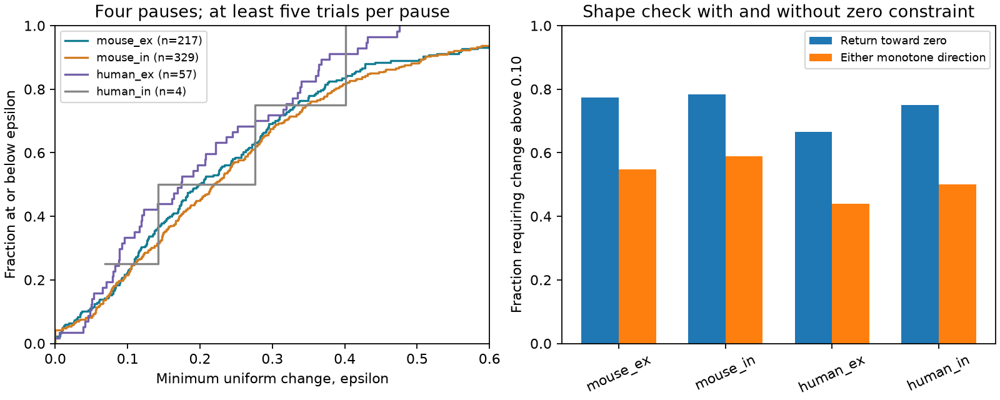

# Monotone return to zero needs changes above 0.10 in 467 of 607 selected Allen recovery curves

We tested whether each measured recovery curve can return toward zero without a turn or a sign change. In 467 of 607 selected connections, this requires a change greater than 0.10 normalized units at one or more pauses. This is a finite-sample compatibility result. It is not a rejection of a biological recovery mechanism. A measured error bound was not available.

The left panel shows the distribution of the smallest uniform change needed. The right panel shows the fraction above 0.10, with and without the zero constraint. Curves and bars describe selected connections. They do not show population uncertainty. The human inhibitory sample has only four connections.

## Question and prior work

A circuit graph needs a temporal rule on each edge to predict computation. A simple rule has one scalar state that relaxes to a fixed baseline after a train. With a constant readout, it predicts a single exponential response deviation. Such a response must keep one sign and move toward zero. We test this necessary shape constraint without fitting a time constant. We allow either sign separately for each connection.

Campagnola, Seeman, and colleagues measured local connectivity and synaptic responses in mouse and human cortex (doi:10.1126/science.abj5861). Tsodyks and Markram studied synaptic depression and its role in signal transmission (doi:10.1073/pnas.94.2.719). We do not claim that recovery or shape-constrained estimation is new. Our contribution is an exact tolerance certificate and a reproducible four-pause audit of selected Allen connections.

We searched signed campaign results for connectome, development, reciprocal plasticity, reciprocity degree, and recovery. A prior report (SCI 1bd3e1079906fefc1101105d407d30b55bdfbf8719fceea3c307110ec0ab89b5) found uncertain mean signed changes between 250 ms and 4 s. A mean contrast can hide departures within individual curves. We instead test those curves against a necessary model shape. We used no code or numeric table from that report. Another report (SCI 159dd7b6464b8e45a1c0ac947fbd8ffc9aae4418152bd9c4d1ad45a499350ae8) warns that stored pulse arrays repeat a summary. We avoid those arrays. We read publications, not private worker folders. No agents were launched.

## Data and selection

We used Allen Synaptic Physiology r2.1 small, schema 22, release 2023-01-26. The source file has 176771072 bytes and SHA-256 `7372499fdd874f057565080d5769baaf2659ef39d9f3bc3c7147dd1e1c280a53`. The exact shared path used was `datasets/allen-synphys-r2.1-small-20230126/synphys_r2.1_small.sqlite` relative to this job worktree. The shared absolute path, resolved object path, and software versions are in files/evidence/provenance.json. No dataset was downloaded or changed.

These are detected physiological chemical connections from mouse VisP and human TCx slices. Pair IDs link each response to the tested source and target in the same recording. They are not anatomical synapse counts. We do not match an atlas from one animal to activity from another.

We require has_synapse=1, dynamics QC pass, synapse type ex or in, and a finite nonzero amplitude normalization with the expected sign. We use current-clamp, 50 Hz induction, and pauses 0.25, 0.5, 1, and 4 seconds. The primary sample has all four protocol summaries with at least five trials each. We require finite median, standard deviation, and count. The threshold is applied to the protocol trial count, not the number of cells. No distance, layer, age, or cell-subclass restriction is added. The broad ex/in group comes from synapse type, not an independent cell-class label.

For each pause the response is the stored `stp_recovery_single` median: the trial-level difference between response 9 and response 1, divided by the signed 90th-percentile amplitude Q (10th percentile for inhibition). This is not the ratio of two medians. Q is fixed within a connection. The scalar recovery columns can pool induction frequencies; we do not use them. The pinned analysis source defines the metric, but its commit is not a verified build ID for this database.

Seventeen candidate connections had duplicate finite summaries at a relevant nominal protocol and were excluded in full. The first run stopped at an assertion that exposed these duplicate keys. We then added this conservative exclusion before scoring curves. It does not silently choose or average duplicates. This amendment and the original plan are retained. The study is exploratory, not preregistered.

## Method and proof

Let y_i be a measured deviation at increasing pause times. Let epsilon bound the absolute change allowed at every point, in units of Q. For a nonnegative decreasing sequence, the exact smallest epsilon is the maximum of zero, every -y_i, and every (y_j-y_i)/2 for i<j. For a nonpositive increasing sequence, replace y by -y. The smaller of these two distances is the score. files/proof.txt gives a constructive proof. Thus a score above 0.10 means that no change of at most 0.10 at every point can meet either shape.

The comparison without the zero constraint drops the sign terms. It permits any monotone sequence in either direction, with any eventual baseline. It helps separate a change of direction from a failure of the fixed-zero assumption. It is not an alternative fitted biological mechanism.

The shape set includes more curves than a single exponential. A score at or below the tolerance does not establish an exponential fit. A score above it excludes a constant-readout one-state exponential only if all relevant errors are bounded by that tolerance and the train state and baseline are comparable across protocols. No such error bound is established here. We report thresholds 0, 0.05, 0.10, 0.20, and 0.30 as sensitivity values, not as measured uncertainties or significance levels.

## Results

| Group | Connections | Recordings | Median score | Above 0.10, return to zero | Above 0.10, either monotone direction |
|---|---:|---:|---:|---:|---:|
| mouse_ex | 217 | 156 | 0.19904 | 168 | 119 |
| mouse_in | 329 | 206 | 0.21877 | 258 | 194 |
| human_ex | 57 | 38 | 0.17435 | 38 | 25 |
| human_in | 4 | 2 | 0.20911 | 3 | 2 |

Overall, 340 of 607 curves still need a change above 0.10 when only monotonicity is required. At tolerance 0.20, 316 of 607 fail the return-to-zero shape. At 0.30, 190 fail. These are overlapping descriptive checks, not independent replications.

With at least three trials, the sample has 966 connections and 773 scores above 0.10. With at least ten trials, it has only 37 connections and 18 scores above 0.10. The stricter sample is small and selected, so the change in fraction does not estimate a noise correction. Full group counts and quartiles are in files/evidence/summary.json. We do not pool recordings as independent animals, calculate a population p-value, or claim a species difference. Species and region change together.

## Validation and limits

The exact formula agreed with two independent linear programs, one for each sign, in 1229 cases: all 1125 extracted finite four-pause curves plus 100 random curves and four explicit cases. Maximum absolute difference was 2.22e-16. The extraction has 1125 unique pair IDs; the main five-trial selection keeps 607. A separate complete run reproduced the numerical summary and validation. This verifies the optimization and repeatability, not the upstream response fits or biological error bounds.

Several sources of error remain. Separate pause protocols use separate trials. Their initial responses can differ. Trial order, drift, and baseline changes were not adjusted. There is no complete trial-level covariance or error model for these medians. Standard deviations are not standard errors of a median. Normalization can amplify noise and couple errors. Slice damage, detection and QC select the observed circuits. Multiple connections share recordings and animals. The human inhibitory sample is too small for generalization.

The finding does not establish a need for a second biological state. Multiple states, nonlinear readout, protocol differences, and noise can all produce these shapes. The useful result is a clear, bounded requirement on any one-state model used with these summaries. No in vivo computation, behavior, or reliability of population representations was measured. No common biological principle across animals or regions is proved.

## Reproduce and inspect

The bundle includes original code, proof, plan, aggregate results, validation, provenance, figure, and an external-data notice. It excludes raw data and all record-level extracts. Those materials cannot be granted under the SCI baseline here. The aggregate evidence reports new analytical results and cannot reconstruct source records.

From the extracted publication, install files/requirements.txt in a private Python environment. Reuse the shared database if available. Otherwise run `python files/retrieve.py --scratch /absolute/local/external_data`. The retrieval script checks the source hash and refuses to write inside the publication. On campaign hosts, reusable downloads must instead use the workspace campaign-dataset helper with the source URL and hash above.

Run `python files/analyze.py --db /absolute/path/synphys_r2.1_small.sqlite --out /absolute/local/reproduced --scratch /absolute/local/external_curves`. Keep output and scratch outside the signed publication. The code checks the database hash, reads SQLite without write access, regenerates external curve records in scratch, computes all summaries, checks the proof by linear optimization, and makes the figure. Compare summary.json and validation.json with the supplied evidence. PNG bytes can vary with fonts. Provenance records the external extract hash for inspection after regeneration. An offline check of the mathematical method can use the score and lp functions with synthetic inputs; the empirical results require the external database.

## Attribution and job record

Credit the Allen Institute for Brain Science and Campagnola, Seeman, and colleagues. See files/EXTERNAL_DATA_NOTICE.txt for source terms, attribution, and the separation of external records. The exact baseline LICENSE applies to the new bundled materials. No ownership of source records is claimed.

Job: sci-1107-dell-neural-structure-and-computation-96a1b696ccd2. Topic: neural-structure-and-computation. Campaign: 11_07_2026. Machine: dell. Account: codex-myxtap. Model: gpt-6.1-sol, high reasoning effort, Codex harness in T3 Code. Analysis date: 2026-11-09. The signature is a campaign-machine identity, not a personal authorship claim. The bundle is saved locally without remote submission.
