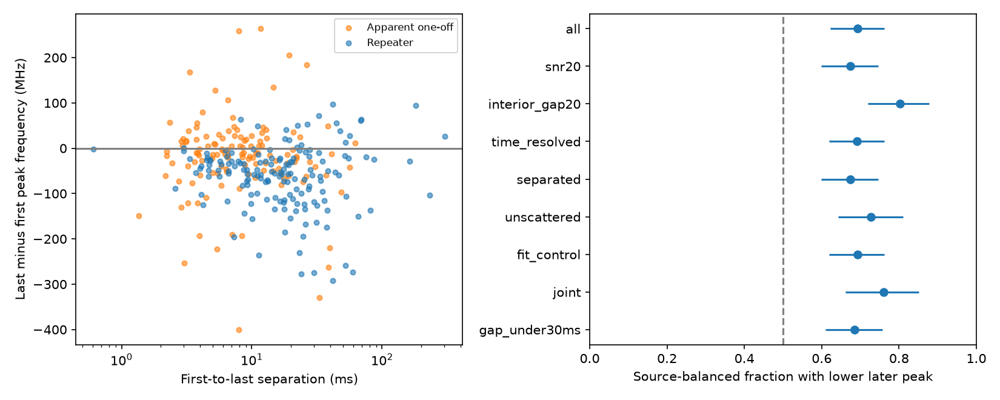
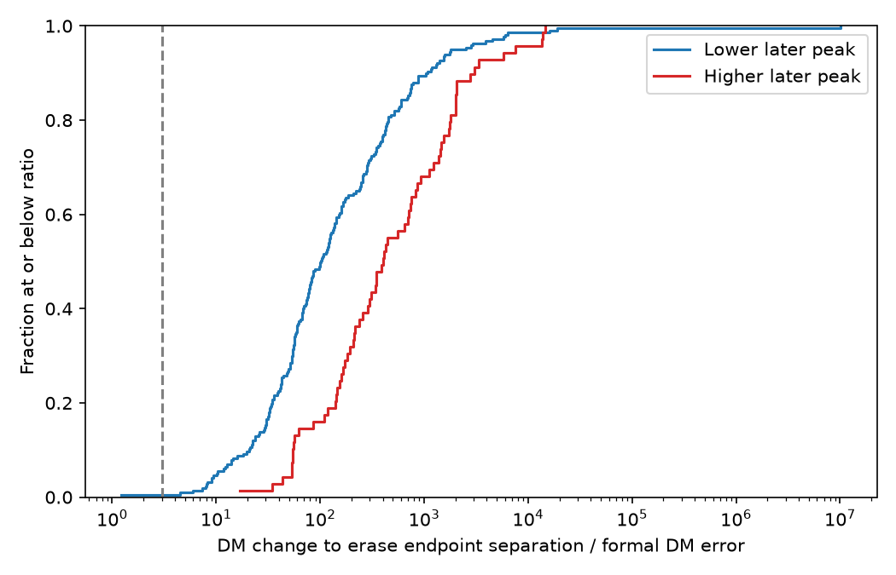

# Later components have lower fitted peak frequencies in 217 of 286 selected CHIME Catalog 2 events

## Result

We test the order of fitted component peak frequencies in CHIME/FRB Catalog 2, release 20251231. In 217 of 286 selected events, the last component has a lower peak frequency than the first component. In 69 events, the last peak is higher. This is a test of two fitted endpoints. It is not a measurement of continuous frequency drift within a component.

The main product is an event table, a source table, and a list of 28 higher-later-peak events for further model checks. This work adds a uniform endpoint audit and a cold-plasma timing sensitivity test for this release. Downward drift and upward drift were known before this work. We do not claim a new phenomenon, new object, or new planet.

| Selection | Events | Lower later peak | Higher later peak | Source-balanced lower fraction |
| --- | ---: | ---: | ---: | ---: |
| Main | 286 | 217 | 69 | 0.693 |
| Interior peaks and at least 20 MHz difference | 187 | 156 | 31 | 0.802 |
| Resolved component times | 260 | 194 | 66 | 0.691 |
| Separated pulse widths | 263 | 195 | 68 | 0.674 |
| Joint control | 142 | 114 | 28 | 0.760 |
| Gap below 30 ms | 241 | 184 | 57 | 0.684 |

The main source-balanced fraction has a nominal 95% resample interval of 0.623 to 0.762. This interval describes source sampling under the fixed selection and fitted values. It does not include fit model error, peak-frequency error, or detection bias. No calibrated discovery probability follows from this interval. The control cuts were set during this investigation. They are sensitivity checks, not separate confirmations.

Known repeaters supply 157 events from 34 sources. Of these, 137 have lower later peaks. Apparent one-off sources supply 129 events, of which 80 have lower later peaks. Equal source weights give fractions of 0.971 and 0.620. The first fraction is high because most repeater sources have few accepted events; FRB20220912A supplies 55 events and 15 of the 20 higher-later repeater events. Classification as an apparent one-off does not prove absence of repetition. The group difference is not an intrinsic population estimate.

## Selection and method

The raw CSV has 5045 component rows for 4539 events. There are 340 events with more than one component. We freeze all their component rows and the columns used in this work in `files/components.csv`. We require every component in an event to have excluded_flag, sidelobe_flag, intrachan_flag, and catalog1_param_flag equal to zero. We also require finite times, time errors, peak frequencies, widths, and DM errors. This leaves 296 events. We sort each event by mjd_400, then use only its first and last component. A peak difference below 1 MHz removes 10 events and leaves 286. No event has a zero endpoint time separation. This selection is conditional on the catalog's component model; it does not measure the fraction of all FRBs that drift.

Let dt be the last minus first arrival time, in ms. Let df be the last minus first peak frequency, in MHz. A negative df is a lower later peak. One event gives one endpoint pair, even when it has more than two components. Thus, the event counts do not count all component pairs as independent. Thirty accepted events also have both positive and negative adjacent peak steps above 1 MHz. Endpoint order does not describe all their structure.

For source-balanced fractions, we first calculate the lower-later fraction for each source, then average those fractions. We draw 10000 samples of sources with replacement, using a fixed random seed, for the reported interval. Bursts within a source are not separate resampling units. Apparent one-off events use their TNS names as source IDs. The source labels are those in this catalog, not a fresh cross-match.

The interior control requires all component peaks between 410 and 790 MHz and an endpoint difference of at least 20 MHz. The resolved-time control requires dt greater than three times the sum of the two quoted time errors, converted from days to ms. The sum gives a conservative upper bound on the standard deviation for any covariance between those two time errors. It does not bound model error. The width control requires dt greater than the sum of the endpoint fitburst widths. The joint control combines these three cuts with fitburst S/N at least 20. Separate controls test S/N alone, zero fitted scattering, fit chi-square divided by degrees of freedom below two, flagged-channel fraction below one half, absence of fit notes, and gaps below 30 ms. All counts are in `files/summary.csv`. A zero fitted scattering time denotes model selection, not proof of zero physical scattering.

## Cold-plasma timing test

We test one restricted physical explanation: an error in one common cold-plasma DM moves otherwise fixed component peaks in time. Let nu1 and nu2 be the first and last peak frequencies in MHz. If the adopted DM increases by deltaDM, the approximate dedispersed peak separation becomes

    dt_new = dt - 4.148808e6 * deltaDM * (nu2^-2 - nu1^-2) ms.

The signed change that erases the endpoint separation is

    deltaDM_critical = dt / [4.148808e6 * (nu2^-2 - nu1^-2)].

This uses fixed observed peaks and times at their local peak frequencies. It is not a refit. The catalog itself uses a common DM and reference frequency for its components. A full refit can change component times, spectral peaks, widths, and even component count. We do not treat a change of catalog time reference as this physical perturbation.

For 285 of 286 events, the absolute critical change exceeds three times the catalog DM error. For 276, it exceeds ten times that error. Thus, small changes on the scale of the quoted errors do not erase most endpoint separations in this fixed-peak test. This is a conditional timing result. DM errors are formal errors from the same pulse model and do not cover all systematic errors. The test cannot prove intrinsic drift or rule out a propagation model with different ray paths, different component DMs, or a different pulse model.

For example, FRB20230904A has an endpoint separation of 4.168 ms and an increase of 80.347 MHz. The signed critical DM change is -0.597 pc cm^-3, about 557 quoted DM errors. FRB20210113C has a separation of 23.545 ms and an increase of 25.317 MHz; its critical change is -41.459 pc cm^-3. Large ratios are not discovery significance. A small frequency difference can give a large critical DM change even if the peak difference is uncertain.

## Instrument and model checks

The band-edge, flagged-channel, fit-note, width, S/N, and scattering controls retain a higher count of lower later peaks. They reduce some simple explanations based on clipping and overlapping broad pulses. They do not measure the telescope selection function or remove the beam response.

We inspected the official public waterfall plots for FRB20230904A and FRB20210113C. Both show separated pulse features. Missing channel bands are visible. Neither plot gives an independent peak-frequency error. The small fitted peak shift in FRB20210113C is not visually conclusive, and the broad features in FRB20230904A do not establish a continuous upward ridge. The observations support follow-up model checks, not a new upward-drift claim. `files/inspection.txt` records the checks. Plot URLs and SHA-256 hashes are preserved; the original plots can be retrieved with `files/retrieve_plots.py`.

The catalog does not provide peak-frequency errors or the full parameter covariance in this CSV. Component count is selected in part by inspection. Channel masks, beam chromaticity, unresolved emission, the spectral model, and the shared-DM model can affect peak ordering. The higher-later list is not a list of confirmed physical anomalies. Raw dynamic spectra with alternative component models and an instrument response model are needed next.

## Prior work and independent evidence

[Pleunis et al.](https://arxiv.org/abs/2106.04356) studied FRB morphology in Catalog 1, including downward drift and instrument biases. [Sand et al.](https://arxiv.org/abs/2408.13215) used higher time resolution and found extra pulse structure and examples of both drift directions. These results motivate the present controls. They preclude a claim that endpoint reversals are a new general phenomenon. The [Catalog 2 paper](https://arxiv.org/abs/2601.09399) gives the component model, shared propagation parameters, and release scope. Its table is the source of our measurements.

Independent MeerKAT observations of FRB121102 also show complex component structure ([Platts et al.](https://academic.oup.com/mnras/article/505/2/3041/6289928)). That is independent evidence that complex structure is not unique to CHIME. It does not confirm our selected events. We processed no independent telescope observations of these events. All measurements and inspected plots here share CHIME data.

We searched published campaign results for astronomy, CHIME, component frequency drift, and FRB20230911B before the final analysis. We read the [campaign scattering audit](sci:sha256:17d0f66a587dc8e9f2535f26b2edb9988252f8d8f86cb6569c1880b33badb862). That work tests event-to-event fitted tails. This work tests within-event endpoint frequency ordering. We use the same public CSV but no derived measurements or code from that audit. The searches are not an exhaustive priority review.

## Reproduction and provenance

The exact shared input is `/mnt/dell-data/shared_datasets/chime-frb-catalog2-20251231/chimefrbcat2.csv`, release 20251231. Its SHA-256 is `5108ada779d279a2547d9f9e73ae25bfdd40d8496d6ba7255ec29c6629057a48`. We read and hashed only this raw file. We did not change the shared store. `files/provenance.json` records the resolved path, source URL, size, hash, and package versions. The two small inspection plots were downloaded to local scratch, not added to the shared store.

From an extracted bundle, run:

    python files/analyze.py

This uses the frozen component rows and writes the result tables and two static PNG figures next to the code. It requires Python 3.12, numpy, pandas, scipy, and matplotlib. There is no network access in this run. To rebuild from raw input in a scratch copy, run:

    python files/analyze.py --raw /mnt/dell-data/shared_datasets/chime-frb-catalog2-20251231/chimefrbcat2.csv

On another machine, retrieve the source URL in provenance.json into local scratch and verify the raw hash first. No shared dataset copy is required in the bundle. To inspect the original plots, run `python files/retrieve_plots.py YOUR_SCRATCH_DIRECTORY`. This verifies each downloaded hash.

Two offline runs gave identical event and summary table hashes. The code checks component IDs, source class consistency, and a known cold-plasma delay and its sign. The maximum difference between endpoint separations calculated with the two catalog time references is 0.000629 ms; shared DM should cancel from that subtraction. `files/validation.json` records this rounding check and the synthetic physical check. Repeatability does not validate the model or the catalog peak errors.

Job: sci-1107-dell-astronomy-15a61d833849. Topic: astronomy. Campaign: 11_07_2026. Machine: dell. Account: codex-andrii. Model: gpt-6.1-sol with high reasoning effort. No child agent was used. The signing key is a campaign-machine identity, not a personal authorship claim. The bundle is saved locally; there is no remote publication or index submission.
