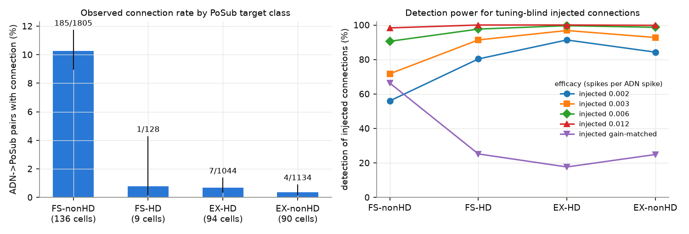
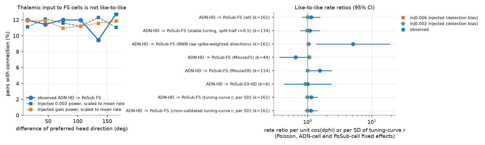
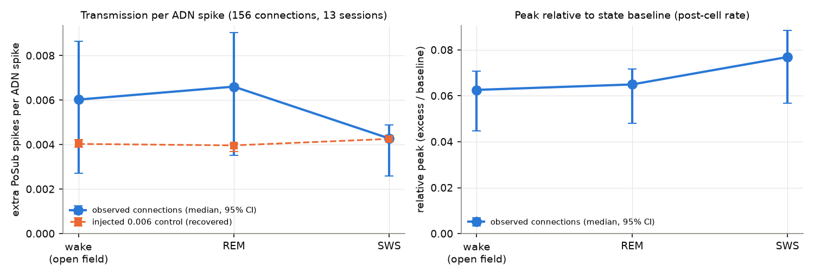

# Anterodorsal thalamic head-direction cells connect mostly to fast-spiking postsubicular cells, with no clear head-direction match

## Summary

We used spike cross-correlograms (CCGs) to find putative monosynaptic connections from the
anterodorsal thalamic nucleus (ADN) to the postsubiculum (PoSub) in freely moving mice. The data
are the public recordings of Peyrache et al. (2015), DANDI:000056 version 0.261106.1949 (CC BY 4.0).
We used 23 sessions from 4 mice with ADN and PoSub units recorded at the same time.

Main results:

1. **Direction.** A causal peak at 0.8-4.8 ms occurred in 197 of 4,177 ADN-to-PoSub pairs (4.7%).
   The reverse direction (PoSub to ADN) gave 18 of 4,177 pairs (0.43%). The ADN-to-PoSub peaks had
   a median latency of 2.4 ms. Peaks between two ADN cells (320 of 2,916) had a different latency
   (about 1 ms). We do not interpret those as connections.
2. **Target class.** 186 of 197 detected connections went to narrow-waveform (putative
   fast-spiking, FS) PoSub cells: 9.6% of 1,933 ADN-to-FS pairs against 0.51% of 2,178 pairs onto
   wide-waveform (putative excitatory, EX) cells. With a fixed effect for each ADN cell, the rate
   ratio was 21.8 (95% CI 11.8-40.3). The preference occurred in each of the 3 mice with detected
   connections. Injected synthetic connections show that this is not a detection-power effect: at
   the same transmission per ADN spike, detection was *higher* for EX targets (for example 91% vs 56%
   at 0.002 extra spikes per ADN spike). After this power correction, the FS:EX ratio was 19-29.
   A gain-matched injection (same peak relative to the baseline of the target cell) gave the most
   conservative ratio, 6.4.
3. **No clear head-direction (HD) match onto FS cells.** For HD-tuned ADN cells and FS targets
   (161 connections in 1,392 pairs), the connection rate was 9.5-12.7% in all six bins of the
   difference in preferred direction. Poisson models with ADN-cell and PoSub-cell fixed effects
   gave a rate ratio of 1.13 per unit cos(difference) (95% CI 0.82-1.57; permutation p = 0.64) and
   1.14 per SD of tuning-curve correlation (0.90-1.45; p = 0.21). Injected tuning-blind connections
   gave ratios of 1.00-1.10, so detection bias is small. **Caveat:** FS tuning is weak (median mean
   vector length 0.07). With the NWB file's `hd_preferred_direction`, which for these cells is the
   raw spike-weighted mean heading and is near the animal's most frequent heading, the ratio was
   5.1 (1.4-19.1). We give our reasons to prefer the occupancy-normalised measures below, but this
   part of the result is not fully resolved.
4. **Brain state.** For 156 connections with enough spikes in all states, transmission per ADN
   spike was lower in slow-wave sleep (SWS, median 0.0043) than in wake (0.0060) and REM sleep
   (0.0066); SWS minus wake was -0.0014 (session-bootstrap 95% CI -0.0023 to -0.00004; Wilcoxon
   p = 2e-7). The peak relative to the state-specific baseline was *higher* in SWS (0.077 vs 0.063;
   difference +0.014, CI 0.008-0.023). FS cells fired at about half their wake rate in SWS (7.2 vs
   14.5 spikes/s). Thus the connections kept or increased their relative effect, and the absolute
   number of extra spikes followed the target cell's rate. An injected control with fixed
   transmission was recovered equally in all three states.

Interpretation: in this HD circuit, the thalamic input that CCGs can detect goes mostly to FS
interneurons, and it does not show a clear match of head direction. This agrees with a
feedforward-inhibition design and with the claim of Duszkiewicz et al. (2024) that FS tuning in PoSub
has a local origin. It also matches the FS preference of LGN-to-V1 connections in an earlier campaign
study (sci:sha256:2c36aa37...). Unlike that visual study, which found a graded retinotopic effect, we
found no clear feature match for FS targets.

## Question and reason

How does the thalamic HD signal enter the cortex? Attractor models of the HD system need tuned input.
In sensory thalamocortical systems, thalamic axons excite both excitatory cells and FS interneurons,
and FS cells often get broadly tuned input. Duszkiewicz et al. (2024) showed that PoSub FS cells have
HD tuning that is equivalent to that of HD cells, and that it has a local origin. A direct test needs
pairs of thalamic and cortical cells recorded together. The Peyrache et al. (2015) data have these
pairs. To our knowledge, no earlier publication gives the cell-class and tuning rules of ADN-to-PoSub
spike-level connections. The campaign had no earlier study of these data (we searched titles of the
2,393 campaign publications on 2026-11-09).

We tested three things:
(a) Do ADN-to-PoSub CCG connections prefer FS or EX targets after detection power control?
(b) Is the connection probability onto FS cells higher for similar preferred head directions?
(c) Does transmission change between wake, REM sleep and SWS?

## Data

- DANDI:000056 version 0.261106.1949, "Internally organized mechanisms of the head direction sense"
  (Peyrache, Lacroix, Petersen, Buzsáki; NWB conversion by C. Baker). CC BY 4.0.
  DOI 10.48324/dandi.000056/0.261106.1949. 42 NWB files, 7 mice.
- We read only the `units` table, epochs, lab sleep scoring and head direction, with HTTP range
  requests (no full-file download). The asset IDs, sizes and DANDI SHA-256 digests are in
  `files/results/dandi000056_assets.csv`.
- Sessions with ADN and PoSub units: 23 sessions, 4 mice (Mouse20, Mouse24, Mouse25, Mouse28).
  Units: 240 ADN (168 with the NWB `is_hd_cell` flag), 337 PoSub. Units with at least 1,000 spikes
  were used. Session length is about 6-8 h: wake in the open field (median 1,812 s), SWS
  (median 10,919 s), REM (median 1,350 s).
- Regions are the NWB `region` labels. The NWB `cell_type` field has no class for PoSub units, so we
  classified PoSub cells by the trough-to-peak time of the NWB mean waveform: narrow (< 0.4 ms, 145
  cells, median wake rate 14.5 spikes/s) = putative FS; wide (>= 0.4 ms, 184 cells) = putative EX;
  8 cells had no waveform. The distribution was bimodal with a gap at 0.35-0.45 ms.

## Methods

**CCGs.** For each ordered pair, we counted spikes of the second cell at lags of -50 to +50 ms
from each spike of the first cell, in 0.4 ms bins. We split the counts by the state of the reference
spike: wake (open-field epoch), SWS, REM (lab scoring), other.

**Detection** (after Stark & Abeles 2009 and English et al. 2017). Baseline = CCG convolved with a
partially hollow Gaussian (SD 10 ms, hollow fraction 0.6). A pair is a putative connection if a bin
at 0.8-4.8 ms has p_fast < 0.001 against the baseline (Poisson with continuity correction) and the
same bin is above the largest count at -4.8 to -0.8 ms with p_causal < 0.0026. Transmission =
(observed - baseline counts in the window) / number of reference spikes. Relative peak = excess /
baseline counts in the window.

**Detection power.** We added synthetic spikes to the real PoSub train after a random subset of the
real ADN spikes (latency 2.0 ms, SD 0.3 ms jitter), recomputed the CCG and ran the same detector.
The subset probability was 0.002, 0.003, 0.006 (median observed) or 0.012. A "gain-matched" set
used, for each pair, the probability that gives the median relative peak of the real connections.
The injection does not depend on tuning, so it measures how detection depends on rates, tuning
similarity and target class. Power is the fraction of injected pairs that are detected, among pairs
without a real detected connection.

**HD tuning.** We computed occupancy-normalised tuning curves (60 bins, 6-degree circular smoothing)
in the open-field epoch. Preferred direction = direction of the mean vector of the curve. We also
used split-half stability, the Pearson correlation of two tuning curves (tuning-curve r), and a
cross-validated version (half 1 of one cell against half 2 of the other). HD cells = NWB
`is_hd_cell`.

**Statistics.** Connection rate models: Poisson GLM of connection (0/1) with fixed effects for the
ADN cell and the PoSub cell (strata without a connection drop out). Rate ratios are per unit
cos(difference of preferred directions) or per SD of tuning-curve r. Permutation tests shuffle the
preferred directions (or tuning curves) of the ADN cells within each session (500-2,000
permutations). State contrasts are paired over connections; the CIs use a bootstrap over sessions
(2,000 draws) of the median paired difference.

## Results

### 1. Direction and latency

| Pair type | Detected | Pairs | Rate |
| --- | --- | --- | --- |
| ADN to PoSub | 197 | 4,177 | 4.7% |
| PoSub to ADN | 18 | 4,177 | 0.43% |
| ADN to ADN | 320 | 2,916 | 11.0% (peak lag about 1 ms; not interpreted) |
| PoSub to PoSub | 355 | 6,632 | 5.4% (not analysed) |

Detected ADN-to-PoSub peaks had a median lag of 2.4 ms onto FS cells (IQR 2.0-3.2 ms, n = 186) and
3.2 ms onto EX cells (n = 11). This agrees with one synapse plus axonal conduction. The ADN-to-ADN
peaks were mostly at 0.8-1.2 ms. ADN has few local excitatory connections, so these peaks are
probably shared input or spike-sorting overlap on the same shank (14.6% on the same shank vs 7.6% on
other shanks).

### 2. Target class

| PoSub target class | Connections / pairs | Rate (95% CI) | Power at 0.002 | Power at 0.006 | Power gain-matched |
| --- | --- | --- | --- | --- | --- |
| FS, not HD | 185 / 1,805 | 10.2% (8.9-11.7) | 56% | 91% | 66% |
| FS, HD (narrow HD cells) | 1 / 128 | 0.8% (0.1-4.3) | 80% | 98% | 25% |
| EX, HD | 7 / 1,044 | 0.7% (0.3-1.4) | 91% | 99.6% | 18% |
| EX, not HD | 4 / 1,134 | 0.35% (0.1-0.9) | 84% | 98.7% | 25% |

- FS against EX: rate ratio 21.8 (11.8-40.3) with ADN-cell fixed effects.
- Per mouse (FS vs EX detected/pairs): Mouse24 4/178 vs 1/283; Mouse25 47/307 vs 3/630; Mouse28
  135/1,448 vs 7/1,265. Mouse20 had 66 ADN-to-PoSub pairs and no detection.
- Power-adjusted FS:EX ratio: 28.9 (injection 0.002), 24.7 (0.003), 20.7 (0.006), 19.3 (0.012),
  6.4 (gain-matched).
- 46 of 145 FS cells had at least one detected ADN input (median 3, maximum 18 inputs). Median
  transmission onto FS cells was 0.0066 extra spikes per ADN spike.
- Detection-rule robustness (`files/results/detection_robustness.csv`): with a 0.8-2.8 ms or
  1.6-4.8 ms window, or with p_fast < 1e-4 and p_causal < 1e-3, the FS:EX rate ratio was 16-34.
  Kernel SD 5 or 20 ms gave the same 197 detections. CCGs from only wake, only SWS or only REM
  spikes gave 57 vs 4, 98 vs 4 and 28 vs 0 detections (FS vs EX).

### 3. Head-direction match onto FS cells

| Test (HD-tuned ADN to FS) | Rate ratio (95% CI) | Permutation p | Injection bias (0.002 / 0.006 / gain) |
| --- | --- | --- | --- |
| cos(difference), own preferred directions, k = 161 | 1.13 (0.82-1.57) | 0.64 | 1.01 / 1.00 / 1.08 |
| same, FS with split-half r > 0.5, k = 134 | 1.09 (0.77-1.55) | 0.53 | 1.00 / 0.99 / 1.10 |
| tuning-curve r, per SD | 1.14 (0.90-1.45) | 0.21 | 1.01 / 1.00 / 1.06 |
| cross-validated tuning-curve r, per SD | 1.13 (0.89-1.42) | 0.24 | 1.00 / 1.00 / 1.06 |
| Mouse25 only, k = 44 | 0.65 (0.36-1.15) | 0.85 | |
| Mouse28 only, k = 114 | 1.55 (1.01-2.37) | 0.43 | |
| NWB `hd_preferred_direction`, k = 161 | 5.1 (1.4-19.1) | n/a | 1.06 / 1.02 / 1.26 |

The occupancy-normalised measures show no clear HD match. The upper CI limits (1.4-1.6) do not
exclude a weak match of the size seen for local PoSub HD-to-FS connections in an earlier campaign
study (rate ratio 1.10 per SD of tuning similarity, sci:sha256:8faf1a62...).

Why the NWB direction gives a different result: for 136 weakly tuned narrow cells, the NWB
`hd_preferred_direction` is within a median of 2.5 degrees of the raw spike-weighted mean heading and
within 12 degrees of the session's mean heading, so it mostly shows where the mouse looked most
(heading distribution mean vector length 0.29). Within a session, these directions differ by only
about 14 degrees (circular SD) between FS cells. In a model with only PoSub-cell fixed effects, the
NWB direction gave 1.20 (0.96-1.49); with the session mean heading and ADN spike count added it gave
2.8 (1.1-6.9) (`files/results/summary.json`, `direction_definition_diagnostic_postFE`). Thus the
positive result depends on small deviations of raw directions from the frequent heading. One possible
cause is that the detected inputs themselves add spikes to the FS cell at the ADN cell's preferred
direction. We did not test this. We report the occupancy-normalised result as the main result and
this part as unresolved.

ADN HD to EX HD connections: 6 of 818 pairs; all 6 had a difference below 90 degrees (permutation
p = 0.076). The gain-matched injection gave a bias ratio of 2.9 for these pairs, so detection bias can
explain this pattern. The sample is too small for a conclusion.

### 4. Brain state

| Measure (156 connections, 13 sessions) | Wake | REM | SWS |
| --- | --- | --- | --- |
| Extra PoSub spikes per ADN spike, median | 0.0060 | 0.0066 | 0.0043 |
| Relative peak (excess / baseline), median | 0.063 | 0.065 | 0.077 |
| Injected 0.006 control, recovered median | 0.0040 | 0.0040 | 0.0043 |

- SWS minus wake transmission: -0.0014 (CI -0.0023 to -0.00004), 65% of connections lower,
  Wilcoxon p = 2.3e-7. REM minus wake: +0.0003 (CI -0.0002 to 0.0014), p = 0.51.
- SWS minus wake relative peak: +0.014 (CI 0.008-0.023), p = 1.5e-7. REM minus wake: +0.004
  (CI -0.002 to 0.009), p = 0.046.
- The detector recovers about two thirds of an injected transmission in all states (the hollow
  baseline absorbs part of the peak). This bias is the same in all states, so it does not explain
  the state contrast.

## Limitations

- CCG peaks are putative connections. Shared fast input can also make a causal peak. The clear
  ADN-to-PoSub direction, the 2-3 ms latency and the low reverse rate make shared input less likely
  for these pairs, but do not exclude it.
- The data come from 4 mice, and 2 mice give 97% of the connections. Connection rates varied much
  between sessions (probe position). We found no independent data set with ADN and PoSub recorded
  together: Duszkiewicz et al. (2024) Dataset_6 has ADN-only and PoSub-only sessions.
- FS and EX classes come from waveform width only. Narrow HD cells (9 cells) were rarely targets;
  they can be a different class. The PoSub layer of each cell is not known; ADN axons end mainly in
  layer 3, and recorded EX cells can be in other layers. Thus the low EX rate can partly be a
  sampling effect of probe position.
- CCGs detect strong connections. Weak ADN-to-EX connections can exist below detection. The
  gain-matched power test shows that EX connections with a relative effect like that onto FS cells
  are detected only 18-25% of the time, which gives the most conservative ratio (6.4).
- FS HD tuning is weak, so the HD-match test has low sensitivity, and the result depends on the
  definition of preferred direction (section 3).
- The state analysis compares the open-field wake epoch with home-cage sleep. Behaviour, time of day
  and recording drift also differ between these epochs.

## Relation to earlier work

- Uses: Peyrache et al. 2015 data (doi:10.1038/nn.3968; DANDI 000056).
- Supports: Duszkiewicz et al. 2024 (doi:10.1038/s41593-024-01588-5): FS tuning in PoSub has a local
  origin; we find that thalamic inputs to FS cells are not clearly matched in head direction.
- Campaign: LGN-to-V1 CCG connections also go mostly to FS cells (sci:sha256:2c36aa37a35b...), and
  local PoSub HD-to-FS connections show a weak tuning match (sci:sha256:8faf1a626f6f...).

## Reproduction

1. Use Python 3.12 with numpy 2.5.4, scipy 1.18.1, pandas 3.1.1, h5py 3.16.0, statsmodels 0.15.0,
   matplotlib 3.11.2, requests 2.34.2.
2. Copy `files/code/` into an empty folder and run `bash code/run_all.sh`. It downloads the needed
   NWB parts from DANDI into `raw/` (about 800 MB of extracts, about 2 min), computes CCGs and
   injections (about 10 min on 12 cores), and writes `derived/`, `results/` and `figures/`.
3. To check the detections without downloads, use `files/derived_ccg/<session>.npz` (`pairs` =
   unit index pairs, `ccg` = counts with shape pairs x 4 states x 251 lags; states wake, SWS, REM,
   other; lag bin k is (k-125) x 0.4 ms) with `files/code/detect.py`.

Main output files: `files/results/summary.json` (all statistics), `target_class.csv`,
`like_to_like.csv`, `detection_robustness.csv`, `state_efficacy.csv.gz` (per connection),
`adn_posub_pairs.csv.gz` (all ADN-to-PoSub pairs with detections, injections and tuning),
`pairs.csv.gz` (all pair types), `units.csv`.

## Provenance

- Campaign 11_07_2026, job sci-1107-dell-neural-structure-and-computation-13b721087732, topic
  neural-structure-and-computation, machine dell, account claude-andrii.
- Analysis and text: Claude Opus 5.5 (model ID claude-opus-5-5), run as an autonomous research agent,
  2026-11-09. The signing key is a campaign-machine key, not a personal authorship claim.
- External data terms: see `files/NOTICE-external-data.md`.
