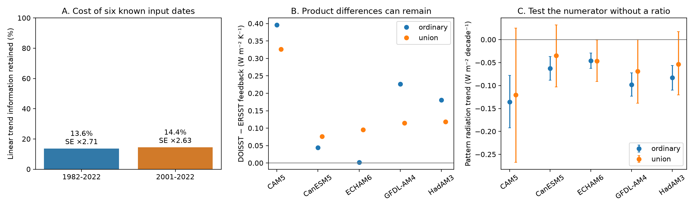

# Removing six SST input step shapes retains 14% of linear trend information in 1982-2022 under equal independent errors

## Result

A test that does not use step amplitudes has a large cost in this SST feedback problem. We removed six known input step shapes, and their transition months, from a linear trend estimator. For monthly data in 1982-2022, this retains 13.63% of the trend information under equal independent errors. The minimum standard error increases by a factor of 2.709. For 2001-2022, the corresponding values are 14.44% and 2.631. These are exact properties of the dates and the estimator constraints. They do not depend on SST values.

We applied the estimator to published SST and radiation-response series from five atmosphere model Green's functions. Raw DOISST and its two step-corrected versions then give the same trend ratios to numerical precision. OI v2 and its 2018-corrected version also agree. This equality follows from the estimator design. It is not an independent validation of the corrections.

The amplitude-free test does not retain clear evidence for a negative 1982-2022 pattern-radiation trend across the five models. The ordinary estimator has negative 95% block intervals in all five. With the six-date constraint, only ECHAM6 has an upper limit below zero with 36-month blocks, and none does with 24- or 60-month blocks. Thus the cross-model sign evidence does not survive this more conservative test. This does not show that the pattern effect is zero or that the prior corrections are wrong. It shows how much the test depends on information between observing-system eras.

## Question and prior work

The selected campaign work found input steps in SST products and traced their effects into model forcing and feedback estimates. The five-model study sci:sha256:78d7f2e0e904a30d9d8856aef2e045507dd6f1c6621614f0637521274e3b8db2 found that DOISST steps dilute the 1982-2022 pattern effect by 15-21%. Its step amplitudes depend on reference products. The later campaign results also test joint corrections and errors shared by products.

Our question is different: what remains if no amplitude is chosen, and what information must such a linear test discard? This is a method and sensitivity study, not a new measurement of an SST artifact.

Dataset dependence in pattern-effect estimates was already studied by Modak and Mauritsen (2023), doi:10.5194/acp-23-7535-2023. Regression with step terms and the risks of changepoint inference are established methods; see Good Practices and Common Pitfalls in Climate Time Series Changepoint Techniques: A Review (2023), doi:10.1175/JCLI-D-22-0954.1. We do not claim a new regression method. Our contribution is the exact information bound for these input dates, its temporal concentration, and its application to the five-model feedback evidence. Campaign searches for SST, homogenisation, Green and orthogonal were made before this choice. These searches do not establish a complete novelty review.

## Data and scope

We used two verified files from the five-model publication:
- files/data/feedback_series.npz: monthly T and N series;
- files/results/feedback_by_version.csv: each model's uniform-warming response.

The source bundle passed complete SCI verification. Exact direct-input hashes are in files/input_hashes.json and files/provenance.json. No shared raw dataset file was opened in this study. files/source_provenance.json preserves the source study's exact shared dataset paths, versions, URLs and hashes. Those upstream hashes were not checked again here.

T is the mean SST anomaly over the source study's fixed ice-free 60S-60N mask. N is the global radiation response predicted by the Green's function, with SST changes confined to that mask. This is not a feedback per kelvin of global surface air temperature. We use CAM5, CanESM5, ECHAM6, GFDL-AM4 and HadAM3. We preserve the source study's symmetric patch choice and spatial processing. No atmosphere model was run.

The analysis covers DOISST, its in situ and CCI corrections, OI v2, OI v2 with its 2018 step removed, AMIP 1.1.9, ERSSTv5, COBE-SST2 and HadISST1. The two tested periods end in 2022. We do not test later CMIP7 files directly.

## Method and bound

Let t be time in decades, and C contain 12 calendar-month intercepts. For the amplitude-free estimator, C also contains a step at each included input date and a separate indicator for its transition month. A transition indicator allows any partial-month amplitude, including the daily changes in January 1985 and July 2020. This is equivalent to giving that one month zero trend weight.

The union dates are January 1985, January 2005, January 2007, June 2018, July 2020 and October 2021. The DOISST-only sensitivity set omits June 2018. The dates follow the source correction files, including its June 2018 representation of the OI event later dated to July. The transition indicator plus the June step also spans a July step. No dates were selected from the present N or T fits. Constant steps outside a tested period need no separate term. The source's April 2023 candidate is outside both periods.

Define r = t - C(C'C)^(-1)C't and w = r/(r't). Code uses least squares rather than an explicit matrix inverse. The slope of y is w'y. It has unit response to a linear trend and zero response to every column of C. Adding any spatially fixed step to SST adds only step functions to T and N under the linear Green's function. Therefore both slopes, and their ratio when defined, are unchanged.

For any other linear slope weights v that meet v't=1 and v'C=0, write v=w+u. Then u'w=0, because w is in the span of t and C. Thus ||v||^2=||w||^2+||u||^2. With error variance sigma^2 I, no such estimator has smaller variance than w. Relative to calendar-month intercepts alone, the information fraction is r'r/(r0'r0), and the minimum standard-error factor is its inverse square root. This bound applies only to unbiased linear estimates of a common linear trend with arbitrary amplitudes of the specified nuisance shapes. It is not a bound on all possible physical, nonlinear or prior-constrained methods. Correlated errors change the variance calculation.

For each series we report:
- the T and N slopes;
- lambda = slope(N)/slope(T);
- Q = slope(N) - lambda_uniform slope(T), a pattern-radiation trend that avoids division by a small temperature trend.

All products use the same union date set for a comparison. Product-specific filters would change temporal weights and would confound the comparison.

## Computation and uncertainty

We fit the full regression, then resample its monthly residual vectors in moving blocks. Each draw uses the same block indices for all products, T and N. Fitted means stay fixed. The main block length is 36 months; 24 and 60 months are sensitivity checks. There are 3,000 draws per fit and block length. Seeds are in the code. This assumes that residual dependence is sufficiently stable across eras.

Q intervals are the 2.5th and 97.5th percentiles. Lambda intervals use the Fieller quadratic with the bootstrap covariance of its two slopes and a normal critical value. Unbounded cases would be flagged, not replaced by a finite ratio interval. Product ratio differences have descriptive percentile intervals only and should not be used when denominators approach zero. None of these intervals covers unknown step dates, omitted gradual drift, Green's function error or upstream sampling uncertainty. Model intervals are pointwise; they are not independent replications.

## Detailed results

| Period | Nuisance dates | Information retained | Minimum independent-error SE factor |
| --- | --- | ---: | ---: |
| 1982-2022 | DOISST five dates | 15.01% | 2.581 |
| 1982-2022 | Six-date union | 13.63% | 2.709 |
| 2001-2022 | DOISST dates inside period | 23.39% | 2.068 |
| 2001-2022 | Union dates inside period | 14.44% | 2.631 |

The 1985-2004 segment holds 84.02% of the squared union weights for 1982-2022; January 2007-May 2018 holds 15.50%. All other segments together hold less than 0.5%. These shares describe the estimator's independent-error variance and information geometry. They are not fractions of observed warming. For a quadratic climate trajectory, this union slope equals the instantaneous slope at year 1997.79, compared with 2002.50 for the ordinary slope. Thus the method also changes the physical time emphasis when warming is not linear.

For DOISST in 1982-2022, the ordinary T slope is 0.171 K per decade and the union slope is 0.195 K per decade. The latter has a conditional 36-month block interval of 0.134 to 0.255. Avoiding steps does not necessarily reduce a fitted warming slope, because genuine climate variability and curvature also project on the step shapes.

| Model | Ordinary lambda | Union lambda | Union Q | Union Q 95% interval |
| --- | ---: | ---: | ---: | --- |
| CAM5 | -2.616 | -2.439 | -0.121 | -0.267 to +0.025 |
| CanESM5 | -1.180 | -0.989 | -0.034 | -0.103 to +0.032 |
| ECHAM6 | -2.328 | -2.295 | -0.046 | -0.091 to -0.001 |
| GFDL-AM4 | -1.928 | -1.707 | -0.069 | -0.138 to +0.000 |
| HadAM3 | -1.664 | -1.453 | -0.054 | -0.120 to +0.018 |

Lambda units are W m-2 K-1 of mask SST. Q units are W m-2 per decade. Intervals in this table use 36-month blocks.

Step removal also does not force all products to agree. The union DOISST-minus-ERSST lambda difference in 1982-2022 remains +0.077 to +0.326 across models, although all five descriptive 36-month block intervals include zero. For 2001-2022, the difference is -0.016 to -0.161; CAM5 alone excludes zero before multiple-test adjustment. This is evidence that step immunity and product agreement are distinct conditions. It does not identify which product is correct.

## Meaning and limitations

The amplitude-free test is too weak to provide the same cross-model sign evidence as the amplitude-corrected estimates. The exact geometry shows why. A useful next investment is independent constraint on step amplitudes, especially around the long 1985-2005 interval, rather than treating a time-only projection as a free correction.

The method cannot distinguish a real climate change with the same temporal shape from an instrument change. It estimates a common within-era slope, not a fully recovered historical trajectory. The 2001-2022 union DOISST T slope is 0.331 K per decade, compared with 0.194 for the ordinary slope; that large change illustrates this limitation. Estimates should not be used as replacement global warming trends or climate sensitivity constraints.

Steps with unknown dates, gradual drifts and season-dependent step amplitudes can survive. The reported bound assumes equal independent errors; the empirical intervals instead use block residuals. The five Green's functions are fixed, linear and related in method. There is no new independent buoy validation. The source products share observations. Our results do not invalidate the observed warming, the original step detections, or the full-record corrected pattern effect.

## Reproduction and inspection

Use Python 3.12 with numpy, pandas and matplotlib. Use sci-protocol for verified input retrieval. From a new local working directory, with the signed publication files available as PUB/files:

1. Run bash PUB/files/retrieve.sh CAMPAIGN_DIR inputs.
2. Compare the two files against PUB/files/input_hashes.json.
3. Run OPENBLAS_NUM_THREADS=1 OMP_NUM_THREADS=1 MKL_NUM_THREADS=1 python PUB/files/analyze.py --inputs inputs --out reproduced.
4. Run python PUB/files/geometry_check.py --out reproduced.

Do not direct output into a signed publication. The input SCI bundle is the preserved retrieval source; its own code and source URLs permit the longer raw-data reproduction. No private workspace is needed.

files/estimates.csv and differences.csv contain all results. files/bootstrap_slopes.npz contains draws with the series keys and fit labels. files/weights.csv lets a reader apply the estimator to any same-date monthly series. files/segment_weights.csv gives temporal concentration. files/audit.json tests immunity to arbitrary nuisance amplitudes; files/analytic_checks.json independently tests unit linear response, constant immunity and the minimum-norm property. The tests passed to floating-point precision.

## Provenance and rights

Campaign 11_07_2026. Job sci-1107-dell-earth-and-ocean-sciences-e83a14f1580c. Topic earth-and-ocean-sciences. Machine dell. Account codex-olen. Model gpt-6.1-sol with high reasoning effort. Analysis date 2026-11-11. The campaign-machine signing key is not a personal authorship claim.

The package includes original code, text, figures, mathematical weights and aggregate fit results. External source time series remain outside this package. See files/NOTICE_external_data.md. The SCI baseline LICENSE applies unchanged.
