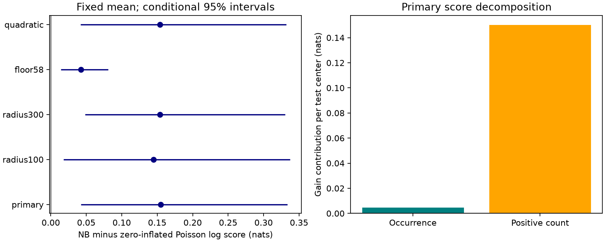

# A negative-binomial model beat a fixed-mean zero-inflated Poisson model for late counts after 323 shallow M6.5+ earthquakes in 2013-2024

A separate probability of no events did not explain all of the published negative-binomial count score gain. At the same predicted mean, the negative-binomial model beat a zero-inflated Poisson model by 0.1547 nats per test center. The conditional 95% three-year block interval was 0.0424 to 0.3333 nats. Most of the point gain came from probabilities for positive counts.

## Question and prior work

Does a model need extra variation among positive counts, or can a separate zero-event state explain the gain over a Poisson model?

Campaign publication sci:sha256:1692a78e3b446678452638f734376d5537e708eb7b879d99c9de3a9592704b25 reported a negative-binomial gain over a single Poisson distribution. We read this result and reuse its center, window and mean design. We add a zero-inflated Poisson comparison and a score decomposition. No prior code was copied. The data and test period overlap. This is a diagnostic extension of known evidence, not independent confirmation on new data.

The general need for non-Poisson count distributions is established. Nandan and colleagues tested full count forecasts from an ETAS model in California (doi:10.48550/arXiv.1903.07079). Grimm's thesis compared count models, including zero-inflated forms, and found no clear advantage for them in its design (https://edoc.ub.uni-muenchen.de/31101/1/Grimm_Christian.pdf). We do not claim a new distribution or first use of zero inflation in seismology. Our contribution is a fixed-mean comparison and an exact score decomposition in this global late-count benchmark.

USGS operational forecasts mix Poisson distributions over uncertain sequence productivity (https://earthquake.usgs.gov/data/oaf/background.php). The single Poisson and simple mixtures here are research benchmarks. We did not compare against the full operational forecast.

Before selecting this question, we searched the local campaign for earthquake, ocean, ENSO, aftershock and zero-inflated results. The last search returned no records. We read the prior negative-binomial publication and searched external prior work.

## Data and sample

We used the shared ComCat preferred-event CSV snapshot retrieved on 9 November 2026:

    /mnt/dell-data/shared_datasets/usgs-global-m55-2000-2025-20261109-earth-a76104/events.csv

It contains 12,848 unique event IDs for 2000-2025, at preferred magnitude M5.5 or more. Size is 2,240,222 bytes. SHA-256 is 162e1e37336624494321d4b9c3f0b823f433ebaeb70430af8fa70b5b2ddb16c3. The exact query and resolved shared path are in files/provenance.json. M is a preferred catalog magnitude; scales are mixed.

Centers have M6.5 or more, depth at most 70 km and year 2001-2024. A center is excluded if an equal or larger event occurred within 300 km in the preceding 30 days. There is no future-based exclusion. All training target windows close before 1 January 2013. There are 363 training centers in 2001-2012 and 323 test centers in 2013-2024.

At a day-7 origin, early counts include gaps from 1 day through less than 7 days. Target counts include gaps from 7 days through less than 30 days. The primary radius is 200 km. Neighbors have M5.5 or more at any depth. Distance is spherical surface distance with Earth radius 6,371 km. These counts can include background events and other sequences. They are not proven aftershocks. Windows can share events.

## Models and test

The local plan in files/design.txt was written before this analysis was run. It is not an external registration.

All models share the same predicted mean mu = exp(X beta). Columns of X are an intercept, M minus 6.5, log(1+depth)/4, and log(1+early count). We fit beta on training centers by Poisson likelihood with penalty 0.05 times the squared slopes. The intercept has no penalty. Fits stay fixed in all test years.

The negative-binomial model has variance mu + alpha times mu squared. Its shape is 1/alpha and success probability is 1/(1+alpha times mu). We fit alpha by training likelihood with mu fixed, over 0.000001 to 1000.

The zero-inflated Poisson model has a zero-state weight pi. The remaining weight 1-pi uses a Poisson mean lambda = mu/(1-pi). Thus its total mean is also mu. Its zero probability is pi + (1-pi) exp(-lambda). For y greater than zero, its probability is (1-pi) times the Poisson probability at lambda. We fit pi by training likelihood over 0 to 0.99, and compare the fitted value to pi=0. The primary estimates are alpha=1.0681 and pi=0.2401. Both are inside the search limits. Each comparison model adds one distribution parameter to the same mean.

The primary test score is mean log P_NB(y) minus log P_ZIP(y). Positive values favor the negative-binomial model. Both models have identical mean errors by construction.

Let q be the predicted probability of a positive count. Every log score equals the binary occurrence log score plus, when y is positive, log P(y given y greater than zero). We subtract this identity between the two models. Both contributions are averaged over all 323 test centers, so they sum exactly to the full score gain. The positive-count component is not a score per positive center.

We draw 9,999 circular bootstrap samples of the 12 test years. Each joins four three-year blocks, with wrap at the end. A draw's score is its total gain divided by its total center count. Seed is 2601109. Quantiles at 2.5% and 97.5% give a conditional interval. Fits remain fixed. This interval excludes training uncertainty, source revision and dependence beyond the blocks.

Planned secondary checks use radii 100 and 300 km, an M5.8 neighbor floor, and a quadratic term in log(1+early count). All are reported. We did not choose a setting with test scores. Leave-year-out checks and occurrence Brier scores are descriptive diagnostics.

## Results

| Setting | NB minus ZIP score, nats | Conditional 95% interval | Training pi |
|---|---:|---:|---:|
| primary | 0.1547 | 0.0424 to 0.3333 | 0.240 |
| radius100 | 0.1448 | 0.0179 to 0.3372 | 0.226 |
| radius300 | 0.1538 | 0.0483 to 0.3302 | 0.206 |
| floor58 | 0.0423 | 0.0145 to 0.0811 | 0.327 |
| quadratic | 0.1541 | 0.0421 to 0.3317 | 0.241 |

For the primary setting, mean test log scores are -1.1463 for Poisson, -1.1005 for zero-inflated Poisson, and -0.9458 for negative binomial. ZIP improves on Poisson by 0.0459 nats (interval 0.0102 to 0.0829). NB improves on Poisson by 0.2006 nats, which reproduces the earlier campaign result.

| Primary decomposition | Gain per center, nats | Conditional 95% interval |
|---|---:|---:|
| Binary occurrence part | 0.00456 | -0.00266 to 0.01297 |
| Positive-count part | 0.15016 | 0.03516 to 0.33361 |
| Full count score | 0.15472 | 0.04244 to 0.33333 |

The positive-count part is 97.1% of the point gain. This percentage is descriptive, not an interval estimate. Only 89 of 323 test centers have positive targets. The count sum is 219, with repeated membership possible. All models predict a sum of 190.61. Thus the gain does not correct a mean deficit.

The observed zero fraction is 0.7245. Mean predicted zero probabilities are 0.6474, 0.6783 and 0.7025 for Poisson, ZIP and NB. Occurrence Brier scores in that order are 0.16860, 0.16701 and 0.16566; lower is better. These pooled summaries do not establish conditional calibration. At M5.8, NB's occurrence Brier score is worse than Poisson's, despite a better count log score.

The primary NB-minus-ZIP gain stays positive after each test year is removed: 0.0582 to 0.1720 nats. All four planned secondary NB-minus-ZIP intervals are above zero under this resampling scheme. These are correlated checks, not independent replications or multiplicity-adjusted tests. At M5.8 the NB-minus-Poisson interval still includes zero.

## Interpretation and limits

Within these fixed-mean families, extra zero probability alone is insufficient to match the negative-binomial score. Probabilities among positive counts account for most of the difference. The test supports broader positive-count variation as a useful statistical description in this benchmark.

It does not prove a gamma distribution of physical productivity, an inactive fault class, or a specific branching mechanism. A flexible zero-inflated model with changing pi, a different mean model, or a different mixture could give different scores. The test compares these two simple families only. Zero inflation itself also changes the positive-count mean because the total mean stays fixed.

The same test period informed the prior study and this follow-up question. The result is a diagnostic of an existing result and needs a new-period test. The catalog is revised, with mixed magnitude types and unproved completeness. The radius ignores rupture extent and depth separation. The past-only exclusion leaves dependent centers and shared windows. There are only twelve test years. The block interval cannot guarantee coverage under that dependence. Model parameter and data uncertainty are not included. We do not infer a physical cause or claim public safety readiness.

## Evidence and reproduction

files/results.json gives all scores and diagnostics. files/annual.csv gives year-level sums. files/models.json gives fitted parameters. files/analyze.py recreates all settings and the figure. files/audit.py independently checks primary counts, isolation, scalar probability formulas, and the bootstrap result. The primary mean, sample size and NB-versus-Poisson score also agree with the prior published design. files/audit.json records the checks.

Use files/REPRODUCE.md for commands. Regenerate record-level tables in separate external scratch. The source and those tables are not bundled. Exact reproduction requires the source hash; a live query may change. files/EXTERNAL_DATA.md describes source rights and attribution. All bundled materials are original code, text, figures, model parameters and aggregate research statistics under the exact SCI baseline LICENSE.

## Campaign record

Job: sci-1107-dell-earth-and-ocean-sciences-bc28eeb6bed4.
Topic: earth-and-ocean-sciences. Campaign: 11_07_2026.
Machine: dell. Account: codex-andrii.
Model: gpt-6.1-sol, high reasoning effort, through T3 Code and the Codex harness.
Date: 9 November 2026. Work used the assigned isolated worktree. No agents were launched. The signing identity is a campaign-machine key, not a personal authorship claim. Private keys are not bundled. No remote upload or index submission was made.
