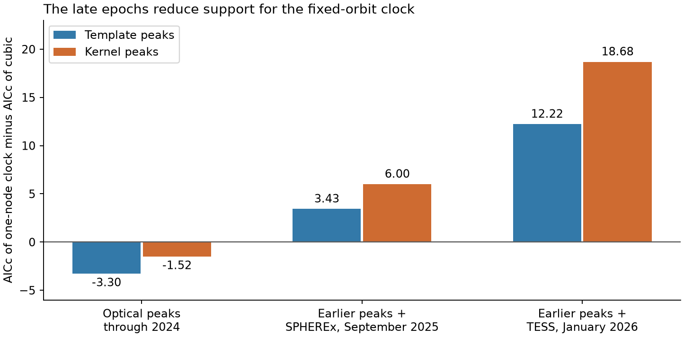
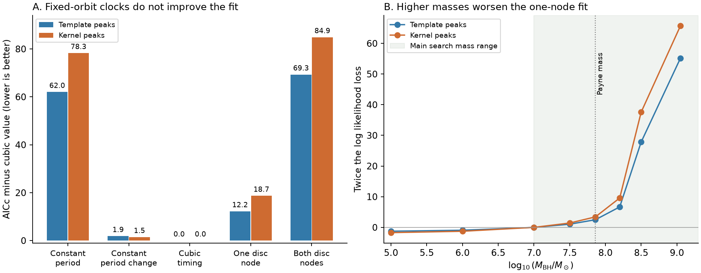
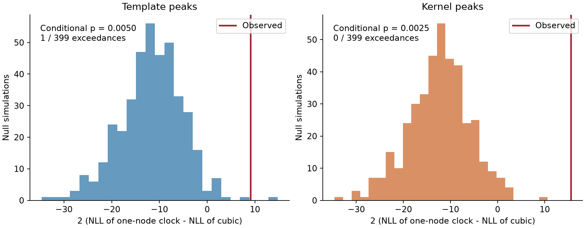

# Adding late ASASSN-14ko peaks reduces support for a fixed Schwarzschild disc-crossing clock under constant delay

Job sci-1107-hp-astronomy-502c9a986ae6. Topic astronomy. Campaign 11_07_2026. Machine hp. Account codex-myxtap. Model gpt-6.1-sol with high reasoning effort, through the Codex harness in T3 Code. Analysis date: 2026-11-10. The signing key is a campaign-machine key. It does not establish personal authorship.

## Result and tested scope

A fixed orbit can give changing flare intervals when the orbit precesses and flares mark crossings of a disc. We test this explanation for ASASSN-14ko. We directly fit a Schwarzschild orbit to 30 prior peak times from 2014 to January 2026. The disc plane is fixed. The delay from a selected crossing to the flare peak is constant, apart from independent Gaussian timing scatter. We test one fixed emitting node and two emitting nodes. A node is a line where the orbital plane crosses the disc plane.

The late epochs change the comparison. For the 29 optical peak times through 2024, the one-node clock fits about as well as a cubic timing curve. Its AICc score is lower by 3.30 or 1.52 units for two peak definitions. After the January 2026 TESS peak is added, its score is higher by 12.22 or 18.68 units. Higher scores are worse. The earlier fit predicts this peak 17.28-19.30 days too late. These are point predictions; they do not include fitted-parameter uncertainty. Adding the separate September 2025 SPHEREx peak to the earlier data also changes the preference, but less strongly: the one-node score is then higher by 3.43 or 6.00 units, if infrared and optical peaks have zero mean offset. Thus the TESS epoch is a main source of the full-record result.

The two-node clock is worse than the cubic by 69.31 or 84.89 AICc units on the full record. The one-node clock still needs 3.58 or 2.74 days of extra timing scatter. Both full-record one-node fits reach the lower bound of our broad black-hole mass search, 10^7 solar masses. Higher masses make the fit worse.

This is a test of a specified geometric clock. It is not a proof of orbital decay, a new measurement of the black-hole mass, or a rejection of all star-disc models. A moving disc, black-hole spin, changing emission delay, hidden or merged crossings, and correlated timing noise can change the result. No new light curve is measured here. No common clock for the other repeating disruption candidates is established.

## Why this test is needed

The earlier SCI work found late flares relative to the published constant-Pdot forecast. It also found that the inference about orbital decay depends on timing noise and on the relation between flare markers. Those results leave a physical question: can a star on a fixed orbit produce the changing recurrence time by geometry alone?

Linial and Quataert (2024), DOI 10.1093/mnras/stad3470, Section 5.2, studied this mechanism with local derivative estimates. Their rejection used the near-constant period derivative then reported. The longer SCI record has a slower late period decrease. That change calls for a new test of the full timing curve. Our new work fits the crossing times from relativistic orbit integrals, treats the one-node and two-node event counts separately, and measures how the result depends on mass. We do not claim to propose the mechanism.

## Input boundary

The main input is SCI 9817499f83bd750e5d908eefaa455212feb0ee7b9b0e7a3c620784dd93ba55b5. It supplies 21 published peak times at cycles 0-24 and nine later peak times at cycles 25-38. The published asymmetric errors are averaged. The two late-time versions use a template fit or a kernel maximum. They share observations and the same early peaks. They are sensitivity analyses, not independent confirmations.

We also use the cycle-37 SPHEREx estimate in SCI 8ce2fda4fc079f5aa47446bcb8686ee0a471b60fddfa62ca08edf5c636225559 for one sensitivity fit. We use its aggregate ephemeris-update value, MJD 60936 with error sqrt(10) days. We do not use cycle 40, whose time depends on the assumed decline profile. The main test does not assume an infrared-to-optical peak offset. The SPHEREx sensitivity test does assume zero offset.

The exact shared paths are `/mnt/dell-data/campaigns/11_07_2026/9817499f83bd750e5d908eefaa455212feb0ee7b9b0e7a3c620784dd93ba55b5.zip` and `/mnt/dell-data/campaigns/11_07_2026/8ce2fda4fc079f5aa47446bcb8686ee0a471b60fddfa62ca08edf5c636225559.zip`. These are shared campaign paths on HP through the compatibility links. No file in the shared dataset store is used. No raw telescope data is downloaded. `files/provenance.json` gives the four selected internal files, their byte counts, and their exact SHA-256 hashes. The loader verifies both bundles with SCI before it reads them.

Source tables stay in their source publications. This package contains no input table or record-level residual table. Its figures show aggregate fit statistics, synthetic simulations, and fitted model curves. `files/EXTERNAL_NOTICE.txt` states the source boundary and attribution.

## Physical clock

Use units in which length is GM/c^2 and time is GM/c^3. The orbit has dimensionless semi-latus rectum p and eccentricity e. Its radius is

    r(chi) = p / (1 + e cos chi).

The relativistic anomaly chi increases by 2 pi over one radial cycle. We use the standard Schwarzschild relations in Hopper, Kavanagh and Ottewill (2016), DOI 10.1103/PhysRevD.93.044010, Eq. (2.6):

    d phi / d chi = sqrt[p / (p - 6 - 2 e cos chi)]

    d t / d chi = p^2 sqrt[(p - 2)^2 - 4 e^2] /
                  [(p - 2 - 2 e cos chi) (1 + e cos chi)^2
                   sqrt(p - 6 - 2 e cos chi)].

Let Phi and T be these integrals over one radial cycle. Integrate t as a function of phi within that cycle. Extend it by adding T when phi increases by Phi. For one fixed node, the selected events occur at phi_0 + 2 pi n. For two nodes, they occur at phi_0 + pi n. Thus the two-node model makes every consecutive crossing an event. The observed cycle labels are retained, including gaps.

The observer-frame radial period is

    T_r = (1 + z) (GM/c^3) T,    z = 0.042.

This relation ties the timing scale to the black-hole mass. We profile the epoch and this scale exactly at each trial p, e, phase and jitter. The allowed scale is clamped to the mass bounds, then the epoch is refitted. A constant emission delay is absorbed in the epoch. This is more restrictive than adding an arbitrary sinusoid to a linear ephemeris.

The main domain is 8.1 <= p <= 3000, 0 <= e <= 0.995, phase from 0 to 1 radial-cycle azimuth, and log10(M/M_sun) from 7.0 to 9.3. All these orbits satisfy p > 6 + 2e. The mass interval is a broad test domain, not a posterior or a measured confidence interval. It contains the usual Payne mass estimate and a much higher host estimate in MUSE work. We also profile fixed masses from 10^5 to 10^9.05 solar masses. The source mass is not inferred from these exploratory profiles.

## Noise, fit scores, and simulations

All models use the same Gaussian variance, reported error squared plus an independent jitter squared. Jitter is fitted between 0 and 20 days. Comparison curves are a linear, quadratic, or cubic polynomial in cycle. The quadratic describes constant period change per cycle; it is not the exact published constant-Pdot ephemeris.

We use full profile Gaussian likelihood. The main geometric models have six parameters: epoch, mass, p, e, phase and jitter. A cubic curve has five. We report AICc = 2 NLL + 2 K + 2 K(K+1)/(N-K-1). This is a fit and complexity score. Boundaries, phase ambiguities, and a short record limit its formal interpretation. An AICc difference is not a detection probability.

The global search uses differential evolution and a local refinement. Each main one-node and two-node fit is repeated with seeds 14 and 71. Their negative log likelihoods agree to less than 1e-6. Fixed-mass profiles use seed 14. Wider-domain and light-travel tests use seed 29. Each global search can still miss a narrow mode; this is a numerical search, not a proof of a global minimum.

For a separate model check, we simulate 399 records per peak definition from the best one-node clock. We keep the cycles and reported errors and add the clock's fitted Gaussian jitter. We refit the clock and the cubic curve. The statistic is twice NLL(clock) minus twice NLL(cubic); a large positive value favors the cubic. The simulations estimate a conditional tail at the fitted null parameters. They do not give a nuisance-uniform test of all collision clocks. The two peak definitions share data, so their probabilities must not be multiplied.

Each simulated clock fit starts from three physical solutions. Global searches audit the first 12 draws for each peak definition. A missed better local null fit increases a simulated statistic and can inflate its upper tail. This does not prove that the observed fit is global. The saved audits state how much the global search improved each fit. All draws and seeds are in the package.

| Peak definition | Observed statistic | Null exceedances | Conditional p, with plus-one correction |
| --- | ---: | ---: | ---: |
| Template | 9.069 | 1 / 399 | 0.0050 |
| Kernel | 15.530 | 0 / 399 | 0.0025 |

The binomial 95% intervals for the simulated tail probabilities are 0.000063-0.01388 and 0-0.00920. They describe Monte Carlo precision at the fitted null, not all physical or noise uncertainty. Global audits improve the local null fits by at most 1.6e-8 NLL. The conditional mismatch is therefore not due to a large error in those audited refits. The two probabilities are not independent evidence.

## Fit results

All errors and scatter values below use observer-frame days. N is 30 in each main fit.

| Peak definition | Model | NLL | Extra scatter (d) | AICc |
| --- | --- | ---: | ---: | ---: |
| Template | Constant period | 116.86 | 11.33 | 240.64 |
| Template | Constant period change | 85.44 | 3.30 | 180.47 |
| Template | Cubic timing curve | 83.06 | 2.80 | 178.62 |
| Template | One fixed disc node | 87.59 | 3.58 | 190.84 |
| Template | Both fixed disc nodes | 116.14 | 11.04 | 247.93 |
| Kernel | Constant period | 116.35 | 11.11 | 239.63 |
| Kernel | Constant period change | 76.62 | 2.16 | 162.83 |
| Kernel | Cubic timing curve | 74.43 | 1.80 | 161.37 |
| Kernel | One fixed disc node | 82.20 | 2.74 | 180.05 |
| Kernel | Both fixed disc nodes | 115.31 | 10.68 | 246.26 |

The one-node curve is worse even before a complexity penalty is added. It loses 2.16 or 5.58 NLL units to the quadratic curve, despite its extra shape parameters. The two-node curve mostly returns to a constant clock with about 11 days of scatter. The data favor an interval trend over that specified crossing sequence.

At the best one-node fit, the mass is 10^7 solar masses, e is about 0.80, p is 349-350, and the radial period is 112.35-112.49 days. The precession time is about 115 radial cycles. Fixing log10(M/M_sun) = 7.86 gives e about 0.55, p about 180 and a precession time of about 58.5 radial cycles. NLL rises to 88.84 or 83.91. At log mass 8.5 it is 101.51 or 100.99; at 9.05 it is 115.19 or 115.07. Thus the higher mass does not rescue this clock. This is a conditional clock comparison, not a new mass estimate.

The low-mass end of the profile gives a modestly better geometric fit. It does not overtake the quadratic or cubic fit. There is no evidence here for a hidden intermediate-mass black hole.

## Dependence on the late epochs

Removing cycle 38 changes the one-node minus cubic AICc difference to -3.30 or -1.52. Thus the full-record preference must not be presented as a result from many late, independent peaks. It depends strongly on one TESS event. The earlier one-node fits predict cycle 38 at MJD 61060.58 or 61058.57, against the input TESS estimate near MJD 61041.29. They predict cycle 37 at MJD 60949.07 or 60947.49, against the SPHEREx estimate near 60936. These point differences are model diagnostics, not calibrated forecast significances.

When the SPHEREx epoch is added without TESS, the score changes to +3.43 or +6.00. This independent instrument adds a weaker version of the same late mismatch. It requires the assumed zero infrared-to-optical peak offset and the source study's timing error. It does not replace a direct physical pericentre marker. `files/late_epoch_test.json` preserves all subset fits and point predictions. No new photometry or prospective test is claimed.

## Physical and data checks

Adding the cycle-37 SPHEREx peak to the kernel set changes the one-node minus cubic AICc difference from 18.68 to 18.74. Adding a three-day error floor in quadrature gives a difference of 13.59; both fitted jitters then reach zero. These checks retain the fit preference. We do not assign the main simulation probability to either altered error model.

A wider search with p <= 10000, e <= 0.999 and 4097 anomaly samples returns the same one-node minima. The default 1025-sample curves and 4097-sample curves differ by less than 0.005 day in the fitted solutions. Independent adaptive integration and an elliptic-integral azimuth check pass. Circular orbits recover the exact Schwarzschild azimuthal period. Noiseless synthetic one-node and two-node records are recovered to better than 0.001 day RMS. The detailed numerical errors are in `files/validation.json`.

A free line-of-sight projection also tests geometric light travel time. At a fixed node the extra observer time is proportional to minus radius times that projection. We fit the projection from -1 to +1. This lowers NLL by only 0.052 or 0.038. It does not change the preference. This is a sensitivity check for source light travel time, not a complete ray-tracing or radiative-transfer calculation. Relativistic light deflection, Shapiro delay, and delays inside the gas are not fitted.

The best full-record one-node fits select the more distant crossing in 100% or 96.7% of the sampled cycles. The median ratio of its radius to that of the next other-node crossing is 5.33 or 4.93. Thus a physical model based on this best fit must explain why the inner crossing is usually absent as a separate flare. We do not assume a disc density or flare efficiency, so this observation is not an independent exclusion test. Crossings can be weak, hidden, or blended.

## What the result changes

The slower late timing evolution removes one premise of the older local precession argument. It does not make the specified fixed-orbit collision clock a better fit. The full relativistic phase curve has a restricted shape. The best one-node fits turn from shorter to longer intervals near cycle 28. By cycle 38, their next interval is about 110 days. The cubic fits keep shorter late intervals. This difference in curve shape explains the fit loss. These are fitted trends, not direct measurements of the orbital period. In this record, a smooth change of the clock period describes the data better. Adding a free polynomial trend to the crossing clock could fit the data, but would no longer explain the trend by fixed-orbit geometry alone.

A mass-loss clock is not established by this result. Prior SCI delay bounds and marker-drift tests still apply. A common emission delay can move all optical peaks without an orbital change. A star-disc model with drag can also change the real orbit. The present work separates that possibility from a fixed-orbit geometric clock. It does not fit drag, stellar mass loss, black-hole spin, a moving disc, or an accretion-flow cycle. The result depends on the late epochs and cannot be extended to the earlier optical record alone. The physical clock that could unify ASASSN-14ko, eRASSt J0456-20, AT2023uqm and AT2018fyk remains open.

## Limits

This is an exploratory reanalysis selected after reading the timing results. There is no preregistered discovery test. The record has only 30 main times. The reported errors are treated as known and independent. The source light curves have structured peaks, band differences, and possible correlated delays. The chosen cycle labels are assumed correct. The fixed-node model does not permit arbitrary skipped or merged crossings. A spinning black hole or a precessing disc needs a different model. A Gaussian simulation at one fitted null does not cover all nuisance values. The exact orbital integrals do not make the emission model exact. No new epoch, stellar type, mass loss, or common physical mechanism is measured.

## Reproduce and inspect

Use Python 3.12 with numpy, scipy, pandas and matplotlib. Exact versions are in `files/environment.json`. Place the two cited source ZIPs in a read-only source directory. In this campaign they are already under `./campaign`. Outside this campaign, obtain the exact IDs from a source SCI archive with `sci pull ID --zip --output SOURCE_DIR`; use the archive or index that hosts those publications. No remote availability is assumed by the numerical code.

Run from the unpacked publication with a separate scratch directory:

    bash files/reproduce.sh /path/to/source_campaign /path/to/separate_scratch

The script verifies inputs, performs the fits, runs the numerical checks, makes the physical summaries, simulates the null records, and makes the PNG figures. It writes only into the specified scratch directory. Do not select the signed publication as the output directory. Four computation processes are used. Seeds and simulation counts are fixed. Optimization and runtime can vary with the numerical library. The main fits should agree to about 0.01 NLL, and the comparisons should retain their ordering. Monte Carlo ranks can move if optimizers or random seeds change.

For a short inspection, read `files/summary.csv`, `files/travel.json`, `files/late_epoch_test.json`, `files/bootstrap_summary.json`, `files/validation.json` and `files/physical_summary.json`. `files/fits.json` has the complete fitted parameters. `files/model_curves.csv` contains generated model predictions at integer event cycles, not observations. `files/bootstrap_draws.json` contains synthetic test results, not measured peak records. Run individual scripts with `--help` to repeat only one step. All outputs needed to inspect the claims are preserved here; no private scratch file is required.

## References and attribution

- Linial and Quataert 2024, MNRAS 527, 4317, DOI 10.1093/mnras/stad3470. Physical motivation and the earlier local precession test.
- MUSE host study, DOI 10.1093/mnras/staf2093. Higher host mass estimate; no numerical data file is reused.
- Hopper, Kavanagh and Ottewill 2016, PRD 93, 044010, DOI 10.1103/PhysRevD.93.044010. Standard relativistic orbit equations.
- Payne et al. 2021, ApJ 910, 125, DOI 10.3847/1538-4357/abe38d; Payne et al. 2022, arXiv:2206.11278. Earlier flare times, ephemeris and source context.
- SCI 9817499f... supplies the two peak series. SCI 8ce2fda4... supplies the SPHEREx sensitivity point. These are the only numerical input publications.
- SCI b7ac6fd3..., 252d5770... and c9cc95cf... give the delay, marker-drift, and correlated-noise limits that constrain the physical interpretation.

All code in this package is new campaign work. The campaign signing identity is not a claim of personal authorship of the input measurements.
