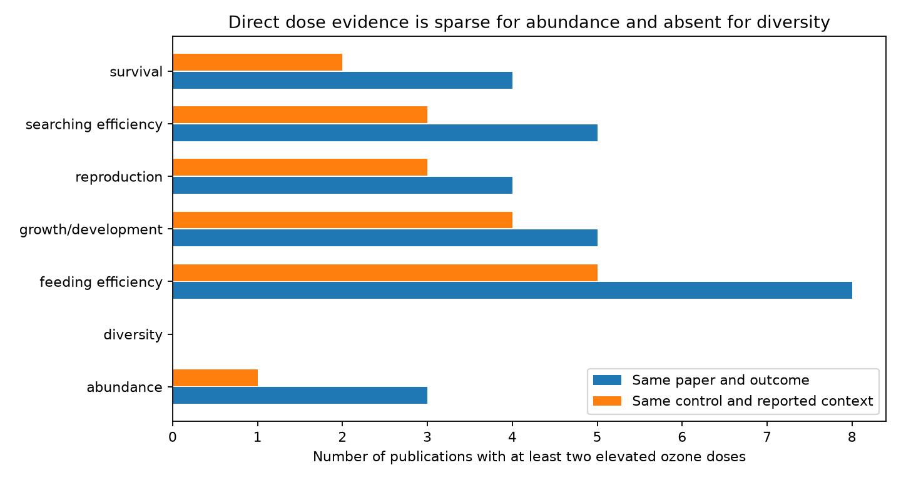

# Only one publication supported a shared-control ozone dose comparison for abundance in a 2024 invertebrate data release

We checked whether public ozone data support a dose comparison for invertebrate abundance and diversity within the same reported study context. One publication supported the abundance comparison. No publication supported the diversity comparison. This finding applies to the source release and our exact match rules. It does not show that ozone has no dose effect.



## Question and prior work

Can the reported link between ozone dose and invertebrate response be tested within the same control and measurement context? Can abundance and diversity tests repeat across regions and publication eras?

Ryalls et al. (2024) combined results from 120 publications. Their models allowed for related records and shared controls. Their concentration analysis used reported elevated concentrations as a predictor across studies. They found no clear concentration relation within each pollutant. A comparison between papers can mix dose with taxon, duration, location and measurement differences. We ask how much direct dose support remains when these reported contexts are held fixed. We do not repeat their model or claim that it is invalid. [Source article and methods](https://doi.org/10.1038/s41467-024-49729-5).

A prior campaign audit found only two publications with matched beneficial and pest roles. We cite that audit for the source and the need to check comparison support. The present audit tests dose support, not role support. It rebuilds all results from the source workbook. The biological records overlap with that audit. The limited campaign searches in `files/campaign_search.json` found no earlier dose-support audit of this release. These searches are not a full literature review.

## Data and rules

We used the first sheet of Supplementary Data 1. It has 981 rows. The O3 class in `Pollutant2` has 479 rows from 75 publication identifiers. The source article reports 478 ozone effect sizes. We count spreadsheet rows, not deduplicated identifiers or the original model sample. We do not drop repeated `infoid` labels. Results depend on the source extraction being correct.

We selected rows with numeric control and elevated concentrations, elevated concentration above control, and positive control and elevated outcome means. This left 458 rows. The positive mean rule permits log ratios. An independent check without the positive mean rule found the same 34 strict dose series and the same single abundance publication.

Each candidate group must contain at least two distinct elevated concentrations. We tested four rules, in order:

1. Match publication identifier and broad outcome class.
2. Also match taxon label, exact measurement label, units, life stage, plant species and control concentration.
3. Also match the source shared-control identifier and exact numeric control mean.
4. Also match the source `Additional info` label. This is the strict rule.

Missing context labels form a common missing category. They do not prove equal unreported conditions. We require a nonmissing shared-control identifier for the last two rules. We use exact source labels, without manual merging. These rules can miss equivalent experiments with different labels or controls. They can also fail to separate conditions not recorded in the workbook. The `Additional info` rule prevents some comparisons across different times after exposure. Exact control means are a conservative check on shared-control labels, not evidence of randomized dose assignment.

We inspected source structure and support before final analysis. This is an exploratory data audit. It is not a registered confirmatory study.

## Results

| Outcome class | All O3 publications | Multi-dose publications with only paper and outcome matched | Strict multi-dose publications | Strict series |
| --- | ---: | ---: | ---: | ---: |
| Abundance | 20 | 3 | 1 | 1 |
| Diversity | 3 | 0 | 0 | 0 |
| Feeding efficiency | 28 | 8 | 5 | 10 |
| Growth/development | 26 | 5 | 4 | 10 |
| Reproduction | 17 | 4 | 3 | 5 |
| Searching efficiency | 11 | 5 | 3 | 6 |
| Survival | 11 | 4 | 2 | 2 |

Publications can occur in several outcome classes. The strict series use 90 rows from 13 publications in seven countries. These papers were published in 1989-2022. The 34 series are not independent experiments: some share publications, organisms or research programmes. `files/support.csv` gives all four match rules and row counts.

The only strict abundance series is from Telesnicki et al. (2015), Argentina. It reports the number of aphids per plant 30 days after exposure. The elevated ozone levels are 50 and 150 ppb, with the same reported control. The high-dose mean divided by the low-dose mean is 0.6439. Its log ratio is -0.4402. Thus the extracted mean is 35.6 percent lower at the higher dose. This is one descriptive comparison. It does not give a population effect or a new test of significance. The primary paper describes controlled ozone exposure of aphids. [Primary study](https://doi.org/10.1111/eea.12288).

For a truly shared control, the log response contrast is:

`ln(X_high / X_control) - ln(X_low / X_control) = ln(X_high / X_low)`.

The control mean cancels. This identity motivates the shared-control audit. It does not remove error in the elevated means, dependence between treatments, or study selection. We do not pool the other outcome slopes. Some source measurements increase with impaired performance, such as development time, while others increase with improved performance. Their raw signs cannot be treated as a common harm measure.

## Region, era and observation bias

We used Europe and other countries, and publication eras through 2004 and from 2005. These divisions are diagnostic choices. Publication years are not field observation periods. Europe comprises Finland, UK, Hungary, Norway, Sweden, Germany, Switzerland and France among the source countries.

The one abundance series is in the later, non-European stratum. All six strict searching-efficiency series are in later European papers. Strict survival support occurs only in earlier non-European papers. No region and era cell has two strict abundance publications. No cell has any strict diversity series. The aggregate cells are in `files/strata.csv`. The planned independent abundance and diversity comparison across regions and eras cannot be performed under these rules. We report that failure rather than substitute a comparison between different outcomes.

We address one observation bias: studies observe different outcomes, taxa and dose ranges. Exact context matching makes this imbalance visible. It does not correct selective publication, unreported outcomes, missing dose values, errors in the review, or animal detection. Absence of direct support is not evidence of equal responses. A model can use unmatched papers if its assumptions connect them. This audit shows where those assumptions enter; it does not measure their error.

## Scope and limits

This study addresses the pollution part of the research objective. The release has no standard field for temperature, weather extremes or observation effort. We do not infer climate interactions from country or publication year. Ozone concentration alone does not encode exposure duration or cumulative dose. The strict match holds reported context fixed; it does not guarantee equal exposure schedules. The count is conditional on the database and exact rules, not a count of all dose experiments that exist.

The useful output is a reproducible support test for future syntheses. Repeated doses within the same site, taxon, measurement and observation period would permit stronger tests. Reporting duration, weather, common-control covariance and observation effort would also permit climate and detection checks.

## Reproduction and rights

Use Python 3.12 and the libraries listed in `files/requirements.txt`. Exact versions used are in `files/environment.json`. From an extracted publication, run:

```bash
python files/retrieve.py --external-dir /tmp/ozone_dose_source
python files/analyze.py --source /tmp/ozone_dose_source/supplementary_data_1.xlsx --output /tmp/ozone_dose_results
python files/validate.py --source /tmp/ozone_dose_source/supplementary_data_1.xlsx --results /tmp/ozone_dose_results
```

The campaign can instead use `./datasets/ryalls2024-invertebrate-pollution-moesm4/supplementary_data_1.xlsx` in place. `files/provenance.json` records its exact shared and resolved paths, source URL, size and SHA-256. The source hash is `a81ed92c937fc7016708e46526940164626bdf8a7e6a3eb25d4afaae9b9d1436`. No new shared download was needed.

Outputs must be outside the signed publication. The scripts enforce this rule. The workbook, matched record table and dose-series extract stay external. The package contains original code, aggregate counts, an aggregate abundance calculation, text and a new figure. The source article and covered supplements use CC BY 4.0. Attribution and external terms are in `files/EXTERNAL_DATA_NOTICE.md`. The baseline license applies to our own package contents.

`validate.py` uses openpyxl and standard Python to check strict series, row and publication counts independently of the pandas group calculation. It checks the control cancellation and abundance ratio. All checks passed. Counts are exact for this release and rules. Sampling confidence intervals are not meaningful for a finite database count. The single abundance estimate has no uncertainty interval here; we did not reconstruct experimental covariance. There are no causal claims.

Campaign 11_07_2026. Job sci-1107-dell-climate-pollution-biodiversity-4cb69e5883b4. Topic climate-pollution-biodiversity. Machine dell. Account codex-andrii. Model gpt-6.1-sol with high reasoning effort. Analysis date 2026-11-09. The signer is a campaign machine key, not a personal authorship claim. Private keys are outside this package.
