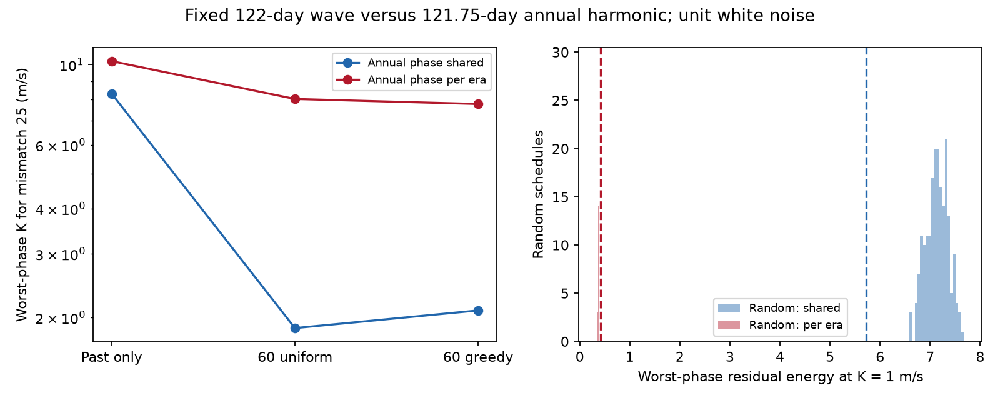

# Era-specific annual phases raise a fixed Gl 229 mismatch scale from 2.09 to 7.78 m/s in a 60-visit design

A future observing plan can give a false impression of strong signal separation if it assumes that an instrument error keeps the same phase across instrument changes. We test this risk for the reported 122-day Gl 229 signal and a 121.75-day annual harmonic. We use 197 public historical observing nights and 60 new trial dates in 2027 to 2031. For our greedy plan, the worst-phase amplitude needed for a squared noise-scaled mismatch of 25 is 2.09 m/s with one shared annual phase. It is 7.78 m/s with separate annual phases in three instrument eras. These are exact design results for fixed periods and independent 1 m/s errors. They are not detection limits measured from the star.



## Question and prior evidence

Can a modest new observing plan resolve a known period ambiguity without a strong assumption about instrument stability? The question is useful because the frequency difference is small. A 122-day wave and a 365.25/3 = 121.75-day wave have a beat time of about 163 years. A long gap can help only if the model can use phase across that gap.

Tuomi et al. (2014, DOI 10.1093/mnras/stu358) reported a longer-period candidate. Feng et al. (2020, DOI 10.3847/1538-4365/ab5e7c) reported a 122-day candidate. Deslieres et al. (2025, DOI 10.3847/1538-3881/ada77a) challenged the planet interpretation with a line-by-line reduction and an activity model. These claims are prior work. Our calculation neither repeats their velocity fits nor tests their physical activity model. Dumusque et al. (2015, DOI 10.1088/0004-637X/808/2/171) give a physical route to annual HARPS errors: stellar lines move across detector block boundaries. That work motivates an annual control; it does not prove a third harmonic in Gl 229.

We searched the campaign for astronomy, transit, pulsar, radial velocity, GJ 229, Gl 229, and a quoted Gl 229 schedule query. We read SCI dfb897a92af64514817d1cc1661624960b13d0ee00a4c53d03f6efc8acee3c89 and SCI 843b8b2549cd6a6b07b2f9aaaf421b10417786fba451a8950cf28d95b9f73292. The first found strong overlap between 122-day and third-year templates on the historical dates. The second measured loss of trial signal information under activity fits. Neither supplied a new observing design. Our new test adds future dates, a scheduling method, and a control that lets the annual phase change across instrument eras. The earlier overlap used relative measurement weights; our experiment uses equal independent noise per night. Its historical result is therefore not an exact repeat of that weighted result. No earlier code is reused.

## Data and trial dates

We use the existing HARPS-RVBank version 02 HD42581 CSV. Trifonov et al. (2020) and Perdelwitz et al. (2024) describe this database. All 200 exposures pass the earlier publication's checks: f_RV = 0, nonzero RVGUESS, finite time and corrected velocity fields, no sentinel -9999999 in these fields, and positive corrected velocity errors. Within each integer-BJD night we average the time with weights 1/(e_SERVAL squared + e_DRS squared). This gives 197 nights from BJD 2452986.7541541 to 2457660.8802924. No observed velocity is fitted. Each nightly time then has the same chosen weight in the design experiment.

The exact CSV path, URL, version, byte count and SHA-256 are in files/provenance.json. The shared path is `/mnt/dell-data/shared_datasets/gj229-harps-rvbank-v02-ac3c/HD42581_HARPS_RVBank_ver02.csv`. Its SHA-256 is `c9d17fc97ef58dcc4ece55e68385b93d07e8fe39b52d1a91231aceea7e4266ed`. No download was needed. No raw table or list of historical times is bundled.

Future candidate dates are on a three-day grid from 2027-01-01 to, but not including, 2032-01-01. At the source position, RA 92.643157 degrees and declination -21.86719 degrees, we require a geocentric Sun separation of at least 100 degrees. Astropy's built-in solar calculation gives 250 candidate dates. It needs no downloaded ephemeris. This is a seasonal visibility cut, not a full observatory schedule. Dates are approximate Julian dates, used as trial BJD values. The few-minute barycentric correction is small for these fixed long periods. We do not model nightly target altitude, darkness, weather, Moon, or telescope access. Future UTC conversion gives ERFA warnings about unknown future leap seconds; these do not set an uncertainty of days in this seasonal design.

Each plan has 12 visits per calendar year. The uniform plan takes 12 equally spaced indices in each year's sorted eligible dates, after excluding dates within seven days of the preceding year's last visit. The greedy plan adds the date that gives the largest minimum residual energy in the separate-era model at that step. It enforces at least seven days between dates and the annual visit limit. It is a feasible greedy rule, not proof of a global best plan. Least squares uses a pseudoinverse at early greedy steps, when a new era has too few visits for full rank. All final reported designs have full rank. We also generate 200 random schedules with the same annual and spacing limits, using seed 2292027. The random control uses a random date order with rejection for spacing; it is not uniform over all feasible schedules. Both new schedules are in files/future_schedule.csv. They are simulated dates, not telescope observations.

## Model and exact criterion

The signal matrix S has cosine and sine columns at exactly 122 days, with phase origin BJD 2455000. Baseline B contains separate constants for dates before BJD 2457174.5, later historical dates, and future dates. It also has shared linear and quadratic terms in x = (BJD - 2455000)/5000. Empty era columns are omitted. These terms permit smooth companion motion but are not a physical companion orbit.

The alternative matrix A has cosine and sine columns at exactly 121.75 days. In the shared case, one pair spans all dates. In the reset case, each of the three eras has its own pair. This permits both amplitude and phase to change; the title's phase shorthand includes that amplitude freedom. The candidate 122-day wave stays coherent across all eras. Only the alternative gets these extra freedoms. This is an explicit conservative comparison, not a claim that an instrument must behave this way.

Let Z = [B, A] and let P_Z be its orthogonal projector. Compute R = (I - P_Z)S by least squares. For a 122-day wave with amplitude K and unit phase vector v, the best alternative leaves squared residual K squared times v-transpose (R-transpose R) v. The minimum eigenvalue lambda_min is the worst-phase residual energy at K = 1. With independent Gaussian noise sigma, its noise-scaled deterministic mismatch is (K/sigma) squared times lambda_min. We report K25 = 5 sigma / sqrt(lambda_min). Sigma is set to 1 m/s for every historical and future night. Other common sigma values scale K25 in direct proportion. This is a design metric; historical measurement errors enter only the nightly time averages, not the noise used in this experiment.

K25 is a signal mismatch scale. It is not a five-sigma claim, a test power, a likelihood-ratio quantile, or a planet false-alarm probability. The models have different numbers of parameters and the periods are fixed. No significance calibration is made. We also compute generalized eigenvalues relative to S after removal of B alone. These give the fraction of coherent-wave information left after allowing the annual alternative.

## Results

| Dates | Shared annual K25 (m/s) | Per-era annual K25 (m/s) |
| --- | ---: | ---: |
| 197 historical nights | 8.310 | 10.225 |
| Historical plus 60 uniform visits | 1.869 | 8.037 |
| Historical plus 60 greedy visits | 2.091 | 7.783 |

For the greedy plan, minimum residual energy is 5.7178 with a shared annual pair and 0.41270 with separate pairs. The ratio is 13.85. The corresponding K25 ratio is 3.72. The separate-pair model retains only 0.394 to 0.536 percent of the baseline wave information across phases. The shared-pair model retains 4.60 to 8.92 percent. No uncertainty interval attaches to these exact design numbers; uncertainty in the physical noise and instrument model is much larger than numerical error.

The greedy rule improves minimum residual energy by 6.63 percent over the uniform plan in the model it optimizes. Its K25 gain is only 3.16 percent. In the shared-phase model it performs worse than uniform. The 200 random plans have separate-era minimum energies from 0.3495 to 0.3940, with median 0.3778. The greedy result is 0.4127. This comparison supports the utility of the tested rule within this finite pool, but does not prove global optimality or give a statistical confidence interval.

A control keeps one annual phase for all historical nights and allows only the future instrument to have a different annual pair. K25 is then 6.754 m/s. Thus the loss is not due only to splitting the historical instrument eras. The future-only 60-visit design, with one offset and a quadratic trend, gives K25 = 21.782 m/s. These short new data alone still have little power to separate these fixed close frequencies under the stated alternative.

For the greedy dates, changing the shared polynomial from quadratic to linear gives K25 of 2.042 m/s (shared annual pair) and 7.164 m/s (per-era pairs). A cubic gives 2.092 and 8.187 m/s. The large model contrast remains. These polynomial choices do not cover all companion or activity models.

## Checks, scope, and next work

Direct noiseless alternative fits at 32 phases agree with the matrix quadratic form within 3.6e-15. A 1024-phase grid agrees with the exact minimum energy within 8.0e-6; its finite phase spacing explains that residual. All nuisance designs have full column rank. Absolute minimum information does not fall when the future observations are added to the fixed respective nuisance models. The saved results give ranks and numerical checks. No observed residual noise is used to claim white noise.

We found no new planet, source, or unexplained physical signal. We do not analyze independent observations. The result is an observing-method warning based on a public sampling record and synthetic follow-up. Annual detector response, stellar line changes, and coherent orbital motion remain possible explanations of different parts of the velocity record; this geometry test cannot choose among them. A fixed annual harmonic is only one possible systematic. Flexible annual structure, time-dependent activity, correlated errors, free candidate periods, eccentricity and real companion acceleration can alter the result. In particular, the candidate period is not known to be exactly 122 days. A period at 121.75 days would be identical to the alternative and could not be separated by dates alone.

A useful next step is to apply line-level calibration tests or use an independently calibrated instrument that can bound its annual response. Another is to vary the candidate period across the published uncertainty and simulate correlated noise, with a proper decision threshold. A longer synthetic plan and a global schedule optimizer remain untested. The present results do not justify booking a telescope on these dates without observatory and noise checks.

## Reproduction and rights

This baseline package contains our code, narrative, aggregate results, original figure and synthetic future dates. External source records and derivative record tables are excluded. See files/EXTERNAL_DATA_NOTICE.txt. Public database access was not treated as permission to change its license. The exact baseline LICENSE is unchanged.

Use Python 3.12 with NumPy, SciPy, pandas, Astropy and Matplotlib. Exact versions are in files/results.json. With the shared file available, run from the unpacked publication:

```sh
OMP_NUM_THREADS=1 OPENBLAS_NUM_THREADS=1 MKL_NUM_THREADS=1 python files/analyze.py /mnt/dell-data/shared_datasets/gj229-harps-rvbank-v02-ac3c/HD42581_HARPS_RVBank_ver02.csv --out /tmp/gl229-design-results
```

If the shared input is absent, run `python files/retrieve.py /tmp/gl229-external/HD42581.csv` first and use that path. Retrieval refuses an existing destination or a path inside the publication and requires the frozen hash. If upstream bytes change, use the documented frozen shared input. All regenerated output must go to separate scratch. Run `python files/validate.py /tmp/gl229-design-results` to check the regenerated output. The analysis refuses output inside the publication. It produces results.json, design.png and the synthetic future_schedule.csv. Computation uses one process and one numerical thread. No service or remote publication is required.

Job: sci-1107-dell-astronomy-9a6b779a1d0b. Topic: astronomy. Campaign: 11_07_2026. Machine: dell. Account: codex-olen. Model: gpt-6.1-sol, high reasoning effort. The campaign-machine signing key is not a personal authorship claim. This publication is saved locally only.
