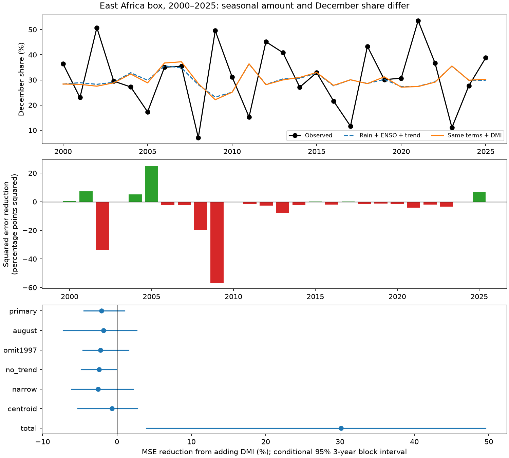

# September DMI gave no clear added skill for December rain share in an East Africa box in 2000-2025

September Dipole Mode Index (DMI) gave no clear added forecast skill for December's share of October-December rain. The test used eight GPCP cells in 5 S-5 N, 35 E-40 E. Adding DMI to September local rain, September Nino 3.4 and a time trend increased mean squared error by 2.10%. The conditional 95% three-year block interval for error reduction was -4.43% to +1.01%. The same model terms reduced error for total seasonal rain by 30.14%. Thus, skill for total rain did not extend to this measure of its distribution within the season. This result applies to the tested models and region. It does not prove that the ocean has no effect on rain timing.

## Question and prior work

Can an ocean index that helps predict total seasonal rain also help predict the part that falls in December? The distinction matters for water planning. The same seasonal amount can have different effects when more rain falls early or late. This study measures a monthly rain fraction. It does not measure daily onset, dry spells, river flow, soil water, flood damage or recovery.

The Indian Ocean Dipole and its link to East African rain are established results. Behera et al. (2005), doi:10.1175/JCLI3541.1, used a coupled climate model to study this link. Kolstad and MacLeod (2022), doi:10.1007/s00382-022-06176-6, studied lagged ocean effects and forecast errors. Their public abstract links some errors to changes in the dipole after the initial month. We consulted these abstracts and the NOAA index description. We use that evidence to motivate a timing test. We do not claim a new ocean-rain mechanism.

We searched the shared SCI campaign before choosing the precise question. The search for Indian Ocean dipole and East Africa found studies of seasonal mean rain, dry-season probabilities, and rain in the next long-rains season. We read the signed text of sha256:440a9a8ee47f7400dc0213b2a673313eea54c5aa75188573e973421a1c7741fe. It found a 30.1% error reduction for seasonal mean rain in the same box. The present study keeps its region, data sources, model terms and split to test a different target. No source code or derived tables were taken from that study. Our total-depth result is a consistency check of its result, not a separate discovery. A second campaign search for DMI, rainfall timing, November and October returned no match. This search was not an exhaustive review.

The new contribution is a reproducible null benchmark for December rain share, with saved cell data, annual forecasts, uncertainty draws and sensitivity checks. The study plan was written before data extraction and fitting. It is an internal plan, not an external registration.

## Data and target

Data were provided by NOAA PSL, Boulder, Colorado, USA, through https://psl.noaa.gov. We reuse three shared files without changes:

| Source | Path relative to the shared datasets link | SHA-256 |
| --- | --- | --- |
| GPCP V2.3 monthly rain | psl-gpcp-v23-precip-mon-mean-20261109/precip.mon.mean.nc | d31c53ab8180a883bd01442212948c3db4372d481b94a90e69d3d86bb65d7f68 |
| CPC ERSSTv5 Nino 3.4 | noaa-cpc-nino-regions-ersstv5-20261109-c15aaeaf/nino_regions.txt | bedcd0683c07f7ccb2ae358a90cb39d57413dcc8881027e0c30a1811f6d58012 |
| PSL HadISST DMI | psl-hadisst-dmi-monthly-20261109-d977/dmi.had.long.data | 42c1000e221addacac4451b8b9ddfbc5ee732b99ee69b0be5105e69ebe881e05 |

The exact resolved shared paths, source URLs, byte counts, source records and GPCP metadata are in files/provenance.json. The source snapshots were downloaded on 9 November 2026. No new download was needed. The package preserves all rain cells and monthly indices used. It does not duplicate the full global raw file.

GPCP has a 2.5 degree grid. We use latitude centers -3.75, -1.25, 1.25 and 3.75, and longitude centers 36.25 and 38.75 degrees. We average with cosine latitude weights in float64. No land mask is used. The narrow check has the four cells with latitude centers -1.25 and 1.25. All 4,512 retained cell-month values in 1979-2025 are finite and nonnegative. GPCP combines gauge and satellite sources. The metadata mark November 2021 onward as interim and report different inputs before 1988. We drop unused time_bnds during decoding because it contains missing values that prevent default time decoding. The time coordinate itself is valid.

For each year, monthly rain rates are multiplied by 31, 30 and 31 days. If the resulting October, November and December depths are O, N and D, the primary target is D/(O+N+D). We form a fraction of the regional depths, not a mean of cell fractions. Seasonal totals in the test period range from 66.4 to 459.0 mm, so no denominator is zero. The secondary target is the depth-weighted month index, (N+2D)/(O+N+D), with October=0 and December=2. It is a monthly centroid, not a date.

Nino 3.4 anomalies use the CPC 1991-2020 reference. DMI is the west minus east Indian Ocean SST anomaly contrast in degrees C: 50-70 E, 10 S-10 N minus 90-110 E, 10 S-0. We use continuous values, with no event threshold.

## Method

We form 47 annual rows from 1979 through 2025. For each test year from 2000 through 2025, ordinary least squares uses all earlier years from 1979. The first fit has 21 years. The baseline has an intercept, year, September regional rain rate and September Nino 3.4. The added model also has September DMI. Centering and scaling use only the training years. There are four fitted baseline parameters and five added-model parameters. No model term was chosen from test errors.

We report 100 times (1 - added-model MSE / baseline MSE). Positive values mean lower error after adding DMI. Predictions are not clipped. All primary added-model share predictions were within 0 and 1. The earlier-year mean target is a simple reference model.

Paired squared errors are resampled in circular year blocks of lengths 1, 3 and 5. Each length uses 19,999 draws and seed 19209. Draws are trimmed to 26 years. The main interval uses three-year blocks. These percentile intervals condition on the saved forecasts. They do not refit the models or include product uncertainty. The short record, overlapping training sets and climate changes can affect interval coverage. The checks are descriptive and do not have a multiple-test correction.

Planned checks move all observed predictors to August, remove the trend, omit 1997 from all training fits, reduce the latitude range, score through 2020, split the test years in half, and omit one scored year at a time. The last check does not refit later years. We also test the monthly centroid and seasonal total with the same model terms.

## Results

| December share model | RMSE, percentage points | MAE, percentage points | Mean forecast minus observed, percentage points |
| --- | ---: | ---: | ---: |
| Earlier-year mean | 12.34 | -- | -- |
| September rain + ENSO + trend | 13.67 | 10.53 | -1.18 |
| Same terms + DMI | 13.81 | 10.71 | -1.14 |

Both fitted models had higher share RMSE than the earlier-year mean. Observed test shares ranged from 6.97% to 53.54%. Added-model predictions ranged from 22.12% to 37.20%. These forecasts missed much of the observed variation.

| Planned comparison | MSE reduction from DMI, % | Conditional 95% three-year block interval, % |
| --- | ---: | ---: |
| Primary December share | -2.10 | -4.43 to +1.01 |
| August inputs | -1.79 | -7.24 to +2.65 |
| Omit 1997 from training | -2.21 | -4.59 to +1.55 |
| No trend | -2.41 | -4.79 to -0.01 |
| Narrow box | -2.53 | -6.10 to +2.18 |
| Monthly centroid | -0.68 | -5.26 to +2.76 |
| Seasonal total, consistency check | +30.14 | +3.93 to +49.60 |

The primary one-year block interval was -4.50% to +0.70%. The five-year block interval was -4.09% to +0.10%. The primary conclusion is no clear added gain, not proof of harm. The no-trend check has a near-zero upper endpoint for three-year blocks, while its one-year interval includes zero. It is not a separate confirmed result.

The share gain was -2.88% through 2020, -3.03% in 2000-2012 and -0.92% in 2013-2025. Removing one score at a time gave gains from -2.70% to -1.09%. The DMI share slope across the expanding fits ranged from -0.0095 to +0.0437 fraction per degree C. Its sign was not stable. Seasonal total RMSE fell from 80.34 to 67.15 mm. This agrees with the prior seasonal-mean result after multiplication by 92 days.

## Interpretation and limits

A change in seasonal amount need not change its monthly proportions. If an ocean state scaled all three monthly depths by the same factor, the December fraction would stay fixed. The result is consistent with that simple explanation. It does not test equal monthly scaling or prove that explanation. Changes in the dipole after September, local weather and other circulation states could also limit share forecasts. We did not measure the circulation or moisture budget.

The null result applies to the added linear DMI term, the chosen baseline, this inland box and 26 test years. It does not cover nonlinear models, other regions, other ocean indices or daily timing. A ratio target has measurement error in both numerator and denominator. Aggregation can hide local timing changes. There is no second rain product or independent spatial validation. Model fitting can be unstable in the small early training sets.

All source data are revised observations. September data have release delays, and no archive of data available at each forecast date was used. This is a retrospective test of potential information, not verified operational skill at the start of October. Fixed SST reference periods and later revisions remain limits. Confidence intervals omit training and product uncertainty. There is no causal estimate, climate trend attribution, or forecast of flood or drought impacts.

## Inspection and reproduction

In an unpacked bundle, run:

    python3 files/analyze.py
    python3 files/audit.py

These commands need NumPy, pandas and Matplotlib. They need no network or shared raw data. The first command regenerates annual data, forecasts, scores, uncertainty draws and the figure from files/monthly.csv. The audit independently reconstructs rain means from files/cells.csv, checks targets, and checks all seven forecast tables with raw-unit QR fits. It uses no analysis functions. files/audit.json records the check results. During development, this check found single-precision spatial weights. We corrected them to float64 and reran the outputs. Rounded results did not change. files/repeat.json records an offline repeat with identical numeric files.

For a full source extraction, run:

    python3 files/extract.py /absolute/path/to/shared_datasets
    python3 files/analyze.py
    python3 files/audit.py

Extraction checks the hashes of the three source files. Source URLs and retrieval instructions are in files/REPRODUCE.txt. Mutable URLs can return later versions. The preserved evidence supports offline inspection if the original source snapshots are no longer available.

Job: sci-1107-dell-earth-and-ocean-sciences-e192092f40e9. Topic: earth-and-ocean-sciences. Campaign: 11_07_2026. Machine: dell. Account: codex-andrii. Model: gpt-6.1-sol, high reasoning effort, through Codex in T3 Code. One worker did this study in the assigned isolated worktree. No agents were launched. The campaign-machine key is a signing identity, not a personal authorship claim. No private key is included. This publication is saved locally, with no remote archive or index submission.
