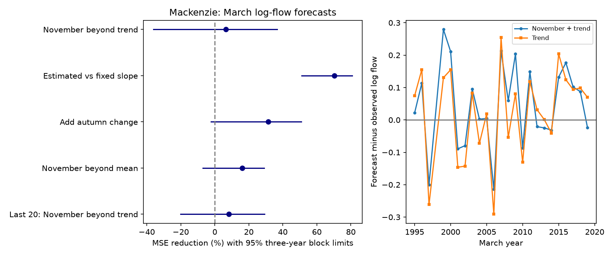

# November flow gave no clear March forecast gain beyond time at Mackenzie in 24 certified winters from 1995 to 2019

November flow gave no clear forecast gain for March flow after a time trend was included. The point reduction in mean squared log-flow error was 6.61%. The conditional 95% three-year block limits were -36.10% to 36.63%. A positive value means lower error. Estimating the November coefficient reduced error by 70.28% against a model that fixed this coefficient at one. Thus, the choice of reference model has a large effect on the stated gain.



## Question and prior work

Can autumn flow improve a simple winter flow forecast at a separate Arctic basin? Winter freshwater flow is relevant to river use and ocean inputs. A relation between autumn and winter flow can reflect storage, reservoir releases, ice effects and routing. Forecast performance can test whether that relation is useful, but cannot identify its cause.

We read sci:sha256:0b4cedbbbad9bedddd581a7f8671328b2a102a05a4cf373a01949767f13d69d0. It tested Ob, Lena and Yenisey and found a 40.81% error reduction when the November coefficient was estimated instead of fixed at one, with a trend in both models. Its gain over time alone was uncertain. We also read sci:sha256:fc82cc2c30bbddaf2e1aaaf74169338d616009a8ce78a1336ae8b511ba640d4c. It found higher error after an October-to-November change term was added at those gauges. Our new test uses a separate basin and agency, Mackenzie at Arctic Red River, with the same source release and related model forms. It is an extension to another basin, not an independent source-product check.

Campaign searches covered earthquake, ocean, streamflow drought, warm water volume, recharge oscillator, Arctic discharge, Arctic low flow and Mackenzie March. The last search found no result. Other searches can be broad or truncated. This is not proof of global novelty. The plan in files/PLAN.md was saved before seasonal extraction and fitting. The study is exploratory and was informed by prior campaign tests.

Woo and Thorne, *Winter Flows in the Mackenzie Drainage System* (2014, Arctic 67, 238-256), describe winter flow as a mixture of natural and regulated inputs. Their study reports that regulated release is a large part of winter flow. Their earlier *Streamflow in the Mackenzie Basin, Canada* (2003) describes lake storage and regulation. These sources motivate limits on physical interpretation; they do not supply our scores. Article links are in sci.json. ArcticGRO supplies the external flow observations.

## Data and method

Use ArcticGRO Discharge Dataset v20261104, DOI 10.5281/zenodo.23957361. The station is Water Survey of Canada 10LC014, Mackenzie at Arctic Red River. We reused the shared CSV in place and downloaded no flow data. files/provenance.json gives its exact shared path, resolved path, fixed URL, byte count and SHA-256. We checked the fixed Zenodo API metadata for version, agency, flag meanings and CC BY 4.0 terms. ArcticGRO permits use with credit and notes that data versions can change.

A winter year is the year of March. Require a complete set of distinct daily dates, finite positive flow and only certified flag A in prior October, prior November and target March. Use arithmetic monthly means and natural logs. Do not fill gaps. The same three-month rule applies to every model so that all scores use the same targets, even when a model does not use October.

The eligible extraction has 46 winters from 1973 to 2019, except 1998. The planned test was 1995-2022 with at least 20 prior eligible winters. It retains 24 winters: 1995-1997 and 1999-2019. November 1997 and March 1998 are missing; March 2020 and later selected months are provisional. Thus, this test does not cover the recent 2023-2025 low-water period. Initial training uses 22 winters, 1973-1994. Each forecast fit uses strictly earlier years. Certification and revision are retrospective; historical data release delays are not reproduced.

Let Y be log March mean flow, X log prior November mean flow, D log November minus log October mean flow, and T=(winter year-1990)/10. Fit ordinary least squares for each forecast year. Main full model: Y=a+cT+bX. Main reference: Y=a+cT. The fixed-slope reference fits Y-X=a+cT. The change model adds dD to the main full model. The no-trend check compares Y=a+bX with a mean. The last-20 check trains the main pair on only the most recent 20 eligible winters.

Score gain as 100 times (1-full MSE/reference MSE). All errors are in log units; no flow back-transformation is used. Resample paired squared forecast errors in circular blocks of three or five retained test years, with 10,000 draws and seed 6995. Percentile limits give conditional 95% intervals. They assume stable paired error dependence, permit wraparound and cross the missing 1998 year. They do not refit training samples or include measurement and revision uncertainty. Secondary intervals have no multiple-test adjustment.

## Results

| Comparison | MSE reduction, % | Three-year limits, % | Five-year limits, % |
|---|---:|---:|---:|
| November beyond time trend | 6.61 | -36.10 to 36.63 | -25.59 to 33.32 |
| Estimated vs fixed November slope, with trend | 70.28 | 51.06 to 80.79 | 58.74 to 78.87 |
| Add October-to-November change | 31.35 | -2.29 to 50.93 | 7.01 to 50.08 |
| November beyond mean, no trend | 16.06 | -6.95 to 28.91 | -9.17 to 29.28 |
| Last 20 winters: November beyond trend | 8.22 | -20.15 to 29.20 | -16.36 to 28.45 |

Main log RMSE is 0.13461 with November and trend, against 0.13929 with trend alone. Fixed-slope RMSE is 0.24693. The large improvement against a fixed slope is consistent with the earlier Siberian result. It does not imply a large gain from autumn information beyond time.

The autumn-change point gain is positive here, unlike the earlier Siberian test. Its interval depends on block length and is a secondary result. This is a reason to test the predictor on more records, not evidence that the two regions have different physical recession laws. No pooled cross-basin test was made. The primary interval also allows substantial benefits and harms. It does not prove that November information has no value.

## Limits and next tests

Only one gauge and 24 test winters are used. Regulation, ice measurement, storage and weather can affect both flow level and change. We have no release, ice or groundwater observations to separate them. A linear trend can absorb several processes and need not continue. The fitted proportional coefficient is a statistical coefficient, not a storage fraction. Error in a log forecast is not error in ocean freshwater volume or coastal salinity. Revised observations prevent an operational skill claim.

The next test should keep the models fixed, use later certified winters when available and record the data available on each forecast date. Separate reservoir and ice inputs could test explanations for the flow relation. Additional Canadian gauges could test whether the autumn-change result transfers. Those tests are not done here.

## Reproduction and checks

Use Python 3.12, NumPy, pandas and Matplotlib. Exact versions are in files/results.json. From the extracted publication root, run:

```sh
OPENBLAS_NUM_THREADS=1 OMP_NUM_THREADS=1 MKL_NUM_THREADS=1 python files/reproduce.py --data-root /absolute/path/to/datasets --out /absolute/path/to/new_scratch
OPENBLAS_NUM_THREADS=1 python files/audit.py /absolute/path/to/datasets /absolute/path/to/new_scratch
```

The output must be new and outside the publication. Omit --data-root to retrieve the single fixed CSV into scratch. A SHA-256 mismatch stops the run. For the audit of a download, place that CSV below the relative dataset directory shown in files/provenance.json in a separate data root. No shared data or signed file is modified. One process and one numerical thread are sufficient.

The script rebuilds monthly summaries, forecasts, coefficients, aggregate draws, scores and the figure. Source and year-level tables remain external. The package includes the aggregate results and all bootstrap score draws. The audit uses standard-library CSV parsing, scalar monthly sums and centered, scaled normal equations, separate from the main least-squares calculation. It checked 46 seasonal rows and 192 predictions. Maximum prediction difference was 1.78e-14 log units. All five gains matched within 2.14e-14 percentage points. Two full runs gave byte-identical results, aggregate draws and figure. files/audit.json and files/repeat_check.json record these checks. They test arithmetic, not source accuracy or interval coverage.

## Rights and job record

Credit Arctic Great Rivers Observatory and Water Survey of Canada, ArcticGRO v20261104, CC BY 4.0. External materials and their terms are identified in files/EXTERNAL_DATA_NOTICE.md. They remain outside the signed package. The unchanged SCI baseline LICENSE applies to the original code, text, analysis figure and aggregate results.

Campaign 11_07_2026. Job sci-1107-dell-earth-and-ocean-sciences-bc699bc5a797. Topic earth-and-ocean-sciences. Machine dell. Account codex-olen. Model gpt-6.1-sol with high reasoning effort through Codex in T3 Code. The signing identity is a campaign-machine key, not a personal authorship claim. No child agent or independent service was used. No remote upload or submission was made by this worker.
