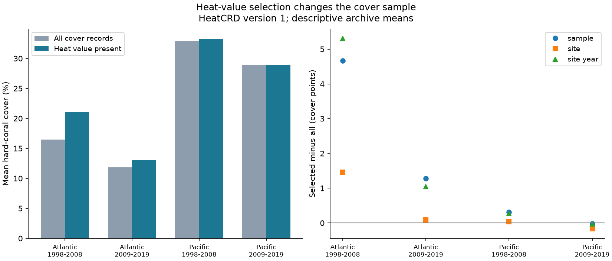

# Heat-value selection raised mean coral cover in two Atlantic HeatCRD samples in 1998-2019

We tested how a requirement for a survey heat value changes the coral-cover sample. HeatCRD version 1 gave 24,291 sample IDs in the Atlantic and Pacific in 1998-2019. We compared all records with records that have a TSA_DHW value in two periods. In the Atlantic, selected mean cover was higher by 4.66 points in 1998-2008 and 1.28 points in 2009-2019. Changes in data-source shares account for +4.65 and +1.30 points. The Pacific shifts were +0.31 and -0.02 points. Equal site weights reduced the Atlantic shifts to +1.46 and +0.09 points. A known-depth filter nearly removed them. These are exact descriptions of selected archive records, not population estimates or heat effects. Missing dates, source loss, survey effort and depth records limit use of the selected sample. The package gives code, the sample panel, source terms, raw-data hashes, checks and a figure.

## Question and prior work

Does a requirement for a survey heat value change the coral-cover sample? A heat analysis often removes records without weather data. If the removed sources have different cover, the remaining cover mean can change before any heat model is fitted. This can limit comparison between heat studies and broad cover summaries.

[Sully et al. (2019)](https://doi.org/10.1038/s41467-019-09238-2) used global bleaching and temperature data. [Van Woesik and Kratochwill (2024)](https://doi.org/10.1038/s41597-024-03221-3) describe HeatCRD. Their extraction rule requires a known month and year. They can use day 15 when the day is missing. The data thus do not require an exact field date for each heat value. This audit tests actual value presence, not whether the date is exact.

The campaign has many bleaching and survey-return studies. We searched four sets of terms and read SCI 8553ad06, which tested common-survey error in cover changes. It uses the same raw archive. The present question, sample and calculation differ. We do not claim an independent data-source replication. Search evidence and the prior verified main text are preserved. This focused search does not establish that no earlier study asked this question.

## Data and selection

We read the shared raw file in place:

    /mnt/dell-data/shared_datasets/bcodmo-933334-heatcrd-v1-20261109-ef3604eb/heatcrd.csv

It is BCO-DMO 933334 version 1, dated 2024-08-15. It has 17,242,977 bytes. Its SHA-256 is:

    c3ca8c2541b0883d50215c4f13cda23d79ebcfaff5dc05d738105f01ae0d4bdb

The exact source URL, retrieval record and license are in files/provenance.json. No download or shared-data change was needed.

The raw table has 29,208 rows and 29,205 sample IDs. For repeated sample IDs, all fields used for selection and matching must agree, including missing values. Cover values can differ; we average these values once per sample ID. This prevents table-join repeats from adding weight. We then keep Atlantic or Pacific records in 1998-2019 with cover from 0 to 100 percent. The result has 24,291 unique sample IDs. We do not require month, day or depth in the primary sample. We do not fill a missing cover or heat value.

A record is selected if TSA_DHW is finite and present. A value of zero is present and remains selected. The two periods are 1998-2008 and 2009-2019. They contain separate years. The oceans contain separate sites. Repeated sites across periods, common sources and shared data methods mean these are four descriptive checks, not four independent experiments. The exploratory design followed inspection of availability counts and means. It is not a registered test.

## Calculation

The primary calculation gives each sample ID equal weight. Let p_s be source s's share of all record weight, and q_s its share of selected weight. Let mu_s be its full mean cover, and nu_s its selected mean. Then:

    selected mean - full mean
      = sum_s (q_s - p_s) * mu_s + sum_s q_s * (nu_s - mu_s)

The first term is the change from source shares. The second term is change within sources. For a source with no heat value, q_s is zero. Its selected mean is not estimated; the second term is set to zero. The identity needs no imputed heat or cover. These terms describe the archive and do not identify causal mechanisms.

We repeat the calculation with each site's records given total weight one. A second rule gives each site-year total weight one. Selected weights are renormalized after removal under each rule. These are different targets, not estimates of a universal reef mean. Other checks restrict depth to 0-30 m or remove Florida CREMP. The depth check also removes missing depth. It is not a clean test of depth itself.

We give exact archive differences. We do not attach confidence intervals or significance tests. There is no random reef sample, known inclusion probability, or specified superpopulation here. Exact arithmetic does not remove cover measurement error or selection bias.

## Results

| Ocean | Years | All IDs | Heat IDs | Full mean | Selected mean | Shift | Source-share term | Within-source term |
| --- | --- | ---: | ---: | ---: | ---: | ---: | ---: | ---: |
| Atlantic | 1998-2008 | 2471 | 1661 | 16.445 | 21.109 | +4.664 | +4.648 | +0.016 |
| Atlantic | 2009-2019 | 4479 | 3553 | 11.816 | 13.100 | +1.283 | +1.299 | -0.016 |
| Pacific | 1998-2008 | 6593 | 6106 | 32.911 | 33.218 | +0.307 | +0.298 | +0.009 |
| Pacific | 2009-2019 | 10748 | 10177 | 28.875 | 28.851 | -0.024 | -0.002 | -0.021 |

Means are percent cover. Shifts and terms are cover percentage points. Rounding can prevent displayed terms from adding exactly. The code checks the unrounded identity.

The Atlantic shifts are positive in both periods. The Pacific does not repeat a large shift. Source-share changes explain almost all of the Atlantic shifts under the stated identity. The negative late Atlantic within-source term makes the source-share term slightly larger than the net shift.

Sources with no heat value in the given ocean-period account for 32.54%, 20.65%, 6.70% and 5.01% of full record weight in table order. They number 8 of 28, 6 of 16, 21 of 41 and 13 of 36 sources. Thus a source-based adjustment fitted only to heat-selected records cannot represent all sources without new assumptions or exposure recovery. A zero-heat source here is defined within each ocean-period, not across the whole database.

Florida CREMP has no selected records in either Atlantic period. Removing it reduces the Atlantic shifts to +0.376 and +0.007 points. This is an influence check; it does not show that the source is wrong. It shows that different data sources can define different heat-analysis samples.

| Weight or filter | Atlantic early | Atlantic late | Pacific early | Pacific late |
| --- | ---: | ---: | ---: | ---: |
| Each sample ID equal | +4.664 | +1.283 | +0.307 | -0.024 |
| Each site equal | +1.461 | +0.093 | +0.034 | -0.169 |
| Each site-year equal | +5.300 | +1.050 | +0.274 | -0.033 |
| Known depth 0-30 m | +0.100 | -0.004 | +0.226 | -0.077 |

The primary Atlantic result depends strongly on repeated survey weight and on which depth records enter the target sample. A heat restriction adds very little shift after the known-depth filter in this archive. The filters therefore act on related record sets. This limits use of the primary shift for analyses that already require a known depth.

## Explanation and limits

Missing month is common among records without heat. Files/date_support.csv gives exact counts. This agrees with the documented extraction rule. Source-level differences are also large. These facts support a source-and-date selection explanation for the mean shifts. They do not prove that missing dates caused a particular biological difference. Recovering dates and heat values would test that explanation more directly.

Coral cover is habitat cover, not species richness, species distribution or recovery after a confirmed heat event. Values can reflect depth, survey method, geography, season, disturbance and real ecological differences. We do not fit a heat-response slope, measure pollution, or attribute changes to climate change. TSA_DHW presence is only one part of complete-case selection. Other temperature metrics, turbidity or covariates can remove more records.

Source standardization cannot fix a lack of exposure data for entire sources without assumptions. Nor does the source-share identity establish that a fitted heat slope is biased by the size of the mean shift. It provides a reproducible warning about the target sample. The small Pacific mean shifts do not prove that Pacific records are representative or that heat-response slopes are unbiased.

## Reproduction and checks

Use a writable extracted copy of the signed bundle. From the publication root run:

    sh files/reproduce.sh

This uses files/panel.csv and needs no network. It writes the results, source terms, date counts and figure. To rebuild the panel from raw data, run:

    python files/analyze.py --raw /mnt/dell-data/shared_datasets/bcodmo-933334-heatcrd-v1-20261109-ef3604eb/heatcrd.csv
    python files/validate.py

On another machine, retrieve the exact source URL in files/provenance.json and use that local file path. The program checks its SHA-256 before analysis. Required packages are NumPy, pandas, Matplotlib and Pillow. Runtime versions are in files/runtime.json. The validator checks unique sample IDs, cover ranges, the sample count, means from a separate calculation, the source identity from grouped totals, and static figure limits. These checks passed. They test implementation, not ecological validity.

Job: sci-1107-dell-climate-pollution-biodiversity-66786b0e4151. Campaign: 11_07_2026. Topic: climate-pollution-biodiversity. Machine: dell. Account: codex-andrii. Model: gpt-6.1-sol with high reasoning effort. The campaign-machine signing key is not a personal authorship claim. No private key is included.
