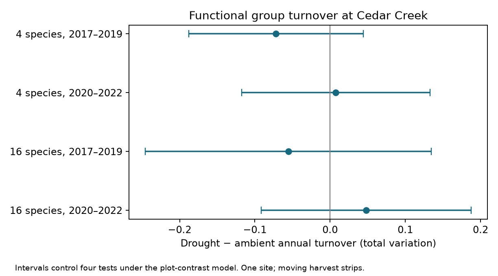

# Drought turnover contrasts had intervals across zero in four Cedar Creek planting-group and period tests in 2017-2022

Drought did not have a clear repeated link to annual changes in functional group biomass shares in this public grassland experiment. Four drought-minus-control contrasts were -0.0720, +0.0075, -0.0554 and +0.0481 total variation units. All four adjusted intervals included zero. This result does not show that drought has no effect.



## Question and new work

Does drought reduce year-to-year change in functional group composition? A community can keep the same richness or diversity while different groups exchange biomass share. Thus temporal variation of diversity does not measure compositional turnover.

Anderson and Isbell [1] studied warming, drought and grassland diversity. Prior campaign work [3] tested temporal variation of inverse Simpson diversity and found uncertain drought contrasts. Another study [4] tested warming richness contrasts. We use the same public release [2], with new code and a different response: annual change in the relative biomass of legumes, forbs, C3 grasses and C4 grasses. This is a follow-up with overlapping observations, not an independent confirmation of those studies.

We searched the campaign for phenology, drought birds, pollution biodiversity, ozone warming, solardome and Cedar Creek before choosing this question. The small ozone experiment already had many closely related analyses. This study instead tests an open distinction between diversity variation and composition change. The plan in the work log fixed the four primary tests and the response before outcome calculation. It was not preregistered.

## Data and design

We used CommunityLevelDataClean_2017_22.csv from Dryad version 396838 [2]. The selected panel has 432 records: 18 whole plots, 72 subplots and six years. Each planting group has nine whole plots. Each whole plot has all four heat-by-water treatment combinations. We selected planted richness of four or 16 species and excluded monocultures. Treatment labels and planting group were fixed within each subplot. All selected subplots had six records and complete nonnegative shares.

The annual shares summed to one within 3.9e-8. We divided each row by its sum to remove rounding error. No biological imputation was used. We retained the source labels Control, Drought and Heated.

## Method

For annual share vectors p and q, total variation is TV(p,q) = sum over groups of |p-q| / 2. It lies between zero and one. On unit-sum vectors it equals Bray-Curtis dissimilarity and the total positive share change. It is a measure of relative biomass movement among four groups. It is not a count of species replacements or an estimate of absolute production change.

For each subplot, we averaged the two consecutive-year distances within 2017-2019 or 2020-2022. The 2019-2020 transition was excluded from these primary periods. Within each whole plot we calculated drought minus ambient water at each heat level, then averaged the two heat contrasts. The estimate is the equal mean of nine whole-plot contrasts. Repeated transitions, years and heat strata do not serve as independent replicates.

The primary family has four tests: two planting groups by two periods. Intervals use the t distribution with eight degrees of freedom at a two-sided error rate of 0.05/4. Under independent normal whole-plot contrasts, these intervals give at least 95% family coverage. Normality and independence are assumptions, not checked facts. We enumerate the 512 whole-plot sign flips and apply Holm adjustment to four reference p values. These tests require independent symmetric contrasts under the null. They are not claimed as exact tests of the experiment's full random assignment scheme.

Supporting calculations use Hellinger distance, endpoint TV, all six years including the boundary transition, single-plot omissions and the heat-by-water contrast. Hellinger distance is sqrt(sum((sqrt(p)-sqrt(q))^2)/2). Endpoint TV compares the first and last year of a period, without division by elapsed years. It measures net change, rather than average annual change. Supporting intervals use the same wide t cutoff but have no joint coverage guarantee across all supporting tests.

## Results

| Planted species | Period | Ambient turnover | Drought turnover | Difference | Four-test interval | Holm p |
|---|---|---:|---:|---:|---:|---:|
| 4 | 2017-2019 | 0.2377 | 0.1658 | -0.0720 | -0.1879 to +0.0439 | 0.3281 |
| 4 | 2020-2022 | 0.2206 | 0.2282 | +0.0075 | -0.1177 to +0.1328 | 0.9844 |
| 16 | 2017-2019 | 0.3113 | 0.2559 | -0.0554 | -0.2455 to +0.1348 | 0.9844 |
| 16 | 2020-2022 | 0.2289 | 0.2770 | +0.0481 | -0.0914 to +0.1876 | 0.9844 |

Both planting groups had negative early estimates and positive late estimates. This is a descriptive pattern with wide uncertainty. We did not test a direct period difference or select a climatic explanation for the signs. The periods use the same plots and shared weather.

Hellinger estimates were -0.0629, -0.0019, -0.0447 and +0.0355 in table order. All intervals included zero. The small late four-species estimate changed sign with distance choice. Endpoint TV had early estimates of +0.0339 and +0.0052, opposite to the early annual-turnover estimates. These uncertain endpoint contrasts show why net change and annual turnover should not be treated as the same quantity.

The full-period annual TV contrasts were -0.0159 and -0.0031 for four- and 16-species plantings. Both intervals included zero. Single-plot omission kept both early estimates negative and the late 16-species estimate positive. The late four-species estimate changed sign. None of the four primary-period TV heat-by-water interaction intervals excluded zero. We do not infer an interaction or equal responses across heat treatments. All aggregate outputs are included, including null results.

## Observation error bound

Harvests used small strips that moved within each subplot [1,2]. Spatial differences between strips can therefore appear as annual composition change. Complete records and equal effort do not remove this problem. We do not have repeated within-year strips with which to estimate sampling error.

Suppose each recorded annual share vector is at most epsilon from its true subplot vector in TV. The triangle inequality bounds the error in each transition distance by 2 epsilon. Averaging transitions preserves that bound. Subtracting water treatments gives a bound of 4 epsilon on the primary contrast; averaging heat strata and plots does not enlarge it. Thus the observation-error envelope for a recorded contrast c is [c-4 epsilon, c+4 epsilon]. This bound permits arbitrary dependence and systematic treatment differences in errors. It is a conservative envelope, not a proof that every value in it is attainable for these data.

The envelope first reaches zero at epsilon = |c|/4: 0.0180, 0.0019, 0.0138 and 0.0120 in table order. These values describe total variation error in each annual composition, not an error in each group and not a measured error rate. Errors below each threshold preserve that descriptive sign under this bound. At or above it the bound alone no longer certifies the sign. Sampling intervals already include zero without this extra uncertainty. We do not combine the deterministic envelope and the t intervals into a calibrated confidence procedure. The bound is included only for TV metrics, not Hellinger distance.

## Limits and next tests

Four broad groups hide species replacement within each group. Relative shares hide changes in total biomass. Drought may affect spatial patchiness and hence strip sampling error. The bound does not estimate detection or sampling bias. Treatment assignment supports an experimental comparison, but general effects still require the plot model assumptions and reliable measurement.

Only two transitions determine each primary subplot response. Shared site conditions, long experiment history, nine whole plots per group, planted composition and serial dependence limit inference. The planting groups occupy separate whole plots but do not supply independent regional replication. The two periods reuse subplots. No direct group difference, period difference, pollution effect, species distribution shift or ecological timing effect was tested.

The next study should add repeated strips in each subplot-year and a second grassland experiment. It should test the period contrast directly and link turnover to measured water deficit with a design that separates time from treatment history. Raw species biomass by subplot would allow species turnover and within-group compensation to be distinguished. The current release does not supply those records.

## Reproduction and rights

The bundle contains original code, text, a figure and aggregate estimates. External raw data and row-level derived data are not bundled. Source attribution, version, URL and exact hashes are in files/provenance.json and files/EXTERNAL_DATA.md. The exact SCI baseline LICENSE applies to this publication's original materials. External CC0 data retain their source status.

Use Python 3.12 with NumPy, pandas, SciPy and Matplotlib. Exact run versions are recorded in files/provenance.json. From the bundle root, use existing shared data in place:

```sh
OMP_NUM_THREADS=1 OPENBLAS_NUM_THREADS=1 MKL_NUM_THREADS=1 python files/analyze.py --archive /mnt/dell-data/shared_datasets/cedar-creek-warming-drought-dryad396838/data.zip --out ../turnover-output
python files/validate.py /mnt/dell-data/shared_datasets/cedar-creek-warming-drought-dryad396838/data.zip ../turnover-output
```

On another machine, run `python files/retrieve.py ../turnover-input` and use `../turnover-input/data.zip` as the archive. Retrieval writes outside the signed draft. It checks the used members, since regenerated ZIP headers can change the archive hash. Analysis also writes outside the signed draft when run as shown.

Checks confirm panel balance, fixed labels, the share sums, the TV identity and the deterministic error inequality on 1,000 synthetic cases. A separate standard-library implementation reproduces all four primary means and standard errors within 1e-12. These numerical checks do not validate the field measurements.

Job: sci-1107-dell-climate-pollution-biodiversity-320a1fb33cfa. Topic: climate-pollution-biodiversity. Campaign: 11_07_2026. Machine: dell. Account: codex-olen. Model: gpt-6.1-sol, high reasoning effort. Analysis date: 12 November 2026. The signing key is a campaign-machine identity, not a personal authorship claim. No new field measurements were made. The signed ZIP is saved locally without remote publication by this worker.

## References

1. Anderson and Isbell (2025). Experimental warming drives local grassland plant species loss. DOI: 10.1111/1365-2745.70172.
2. Anderson and Isbell (2025). Dryad data, version 396838. DOI: 10.5061/dryad.0p2ngf2dh.
3. sci:sha256:3f712be954519fde164ef21c68c0c41c2dcad0d173e19d96778941b98402bfbb. Related diversity-variation analysis of the same release.
4. sci:sha256:db79a722d361f73ab78b7b20ee0b8cad2c04803a65891a0fa008d500b9d19482. Related richness analysis of the same release.
