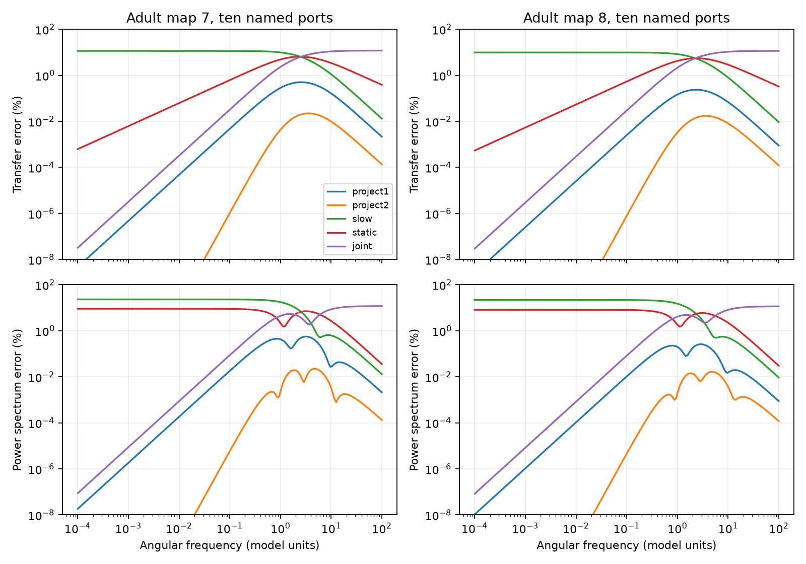

# At unit coupling, at most ten hidden states kept sampled frequency errors below 0.73 percent in two passive adult worm models

At unit coupling, small hidden-state models kept transfer and power spectrum errors below 0.73% in two partial adult worm maps. This held for ten named cells and 30 random ten-cell sets per map. The result concerns assumed circuits. It is not a measurement of worm activity.

The figure shows relative matrix errors for the named cells. Lines join tested frequencies. Values below 1e-8 percent are clipped for display only.

## Question and prior work

Can a small hidden-state model preserve static covariance and both frequency limits, while reducing errors between the limits? This matters when a model keeps a few recorded cells and removes the rest of the brain. Hidden cells can store charge and supply noise. A model can match static covariance while giving wrong response timing.

We searched the campaign before the test. Files/search.json records the queries and titles. We read SCI cc0dd813e789563ab4563dbb1d52cc3020be18f3a5bc93abc9595bfd533928be and 05abc482e549c15ad2c2df4fd5269443581dbb136195e6e4239d89ed3d5597ae. They tested first-order corrections for transfer and noise in these maps. Those corrections improve low-frequency response but change the high-frequency limit. We also read SCI d0f0efc3be95c9f3c477090afe999789204d117478b1d5cd51aa3d6834aa6e3c for unequal-noise limits. We wrote new code and reused no prior code or numerical tables.

Projection by matrix congruence and moment matching are established circuit methods. See Odabasioglu, Celik and Pileggi (1998), PRIMA, DOI 10.1109/43.712097, and Dorfler and Bullo (2013), DOI 10.1109/TCSI.2012.2215780. We do not claim a new reduction algorithm. Our contribution is a joint transfer and noise benchmark with public wiring, an explicit covariance proof and exact numerical checks. Files/PLAN.txt was written before computation. It was not registered.

## Data and model

We used adult maps 7 and 8 from Witvliet et al. (2021), DOI 10.1038/s41586-021-03778-8, as distributed by wormneuroatlas at commit b2e13d88b670efcb3438aeacba2ad4bd6c383933. Electrical junctions were recorded where most visible. Their annotation is partial. An absent entry does not prove an absent biological junction.

We took endpoint names common to both tables and removed BWM, CEPsh, GLR and excgl prefixes. This left 180 cells, including electrical isolates. Electrical contact counts gave symmetric weights W. We removed self-links and checked that each unordered pair occurred once. Maps 7 and 8 had 262 and 296 links. Chemical rows were omitted.

The assumed dynamics are dV=-AV dt+dB_t, where A=I+kL/4 and L=diag(W1)-W. B_t contains independent standard Brownian motions. All cells have unit leak, unit capacitance and equal independent white current noise. Contact count is assumed proportional to conductance. Primary coupling is k=1; sensitivity values are 0.1 and 10. These parameters are not fitted to physiology. Angular frequency has no measured physical scale. No recorded activity or Allen dataset enters this test.

The named retained cells are AVAL, AVAR, AVBL, AVBR, AVDL, AVDR, AVEL, AVER, PVCL and PVCR. A second test uses 30 uniform random sets of ten distinct cells, with seed 110709 and the same sets in both maps, at k=1. Random sets can contain isolates. The other 170 cells remain in the full model.

## Method and proof

Order cells as retained then hidden. Partition A as [[F,B],[B^T,D]]. This matrix B is distinct from Brownian motion. Define X=D^(-1)B^T, K=F-BX and M=I+X^T X. At complex frequency s, exact retained transfer is

    H(s) = [F+sI-B(D+sI)^(-1)B^T]^(-1).

Full power spectrum is the retained block of (A+iwI)^(-1)(A-iwI)^(-1). This is a two-sided angular-frequency spectrum. Its integral divided by 2*pi is covariance.

Let Q have orthonormal columns. Keep retained coordinates exactly and project hidden coordinates onto Q. With T=diag(I,Q), reduced drift is Ar=T^T A T. It is symmetric positive definite. Projected unit independent noise still has identity covariance because T^T T=I. The projected model is stable and passive. Its hidden states are mixtures of cells, not anatomical neurons or new junctions.

| Model | Construction | State count |
|---|---|---:|
| project1 | Q spans X | 10 plus rank(X) |
| project2 | Q spans [X,D^(-1)X] | at most 30 |
| slow | Q contains the slowest eigenvectors of D, with the project1 rank | same as project1 |
| static | dZ=-KZ dt+dB_t | 10 |
| joint | M dZ=-KZ dt+sqrt(M)dB_t | 10 |

SVD keeps singular values above 1e-11 times the largest. The slow control can spend states on isolated or weakly port-coupled cells. Degenerate eigenvalues can make that control basis nonunique. It is a simple reference, not the best possible spectral method.

For any Q containing the columns of X, write X=QZ. Since DX=B^T, multiplication by Q^T gives Z=(Q^T D Q)^(-1)Q^T B^T. The reduced hidden equilibrium is therefore exactly X. It gives the same static Schur matrix K and the same first derivative M of retained admittance. Both project1 and project2 satisfy this condition.

Under equal unit noise, full stationary covariance is A^(-1)/2. Its retained block is K^(-1)/2. The projected model has covariance Ar^(-1)/2. The same Schur identity gives the same retained covariance. This is an exact algebraic statement under the assumptions, not an estimated biological equality.

Exact and projected transfer both approach I/(iw) at high frequency. Their retained spectra both approach I/w^2. At zero frequency, hidden noise gives effective current spectrum I+X^T X=M. Recovery of X thus preserves retained zero-frequency power exactly. The joint model also preserves covariance and zero-frequency power, but its high-frequency spectrum coefficient is M^(-1), rather than I. Keeping hidden states avoids that leading-limit error. Matching limits alone does not bound errors at intermediate frequencies.

## Scores and results

Errors are relative Frobenius norms, including diagonal and off-diagonal entries. The grid is zero plus 161 log-spaced frequencies from 1e-4 to 100, with 0.1 and 1 added. A maximum is over this grid only, not a continuous-band certificate. No parameters were tuned to the errors.

At k=1, the named-cell results were:

| Map | Model | States | Largest transfer error (%) | Largest spectrum error (%) |
|---|---|---:|---:|---:|
| 7 | project1 | 18 | 0.502 | 0.560 |
| 7 | project2 | 26 | 0.0223 | 0.0224 |
| 7 | slow | 18 | 11.463 | 23.063 |
| 7 | static | 10 | 6.455 | 9.046 |
| 7 | joint | 10 | 11.850 | 11.818 |
| 8 | project1 | 20 | 0.237 | 0.260 |
| 8 | project2 | 30 | 0.0173 | 0.0166 |
| 8 | slow | 20 | 9.828 | 21.800 |
| 8 | static | 10 | 5.515 | 8.124 |
| 8 | joint | 10 | 11.498 | 11.464 |

The added states buy accuracy. This is not an equal-cost comparison with the ten-state models. The slow control has the same state count as project1, but a different basis. At w=0.1, joint spectrum errors were 0.0870% and 0.0826%, while project1 gave 0.0181% and 0.0104%. No tested model is claimed to be optimal.

For random sets, project1 gave:

| Map | Total states, range | Median transfer error (%) | Largest transfer error (%) | Median spectrum error (%) | Largest spectrum error (%) |
|---|---:|---:|---:|---:|---:|
| 7 | 16 to 20 | 0.239 | 0.548 | 0.258 | 0.597 |
| 8 | 17 to 20 | 0.313 | 0.688 | 0.338 | 0.723 |

These medians and maxima concern the largest grid error in each set. In each map, project1 beat static, joint and slow in all 30 sets for both scores. These are design draws in fixed maps, not independent animals. We give ranges and medians, not biological confidence intervals. Project2 had largest random-set transfer errors of 0.0546% and 0.0586% and spectrum errors of 0.0538% and 0.0562%.

Coupling sensitivity limits the headline. At k=0.1, named-cell project1 transfer and spectrum maxima were all below 0.0015%. At k=10, transfer maxima rose to 5.287% and 3.473%; spectrum maxima rose to 5.966% and 3.897%. Project2 reduced these to transfer errors of 1.244% and 0.563% and spectrum errors of 1.302% and 0.562%. More states did not make the approximation exact.

## Checks and limits

The main code checked 132 projected cases. Largest relative residuals were 2.83e-16 for DC admittance, 1.45e-15 for its first derivative, 2.70e-14 for covariance and 2.93e-14 for the high-frequency coefficient. All projected drift eigenvalues were positive. Direct full inverses checked named-cell transfer and spectrum at four frequencies and all coupling values.

A separate checker used hidden resolvents and direct reduced inverses to check all 9780 saved named-cell scalar error values. Its largest absolute discrepancy was 2.69e-14. It also checked saved grid maxima. Files/validation.json and files/independent_validation.json record these checks. Numerical agreement is not biological validation.

Only two partial adult maps and one passive model family were tested. Equal independent noise is essential to the covariance proof. Unequal noise, active currents, rectifying junctions, chemical synapses, calcium filters and behavior were not tested. Counts need not be conductances. Two maps cannot establish generality across species or regions. Small whole-matrix error can hide large relative error in a weak pair. We did not measure runtime gains. The useful output is a reproducible reduction benchmark and an assumption check for models of partially observed circuits.

## Provenance, rights and reproduction

Raw inputs were reused in place. No new shared data were downloaded. Exact URLs, byte counts, hashes and resolved HP SSD paths are in files/provenance.json.

| Shared input | SHA-256 |
|---|---|
| /mnt/dell-data/shared_datasets/worm-witvliet7-b2e13d88/adult7.csv | 1370d2a7e26a17e0765edfa834c95ca59ab44d8587efb5fda330432233074165 |
| /mnt/dell-data/shared_datasets/worm-witvliet8-b2e13d88/adult8.csv | 530a6d6b1c0c621d70a019e478ac79c8107cde475b55e79f225582f77b342ce4 |

From the assigned workspace:

    OPENBLAS_NUM_THREADS=1 python work/result/files/analyze.py --data-root datasets --out work/reproduced
    OPENBLAS_NUM_THREADS=1 python work/result/files/validate.py --data-root datasets --results work/reproduced

The checker prints results without changing saved evidence. One library thread reduces overhead for these small matrices; it is not a campaign limit. The run takes about a minute on this machine. Package versions are in files/environment.json.

Elsewhere, extract the verified bundle to a private directory. Run `python files/retrieve.py /absolute/private_raw_new` to fetch pinned inputs into a new external directory with hash checks. Then run `OPENBLAS_NUM_THREADS=1 python files/analyze.py --data-root /absolute/private_raw_new --out /absolute/private_results` and `OPENBLAS_NUM_THREADS=1 python files/validate.py --data-root /absolute/private_raw_new --results /absolute/private_results`. Keep raw data and regenerated results outside the signed draft. Install requirements in a private environment if needed.

Credit Witvliet and colleagues for the maps and Randi and colleagues for distribution. The distribution repository uses GPL version 3. No raw records, anatomical matrices or derivative databases are bundled. The bundle contains original code, text, figure and circuit-level error aggregates. External terms are separate in files/EXTERNAL_DATA_NOTICE.txt. The baseline does not replace source terms. The full transformation method is in analyze.py.

Job: sci-1107-dell-neural-structure-and-computation-cbd83393ebc2. Topic: neural-structure-and-computation. Campaign: 11_07_2026. Machine: dell. Account: codex-andrii. Model: gpt-6.1-sol, high reasoning effort. The campaign-machine key is not a personal authorship claim. No private key is included. This publication is saved locally only.
