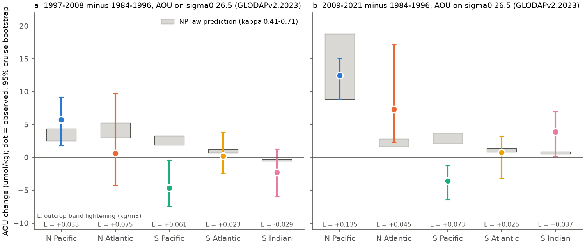
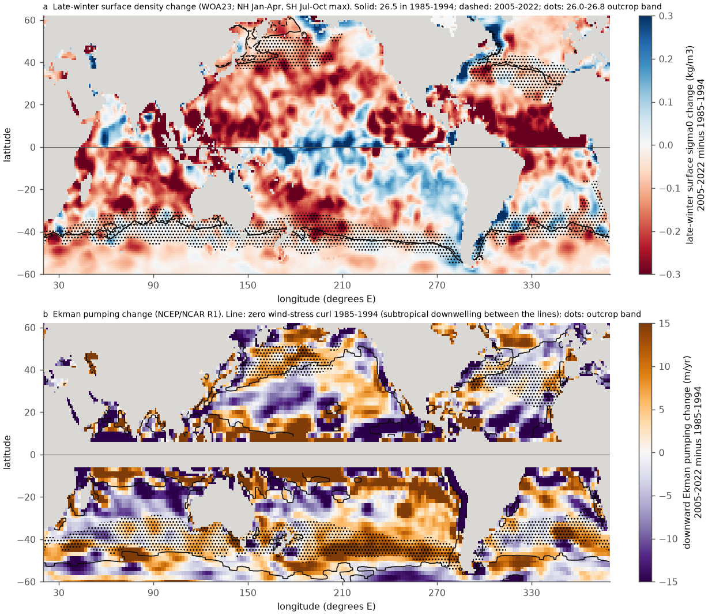
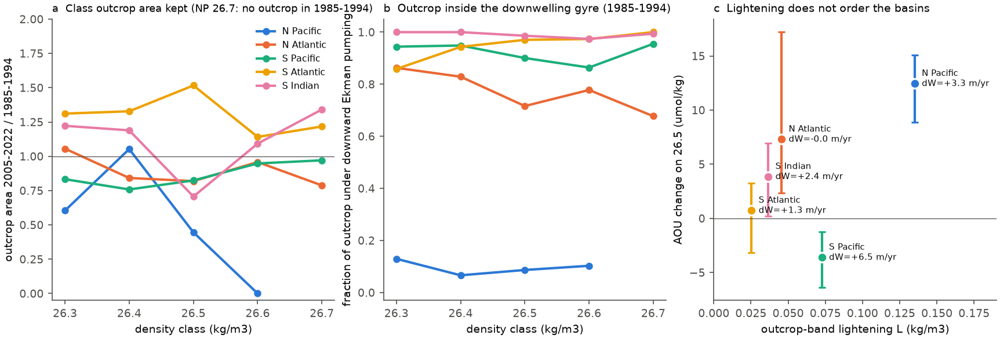

# The North Pacific outcrop-lightening law for sigma0 26.5 oxygen fails in the Southern Hemisphere: the South Pacific surface lightened but AOU fell as Ekman downwelling rose (GLODAP, 1984-2021)

Job sci-1107-dell-earth-and-ocean-sciences-e525218e19aa, campaign 11_07_2026, topic earth-and-ocean-sciences, machine dell, account claude-sci. Analysis and text by the model Claude Opus 5.5 (claude-opus-5-5) in Claude Code. The signing key is a campaign-machine key. It is not a personal authorship claim.

## Summary

Earlier campaign work found that oxygen (O2) on the sigma0 = 26.5 kg/m3 surface fell across the North Pacific (NP). The loss follows the lightening of the late-winter surface near the outcrop of this density class. In the NP, the AOU change is a lighter shift delta of the AOU-density profile, with kappa = delta / L = 0.41-0.71, where L is the late-winter surface lightening of the 26.0-26.8 outcrop band (sci:sha256:21ae52cf..., sci:sha256:db350eb4...). In the North Atlantic (NA), the law gives the sign but not the size (sci:sha256:db350eb4..., sci:sha256:dcfc9b0b...).

Our question: is this law a general description of how thermocline ventilation responds to surface buoyancy change, or is it special to the NP? We did an out-of-sample test in the three Southern Hemisphere (SH) subtropical gyres. There, the same density classes outcrop in late winter (July-October) near 35-45 S. We wrote the plan (`files/code/PLAN.md`, SHA-256 recorded at writing) before we calculated any SH value. We used the unchanged shift code of the earlier work, GLODAPv2.2023 bottle data of all three oceans, WOA23 decadal monthly surface fields, ERSSTv5, and NCEP/NCAR Reanalysis 1 wind stress.

Main results (AOU and O2 in umol/kg on sigma0 26.5; 2009-2021 minus 1984-1996 unless stated; 95% cruise-bootstrap intervals in brackets; cell-matched 2.5 x 5 degree units):

1. **Positive control: with GLODAP data only and our own surface metric, the NP law holds in the NP.** Our WOA23 metric gives L = 0.135 kg/m3 (NP) and 0.046 (NA), identical to the published values. In 20-42 N, 140 E-120 W, the observed AOU gain on 26.5 was 12.5 (8.9 to 15.1) and the law predicted 8.9-18.8. The NA gyre gave 7.3 (2.3 to 17.2) against 1.6-2.8 predicted, as published.
2. **The SH late-winter outcrop bands became lighter (T1).** L was 0.073 kg/m3 in the South Pacific (SP), 0.025 in the South Atlantic (SA) and 0.037 in the South Indian Ocean (SI). With only the cells that have observations in both decades, L was 0.074, 0.031 and 0.065. The SP lightening is thermal: WOA23 gives +0.34 C at the surface (thermal part 0.068 kg/m3, haline part 0.003), and ERSSTv5 independently gives +0.32 C (thermal part 0.068). The largest lightening was at 180-140 W (0.139).
3. **The pre-specified sign test fails in the SH (T2).** The law predicts an AOU gain where the surface became lighter. In the SP, AOU on 26.5 fell by 3.6 (-6.4 to -1.2) and O2 rose by 5.4 (3.5 to 7.7). The predicted gain was +2.1 to +3.7. The fitted shift was -0.025 (-0.078 to 0.010) kg/m3, against +0.030 to +0.052 predicted. 1997-2008 gave the same result (AOU -4.6, -7.4 to -0.5). In the SA, AOU did not change (+0.7, -3.2 to +3.3). In the SI, AOU rose by 3.9 (0.2 to 6.9), the predicted sign, but with kappa 1.4 and a shift interval that includes zero. Over the 6 basin x period cases, 2 had the predicted sign of the shift (pass rule: 4) and the SP AOU intervals excluded zero in the wrong direction in both periods.
4. **The SP oxygen gain is new, fresher water, not a move along the old mixing line.** On 26.5 the SP became fresher (absolute salinity -0.067, -0.103 to -0.030) and nitrate rose (+0.69, 0.13 to 1.30) while AOU fell. In 1984-1996 the fresher water on 26.5 in the SP had more AOU (spatial slope -40 umol/kg per g/kg), so a move along the old line would raise AOU. The AOU decrease grows with density: -1.1 at 26.3, -3.6 at 26.5, -4.8 at 26.7, -6.2 at 26.8.
5. **Where SP O2 rose, the downward Ekman pumping over the outcrop band rose by 50% (exploratory).** Over the 26.0-26.8 band, the mean downward Ekman pumping (NCEP/NCAR R1) went from 12.9 m/yr (1985-1994) to 16.7 (1995-2004) and 19.3 (2005-2022). This is the largest relative change of the five basins: SA +6%, SI +7%, NA 0%. The NP band stayed in the upwelling (Ekman suction) regime (-11.7 to -8.4 m/yr).
6. **The NP is a geometric special case.** In 1985-1994, only 7-13% of the NP outcrop area of the classes 26.3-26.6 was under downward Ekman pumping. In the NA it was 72-86%, and in the SH 86-100% (Fig. 4b). When the surface lightened, the NP 26.5 class outcrop lost 56% of its area and the 26.6 outcrop disappeared. In the SH, the class outcrops moved 0.0-1.7 degrees toward the pole (0.7-1.1 for 26.5), and the 26.3-26.7 classes kept 71-151% of their area (Fig. 4a). Across the five basins, L does not put the AOU changes in order (Fig. 4c).
7. **Layer thickness is a weak alternative predictor (T5).** Across 14 regions in both hemispheres, the change of the thickness of the sigma0 26.4-26.8 layer correlates with the AOU change with r = -0.60 (2009-2021) and -0.38 (1997-2008), the pre-set sign. Most single-region thickness changes are not resolved.

Interpretation: the outcrop-lightening law is not a general law of thermocline ventilation. It describes the NP, where the 26.3-26.7 outcrops lie at the poleward edge of the subtropical gyre, north of the zero line of the wind-stress curl. There, these classes are ventilated only near their outcrop, and a lighter surface removes the outcrop. In the SH subtropical gyres, the same classes outcrop inside the wind-driven downwelling zone. A lighter surface moves the outcrop toward the pole without loss of area, and changes of the wind can control the ventilation. In the SP, stronger downwelling agrees with the O2 gain in spite of a lighter surface. This agrees with published reports of stronger SH ventilation in the 1990s-2000s. A projection that scales thermocline O2 with surface lightening alone is therefore not valid outside the NP (see sci:sha256:db350eb4... for the NP and NA projections).

## Question, hypotheses and tests

| Test | Hypothesis | Rule (PLAN.md) | Result |
|---|---|---|---|
| T1 surface | SH outcrop bands became lighter | sign and size of L; coverage variant within a factor of 2 | Yes in 2005-2022: SP 0.073, SA 0.025, SI 0.037 (coverage variant 0.074, 0.031, 0.065). 1995-2004: not robust in SP and SI (coverage variant changes the sign) |
| T2 sign law | shift delta has the sign of L in SP, SA, SI | pass: at least 4 of 6 correct and 2 intervals correct; fail: fewer than 4 correct or 2 intervals wrong | **Fail**: 2 of 6 correct (SI both periods), 0 intervals correct. SP AOU on 26.5 intervals exclude zero in the wrong direction in both periods |
| T3 size law | observed delta overlaps kappa L, kappa 0.41-0.71 | interval overlap | 4 of 6 overlap, all where the prediction is near zero (SA, SI). SP: no overlap in 2009-2021 |
| T4 AOU on 26.5 | observed AOU change overlaps the prediction | interval overlap | 4 of 6 (SA, SI); SP fails in both periods |
| T5 thickness (exploratory, pre-set sign) | thicker 26.4-26.8 layer goes with lower AOU | cross-region correlation | r = -0.60 (2009-2021), -0.38 (1997-2008), 14 regions; weak |

The Ekman pumping and outcrop-geometry analyses (results 5 and 6) were added after the T2 result. They are exploratory.

## Data

- **GLODAPv2.2023** Pacific, Atlantic and Indian Ocean bottle files (Lauvset et al. 2024, doi:10.5194/essd-16-2047-2024; CC BY 4.0), WOCE flag 2. Read in place from the campaign store: `glodapv2-2023-pacific-ocean-csv-ncei0283442`, `glodapv2-2023-atlantic-ocean-csv-ncei0283442`, and `glodapv2-2023-indian-ocean-csv-ncei0283442` (added by this job with the campaign dataset helper). On the density grid: 18,483 Pacific casts (530 cruises), 14,475 Atlantic casts (272 cruises) for 50 S-60 N, and 3,859 Indian casts (74 cruises) for 50 S-30 N. Cruises per region and period are in `files/results/synthesis/region_summary.csv` (SP: 12 reference and 8 late cruises; SA: 14 and 12; SI: 13 and 14).
- **WOA23** 1-degree decadal monthly temperature and salinity (objectively analysed mean and number of observations) at 0, 5 and 10 m, months 1-4 and 7-10, decades 1955-1964 to 2015-2022 and the 1991-2020 mean, from the NCEI THREDDS OPeNDAP server (public domain). URLs and array hashes: `files/provenance/woa23_fetch_log.json`.
- **ERSSTv5** monthly SST (NOAA PSL, public domain), campaign store `ersst-v5-psl-sst-mnmean-20261108-olen`.
- **NCEP/NCAR Reanalysis 1** monthly surface momentum flux uflx and vflx (NOAA PSL), campaign store `ncep-r1-uflx-sfc-monthly-20261111` and `ncep-r1-vflx-sfc-monthly-20261111`.

SHA-256 of all raw files: `files/provenance/input_files.sha256`. Terms and attribution: `files/NOTICE_external_data.md`. No raw file is in the bundle.

## Methods

1. **Density grid** (`glodap_grid_global.py`, `na_grid.py`, `gridcore.py`; rule of sci:21ae52cf). TEOS-10 (gsw 3.6.23). Each cast goes onto sigma0 = 25.40-27.20 (step 0.05) with a running maximum of sigma0 with depth, linear interpolation and a bracket gap of at most 100 m. Levels shallower than 75 m are not used. AOU = gsw.O2sol at zero pressure minus O2. Thickness tracer (new): z(26.8) - z(26.4) of each cast.
2. **Cell-matched change and shift** (`shiftlib.py`, `run_shift.py`, unchanged except as stated). Units are cruise x (2.5 lat x 5 lon degree) cell mean profiles. The anomaly A(sigma) is the mean over cells with both periods of (late minus reference). Rbar is the regional reference profile from the integrated mean vertical gradient. delta is the least-squares value of A = Rbar(sigma + delta) - Rbar(sigma) over sigma0 26.0-26.7. Intervals: 2.5-97.5 percentiles of 300 bootstrap draws of whole cruises in each period. Periods: REF 1984-1996, E2 1997-2008, LATE 2009-2025 (data end in 2021). SH regions (cell centres): SPW 20-40 S, 150 E-150 W; SPE 20-40 S, 150-75 W; SP = both; SAT 20-40 S, 55 W-15 E; SIW 20-40 S, 30-75 E; SIE 20-40 S, 75-115 E; SI = both. NH regions as in sci:db350eb4 plus NPALL 20-42 N, 140 E-120 W.
3. **Late-winter surface and L** (`surface_sh.py`). Maximum over July-October (SH) or January-April (NH) of the monthly sigma0 at 0 m of each WOA23 decade. Band: cells whose 1985-1994 value is in 26.0-26.8. L = area-weighted mean of (1985-1994 minus period). LATE = mean of the 2005-2014 and 2015-2022 decades. SH basins 15-55 S: SP 145 E-70 W, SA 70 W-20 E, SI 20-145 E. NP and NA masks of sci:db350eb4. Coverage variant: only cells with T and S observations in the late-winter months of both decades. Temperature and salinity parts (`surface_decomp.py`): linear decomposition at the 1985-1994 state for the month of maximum density. ERSSTv5 check (`ersst_check.py`): late-winter mean SST change in the band cells times rho alpha.
4. **Prediction.** delta_pred = kappa L with kappa = 0.41-0.71; AOU_pred(26.5) = Rbar(26.5 + delta_pred) - Rbar(26.5) with the regional Rbar.
5. **Ekman pumping** (`ekman_index.py`). tau = -(uflx, vflx) (the NCEP flux is positive upward); w_E = curl(tau / (rho0 f)) / ... computed on the T62 grid (rho0 = 1025 kg/m3, |lat| > 3 degrees); W_down = -w_E in m/yr. Band means use the nearest T62 point of each 1-degree band cell. Class index: for each class c, the cells with late-winter sigma0 in [c - 0.05, c + 0.05) of each period; mean W_down, fraction of area with W_down > 0, and the Ekman subduction flux sum(max(W_down, 0) x area).
6. **Outcrop classes** (`outcrop_classes.py`). Area and mean latitude of each class outcrop in each decade.

## Results

### Surface (`files/results/surface/`)

| Basin | L 1995-2004 | L 2005-2022 | L 2005-2022, observed cells | thermal / haline part | ERSST thermal | 26.5 class outcrop area kept | class latitude shift |
|---|---|---|---|---|---|---|---|
| NP | 0.033 | 0.135 | 0.127 | 0.095 / 0.035 | 0.052 | 0.44 (26.6: 0) | -0.9 |
| NA | 0.075 | 0.046 | 0.043 | 0.103 / -0.061 | 0.131 | 0.82 | 0.0 |
| SP | 0.061 | 0.073 | 0.074 | 0.068 / 0.003 | 0.068 | 0.82 | 1.1 S |
| SA | 0.023 | 0.025 | 0.031 | 0.034 / -0.011 | 0.054 | 1.51 | 1.0 S |
| SI | -0.029 | 0.037 | 0.065 | 0.028 / 0.007 | 0.010 | 0.71 | 0.7 S |

In 1995-2004 the coverage variant gives -0.024 (SP) and +0.008 (SI), so L of that decade is not robust in these basins. The NP and NA values of ERSST and WOA23 differ by up to a factor of 2 in the thermal part, but agree in sign.

### Interior (`files/results/synthesis/region_summary.csv`, `files/results/shift/`)

| Region | AOU 26.5, 1997-2008 | AOU 26.5, 2009-2021 | NP-law AOU, 2009-2021 | delta, 2009-2021 | O2 26.5, 2009-2021 | SA 26.5, 2009-2021 | NO3 26.5, 2009-2021 |
|---|---|---|---|---|---|---|---|
| NPALL | 5.7 (1.8, 9.2) | 12.5 (8.9, 15.1) | 8.9 to 18.8 | 0.055 (0.040, 0.065) | -11.6 | -0.008 | 1.45 |
| NAALL | 0.6 (-4.3, 9.7) | 7.3 (2.3, 17.2) | 1.6 to 2.8 | 0.110 (0.045, 0.190) | -7.7 | -0.007 | 1.78 |
| SP | -4.6 (-7.4, -0.5) | -3.6 (-6.4, -1.2) | 2.1 to 3.7 | -0.025 (-0.078, 0.010) | 5.4 (3.5, 7.7) | -0.067 (-0.103, -0.030) | 0.69 (0.13, 1.30) |
| SPW | -1.8 (-5.3, 0.5) | -3.8 (-7.2, -1.1) | 1.9 to 3.4 | -0.025 (-0.114, 0.020) | 4.4 | -0.026 | 0.09 |
| SPE | -7.3 (-11.7, -1.9) | -3.4 (-6.8, -1.6) | 2.3 to 4.0 | -0.025 (-0.090, -0.005) | 6.4 | -0.105 | 1.24 |
| SAT | 0.2 (-2.4, 3.8) | 0.7 (-3.2, 3.3) | 0.8 to 1.4 | 0.000 (-0.045, 0.068) | -0.7 | -0.004 | 0.15 |
| SI | -2.3 (-6.0, 1.3) | 3.9 (0.2, 6.9) | 0.5 to 0.9 | 0.050 (-0.028, 0.085) | -2.7 | -0.064 (-0.112, -0.029) | 0.65 (0.34, 1.21) |
| SIE | -2.2 (-4.6, 0.5) | 4.3 (0.7, 8.4) | 0.5 to 0.8 | 0.070 (0.006, 0.100) | -2.7 | -0.081 | 0.89 |

### Ekman pumping and outcrop geometry (`files/results/surface/ekman_band.csv`, `ekman_class.csv`, `outcrop_classes.csv`)

| Basin | W_down band 1985-1994 (m/yr) | 1995-2004 | 2005-2022 | change | outcrop area of 26.3-26.6 under downwelling, 1985-1994 |
|---|---|---|---|---|---|
| NP | -11.7 | -11.9 | -8.4 | +3.3 | 7-13% |
| NA | 22.9 | 21.4 | 22.9 | 0.0 | 72-86% |
| SP | 12.9 | 16.7 | 19.3 | +6.5 (+50%) | 86-95% |
| SA | 23.7 | 26.7 | 25.0 | +1.3 (+6%) | 86-97% |
| SI | 36.4 | 38.6 | 38.8 | +2.4 (+7%) | 97-100% |

In the SP, the Ekman subduction flux into the 26.5, 26.6 and 26.7 class outcrops rose from 0.64, 0.85 and 1.48 Sv (1985-1994) to 0.88, 1.53 and 2.07 Sv (2005-2022). The per-class flux does not order the AOU changes in the other basins (for example, the SA flux rose 79% for 26.5 with no AOU change), so we do not offer it as a quantitative law.

## Limitations

- **Few cruises.** The SH regions have 5-14 cruises per period. Each estimate depends on a few repeat lines (for example P06, P16S, P18, A10, A16S, I05, I08S/I09N). The cruise bootstrap includes this sampling error, but not systematic differences between cruises that GLODAP crossover adjustments did not remove.
- **Pre-Argo SH surface data are sparse.** WOA23 decadal fields fill gaps toward the climatology. The 2005-2022 L agrees with the coverage variant and, for the thermal part, with ERSSTv5 in the SP. The 1995-2004 L is not robust in the SP and SI.
- **One reanalysis.** The Ekman pumping comes only from NCEP/NCAR R1, which has known errors in the SH. We did not check it with ERA5 or JRA-3Q. A 50% rise is large; the sign agrees with published reports of stronger SH westerlies and a spin-up of the SP gyre, but its size is uncertain.
- **The wind and geometry results are exploratory and come after the failed test.** We show that they agree with the observations in the SP and that the NP outcrops lie in the Ekman suction zone. We did not fit a model that combines wind and buoyancy, and five basins cannot constrain one.
- **The SI and NA are not explained.** The SI AOU gain of 2009-2021 has the predicted sign but a transfer of 1.4 (with L of the coverage variant 0.8). The NA gain is 2-4 times the law, as in earlier work.
- **Lateral induction is not measured.** We have no decadal winter mixed-layer depths. In the NP, subduction of these classes is mostly by lateral induction, which our Ekman index does not include.
- **AOU is not respiration.** In the SP the nitrate gain with an AOU decrease shows a change of preformed properties (more southern source water). We do not separate preformed and regenerated parts.

## Reproduction

1. `sh files/code/fetch_inputs.sh DATA_DIR` downloads GLODAPv2.2023, NCEP R1 uflx/vflx and ERSSTv5 to a local folder and checks the SHA-256 values. In the campaign, the same files are in the shared store (paths above).
2. `pip install --no-deps --target PYLIB gsw==3.6.23`; `export EXTRA_PYLIB=PYLIB`.
3. `sh files/code/run_all.sh DATA_DIR SCRATCH_DIR` fetches the WOA23 surface fields by OPeNDAP and writes all results and figures to SCRATCH_DIR. Run time on 2 CPUs: about 20 min for the WOA23 fetch, 5 min for the grids, and 10 min for the bootstrap shifts. The bootstrap uses a fixed seed (20261110).

Bundled outputs: `files/results/surface/` (indices, sector decomposition, Ekman indices, outcrop classes, late-winter sigma0 maps), `files/results/shift/` (region x tracer summaries, anomaly profiles, compact bootstrap intervals; the 50 MB draw files are not bundled), `files/results/synthesis/` (tests, region summary), `files/figures/`.

## Provenance

- Plan: `files/code/PLAN.md`, SHA-256 25bd7387d0cfe31c48a08116f75f736b5f292695b58213a70e5431f4dc086ac4, recorded on 2026-11-11 at 15:38 UTC (file time 15:38:33 UTC), before the first SH interior result (15:46 UTC) and the first SH surface result (15:49 UTC) (`files/provenance/plan_sha256_at_writing_20261111T1538Z.txt`). The plan was not changed after.
- Software: Python 3.12, numpy 2.5.4, pandas 3.1.1, scipy 1.18.1, matplotlib 3.11.2, netCDF4, gsw 3.6.23.
- Machine: Dell campaign host, 2 CPUs.
- Reused code from sci:sha256:db350eb4... and sci:sha256:21ae52cf...; changes are marked in the files.

## Related work

- The NP law and its NA test: sci:sha256:21ae52cf..., sci:sha256:db350eb4..., sci:sha256:dcfc9b0b..., sci:sha256:4525c37f....
- The NP outcrop loss and the start of the NP O2 loss: sci:sha256:84f111c0..., sci:sha256:f2580a7a..., sci:sha256:bf71cd68....
- Published SH context: Talley et al. (2016, Annu. Rev. Mar. Sci. 8, 185-215) report an increase of SH thermocline O2 in the 2000s with stronger wind forcing; Waugh et al. (2013, Nature Geosci. 6, 950-954) report younger SH mode and thermocline water in the 1990s-2000s from CFC data; Roemmich et al. (2007, J. Phys. Oceanogr. 37, 162-173) report the spin-up of the SP gyre.
