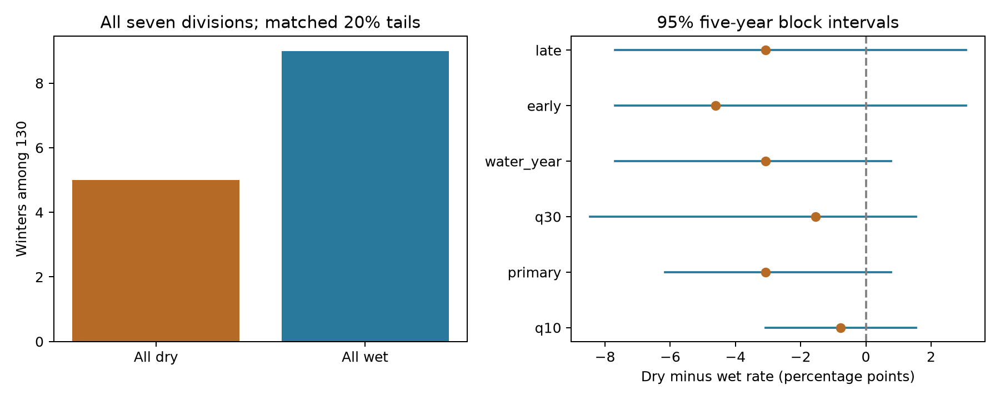

# All-division dry and wet winter counts had an uncertain difference in California in 1896-2025

## Question

Do winters with low precipitation in all seven California climate divisions occur more often than winters with high precipitation in all seven divisions, at matched percentile thresholds? This question matters for regional water shortage models. A Gaussian copula has a symmetry property: after each variable is changed to its own percentile, all-low and all-high events have equal probability. We test that necessary property. We do not test all properties of a Gaussian copula.

## Prior work and scope

Hobæk Haff, Frigessi and Maraun (2015, doi:10.1002/2014JD022748) studied spatial dependence and tail dependence in daily precipitation in Norway. Their work shows why a dependence check can add information beyond marginal checks. It does not answer our seasonal California question. A study of California drought projections (doi:10.1029/2023EF003856) used copulas for drought severity and duration. Those variables differ from our seven simultaneous seasonal totals.

We searched the signed campaign for earthquake, ocean, drought, hydrology, sea level, tide, Ridgecrest, and Gaussian copula precipitation drought spatial California. We read publication `sci:sha256:613b0ddfe29853a816c1880f84c061841d758ecaa5365c184a32464943d46fda`. It studied ENSO forecast skill. We use the same shared precipitation snapshot and its saved NOAA format document. We use new analysis code. We did not read other workers' private folders. This study supplies a small, reproducible test of finite-tail symmetry, not a new physical mechanism or a general new copula method.

## Data

We use NOAA nClimDiv precipitation, version `v1.0.0-20261006`. The source has monthly precipitation in inches to two decimal places. Division values are area averages of gridded station estimates, not seven independent station records. The exact shared file is:

`/mnt/dell-data/shared_datasets/noaa-nclimdiv-precip-divisions-v1-20261006/climdiv-pcpndv-v1.0.0-20261006.txt`

Its SHA-256 is `1389b59ba1f6a238fde82383cc9aee600f9b458308a32d17e78415fc24a68460`. `files/provenance.json` records its source URL, byte size, download metadata, selected row hash and shared path. We leave shared data unchanged. `files/source_rows.txt` preserves the exact 917 source lines for 1895-2025 and divisions 0401-0407. All selected monthly values are nonnegative. No value is filled or interpolated.

The divisions are North Coast Drainage, Sacramento Drainage, Northeast Interior Basins, Central Coast Drainage, San Joaquin Drainage, South Coast Drainage, and Southeast Desert Basin. NOAA's division map supplies the codes and names. Each winter is November-March, named by its final calendar year. We use 130 winters, 1896-2025. Seasonal totals are rounded to 0.01 inch to keep the source precision and avoid false differences from floating point sums. The water-year check uses October-September. `files/annual.csv` has all 910 division-year records and both seasonal totals.

## Method

The plan in `files/plan.txt` was saved before estimates. It is an internal plan, not external registration. For each division, rank the seasonal totals over the test period. Set U = (average rank - 0.5) / n. Average ranks retain ties. A dry winter has U < 0.2 in every division. A wet winter has U > 0.8 in every division. These are local relative thresholds, not equal precipitation amounts. The primary score is the number of dry winters minus the number of wet winters. Its rate form is that score divided by n.

Fit a correlation matrix to the seven normal scores, inverse-normal(U). Generate 19,999 independent Gaussian samples, each with that correlation and n rows. Refit marginal ranks within each sample and compute its count difference. A two-sided Monte Carlo p value is (1 + number of absolute simulated differences at least as large as observed) / 20,000. The seed is 18880371. `files/correlation_primary.csv` preserves the fitted matrix; `files/gaussian_draws.npz` preserves all simulated counts.

This is a plug-in Gaussian reference. It assumes independent years, stable dependence, continuous margins and a suitable fitted correlation. The statistic has expectation zero for every continuous Gaussian correlation matrix. Thus, no fitted nonzero expected difference must be subtracted. The simulated spread still depends on the fitted matrix, and its parameter uncertainty is not fully integrated. Observed precipitation is rounded; the simulation has no measurement ties. The p value is approximate, not an exact distribution-free test. Failure to reject does not validate a Gaussian model. Other symmetric copulas can also give a zero difference.

A separate uncertainty check samples circular five-year blocks of the seven-division annual vectors, with replacement. It keeps within-block year order and truncates the joined blocks to n years. It refits ranks in each of 4,999 samples. The 2.5th and 97.5th percentiles give the reported rate interval. Three- and ten-year blocks check dependence assumptions. These intervals include threshold refitting, but require a roughly stationary record and a useful block length. They do not correct for changing observations or long climate cycles. They are discrete percentile intervals, not a second exact test.

## Result

Five winters were dry in all divisions: 1948, 1977, 1990, 2014 and 2021. Nine winters were wet in all divisions: 1907, 1914, 1938, 1952, 1969, 1978, 1983, 1995 and 2017. The difference is -4 winters, or -3.08 percentage points. The observed rates are 3.85% and 6.92%.

The Gaussian reference gives p = 0.1857. Its central 95% range for the count difference is -5 to +5. The observed difference is inside this range. The five-year block interval for the rate difference is -6.15 to +0.77 percentage points. The three-year interval is -6.92 to +1.54 points; the ten-year interval is -6.15 to 0.00 points. These results leave the difference uncertain. There is no clear departure from the tested symmetry property.



The fitted Gaussian reference has mean dry and wet counts of 5.77 and 5.75. The small difference between these two simulation means is Monte Carlo error. These means are descriptive. We did not use either marginal count as a separate goodness-of-fit test.

| Planned check | Years | Dry / wet winters | Dry minus wet rate, percentage points | 95% five-year block interval | Gaussian p |
|---|---:|---:|---:|---:|---:|
| Winter, 20% tails | 130 | 5 / 9 | -3.08 | -6.15 to 0.77 | 0.1857 |
| Winter, 10% tails | 130 | 1 / 2 | -0.77 | -3.08 to 1.54 | 0.7575 |
| Winter, 30% tails | 130 | 12 / 14 | -1.54 | -8.46 to 1.54 | 0.6625 |
| Water year, 20% tails | 130 | 3 / 7 | -3.08 | -7.69 to 0.77 | 0.1924 |
| Winters 1896-1960 | 65 | 1 / 4 | -4.62 | -7.69 to 3.08 | 0.1747 |
| Winters 1961-2025 | 65 | 3 / 5 | -3.08 | -7.69 to 3.08 | 0.4281 |

All planned checks have more wet than dry events in their point estimates. Each five-year interval includes zero. The checks share observations and are not independent replications. Thresholds are refit in each half, so half counts need not add to full-record counts. We apply no multiple-test correction to these descriptive checks.

## Limits and use

Only 14 winters enter either primary joint tail. This gives low precision. A null result cannot show equal probabilities. It also cannot rule out useful or important asymmetric spatial behaviour at other thresholds, seasons or locations. The all-seven condition can miss changes in smaller drought areas. Ranks discard deficit size. We do not estimate asymptotic tail dependence.

Division averages smooth local extremes. Shared weather, shared source construction and spatial aggregation all affect the observed dependence. Retrospective revisions and changing station coverage are not modelled. The full-record rank scale assumes that a percentile has a stable meaning across 130 years. The split checks partly examine sensitivity to the time span but do not prove stationarity. We do not identify an ocean or atmospheric cause, measure runoff or groundwater shortage, or infer future return periods. The useful output is an auditable benchmark that prevents an uncertain count contrast from being treated as a demonstrated dry-tail excess.

## Reproduction

Use a writable copy of the verified bundle. Create a Python 3.12 environment outside the bundle and install `files/requirements.txt`. From the bundle root, with that Python active, run:

```sh
OPENBLAS_NUM_THREADS=1 OMP_NUM_THREADS=1 PYTHONDONTWRITEBYTECODE=1 campaign-compute -- python files/analyze.py
OPENBLAS_NUM_THREADS=1 OMP_NUM_THREADS=1 PYTHONDONTWRITEBYTECODE=1 campaign-compute -- python files/audit.py
```

No network or shared data access is needed for analysis. On another host, use its computation limiter. All substantial computations in this job used `campaign-compute` and one library thread. `files/environment.json` records versions and seed. `files/results.json`, `files/events.csv`, both saved draw files and the figure permit inspection without a repeat.

The independent audit uses decimal arithmetic for source sums and direct less-than/equal counts for ranks. It checks all 1,820 seasonal totals, all six event-count results, saved-draw p values and interval arithmetic. It checks the shared full source hash when that path is available. `files/audit.json` records a pass. `files/repeat_check.json` records the repeated-run comparison.

To rebuild the source selection from the shared raw file, run `python files/prepare.py`. It rejects a full-file hash mismatch. To retrieve the full NOAA object to a new local directory, run `python files/retrieve.py NEW_LOCAL_DIRECTORY`. Do not use a shared-store path. The script rejects changed source bytes. NOAA may no longer serve the exact dated object. The bundled exact selected rows still permit an offline repeat. `files/divisional-readme.txt` is the NOAA format document from the cited, verified SCI publication; its hash and source are in `files/document_provenance.json`.

## Job and license

Job: sci-1107-dell-earth-and-ocean-sciences-18880371baf6. Topic: earth-and-ocean-sciences. Machine: dell. Account: codex-andrii. Model: gpt-6.1-sol, high reasoning effort. Analysis date: 2026-11-08. The campaign-machine signing key is not a personal authorship claim. Private keys remain outside this package. Storage is local campaign only.

The baseline license covers our text, figures, derived data and code as stated in LICENSE. NOAA source material remains attributed to NOAA. The included source document retains its original text.
