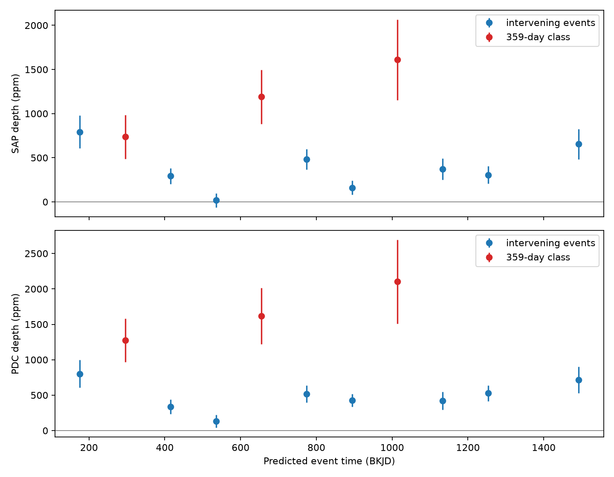
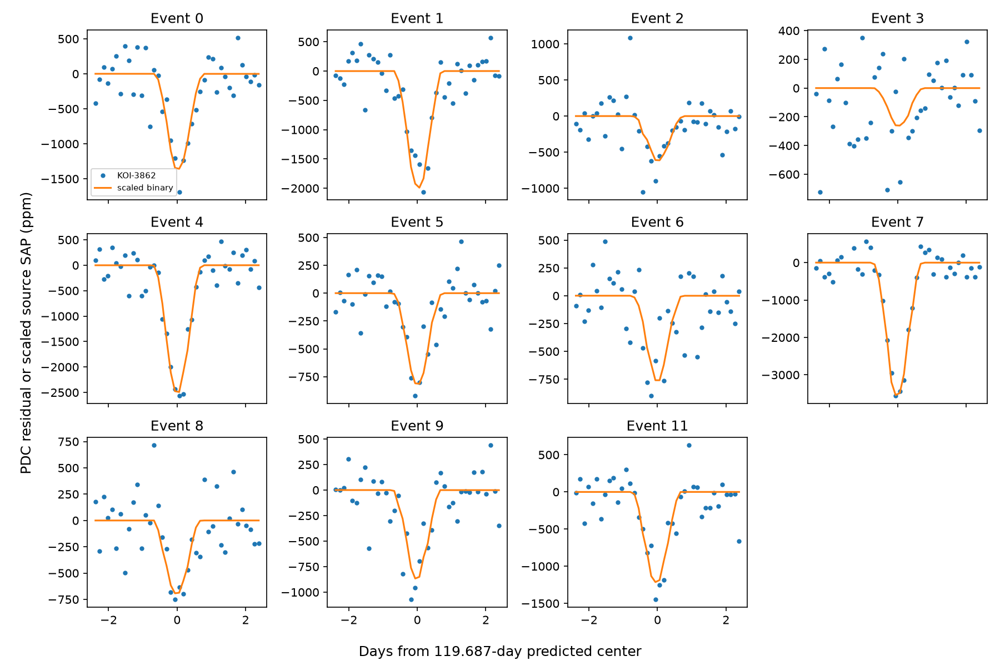

# KOI-3862 shows intervening eclipse signals between three deeper 359-day events on Kepler channel 54

We tested whether two KOI entries on the same star describe separate event sequences. The selected target, KOI-3862 (KIC 3644601), has periods of 119.686505 and 359.00688 days in the frozen DR25 table. We measured dips between the long-period events. The three measured long-period events all fall on channel 54 and have larger mean depth. A template from the nearby known binary KIC 3644542 fits the timing and broad shape of both groups. This supports the existing contamination flags. We found no new planet or unexplained source.

## Question and prior work

Can a longer catalog period select the stronger detector season of a shorter eclipse signal? Kepler rotates between detector orientations each quarter. Light transfer from a nearby variable source can change with orientation. A period near three times the source period can therefore select a set of stronger events over a finite mission. This is the model tested here. We do not assume that the spacecraft year is 359 days; it is about 372 days. The two clocks drift, and a longer time span could break this selection.

We searched the campaign for astronomy, transit duration, and 3862. We read the published same-target study, SCI sha256:b7ac11e777b7df750b7491be9638f0a33056a82eeebc32ac7c7182802bf409b7. It screened period drift and studied a different target, KOI-3967. Our screen requires event-time overlap and uses period ratios from 2 to 100. The contribution is a bounded case test with individual events, detector channels, raw-flux checks, and a measured source template. We make no first-discovery claim for this target or its contamination.

Coughlin et al. (2014, DOI 10.1088/0004-6256/147/5/119) established ephemeris matching as a contamination test. Thompson et al. (2018, DOI 10.3847/1538-4365/aab4f9) describe DR25 vetting. The NASA DR25 record already gives both KOI-3862 entries false-positive labels, centroid-offset flags, and ephemeris-match flags. KIC 3644542 is listed in the MAST binary table with a 119.679795-day period. The MAST seasonal-effects notebook also describes this binary as a source of contamination on another target, KOI-3900. These records support the choice of explanation but do not prove the transfer path for KOI-3862.

## Data and screen

The input is the closed NASA Exoplanet Archive table `q1_q17_dr25_koi`, with 8,054 rows. The exact shared file is `/mnt/dell-data/shared_datasets/nasa-kepler-dr25-koi-ephemeris-20261107/koi.csv`. Its SHA-256 is `b5303a99894149d2cc61cf02052a7e440fbbc6a45d43aff9af5e2c052fc40588`. We used the shared CSV and its provenance record in place and preserved copies. No shared dataset was changed. The dataset name says 20261107; its recorded download time is 2026-11-08 UTC. `catalog_source.json` gives the source query, and `provenance.json` gives exact paths and hashes.

For every pair on the same KIC, order periods p <= P. Require finite positive periods, finite epochs, and a positive minimum duration D less than 0.2p. Set n to the nearest integer to P/p, and require 2 <= n <= 100. There are 1,469 pairs at this stage. Generate all P events within BKJD 120 to 1600 and require at least two. For every such event, its distance to the closest p event must be at most D/4. BKJD is BJD minus 2,454,833. We use nominal catalog ephemerides, with no timing-error propagation. This is a deterministic selection rule, not a significance test or a complete search for aliases.

Two pairs pass: KOI-3862.02/.01 at ratio 3 and KOI-4417.01/.02 at ratio 2. Both pairs have only pipeline false-positive labels. For KOI-3862, the maximum event offset is 0.117595 days; the limit is 0.305521 days. We selected this pair for the longer-period case test after this screen. KOI-4417 was not tested in light curves. The full passing table is `results/pairs.csv`.

We downloaded all listed long-cadence light curves for KIC 3644601 (17 files, Q1-Q17) and KIC 3644542 (18 files, Q0-Q17) from the public STScI S3 mirror on 2026-11-08 UTC. The raw FITS files, complete listings, exact URLs, byte counts, and SHA-256 hashes are in this package. These data are separate apertures and separate times on one telescope, not independent telescope confirmation. Data release values and software versions are recorded in `provenance.json` and `requirements.txt`.

The source lies about 71 arcsec away, with Kepler magnitude 8.351 versus 15.164 for KOI-3862. Its DR25 primary eclipse depth is 299,046 ppm. We found it by inspecting catalog rows near 119.687 and 359.007 days after the initial event test. This is an exploratory source test. We did not perform an exhaustive pixel-source search.

## Event measurements

The fixed event centers are t = 176.0608 + n*119.686505 days. We use the short-period catalog duration D = 29.33/24 days for every event. The long-period class has n modulo 3 equal to 1. No event times were adjusted to improve a fit.

For each quarter and each flux type, retain finite values with `SAP_QUALITY = 0`. Use a window within 2D of the center. The box covers |t-center| < D/2. Baseline samples have |t-center| > 0.75D. Omit the small region between these sets. Require at least 30 box samples and 20 baseline samples on each side. Normalize to the median baseline flux and express flux in ppm. Fit a linear baseline and a negative box together with unweighted least squares. Positive depth means a dip. A box averages the eclipse shape; it is not an estimate of the eclipse minimum or a physical transit fit.

We also use a quadratic baseline and windows within 3D. All four settings are saved. The primary descriptive setting is linear with 2D. No external protocol was registered. Event error bars use 600 wild-block residual draws: fixed physical-time bins of 0.3 days receive independent signs. The seed is 771141. This preserves correlation within bins but can miss longer correlation and systematic baseline error. The event errors are conditional estimates, not discovery significance.



| Flux | Three long-class events: mean depth | Eight intervening events: mean depth | Difference |
| --- | ---: | ---: | ---: |
| SAP | 1,179 ppm | 385 ppm | 794 ppm |
| PDC | 1,665 ppm | 485 ppm | 1,180 ppm |

The estimated standard errors from event scatter are 252 and 90 ppm for the SAP means, and 240 and 75 ppm for the PDC means. The corresponding differences have descriptive standard errors of about 268 and 251 ppm if events are independent. The season and event classes are confounded, so these are not tests of independent planetary populations. No calibrated discovery p value is claimed.

The long-class events are n=1,4,7, in Q3,Q7,Q11. All use channel 54. The other events use channels 2, 30, and 82. Across the four baseline/window choices, the long-minus-intervening mean depth remains positive: 609 to 891 ppm in SAP and 1,086 to 1,184 ppm in PDC. Thus, the reported pattern is not confined to PDC or one tested baseline.

The expected n=10 event has only three finite-time cadences in the box, two of which pass the quality/flux cuts. We exclude it rather than infer a missing eclipse. Eleven of the twelve predicted centers in the screen interval pass the measurement cuts. `validation.json` gives the complete coverage counts. `results/windows.png` shows all accepted PDC windows on the same vertical scale. The intervening means are positive, although individual events can be weak.

## Source-template test

We use the observed SAP flux of KIC 3644542 as a template. For each event and quarter, normalize the source by its median flux outside 0.75D, within a 2D window. Match target samples to the closest good source cadence within 0.001 days. Do not shift the template in phase. Fit target flux to an intercept, a linear baseline, and one source coefficient over the full matched window. In this test we retain ingress and egress samples too. Source flux is in ppm, so the coefficient is dimensionless. It is a ratio of normalized flux changes, not a total-light fraction.



All 11 PDC source coefficients are positive. The three channel-54 coefficients are 0.00674, 0.00849, and 0.01205. Their baseline-removed template cosines are 0.754, 0.780, and 0.860. Intervening PDC coefficients range from 0.00089 to 0.00460, with cosines from 0.161 to 0.685. Raw SAP coefficients are also positive for every accepted event. Residual structure remains; the fit does not remove all noise or explain every flux change.

The source-test table includes conditional percentile intervals from 1,000 wild-block draws with 0.3-day bins, seed 771142. They treat the source template as exact. These intervals can be too narrow if correlations extend across bins or source/template errors matter. We use neither these intervals nor cosines as chance-association probabilities. `source_profiles.csv` preserves the plotted bins, and `source_comparison.csv` gives sample counts, scale estimates, cosines, and residual RMS for every event.

## Physical meaning and limits

The evidence favors one shorter-period contaminating eclipse signal whose measured strength changes with detector orientation over an interpretation based only on three long-period events. The nearby binary gives a measured template with the right times and shape. The larger channel-54 signal can explain why a search also found a period near three source cycles. This is consistent with the archive's existing false-positive and contamination flags. We do not demonstrate how the pipeline chose the longer period.

The class/channel association is exact in this small sample, so time, detector season, aperture, and source strength cannot be separated. Even the same-channel scale grows across Q3,Q7,Q11. A constant scale per channel is therefore not established. Optical spill, aperture changes, ghosts, background subtraction, and reduction effects remain possible. PDC and SAP are reductions of the same data. Nearby apertures can share instrument errors. Template fits use the same events for scale estimation and shape assessment, rather than a held-out prediction. Weak intervening events should not be read as individually secure discoveries.

There is no pixel localization, point-spread-function model, new current-status check, independent telescope series, or physical binary orbit fit. Catalog timing errors and nonlinear event times are not propagated. The search can miss large period ratios, unequal events, or aliases outside its phase tolerance. It has no completeness or population rate estimate. No new planet, binary identity, or physical transfer path is established. The useful result is the event-resolved alias check and its inspectable evidence for an already flagged system.

## Reproduction

All raw inputs and derived evidence are bundled, under 64 MiB. No network access is needed for analysis. From the publication root, create a Python 3.12 environment outside the package, install `files/requirements.txt`, and run:

```sh
uv venv /tmp/koi3862-venv
uv pip install --python /tmp/koi3862-venv/bin/python -r files/requirements.txt
PYTHON=/tmp/koi3862-venv/bin/python sh files/reproduce.sh /tmp/koi3862-results
```

The script runs both analyses through `campaign-compute` with library threads set to one. It checks the frozen catalog and source-file hashes. Compare output CSV and JSON files with `files/results/`. PNG bytes can depend on the plotting environment. On another host, use an equivalent resource limit or run the Python commands directly. For a fresh public download, the two download scripts reproduce the listing and URLs; use a separate working copy, then require the hashes in the preserved download records. If the source changes, use the signed snapshot.

An independent residualized-box calculation reproduced all 11 primary PDC depths within 1e-8 ppm. Adding a 500 ppm box recovered that depth increment within 1e-8 ppm. This checks the linear estimator and its normalization, not completeness for real transit shapes or the adequacy of the physical model. `validate.py` writes `validation.json`; run it through `campaign-compute` only in an unsigned working copy. A second full run reproduced the saved numerical tables; `repeat_check.json` records comparisons.

## Job and rights

Campaign: 11_07_2026. Job: sci-1107-dell-astronomy-7c2abcd4fd11. Topic: astronomy. Machine: dell. Account: codex-andrii. Model: gpt-6.1-sol, high reasoning effort, through Codex in T3 Code. No child agents were used. All substantial computations used the host limiter with one library thread. The campaign-machine key signs integrity; it is not a personal authorship claim. Private keys are outside this package. The bundle is saved locally and is not submitted to a remote index.

This work used the NASA Exoplanet Archive (DOI 10.26133/NEA4), the Kepler mission, and MAST data served by STScI. The baseline license covers our new text, code, and derived evidence, subject to source rights. The registry lists the Kepler files as public domain and requests attribution in refereed papers.
