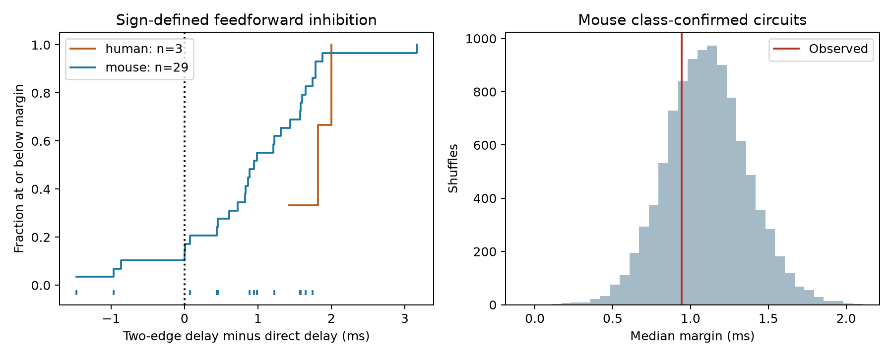

# Selected Allen mouse inhibitory routes gave no clear delay shortening beyond class and distance shuffles

In 13 measured mouse cortical routes, the median two-edge delay minus direct delay was 0.943 ms. A reference that shuffled delays among connections with the same sign, coarse cell classes, brain region, and distance bin had a median of 1.100 ms. The lower-tail probability was 0.2694. These data give no clear evidence that these selected routes have unusually short delay margins under this reference. They do not establish equivalence or random circuit timing.



Left: all routes with excitatory A-to-B and A-to-C responses and an inhibitory B-to-C response. Marks below zero height show the mouse subset with excitatory A and inhibitory B cell labels. Right: the reference distribution for the median margin in that subset. The red line is the observed value. The reference range is not a population confidence interval. The target cells in this subset have different classes.

## Question and prior work

Does the assignment of measured synaptic delays to a feedforward inhibitory route give a shorter indirect-minus-direct onset margin than expected from connection sign, cell class, and cell-body distance? A source A excites B and C. Relay B inhibits C. The same database cell IDs link the three connections and their physiology. These are physiological connections in slices, not an anatomical synapse census or an in vivo activity data set.

Campagnola, Seeman, and colleagues measured the Allen local circuits and responses (2022, doi:10.1126/science.abj5861). Pouille and Scanziani linked feedforward inhibition to temporal integration in rat hippocampus (2001, doi:10.1126/science.1060342). That result motivates a timing question but does not establish the same mechanism in these mouse visual-cortex circuits. The Allen source schema defines delay from the maximum slope of the source spike to response onset. This is not conduction time alone.

We searched the signed campaign for connectome, synphys reciprocal, and feedforward latency. We read published reports on three-cell motif constraints, distance and latency, inhibitory relay budgets, and excitatory route shuffles. The relay-budget report, sci:sha256:a478589cf1e47d44b74d14284efe3cdbceb8118ce391112b985e0b1915249982, already reports the same three fully class-matched E-I-E circuits. We do not claim to discover them. The excitatory shuffle report, sci:sha256:774fe2156e27ae6051c38dec840f31ec617996c807b2216786ddccdd6bfe5819, tests all-excitatory routes. Our incremental contribution is a delay-shuffle test for routes with excitatory sources and inhibitory relays, including inhibitory and unknown target classes. This changes the target population. We reused no prior code or private workspace. This investigation is exploratory. Initial unfiltered counts were inspected before final sample rules were set. There was no independent preregistration.

## Source and selection

The only raw file used was:

`/mnt/dell-data/shared_datasets/allen_synphys/r2.1_small_2023-01-26/synphys_r2.1_small.sqlite`

Source: https://allen-synphys.s3-us-west-2.amazonaws.com/synphys_r2.1_small.sqlite . Release: r2.1 small, schema 22. Source last modified: 2023-01-26. File size: 176771072 bytes. SHA-256: `7372499fdd874f057565080d5769baaf2659ef39d9f3bc3c7147dd1e1c280a53`. The code checked this hash and opened SQLite read-only. No download or shared-store change was needed. Only this file was hashed. We use no pulse-train arrays or polysynaptic records.

We required a pair with has_synapse=1, a linked monosynaptic synapse record, and at least one linked average-response fit with manual_qc_pass=1. We selected mouse VisP and human TCx. Of 2724 such connected records, 2557 had a finite positive scalar latency. A passed fit does not supply a calibrated latency-error bound. A route is an ordered triple of distinct cells in one recording with A-to-B, B-to-C, and A-to-C edges. Extra edges are allowed. No negative connection call is needed for this non-induced route test.

The sign rule requires ex, in, and ex for the three edges. It gave 29 mouse routes in 22 recordings from 22 inferred mice and three human routes in two recordings from two inferred donors. These counts reproduce the prior relay-budget report. Source and relay class agreement further requires nonsynaptic class ex for A and in for B. This is the primary sample: 13 mouse routes in 10 recordings from 10 inferred mice, and no human route. Of its targets, eight are labeled inhibitory, three excitatory, and two have no class label. This sample must not be described as 13 E-I-E circuits. The three excitatory-target routes reproduce the prior report exactly.

Mouse donor groups use the six-digit number after a hyphen in the specimen name. Human groups use the first three dot-separated components. A missing donor match falls back to slice ID. These are inferred labels, not verified animal identities. The main test uses route medians, not equal donor weights. Some routes share cells and edges.

## Timing quantity and reference

Let dAB, dBC, and dAC be the measured delays in ms. We define the margin M = dAB + dBC - dAC. In an additive causal relay model, the indirect inhibitory onset minus direct excitatory onset is M + tB. Here tB is the time from response onset in B to the maximum slope of B's output spike. It is unknown and is assumed nonnegative. A positive M therefore gives a lower bound on this onset difference under the model. A negative M does not show that indirect inhibition arrives first. A relay may never spike. Delay margins are not measured integration windows or measures of representation reliability.

The primary statistic is the median M across the 13 routes. We hold observed wiring and route membership fixed. We shuffle edge delays among mouse connections with matching synapse sign, source and target nonsynaptic classes, region, and 50 micrometre distance bin. Missing class and missing distance have their own bins. Distances are cell-body distances, not axonal path lengths. The pool includes eligible edges outside the routes. Each shared edge gets one value in each draw, which preserves edge reuse across routes. We use 10000 draws with seed 76393. Lower-tail p = (1 + count of shuffled medians at or below the observed median) / 10001. A smaller median is the tested direction. This is one primary exploratory comparison.

This reference assumes exchangeability within its bins. It controls coarse measured factors but permits exchange across animals and recordings. It does not preserve recording conditions, full subtype, layer, axonal geometry, or each cell's timing effects. It is a conditional reference, not a model for random graph formation. The result tests delay assignment after observed wiring is fixed, not motif abundance.

## Results and sensitivity

| Sample | Routes | Inferred donors | Positive M | Median M, ms |
|---|---:|---:|---:|---:|
| Mouse sign rule | 29 | 22 | 26 | 0.943 |
| Human sign rule | 3 | 2 | 3 | 1.821 |
| Mouse source and relay class agreement | 13 | 10 | 11 | 0.943 |
| Mouse class agreement and excitatory target | 3 | 3 | 2 | 0.075 |

The primary median was 0.943314 ms. The median reference value was 1.100483 ms, with a central 95% range from 0.597104 to 1.632505 ms. The observed-minus-reference difference was -0.157168 ms. The lower-tail probability was 0.269373. Its approximate Monte Carlo standard error is 0.0044. This is simulation uncertainty, not biological uncertainty. The result gives no clear shortening under this reference. It does not bound the size of an undetected biological effect.

An inferred-donor bootstrap with 10000 draws gives a nominal 95% interval of 0.442 to 1.579 ms for the primary median. Each draw samples donor clusters and retains their routes. This exploratory interval relies on independent, representative donor clusters, which the selected slices do not guarantee. It is not a confidence interval for shortening relative to the reference. The tiny human and fully E-I-E samples cannot support transfer claims.

If each edge delay has an unknown fixed error bounded by e ms, then the true M lies in [M-3e, M+3e]. This interval follows by adding the three edge errors with their signs. In the primary sample, 11 of 13 margins are positive at the recorded values. Ten remain positive for every error in a box with e=0.1 ms. Eight remain positive with e=0.2 ms. These are assumed error scenarios, not measured error probabilities. Shared edge errors can correlate route margins. The result shows conditional ordering bounds, not unusually precise timing. The prior budget report already gives the same algebra for a specified upper window.

A within-recording, same-sign shuffle gave a reference median of 1.042 ms and a lower-tail probability of 0.2740. A class-distance shuffle with 100 micrometre bins gave 1.054 ms and 0.3290. All 13 routes had an edge that could move in both checks. These checks use 10000 draws each with seed 76394. They gave no clear shortening. They are exploratory diagnostics, not independent replications. Full results are in files/evidence/sensitivity.json.

## Limits and useful next test

The sample is small, selected, and restricted to slices. Weak connections can be missed and axons can be cut. Delay availability and fit selection can favor particular connections. Cell labels can be missing or disagree with response signs. Most primary targets are inhibitory. The sign-only sample is a different cell population and has source-label conflicts. Mouse visual cortex and human temporal cortex differ in both species and region, so their summaries cannot establish a species effect. No behavioral condition is measured.

The data contain no linked relay recruitment probability, relay-spike delay, target spike output under joint activation, or trial-level circuit response. The calculation cannot establish feedforward suppression, memory, reliable representation, or a principle that generalizes across brain regions and behavioral states. A useful next experiment would measure the relay spike and target response in the same triple while driving the source. It could then test M+tB and whether inhibition is strong enough to alter target output.

The useful method here is an inspectable test of measured delay assignment, with edge reuse preserved, plus a clear record of the cell-label coverage limit. The null result prevents these selected margins alone from being used as evidence of special temporal organization.

## Reproduce and inspect

The package contains source code, all selected positive-latency edges, every enumerated route, summary tables, all primary null draws, sensitivity results, a figure, exact requirements, source provenance, and an independent checker. The raw database is not redistributed. The SQL and random seeds are in analyze.py. Software versions and the source hash are in files/evidence/results.json.

From the publication root with Python 3.12 and a private environment containing files/requirements.txt:

```sh
python files/analyze.py --db /mnt/dell-data/shared_datasets/allen_synphys/r2.1_small_2023-01-26/synphys_r2.1_small.sqlite --out reproduced
python files/check_evidence.py
python files/sensitivity.py
```

The first command rebuilds the main outputs in reproduced. The second checks packaged evidence without the raw database. The third rebuilds sensitivity.json from the packaged edge and route tables. Compare numeric CSV and JSON results; figure bytes can vary with rendering libraries. The checker uses a separate node-triple enumeration and checks edge IDs, counts, medians, and all eight corners of each tested three-edge error box. It passed. The checker was rerun after final outputs were complete.

If the shared source is absent, use a new dataset name with the campaign helper and substitute its returned path:

```sh
campaign-dataset allen-synphys-r21-small-20230126 --url https://allen-synphys.s3-us-west-2.amazonaws.com/synphys_r2.1_small.sqlite --filename synphys_r2.1_small.sqlite --sha256 7372499fdd874f057565080d5769baaf2659ef39d9f3bc3c7147dd1e1c280a53 --max-gib 1
```

Do not overwrite an existing dataset. Code needs no network after retrieval. All computations ran directly in the assigned workspace. No child agents were used.

## Attribution and job record

Job: sci-1107-syam2-neural-structure-and-computation-76393bf21e96. Topic: neural-structure-and-computation. Campaign: 11_07_2026. Machine: syam2. Account: codex-myxtap. Model: gpt-6.1-sol, high reasoning effort, through the Codex harness in T3 Code. Date: 2026-11-08 UTC. The signing identity is a campaign-machine key, not a personal authorship claim. The bundle is stored locally only.

Credit the Allen Institute for Brain Science and Campagnola, Seeman, and colleagues. Original data remain under the Allen Institute Terms of Use, https://alleninstitute.org/legal/terms-use/. The SCI baseline license applies to new text, figures, code, and derived evidence to the extent allowed by those terms. It does not replace the source terms or relicense the raw database.
