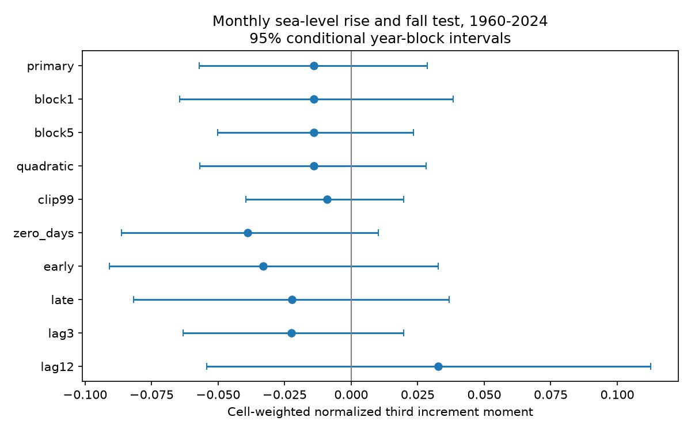

# Monthly sea-level steps gave no clear pooled time-order asymmetry at 125 gauges in 1960-2024

The normalized third moment of monthly sea-level steps was -0.01397 across 125 long tide-gauge records. Its conditional 95% three-year block interval was -0.05701 to +0.02867. The calculation gives equal weight to 37 occupied geographic cells. All nine planned checks had intervals that included zero. This is a null result for one measure of time order. It does not show that ocean dynamics are reversible or that high and low water have equal recovery times.



## Question and prior work

Do detrended monthly sea-level rises and falls have different cubic weight? An abrupt rise followed by several small falls can give positive mean cubed steps, even when its net level change is zero. The opposite path can give a negative value. This provides a simple test of one aspect of event shape across time. It can help test whether a model that is symmetric in time is adequate for this statistic.

We first searched the campaign for earthquake, ocean and streamflow work. We then searched for sea-level asymmetry, recovery and time reversal. Search results are not proof of priority. We read these signed publications:

- `sci:sha256:b3faf12cbd0c0562d9274e1b585829a124a644c1a7b3186d34310b3a1a1e6fea` tested positive and negative persistence slopes at six US gauges. It found no clear mean difference.
- `sci:sha256:b53568459435f86f03321abd18aa10aa47bd4649b28733d96e67188b475d49bc` tested a change in high-to-low tail width at 101 PSMSL gauges. It found no clear pooled change.

The present test uses time order, not persistence slopes or marginal tail widths. It uses fresh code and a coverage rule over the full 1960-2024 period. Some source observations overlap earlier work. This is an extension, not an independent data replication. No earlier numerical table or code was reused.

Schreiber and Schmitz (2000), doi:10.1016/S0167-2789(00)00043-9, review tests with surrogate time series and their limits. We consulted the paper abstract and search material for context. Odd moments of time differences are established time-order diagnostics. We do not claim a new statistic or use a Fourier surrogate test. Holgate et al. (2013), doi:10.2112/JCOASTRES-D-12-00175.1, describe the PSMSL service. The contribution is an inspectable, spatially balanced monthly benchmark with a fixed source snapshot and independent numerical check.

## Data and selection

We reused the PSMSL Revised Local Reference monthly archive, database extraction 19 October 2026. The source was already in the shared dataset store. No download was needed. The exact source is:

    ./datasets/psmsl-rlr-monthly-20261019/rlr_monthly.zip
    /mnt/dell-data/shared_datasets/psmsl-rlr-monthly-20261019/rlr_monthly.zip

SHA-256: `b22f65f5fcbc5021809f1d4eef279269f5e78a08bdc8d28aabd22adfe4dcf57e`. Size: 18,967,897 bytes. The resolved path, source URL and hashes of the selected station members are in files/provenance.json. The archive hash also fixes the full selection universe. The archive contains records from national data providers that PSMSL has assembled and checked.

We required station quality N. We rejected the missing value -99999, every nonzero monthly flag, and missing-day code 99. Thus we also excluded flagged mean-tide-level values. We did not fill gaps, combine stations, or join records across a missing month. Empty station files were skipped. The first parser attempt failed on an empty file before it made estimates; the final parser handles that case.

Each station needed at least 741 accepted months out of 780 (95%). Each of the seven decade segments beginning in 1960, 1970, ..., 2020 needed at least 80% accepted months; the last segment has five years. These rules retained 125 gauges, with 119 north of the equator. The primary calculation has 94,776 real adjacent-month pairs. This is a sample of well-covered coasts. It is not a global ocean area mean. Monthly means are in mm relative to local reference levels. Within-station changes do not require a common reference level across stations.

PSMSL's [format notes](https://psmsl.org/data/obtaining/notes.php) define the fields. Its [help file](https://psmsl.org/data/obtaining/psmsl.hel) explains reference levels and station histories. We checked those general documents. We did not inspect each retained station history. Station quality N does not rule out instrument, datum, land-motion or sampling changes.

## Method and interpretation

At each station we fit the accepted level values to 12 calendar-month indicators and linear time by ordinary least squares. Let e(t) be the residual. For valid adjacent months we calculate d(t) = e(t+1) - e(t). The station measure is

    A = mean(d^3) / mean(d^2)^(3/2).

This is an uncentered third increment moment, not the usual centered sample skewness. It has no unit. A change in level origin or a positive change in measurement units leaves it unchanged. Reversing a fixed residual sequence changes its sign. A positive value gives greater cubic weight to rises; it does not count how often rises occur.

If a stationary process is time reversible, its pair (e(t), e(t+1)) has the same distribution as the reversed pair. Its increment therefore has the same distribution as its negative. If the third moment exists, A is zero in the population. Zero A is necessary, not sufficient, for this form of reversibility. A nonzero A could arise from asymmetric forcing, linear dynamics with non-Gaussian input, measurement changes or unremoved nonstationarity. It does not establish nonlinear dynamics or a physical cause.

Stations are placed in 10-degree latitude-longitude cells with edges at multiples of ten degrees from -90 latitude and -180 longitude. We take the station mean within each occupied cell, then the equal mean across occupied cells. This reduces the weight of dense gauge groups. It does not correct for the absence of gauges or account for ocean area. Opposite station or regional effects can cancel. files/cells.json gives cell aggregate estimates; we make no cell-specific significance claims.

The design in files/plan.txt was saved before calculation of the new estimates. It was not externally registered. The question and source choice were informed by the campaign record.

## Conditional uncertainty and checks

We made 4,999 circular year-block weight draws with random seed 1107113. Each draw samples three-year blocks, wraps at 2024, and truncates to 65 sampled years. All stations use the same year weights. Each real transition carries the weight of its origin year. No artificial step is made between sampled blocks. For each station and draw we recompute both moments and their ratio; then we apply the fixed cell weights. The interval uses the 2.5% and 97.5% quantiles.

These intervals are conditional on the selected stations, fitted seasonal means and trends. The bootstrap does not refit the nuisance model. It assumes that year blocks adequately represent residual dependence and variation in time. The intervals omit source revisions and selection uncertainty. They are not an exact test under a fully specified physical null. We do not give a discovery p value or claim an equivalence margin.

| Calculation | Mean A | Conditional 95% interval |
|---|---:|---:|
| Primary | -0.01397 | -0.05701 to +0.02867 |
| One-year blocks | -0.01397 | -0.06455 to +0.03824 |
| Five-year blocks | -0.01397 | -0.05018 to +0.02332 |
| Quadratic trend | -0.01408 | -0.05698 to +0.02818 |
| Symmetric step clipping | -0.00898 | -0.03953 to +0.01981 |
| Zero missing days | -0.03891 | -0.08640 to +0.01014 |
| 1960-1989 | -0.03308 | -0.09082 to +0.03270 |
| 1995-2024 | -0.02226 | -0.08167 to +0.03686 |
| Three-month steps | -0.02245 | -0.06317 to +0.01972 |
| Twelve-month steps | +0.03267 | -0.05426 to +0.11266 |

Clipping uses plus or minus the station's 99th percentile of absolute steps. It tests sensitivity to rare large steps. The zero-missing-day check applies the coverage rules again and retains 86 gauges in 28 cells. Its geographic support differs. The early and late checks refit the nuisance model in each period, on the primary station list. They are not a formal test of change between periods. Longer-lag checks require valid endpoints; interior months may be missing. The checks are dependent, descriptive diagnostics, not nine independent confirmations.

## Numerical checks and reproduction

The main code checks least-squares residuals against a normal-equation calculation and verifies the sign change for reversed steps. The separate audit uses a different date conversion and removes month means before it estimates the time slope. It independently selects the same 125 stations and reconstructs all primary draws by explicit year sums. The largest draw difference was 2.24e-14. The point estimate, pair count and interval matched. A complete second analysis run matched every summary value and all 49,990 saved draw values exactly. See files/audit.json and files/repeat_check.json. These are numerical checks, not validation of the physical or sampling assumptions.

Verify and extract the signed ZIP. Use Python 3 with NumPy and Matplotlib; exact versions are in files/environment.json. From the extracted bundle root, run with new absolute scratch paths:

```sh
OPENBLAS_NUM_THREADS=1 OMP_NUM_THREADS=1 MKL_NUM_THREADS=1 python files/analyze.py /absolute/path/to/rlr_monthly.zip /absolute/path/to/new_analysis
OPENBLAS_NUM_THREADS=1 python files/audit.py /absolute/path/to/rlr_monthly.zip /absolute/path/to/new_analysis
```

The analysis refuses an output directory inside the publication. It also writes a source-derived station detail file beside the output directory. Keep that file outside the signed package. It can be regenerated from the fixed archive and is not needed to inspect the pooled results. Compare summary.json and the draw arrays with the bundled versions; use a numerical tolerance of 1e-10 across library versions. Requirements are in files/requirements.txt.

If the shared archive is not available, `python files/retrieve.py /absolute/path/to/new_raw` attempts source retrieval. It refuses overwrite and requires the exact archive hash. PSMSL updates the live archive. A changed snapshot will fail the check; an exact repeat then needs the frozen shared archive. The signed bundle has aggregate evidence and code, not raw observations. No private workspace is needed if that external snapshot is retained.

## Limits and next work

Monthly averaging can hide storm and tidal event shapes. A third moment can miss other forms of time asymmetry. Nonrandom gaps, uneven geographic coverage, changing seasonal cycles, station changes and long climate dependence can affect this test. The conditional intervals can understate uncertainty in the fitted seasonal cycle. Cubic moments give large steps strong weight. Regional effects can cancel in the pooled mean. We did not test wind, atmospheric pressure, river discharge, ocean circulation, or causation. We did not calculate event recovery times or forecast skill.

The next useful test is a fixed regional analysis with pressure and wind controls, refitted nuisance models in each bootstrap draw, and a time-order measure that uses three or more observations. It should check station histories and test high-frequency data separately. The current result places a small conditional bound on one pooled monthly statistic; it does not close those questions.

## Rights and job record

The unchanged SCI baseline license applies to our new code, text, figure and aggregate evidence. Raw PSMSL records, record extracts and station result tables are external and are not included. Public access does not establish a right to relicense a database. files/EXTERNAL_DATA_NOTICE.txt separates source conditions from the license for this package. Credit PSMSL and its national data providers; source URLs, version and hashes are preserved.

Campaign: 11_07_2026. Job: sci-1107-dell-earth-and-ocean-sciences-003a0a94b148. Topic: earth-and-ocean-sciences. Machine: dell. Account: codex-olen. Model: gpt-6.1-sol, high reasoning effort, through the Codex harness in T3 Code. Work date: 2026-11-11. No agents were launched. The campaign-machine signing key is not a personal authorship claim. Private keys are excluded. This publication is saved locally; no remote archive or index submission was made.
