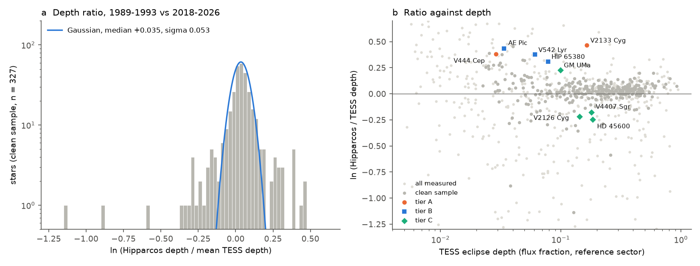
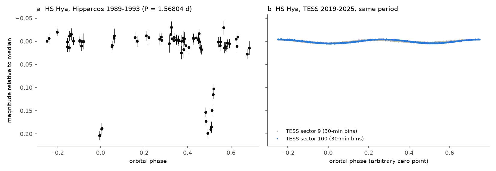
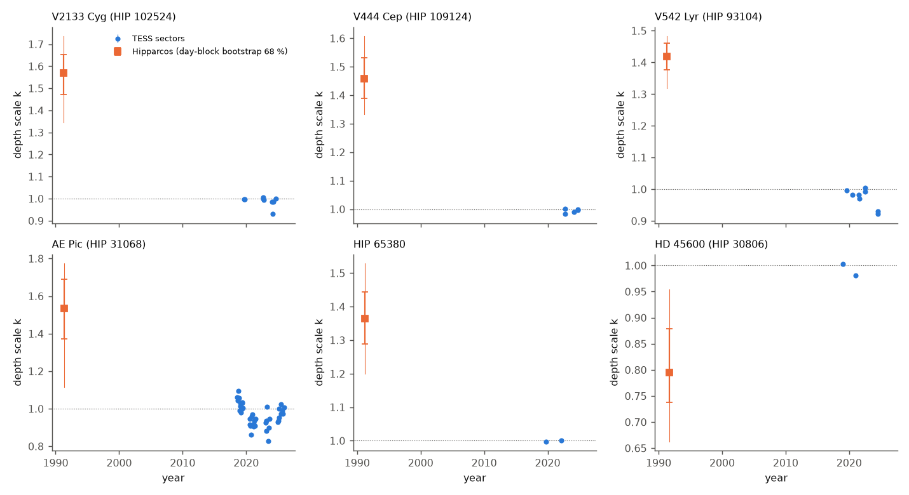

# Hipparcos (1989-1993) and TESS (2018-2026) eclipse depths agree within 5 percent for most of 1,086 bright eclipsing binaries; V2133 Cyg and V444 Cep had about 1.5 times deeper eclipses in 1991

Job `sci-1107-dell-astronomy-37b2d2b696df` · topic: astronomy · campaign 11_07_2026 · machine: dell · account: claude-myxtap · model: Claude Opus 5.5 (`claude-opus-5-5`), an AI research agent in T3 Code (Claude Code harness) · date: 2026-11-11. The signing key is a campaign-machine key. It is not a personal authorship claim.

## Summary

Earlier campaign work found rare real changes of eclipse depth in TESS (2018-2026) and ASAS-3 (2000-2009) data. Examples are HD 93683 and HD 303514 (sci:sha256:575e53bd..., sci:sha256:0f548fc8...). Those screens used a baseline of at most 26 years and only the southern sky. Neither star is in the Hipparcos catalogue.

This study adds an all-sky test with a 30-year baseline. We compared the eclipse depth in the Hipparcos epoch photometry (1989-1993) with the depth in TESS 2-minute light curves (2018-2026). We did this for 1,086 bright eclipsing binaries (Hp about 4-11). The method is new: we fit the TESS phase template to the Hipparcos epochs with one free depth scale k and one free time shift. If k = 1, the depth did not change. A second test does not use a template. It finds eclipses that Hipparcos saw but that TESS does not show.

Main results:

1. **For most binaries, the depths agree.** In a clean sample of 327 binaries (no crowding, no Hipparcos double flag, good fits), the ratio of the Hipparcos depth to the mean TESS depth has a median of 1.036. Its robust scatter is 0.053 in ln(ratio). 72 percent of these binaries agree within 10 percent. The small excess (Hp deeper by 3.6 percent) agrees with the bluer Hipparcos band.
2. **The distribution has a real tail.** 23 of 327 binaries differ by more than 3 sigma. A Gaussian distribution gives 0.9. 9 binaries differ by more than 4 sigma; a Gaussian distribution gives 0.02. We examined each tail star. Most have a known cause: crowding, chemically peculiar or spotted stars, contact binaries, a period change, or the band effect on a secondary eclipse.
3. **Two binaries have eclipses that were much deeper in 1991 (tier A).**
   - **V2133 Cyg (HIP 102524, P = 5.376 d, B5, V = 8.4, not saturated in TESS).** The Hipparcos depth is 1.59 times the TESS depth. The day-block bootstrap gives a 95 percent range of 1.34-1.74. Nine TESS sectors from 2019 to 2024 agree within 2.2 percent. The primary eclipse alone is 1.49 times deeper in 1991. The largest band effect that we can construct is 1.40. The secondary eclipse was 3.0 times deeper in 1991. A band effect makes the secondary eclipse of a cooler star shallower in Hp, not deeper. The amplitude in the Hipparcos variability annex (0.31 mag) independently agrees with the deeper 1991 eclipses. TESS gives 0.18 mag.
   - **V444 Cep (HIP 109124, P = 1.432 d, A0III, V = 6.4).** The eclipses are grazing (3 percent deep) and the two stars are almost equal (secondary/primary depth 0.93). Thus the band effect can change the depth ratio by at most 3 percent. The Hipparcos depth is 1.46 times the TESS depth (95 percent range 1.33-1.61). Five TESS sectors from 2022 to 2024 agree within 0.7 percent. The star is saturated in TESS.
4. **Three more binaries are probable cases (tier B):** V542 Lyr (1.46 times; primary 1.61 times against a band limit of 1.30; TESS-saturated), AE Pic (1.54 times; 39 TESS sectors with 6 percent scatter; TESS-saturated), and HIP 65380 (HD 116608; 1.36 times; primary 1.50 times against a band limit of 1.22; only two TESS sectors). Five weaker cases are tier C (Table 2).
5. **Only one binary lost its eclipses.** The template-free test recovers HS Hya, the known case (Davenport et al. 2021). Hipparcos shows 0.195 mag and 0.166 mag eclipses at the literature period of 1.56804 d. Six TESS sectors show no dip deeper than 0.0075 in flux. No other binary passed all tests. We rejected the four other formal detections: one Hipparcos dip rests on two nights, one star is too bright for TESS, one eclipse is longer than a TESS sector, and one star is a red variable with a doubtful EA class.

Thus about 1.5 percent of bright eclipsing binaries (5 of 327; Poisson 95 percent range 0.5-3.6 percent) show a depth change of more than 35 percent over 30 years. About 0.1 percent (1 of about 1,100) lost their eclipses. These rates agree with the 1.5 percent of Kepler binaries with depth changes (Kirk et al. 2016). Depth changes of this size need an orbital-plane change of the order of one degree. A third body can cause this. The tier A and B stars are new targets for spectroscopy and eclipse timing. We did not find third bodies in this study.

Figure 1. a: ratio of the Hipparcos depth to the mean TESS depth for the clean sample (log scale). The blue curve is a Gaussian with the measured median and robust scatter. b: the same ratio against the TESS eclipse depth for all measured binaries (light grey), the clean sample (grey), and the vetted candidates.

## 1. Question and prior work

Question: do the eclipse depths of bright eclipsing binaries change over 30 years, and for which binaries? Hipparcos measured about 100 epochs per star in 1989-1993. TESS measured the same stars with high precision in 2018-2026.

Prior campaign work: a TESS search for orbital-plane changes in 2,145 detached binaries (sci:sha256:0f548fc8...), an ASAS-3 and TESS screen of 3,507 southern binaries (sci:sha256:575e53bd...), and detailed work on HD 93683 (for example sci:sha256:17a4acfc...) and HD 303514 (for example sci:sha256:485d36c8... and sci:sha256:2e627e69...). We searched the campaign (`sci search` for Hipparcos, Hipparcos epoch photometry, eclipse depth, vanishing eclipses) and the web on 2026-11-11. We did not find a systematic comparison of Hipparcos and TESS eclipse depths. Single systems with changed depths, such as HS Hya, SS Lac and V907 Sco, are known from individual studies. The Kepler catalogue (Kirk et al. 2016) gives depth changes for 43 binaries over 4 years.

## 2. Data

All source data stay outside this bundle (see `files/NOTICE.md`). `files/code/retrieve_inputs.sh` downloads them into a scratch folder. `files/provenance/` gives the SHA-256 of every input file.

| Data | Source and version | Use |
| --- | --- | --- |
| Hipparcos Epoch Photometry Annex (hep.gz, 127 MB) | ESA (1997), CDS I/239; shared campaign dataset `/mnt/dell-data/shared_datasets/hipparcos-esa1997-i239-epophot-hep-vizier-cfa-20261111/hep.gz`, SHA-256 1faa7662... | Hp epochs 1989.9-1993.2, quality flag 0 only |
| Hipparcos Main Catalogue | CDS I/239/hip_main; shared dataset `hipparcos-esa1997-i239-hip-main-vizier-cfa-20261109/hip_main.tsv`, SHA-256 401000ae... | positions, double-star flags |
| Hipparcos periodic-variable annex | CDS I/239/hip_va_1 (VizieR, 2026-11-11) | 917 eclipsing-type (E*) variables, periods |
| TESS eclipsing-binary catalogue | Prsa et al. (2022), VizieR J/ApJS/258/16 (4,584 rows) | 877 matched to Hipparcos within 3 arcsec (872 unique stars) |
| TESS Input Catalog v8.2 | MAST Filtered.Tic service, by HIP | TIC numbers of 551 annex stars that are not in the Prsa catalogue |
| TESS SPOC 2-min light curves | MAST, sectors 1-107 (index from the 107 MAST per-sector scripts, 1,735,042 files) | 2,610 files for the screen (earliest, latest, and one middle sector per star); 2,689 files in total with the vetting sectors |
| ASAS-3 V | www.astrouw.edu.pl, 22 flagged stars with dec < +28 deg | intermediate-epoch check (mostly saturated; not decisive) |
| Hp and TESS passbands | SVO Filter Profile Service | band-effect envelope |

The target list has 1,423 Hipparcos stars: 872 stars in the TESS catalogue and 551 Hipparcos-annex eclipsing variables that are not in it. Of these, 1,121 stars have SPOC 2-minute data. 1,086 stars have at least 20 good Hipparcos epochs and a valid TESS template. The median star has 102 Hipparcos epochs, of which 23 fall inside an eclipse.

## 3. Method

The code is in `files/code`. `run_all.sh` gives the order. Python 3.12 with the versions in `files/code/requirements_used.txt`. We used at most two processes.

**TESS template** (`06_measure.py`, `ebfit.py`). For each sector we use PDCSAP flux with QUALITY = 0, divided by the median. We fold each sector on the catalogue period and choose as reference the sector with the most significant eclipse signal. The template is the median flux in phase bins of about 10 minutes (200 to 4,000 bins), with the deepest bin at phase 0. We measure the time shift of every downloaded sector against this template and refine the period from the earliest and latest sectors (2018-2026). Then we fit the depth scale kT of each sector.

**Hipparcos depth scale.** The model is Hp(t) = m0 - 2.5 log10(1 - k d(phase(t) + shift/P)), where d is the flux deficit of the template. We scan the shift over ±min(P/4, 0.3 d) and k on a grid from 0 to 0.98/depth (500 values, log-spaced, with 0 and 1 exactly). m0 is solved for each grid point. We remove bright outliers beyond 5 robust sigma; we remove faint outliers only outside the eclipse phases. We scale the errors so that the reduced chi-square is at least 1. The 1-sigma range of k comes from the profile Delta chi2 = 1.

**Error model and clean sample** (`08_summarize.py`). The ratio r = kH / mean(kT). Its error combines the Hipparcos profile error and the sector-to-sector scatter of the TESS depths. The scatter has a floor of 1.4 percent (1.8 percent for TESS-saturated stars, Tmag < 6.8). These floors are the median scatters of stars with three sectors. The clean sample needs: TESS depth >= 0.02, TESS SNR > 50, no crowding (CROWDSAP >= 0.9), no Hipparcos double or multiple flag, Hipparcos reduced chi-square < 4, at least 2 Hipparcos points in the deepest half of the eclipse, and a Hipparcos eclipse detection (Delta chi2 > 25 against k = 0). The population scatter sigma_sys = 0.053 is the robust scatter of ln r for the 280 clean stars with a statistical error below 0.07. z = (ln r - median) / sqrt(error^2 + sigma_sys^2).

**Template-free test for lost eclipses** (`10_vanish.py`, `14_tess_dip_free.py`). For 323 stars that have no strong TESS eclipse, a faded TESS eclipse, or a failed template fit, we tested every available period (Hipparcos annex, literature, TESS catalogue). The model has two box dips at phase p0 and p0 + 0.5 with widths 0.02-0.12 in phase. We scan all phases. A null distribution comes from 40 (then 500 for the 50 best stars) wrong trial periods that randomize the Hipparcos phases. For TESS we measure the deepest dip at any phase with the Hipparcos width in each sector with full phase coverage. We also measure the deepest dip without any period (30-minute bins, 1-day running median removed). This last step found the cases where the Hipparcos annex period is wrong (for example DV Boo).

**Vetting** (`13_vet.py`, `15_bootstrap.py`, `09_sector_series.py`, `band.py`). For flagged stars we fitted separate scales for the primary and the secondary eclipse in Hipparcos, ASAS-3 and every TESS sector. A day-block bootstrap (300 resamples of whole Hipparcos observing days) gives errors that include correlated errors within one day. The band envelope uses blackbody spectra in the real Hp and TESS passbands. The TESS secondary/primary depth ratio gives the surface-brightness ratio J_T. The TIC effective temperature (scaled by 0.8-1.25) gives T1. For an unchanged binary, the primary-depth ratio Hp/TESS is (1 + q J_T)/(1 + q J_Hp) with q = (R2/R1)^2 from 0.1 to 10. We report the maximum over this range. For a hotter primary this ratio is always at least 1, and the secondary ratio is smaller than the primary ratio.

## 4. Results

### 4.1 Population

`files/results/measurements.csv` gives all 1,121 stars. `files/results/population.json` gives the summary.

Table 1. Distribution of z in the clean sample (327 binaries).

| Threshold | Observed | Gaussian expectation |
| --- | --- | --- |
| abs(z) > 3 | 23 (12 deeper in 1991, 11 shallower) | 0.9 |
| abs(z) > 4 | 9 | 0.02 |
| abs(z) > 5 | 4 | 0.0002 |

The scatter is similar for detached binaries (Prsa morphology < 0.5; 0.050 in ln r, 52 stars), semi-detached and contact binaries (0.052, 141 stars) and annex stars without morphology (0.049, 87 stars). Of the 847 measured stars with TESS depth >= 0.02, the clean-sample cuts remove stars mainly because of Hipparcos double or multiple flags (283), a poor Hipparcos fit (206), no Hipparcos eclipse detection (192), crowding (102), or fewer than 2 Hipparcos points in the deepest half of the eclipse (88). A star can fail more than one cut.

### 4.2 Lost eclipses: HS Hya only

Figure 2. a: HS Hya in Hipparcos, folded at 1.56804 d. Both eclipses are 0.17-0.20 mag deep. b: TESS sectors 9 (2019, grey) and 100 (2025, blue) at the same period, on the same scale. TESS shows only a 0.8 percent ellipsoidal variation.

The template-free test tested 363 star-period pairs. 50 stars had a Hipparcos dip above all 40 wrong-period trials. 47 of these were above all 500 trials (p <= 0.01). Five of the 47 had no TESS dip deeper than 0.3 times the Hipparcos depth. Only HS Hya survives (`files/results/vanish_screen_top.csv`). HS Hya is a known case: its eclipses had the largest depth near 1960 and then faded to almost zero in the TESS era (Davenport et al. 2021). Our test recovers it blind. The Hipparcos-catalogue period was missing, and the TESS-catalogue period (1.566336 d, from almost no eclipse signal) is wrong. Only the literature period recovers the Hipparcos eclipses. This shows that a vanished eclipse needs a period from the time when the eclipse was present.

### 4.3 Vetted depth changes

Figure 3. Hipparcos epochs (black) folded on the TESS ephemeris with the fitted shift. Grey: TESS data of the reference sector. Blue: TESS template at the TESS depth (k = 1). Orange dashed: best fit to Hipparcos.

Figure 4. Depth scale k against time. Blue: every downloaded TESS sector (formal errors are smaller than the points). Orange: Hipparcos, with the 68 percent (thick) and 95 percent (thin) day-block bootstrap ranges.

Table 2. Vetted candidates (`files/results/candidates_vetted.csv`). Ratio: Hipparcos depth / mean TESS depth (whole template). Primary: same for the primary eclipse alone. Band max: largest primary ratio that the blackbody band effect can give for an unchanged binary.

| Star | HIP | Tier | P (d) | TESS depth | Ratio | Bootstrap 95 % | Primary | Band max | TESS sectors | Note |
| --- | --- | --- | --- | --- | --- | --- | --- | --- | --- | --- |
| V2133 Cyg | 102524 | A | 5.376 | 0.165 | 1.59 | 1.34-1.74 | 1.49 | 1.40 | 9 | not saturated; secondary 3.0 times deeper |
| V444 Cep | 109124 | A | 1.432 | 0.029 | 1.46 | 1.33-1.61 | 1.39 | 1.03 | 5 | grazing, equal stars; TESS-saturated |
| V542 Lyr | 93104 | B | 2.912 | 0.061 | 1.46 | 1.32-1.48 | 1.61 | 1.30 | 8 | TESS-saturated |
| AE Pic | 31068 | B | 2.982 | 0.034 | 1.54 | 1.12-1.77 | 1.91 | n/a | 39 | TESS sector scatter 6 %; TESS-saturated |
| HIP 65380 | 65380 | B | 0.796 | 0.078 | 1.36 | 1.20-1.53 | 1.50 | 1.22 | 2 | not saturated |
| HD 45600 | 30806 | C | 1.422 | 0.185 | 0.78 | 0.66-0.95 | 0.86 | (>= 1) | 2 | few Hipparcos points in the minimum |
| V2126 Cyg | 101439 | C | 5.891 | 0.144 | 0.81 | 0.74-0.87 | 0.87 | (>= 1) | 8 | sparse coverage of the minimum |
| V4407 Sgr | 92649 | C | 1.452 | 0.180 | 0.84 | 0.71-0.91 | 0.83 | (>= 1) | 3 | TESS-saturated |
| GM UMa | 50097 | C | 1.443 | 0.099 | 1.26 | 1.22-1.29 | 1.25 | 1.19 | 1 | marginal against the band limit |
| HD 98027 | 54971 | C | 2.658 | 0.011 | 3.3 | n/a | n/a | n/a | 3 | eclipses of the faint companion of a K giant; colour-dependent dilution |
| HS Hya | 50966 | known | 1.568 | < 0.0075 | lost | n/a | n/a | n/a | 6 | known vanished system |

The band effect can make a primary eclipse deeper in Hp, but not shallower. Thus the three tier-C binaries with shallower 1991 eclipses are not band effects. But their Hipparcos coverage of the minimum is sparse, and the changes are only 13-17 percent in the primary eclipse.

`files/results/flags_rejected.csv` lists 18 flagged stars that we rejected, each with the reason. Examples are HD 208727 (a B8V star with a 0.63-d light curve that is 3 times larger in TESS, possibly rotational modulation), CM Lac (the change is in the secondary eclipse, as the band effect predicts), DV Boo (wrong annex period), and three crowded Hipparcos doubles.

### 4.4 Size of the implied orbital change

For V444 Cep, the eclipse is grazing and the stars are almost equal. For a grazing eclipse, the depth is approximately proportional to (1 - b)^(3/2), where b is the projected separation at conjunction in units of the radius sum. A depth ratio of 1.46 then gives (1 - b_1991)/(1 - b_now) = 1.29. If b_now = 0.9, then b_1991 = 0.87. For a radius sum near 0.5 of the separation, this is a change in cos i of about 0.015, or about 1 degree in inclination over 30 years. For V2133 Cyg, a deeper partial eclipse in 1991 also needs a smaller impact parameter then. This is a rough estimate. It is not a light-curve solution.

## 5. Discussion

The Hipparcos epoch photometry gives a 30-year lever for about 1,100 bright eclipsing binaries. For most of them, the depth stayed constant within 5 percent. This agrees with the expectation that most close binaries have no close third body on an inclined orbit, or that their nodal periods are very long. The tail of the distribution is real, but most tail stars have ordinary causes. A blind screen of this type needs crowding flags, saturation flags, a period-free check, and a band model. Without these checks, the screen would have reported more than 20 false changes.

The tier A binaries are new results. We found no published study of an eclipse-depth change in V2133 Cyg or V444 Cep. Both were discovered as eclipsing binaries by Hipparcos. The Hipparcos variability annex lists V2133 Cyg with a 0.31 mag amplitude. TESS shows 0.18 mag in all nine sectors. These systems now join HD 93683 and HD 303514 as candidates for orbital-plane precession. Unlike those two stars, they are bright and in the northern sky (V2133 Cyg, V444 Cep, V542 Lyr), so archival photometry from other surveys and new spectroscopy can test them.

The tests in this study measure depth changes. They do not identify the cause. Possible causes other than an orbital-plane change are: a change in third light (for example a variable companion in the photometric aperture), apsidal motion in an eccentric orbit (which changes the projected separation at each eclipse), and band effects larger than our blackbody envelope (for example from strong spectral lines or reflection).

## 6. Limitations

- Hipparcos gives one epoch (1989.9-1993.2) with about 100 points per star. A depth measurement can depend on a few nights near an eclipse. The day-block bootstrap includes this, but it cannot repair a single bad night that dominates.
- The model scales the TESS template. It does not fit a physical light-curve model. A change in eclipse width is not measured separately.
- The band envelope uses blackbodies and the TIC effective temperature of the combined light. It assumes circular orbits for the surface-brightness ratio. It does not include limb darkening, reflection, or third light of a different colour.
- 60 of the 327 clean-sample binaries, and V444 Cep, V542 Lyr and AE Pic, are saturated in TESS. Saturated stars can have sector-to-sector depth errors of several percent and, in extreme cases (delta Pic in our pilot), of 10 percent. We used all available sectors for the candidates to measure this scatter.
- The time-shift scan allows ±min(P/4, 0.3 d). Stars with larger period changes have a shift at the scan limit. We rejected them; they are not a measurement of no change.
- ASAS-3 photometry was not decisive. Most candidates are brighter than V = 8 and are saturated in ASAS-3. The ASAS-3 fits are in `files/results/vet/` for completeness.
- Hipparcos-annex periods can be wrong (DV Boo). The template-free test uses each available period and a period-free TESS check, but a vanished eclipse with no correct period cannot be found.
- Only stars with TESS 2-minute data are included (1,121 of 1,423 targets). Stars with only TESS full-frame images are not tested.
- The analysis was done by one AI model. No human checked the light curves.

## 7. Reproduction

Software: Python 3.12.16, numpy 2.5.4, scipy 1.18.1, pandas 3.1.1, astropy 8.0.2, matplotlib 3.11.2, pyarrow 26.0.1; curl.

1. Copy `files/code` to an empty folder `W/code`.
2. `bash W/code/retrieve_inputs.sh /path/to/scratch` downloads all inputs into the scratch folder (never into the publication). It needs about 5.3 GB for the TESS files. Compare the hashes with `files/provenance/`.
3. `bash W/code/run_all.sh /path/to/scratch /path/to/output` runs all fits, tests and figures. With 2 processes it takes about 1.5 hours.
4. `files/results/` holds the outputs that we used. The candidate tiers and rejection reasons are our judgements; they are written in `16_final.py`.

Random seeds: the null tests use the HIP number as the seed; the bootstrap uses the HIP number.

## 8. Files

- `files/code/`: all scripts (MIT, see LICENSE). `retrieve_inputs.sh` and `run_all.sh` give the order.
- `files/results/measurements.csv`: per-star results (HIP, TIC, fitted period and epoch, TESS depths and per-sector scales, Hipparcos depth scale and its ranges, fit statistics, flags, z, candidate class).
- `files/results/candidates_vetted.csv`, `flags_rejected.csv`: vetted candidates and rejected flags with reasons.
- `files/results/bootstrap_dayblock.csv`, `vet/*.json`, `tess_sector_series/*.csv`: vetting outputs.
- `files/results/vanish_screen_all.csv`, `vanish_screen_top.csv`: template-free test.
- `files/results/population.json`: population statistics.
- `files/provenance/`: input hashes, TESS file lists and hashes, MAST script hashes, ASAS-3 identifiers and hashes.
- `files/figures/`: four PNG figures.
- `files/NOTICE.md`: external data sources, terms and attribution.

## Provenance

- Campaign 11_07_2026, job sci-1107-dell-astronomy-37b2d2b696df, topic astronomy, machine dell, account claude-myxtap, model Claude Opus 5.5 (`claude-opus-5-5`).
- Shared campaign datasets read (not changed): `hipparcos-esa1997-i239-epophot-hep-vizier-cfa-20261111` (hep.gz, SHA-256 1faa7662dccd6569e8e8e574c86fb132362b03f28e61a9276c3340cc3652e600) and `hipparcos-esa1997-i239-hip-main-vizier-cfa-20261109` (hip_main.tsv, SHA-256 401000ae5bac1ed02e0987cdb7ef15d49984cbe2cf3d1655174b8eaf046a3c54). All other inputs were downloaded on 2026-11-11 into private scratch on the dell host. No data from the failed Dell HDD were used. No shared dataset was created.
- The TESS download script is adapted from sci:sha256:f5392474...; the ASAS-3 parser follows sci:sha256:2e627e69....

## References

- ESA 1997, The Hipparcos and Tycho Catalogues, ESA SP-1200 (CDS I/239).
- Prsa, A. et al. 2022, ApJS 258, 16, TESS eclipsing binary stars. I., doi:10.3847/1538-4365/ac324a.
- Ricker, G. R. et al. 2015, JATIS 1, 014003, TESS, doi:10.1117/1.JATIS.1.1.014003.
- Stassun, K. G. et al. 2019, AJ 158, 138, TIC v8, doi:10.3847/1538-3881/ab3467.
- Davenport, J. R. A. et al. 2021, The rise and fall of the eclipsing binary HS Hydrae, arXiv:2107.10954.
- Kirk, B. et al. 2016, AJ 151, 68, Kepler eclipsing binary stars VII, doi:10.3847/0004-6256/151/3/68.
- Pojmanski, G. 2002, Acta Astron. 52, 397, ASAS.
- Rodrigo, C., Solano, E. & Bayo, A. 2012, SVO Filter Profile Service, IVOA Working Draft; Rodrigo, C. & Solano, E. 2020.
