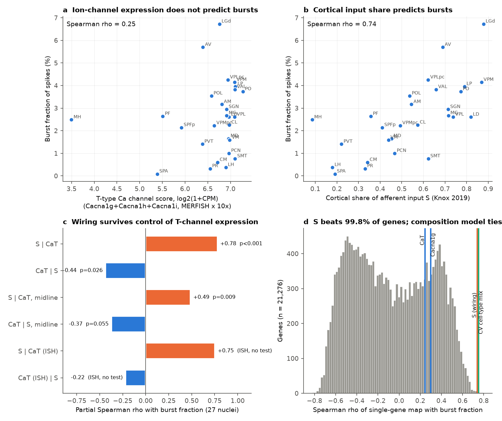
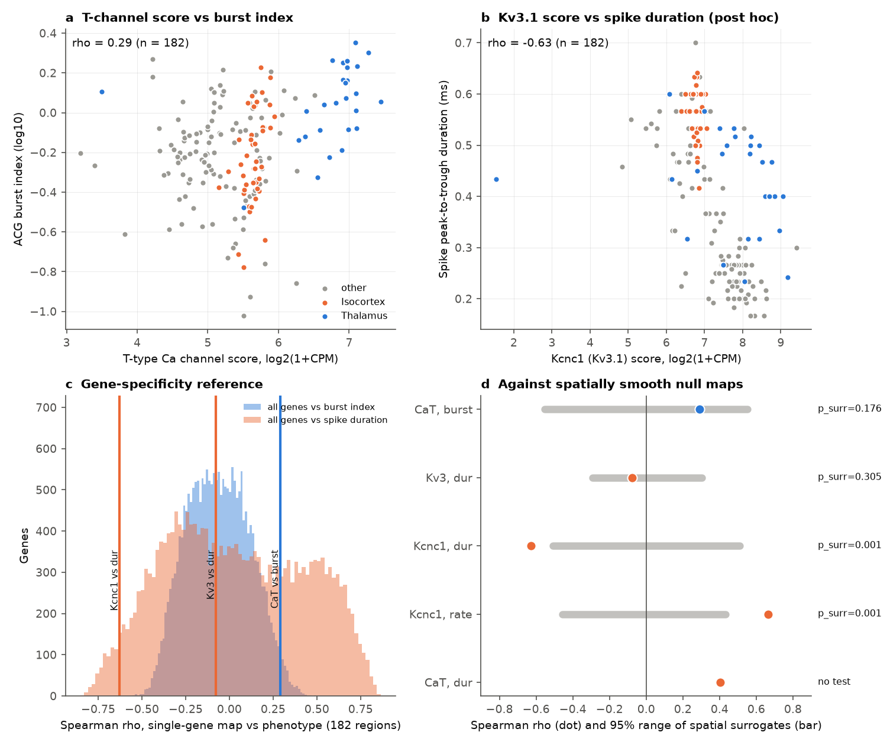
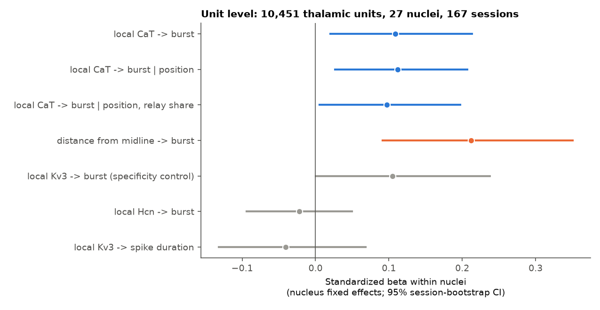

# In 27 mouse thalamic nuclei, T-type calcium channel expression did not explain burst firing, but cortical input share did; brain-wide, Kv3.1 expression tracked spike duration (IBL, Allen MERFISH and ISH)

Job `sci-1107-dell-neural-structure-and-computation-9d57ab1e0c17`. Campaign 11_07_2026. Topic
neural-structure-and-computation. Machine dell. Account claude-sci. Analysis, code and text: Claude Opus 5.5
(`claude-opus-5-5`) with the SCI CLI, 2026-11-10. The signing key is a campaign-machine key. It is not a
personal authorship claim.

## Summary

**Question.** Earlier campaign work found that the cortical share of afferent input (S) predicts burst firing
in 27 mouse thalamic nuclei (rho 0.74; sci:sha256:0b0f9e1c...). It also found that input wiring and cell-type
composition both predict regional spiking phenotypes, and that the two are correlated
(sci:sha256:48d934f4..., sci:sha256:f4e4c521..., sci:sha256:49479722...). Generic composition similarity does
not name a mechanism. Thus we tested a mechanism-specific alternative to the wiring account. Biophysics
gives the genes: low-threshold bursts need T-type Ca2+ channels (Cacna1g, Cacna1h, Cacna1i), and brief spikes
need Kv3 channels (Kcnc1, Kcnc2). If the local molecular make-up sets the regional phenotype, the regional
expression of these genes must predict the matched phenotype, more than most other genes do. Also, the wiring
predictor S must add nothing after T-channel expression.

**Data.** Phenotypes of 62,049 good IBL Brain-Wide Map units (182 regions) and the thalamic burst fraction of
27 nuclei, reused from earlier SCI publications. Gene expression of each region: Allen Brain Cell Atlas 10x
cluster means (5,322 clusters, all genes), weighted by the cluster mix of the region in MERFISH brain
C57BL6J-638850 (1.92 million neurons). Replication: Zhuang-ABCA-1 MERFISH brain (0.99 million neurons).
Independent check: Allen Mouse Brain ISH expression energy. Wiring: Knox 2019 connectome.

**Method.** The plan (`files/code/PLAN.md`, SHA-256 6b6f1014...) was frozen before we computed any
gene-phenotype statistic. Inference used 1,000 spatially autocorrelated surrogate phenotype maps (brainsmash),
a gene-specificity reference (all 21,309 expressed genes and 1,000 expression-matched random gene sets) and
residual permutation for partial correlations.

**Main results.**

1. **H1 not supported. T-channel expression did not predict thalamic bursts.** Across 27 nuclei, rho = 0.25
   (surrogate p = 0.12; 74th percentile of genes). Most dorsal thalamic nuclei have almost the same high
   T-channel score (Figure 1a). The second MERFISH brain gave rho = 0.30 (p = 0.08). Direct ISH measurement gave
   rho = 0.01.
2. **H2: the opposite of the mechanistic prediction. Wiring survived control of T-channel expression.** The
   partial rho of S given T-channel score was +0.78 (p < 0.001). The partial rho of T-channel score given S was
   negative (-0.44, p = 0.026). S stayed after control of T-channel score and midline distance together (+0.49,
   p = 0.009). With ISH T-channel expression, S gave +0.75. The pre-set rule for "T-channel expression explains
   the S-burst link" failed.
3. **H3a: brain-wide, the T-channel score went with the burst index, but not beyond spatial smoothness.** Across
   182 regions, rho = 0.29. This was in the 98th percentile of genes and of matched random gene sets, but the
   spatial surrogate p was 0.18. Without thalamus (155 regions), rho fell to 0.08.
4. **H3b not supported.** The pre-set Kv3 score (Kcnc1 + Kcnc2) did not predict spike duration (rho -0.08,
   surrogate p = 0.31). The reason: Kcnc2 is very high in thalamic relay neurons, and these have broad spikes.
5. **H3c: the pre-set double-dissociation contrast was positive (C = 0.68, surrogate p = 0.014, Holm p = 0.07),
   but we do not count it as support.** The contrast is large mainly because the T-channel score went with
   *longer* spikes (rho +0.40), not because each gene set is specific. The contrast design did not exclude
   this case. This is an error in our plan.
6. **Post hoc: Kcnc1 (Kv3.1) alone tracked spike duration.** rho = -0.63 (surrogate p = 0.001; 97th percentile of
   genes), narrow-unit fraction +0.50 (p = 0.003) and firing rate +0.66 (p = 0.001). The second MERFISH brain gave
   -0.54 (p = 0.001). ISH gave the same sign but a weaker value (-0.24). Inside brain divisions the link was
   weaker (pooled within-division r = -0.26). Kcnc1 was selected after H3b failed, so this result needs an
   independent test.
7. **Unit level inside thalamic nuclei (secondary).** Local T-channel score (MERFISH neurons within 200 um of each
   unit) had a small positive link with the unit burst index (beta 0.11, 95% CI 0.02 to 0.21; 10,451 units,
   167 sessions). But the pooled within-nucleus rank correlation was 0.009, and local Kv3 score gave the same
   link (0.10). Thus this link is not specific. Distance from the midline inside the nucleus had a larger link
   (0.21, CI 0.09 to 0.35).
8. **Exploratory: S beat 99.8% of single-gene maps, but the cell-type mix as a whole predicted bursts equally
   well.** Only 0.17% of genes reached |rho| >= 0.74 with burst fraction. A leave-one-out ridge model on the
   MERFISH subclass mix gave cross-validated rho = 0.75, the same as S (0.74) and as midline distance (0.74).
   The input share from the reticular nucleus (RT), the main source of inhibition that de-inactivates
   T channels, did not predict bursts (rho 0.12).

**Conclusion.** The thalamic burst gradient is not a gradient of T-type channel transcript abundance. Nearly
all dorsal thalamic nuclei express T channels at high levels. The nuclei differ in how much they use them, and
this follows their cortical input share, their position and their overall cell-type mix, which we still
cannot separate. Thus the earlier wiring result is not a proxy for channel expression. For spike width, one
specific channel gene (Kcnc1) tracks the regional phenotype beyond spatial smoothness, in two MERFISH brains,
but we found this after the pre-set test failed.

## 1. Background

The burst firing of thalamic relay neurons needs T-type Ca2+ channels (Cav3.1, gene Cacna1g, in relay neurons;
Cav3.2/3.3 in the reticular nucleus). The channels de-inactivate only after hyperpolarization. Thus two
classes of cause can make one nucleus burst more than another: more channels (a molecular cause), or more
time at hyperpolarized potentials (a circuit or state cause, for example the input pattern). The earlier
campaign result that cortical input share S predicts burst fraction (sci:sha256:0b0f9e1c...) is a circuit
account. A later study (sci:sha256:48d934f4...) showed that S correlates with midline distance (0.82) and with
the share of the main relay cell type (0.90), and that S did not clearly add beyond midline distance. Neither
study tested the molecular cause directly.

Fast repolarization of brief spikes needs Kv3 channels (Kcnc1, Kcnc2). Earlier campaign studies related the
narrow-unit share to the Pvalb-type share (sci:sha256:18f77139..., sci:sha256:745e2c94...), with mixed
results.

## 2. Data

| Input | Version / shared path | Use |
| --- | --- | --- |
| Region phenotypes, unit features | sci:sha256:48d934f4... `files/data/` (from IBL BWM 2026_Q2) | 8 features, 182 regions; unit acg_burst, dur |
| Thalamic burst fraction (27 nuclei) | sci:sha256:0b0f9e1c... `files/results/nucleus_burst_table.csv` | H1, H2 |
| IBL BWM `clusters.pqt` | `datasets/ibl-bwm-2026q2-clusters` | unit coordinates |
| ABC WMB-10X cluster means | `datasets/abc-wmb-10x-precomputed-stats-230821-20240831` | expression of 32,285 genes in 5,322 clusters |
| ABC MERFISH C57BL6J-638850 | `datasets/abc-merfish-638850-parcellation-meta-20231215` | cluster mix per region; local scores |
| ABC MERFISH Zhuang-ABCA-1 | `datasets/abc-zhuang-abca1-*`, `abc-ccf2020-parcellation-membership-acronym-20230630` | replication |
| Allen ISH | Allen API StructureUnionize, 14 data sets | independent check |
| Knox 2019 connectome, CCF 2017 | `datasets/knox2019-...`, `datasets/allen-ccf2017-annotation10-20261109` | S, input shares, centroids |

SHA-256 values, source URLs and ISH data set ids are in `files/provenance/input_sha256.txt`. Terms and
attribution are in `files/NOTICE.md`.

## 3. Methods

**Region gene score** (`01_structure.py`). Each MERFISH neuron goes to the Knox region of its CCF parcellation
(nearest Knox ancestor). Non-neuronal classes are removed. For region r with cluster shares p_rk, the linear
expression of gene g is E_g(r) = sum_k p_rk (2^m_kg - 1), where m_kg is the 10x cluster mean of log2(CPM+1).
The cluster names map to MERFISH cluster aliases by the taxonomy `name_mapper`. A gene-set score is
log2(1 + sum of E_g). CaT = Cacna1g + Cacna1h + Cacna1i. Kv3 = Kcnc1 + Kcnc2. Regions need >= 200 MERFISH
neurons for the brain-wide test.

**Sanity check of the scores.** Cacna1g is high in relay nuclei (VPM 135, LGd 105 CPM) and low in cortex
(about 11). Cacna1i, Kcnc1 and Pvalb are high in the reticular nucleus. This agrees with known biology.

**Tests** (`02_primary.py`). H1: Spearman rho(CaT, burst fraction), 27 nuclei. H2: partial Spearman rho by rank
residuals, 10,000 permutations. H3a: rho(CaT, ACG burst index); H3b: rho(Kv3, spike duration); 182 regions.
H3c: C = [rho(CaT, burst) - rho(CaT, -dur)] + [rho(Kv3, -dur) - rho(Kv3, burst)], region bootstrap (2,000) and
surrogate p. Spatial null: 1,000 brainsmash variogram-matched surrogate maps of the phenotype on region
centroids. Gene-specificity reference: the rho of every expressed gene (max cluster mean >= 1; 21,309 genes),
and 1,000 random gene sets with one gene from the same expression decile for each set gene. Holm correction
over five primary p values.

**Unit level** (`03_units.py`). IBL unit coordinates go to CCF with the IBL bregma (ML 5.739, AP 5.400,
DV 0.332 mm) and are mirrored to one hemisphere. Check: for 93.6% of thalamic units, the nearest MERFISH
neuron is in the same Knox region (median distance 36 um). The local score of a unit is the mean score of
MERFISH neurons within 200 um (>= 20 neurons). Model: z-scored unit ACG burst index on the local score, with
nucleus fixed effects (within-nucleus demeaning); 95% CI from 2,000 session-bootstrap samples.

**Robustness and exploratory analyses.** `04_secondary.py` (single genes, log-scale means, Pvalb, relay share,
S beyond CaT brain-wide). `05_thal_explore.py` (RT, zona incerta and cholinergic input shares; S against all
genes; nested leave-one-out ridge models on the subclass mix, all genes and CCF coordinates). `06_ish.py`
(Allen ISH). `07_kcnc1.py` (post hoc Kcnc1). The plan marks which tests are primary; all other analyses are
secondary or exploratory, and we label them so.

## 4. Results

### 4.1 Pre-registered tests

| Test | Statistic | MERFISH 638850 | Surrogate p | Gene percentile | Zhuang-ABCA-1 (p) |
| --- | --- | --- | --- | --- | --- |
| H1 | rho(CaT, burst fraction), 27 nuclei | 0.25 | 0.116 | 74 | 0.30 (0.080) |
| H2 | partial rho(S, BF given CaT) | +0.78 (perm p < 0.001) | - | - | +0.75 (< 0.001) |
| H2 | partial rho(CaT, BF given S) | -0.44 (perm p = 0.026) | - | - | -0.35 (0.074) |
| H2 | partial rho(S, BF given CaT, midline) | +0.49 (perm p = 0.009) | - | - | +0.44 (0.024) |
| H3a | rho(CaT, ACG burst index), 182 regions | 0.29 | 0.176 | 98 | 0.29 (0.156), 162 regions |
| H3b | rho(Kv3, spike duration) | -0.08 | 0.305 | 56 | +0.16 (0.773) |
| H3c | contrast C (bootstrap 95% CI) | 0.68 (0.46 to 0.89) | 0.014 | - | 0.48 (0.024) |

Holm-corrected p values (MERFISH 638850): H3c 0.07, H2 0.10, H1 0.35, H3a 0.35, H3b 0.35. The H2 p value in
the Holm family is two-sided; its sign is opposite to the prediction.

Parts of H3c: rho(CaT, burst) 0.29, rho(CaT, -dur) -0.40, rho(Kv3, -dur) 0.08, rho(Kv3, burst) 0.09. Burst index
and duration were nearly independent across regions (rho 0.08). Thus the contrast mostly measures the positive
CaT-duration link.

### 4.2 Secondary and exploratory results

* **Single genes in thalamus** (27 nuclei, rho with burst fraction): Cacna1g 0.30, Cacna1h -0.38, Cacna1i -0.58,
  Kcnc1 0.54, Kcnc2 0.64, Hcn2 0.48, Hcn4 0.49, Pvalb 0.50. Many genes that differ between relay and midline
  cell types correlate with bursts. Thus a single-gene correlation in 27 nuclei is weak evidence for a
  mechanism. With a log-scale mean (not pre-set as primary), the CaT score gave -0.49, because the
  Cacna1h/Cacna1i signal then dominates.
* **Relay cell share.** Relay subclass share and CaT correlated at 0.80. Given relay share, CaT had partial rho
  -0.51; given CaT, relay share had +0.72.
* **S against the transcriptome.** 0.17% of 21,276 gene maps reached |rho| >= 0.74 (maximum 0.82, mostly
  uncharacterized transcripts). Cross-validated predictions: subclass mix 0.75, CCF coordinates 0.72, all genes
  0.56, subclass mix plus S 0.66.
* **Other input shares.** RT share 0.12, zona incerta share -0.23, brainstem cholinergic (PPN, LDT) share -0.63.
  The cholinergic share correlated with S at -0.75, and S stayed given it (partial +0.52).
* **ISH check.** ISH and imputed scores agreed moderately (thalamus CaT 0.41; brain-wide CaT 0.71, Kv3 0.51).
  ISH CaT: thalamic bursts 0.01; brain-wide burst index 0.29; spike duration +0.70. ISH Kcnc1 with duration
  -0.24, with rate +0.38.
* **Post hoc Kcnc1.** See Summary item 6 and `files/results/kcnc1*.json`. Per division (MERFISH 638850):
  PAL -0.81, STR -0.59, MY -0.50, TH -0.35, Isocortex -0.17, CB -0.05.
* **S beyond CaT brain-wide.** S did not predict the ACG burst index across all regions (rho 0.11; partial given
  CaT -0.09). The S-burst link is a thalamic pattern.

## 5. Interpretation

The data reject the simplest molecular account of the thalamic burst gradient: nuclei with more burst firing
do not have more T-channel transcript. This agrees with the classic view that thalamic burst mode depends on
membrane potential, which inputs and neuromodulators set, more than on channel number. The cortical input share
predicts bursts after T-channel control in both MERFISH brains and with ISH. But the data do not show that the
cortical input itself causes the gradient. S, midline position and the whole cell-type mix predict bursts
equally well. Also, RT inhibition, the obvious path from cortex to hyperpolarization, did not predict bursts in
this connectome. A causal test needs manipulation of cortical input or recordings that separate input from
cell identity.

Spike width is different. One canonical channel gene, Kcnc1, predicts regional spike duration and firing rate
beyond spatial smoothness, in two MERFISH brains. The pre-set Kv3 sum failed because it added Kcnc2, which marks
thalamic relay neurons. The Kcnc1 result fits the known role of Kv3.1 in fast-spiking neurons, but we selected
it after the pre-set test failed.

## 6. Limitations

* Correlational, region-level data. Each MERFISH atlas is one animal; 10x cluster means ignore regional
  differences inside a cluster. Transcript level is not channel protein, location or function.
* The 27 thalamic nuclei give limited power, and many predictors are collinear (S, midline distance, relay share
  and CaT).
* The extracellular ACG burst index and duration are biased by unit sampling and electrode geometry. The thalamic
  burst fraction comes from spike times in an earlier study.
* Our H3c contrast was badly designed (it rewards opposite-sign links). We report it as pre-set but do not count
  it as support.
* Kcnc1 is post hoc. The ISH check of Kcnc1 is weaker (-0.24) than the imputed value.
* The unit-level analysis uses CCF registration (about 100-200 um error); local scores vary little inside a
  nucleus.
* The Knox model has few injections in RT and other small sources, so the RT and cholinergic input shares are
  uncertain.
* The surrogate null is isotropic and approximate.

## 7. Reproduction

1. `bash files/code/00_get_data.sh SCRATCH CAMPAIGN_DIR` gets all inputs into SCRATCH (not into this folder).
   CAMPAIGN_DIR is a folder with the two reused SCI ZIPs.
2. Install `brainsmash==0.11.0 pynrrd==1.1.3 nibabel==5.3.2` with `pip --target pylib --no-deps`.
3. `SCRATCH=SCRATCH SCI_DATASETS=SCRATCH/datasets PYTHONPATH=pylib bash files/code/run_all.sh`.

Total time was about 1.5 hours on a shared 23-CPU machine at high load. Random seeds are fixed in the scripts.
The environment is in `files/provenance/environment.txt`. Logs of the runs that made the bundled results are in
`files/results/logs/`. `run_02.log` is the full 1,000-surrogate run; an earlier profiling run with 20 surrogates
gave the same point estimates.

## 8. Files

* `files/code/` analysis code, frozen plan and its hash.
* `files/results/primary*.json` pre-registered tests; `primary_nulls*.npz` null distributions of rho.
* `files/results/gene_rho*.csv.gz` Spearman rho of every expressed gene map with the three phenotypes.
* `files/results/secondary.json`, `units_r200.json`, `units_per_nucleus_r200.csv`, `thal_explore.json`,
  `ish_check.json`, `kcnc1*.json`, `thal_top_genes_bf27.csv`.
* `files/figures/` Figures 1-3. `files/NOTICE.md` external data terms.
