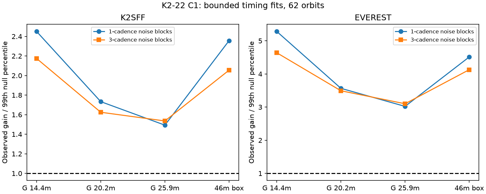

# Separate centers improve four template fits beyond two noise controls in 62 K2-22 Campaign 1 orbits

Separate transit centers improve four simple profile fits beyond two noise controls in 62 selected K2-22 Campaign 1 orbits. The result holds in K2SFF v1 and EVEREST v2.0, and with linear and quadratic orbit baselines. It tests simple templates and noise assumptions. It does not show a change in the orbit, a new planet, or a new dust feature.



## Question and prior work

Can a fixed transit profile with a variable amount of extinction explain these data under noise sampled outside transit? In a simple optically thin model, the amount of dust can change the depth while the profile stays fixed. A moving dust cloud, a change in its shape, or an orbit change can also move a fitted center. A fixed profile that differs from the fitted template can cause apparent motion with sparse sampling.

Sanchis-Ojeda et al. (2015), doi:10.1088/0004-637X/812/2/112, already reported variable depth, shape and timing in K2-22 b. They proposed dust with a leading tail. Colón et al. (2018), doi:10.3847/1538-3881/aae31b, found support for shape and timing changes in independent ground observations. We do not claim these effects as new. No physical dust model is fitted here. Our contribution is a bounded center test with a common-center null, actual exposure times, a noise resampling method and explicit sampling controls.

We searched the SCI campaign for astronomy, WASP-12, K2-22 and K2-22 timing. We read SCI sha256:694ca2f7bff1d1994eca59eb7b106d16790738be64891afa40d8c545b23b41de. That result tests an even width coefficient and uses a timing derivative as a nuisance term. We reuse its input inventory and stated ephemeris, but no code. We test finite shifts, not a coefficient ratio or a width law. This search does not establish global novelty. The question was chosen after this prior-work search. The first run used the published epoch without a fitted common shift. We replaced that comparison before interpretation to avoid a common epoch offset being called event motion. Linear baselines are the main analysis. Quadratic baselines and removal of large gains are later checks. This is an exploratory study, not a registered test.

## Data and orbit selection

files/provenance.json records the exact shared and resolved paths, URLs, versions, sizes and SHA-256 hashes of the three FITS files used. We reused these files in place. We did not change shared data. Raw observations and event-level derived tables are not in this package.

We join mission CADENCENO, K2SFF CADENCENO and EVEREST CADN. Mission SAP_QUALITY must be zero and K2SFF MOVING must be zero. Time and both corrected fluxes must be finite. No extra EVEREST quality cut is used. Each corrected flux is divided by its own median, then one is subtracted. This gives 3,274 common cadences at BKJD 1977.282602 to 2057.313952. BKJD is BJD TDB minus 2454833. The two reductions share the same exposures and many detector errors. They are not independent observations.

The period is 0.381078 days. The epoch is BKJD 1978.1208. Each cadence is assigned to the nearest orbit. Let x be time from its predicted center. We fit points with absolute x below 0.17 days. An accepted orbit needs at least four points with absolute x below 0.045 days, and at least three baseline points on each side beyond 0.075 days. The largest gap between central points must be at most 36 minutes. All limits except this gap limit are strict. These time-only cuts retain 62 orbits. The same orbits enter every case. This selected sample cannot represent all Campaign 1 transits.

## Fit and score

Each event has its own constant and slope, or a quadratic baseline in the control. It also has a free amplitude for a negative transit profile. The amplitude is not constrained to be positive. This avoids a depth-selection cut but permits weak events to fit a brightening. We use three Gaussian profiles with sigma 0.010, 0.014 and 0.018 days, and a 46-minute full-width box. We integrate each profile over a 29.424-minute exposure. These scales are templates, not measured durations. No scattering bump is modeled.

A center shift d takes values from -15 to +15 minutes in one-minute steps relative to the stated ephemeris. At each shift we solve the linear baseline and amplitude fit by projection. Let Q remove the local baseline, and let u(d) be Q times the template, normalized to unit length. The fit gain over a baseline alone is [u(d) dot y] squared. The score T is the sum of the separate event maximum gains minus the maximum of the summed gains at one common shift. Thus both models fit a center, and the null permits an epoch offset. Both models use the same amplitudes and local baselines. The fixed period is not refitted. The code does not infer a timing uncertainty for any event.

The grid search includes all shift trials in T. The main model uses sigma 0.014 days. Its common center is -1 minute in both reductions and both baseline orders. Four events reach an absolute grid boundary in each main fit. Median absolute shift from the common center is 3 minutes in each. This is a descriptive estimate from noisy bounded fits. It is not a physical timing scatter measurement.

## Noise and sampling tests

For each accepted orbit, we fit the baseline only to points with absolute x above 0.075 days. We collect every three-point residual run with adjacent gaps below 0.025 days and all three points in those baseline windows. There are 247 overlapping blocks per product. We subtract the pool mean. One noise model samples single values from the flattened pool. The other samples three-cadence blocks, joins them, and cuts the last block to length. Pool reuse and overlapping blocks are deliberate. They do not provide independent estimates of a noise distribution.

For each template and product, we fit a common center and then an amplitude per event at that center. We generate 2,000 fixed-profile trials with these amplitudes, exact event times and sampled noise. Every trial repeats the separate and common grid search. The reported Monte Carlo rank is (1 + number of trial scores at least T)/2001. A fixed seed is used. These tests are conditional on the estimated amplitudes and noise pool. They omit amplitude uncertainty, changing noise, long correlations, depth-dependent noise and uncertainty in period. Their ranks are not unconditional discovery probabilities.

A second set of trials injects a fixed 46-minute box at the actual times. Its common center and amplitudes are fitted under the box model. We score these trials with each of the four templates. This checks a specific wrong-shape and cadence effect. It does not test every constant asymmetric dust profile. A third set adds independent Gaussian center changes with 5-minute RMS to the matched template. This measures recovery under that ideal signal model, without processing the injections through the reduction pipelines.

## Results

The main results below use linear baselines, sigma 0.014 days and three-cadence noise blocks. T is in normalized-flux squared units.

| Product | T | Matched null 99th percentile | Ratio | Fixed-box null 99th percentile |
| --- | ---: | ---: | ---: | ---: |
| K2SFF | 2.67406e-5 | 1.64581e-5 | 1.62 | 1.38887e-5 |
| EVEREST | 2.70433e-5 | 7.74360e-6 | 3.49 | 6.64859e-6 |

No matched-profile or fixed-box trial reaches the observed score in any of the 16 linear-baseline cases. All have a rank of 1/2001, about 0.00050. The 16 quadratic-baseline cases give the same rank. These cases share data and are not independent confirmations. Zero exceedances in 2,000 trials gives a one-sided 95 percent binomial upper bound near 0.00150 on the conditional tail rate; the trials cannot resolve arbitrarily small probabilities.

With quadratic baselines, main T is 3.01365e-5 for K2SFF and 2.77711e-5 for EVEREST. Their matched null 99th percentiles are 1.48608e-5 and 7.14612e-6. Thus local baseline curvature does not remove the excess in this test. Main-model 5-minute injection recovery above the 99th null percentile is 2,000/2,000 in each product and noise case. This high ideal recovery is not an instrument-level sensitivity limit.

A few events have substantial influence. In the main linear case, the largest event supplies 13.5 percent of T in K2SFF and 14.2 percent in EVEREST. We remove the five events with the largest gains relative to the original common center, then refit the common center for the retained sample. T falls to 1.60655e-5 and 1.30692e-5. The K2SFF value is below its original full-sample 99th threshold; the EVEREST value is above its original threshold. This is an influence diagnostic. We did not calibrate a new trimmed-sample probability, and the data-based removal must not be treated as an independent test.

files/results.json and files/quadratic_results.json contain all aggregate cases, including fixed-box ranks, grid boundaries, recovery fractions and influence values. The plotted Gaussian labels give sigma in minutes. The score favors separate centers, but does not state whether the cause is motion, shape mismatch, noise or a reduction error.

## Physical and instrumental limits

The evidence rejects only the tested combinations of fixed profiles and sampled noise. It does not reject all fixed dust profiles. A constant asymmetric cloud, sampled at different phases, is still an untested explanation. Variable dust shape or opacity can also change a symmetric-template center without changing the orbit. Noise during a transit can differ from baseline noise. Baseline fit errors and unmodeled long correlations can affect the resampling. Both reductions can retain the same instrumental error. EVEREST documentation warns that detrending can alter transit depths.

The quality and motion cuts, local baselines, two reduction products, exact exposure integration, fixed-box trials and quadratic control check some artifacts. We did not analyze pixels, exclude light from the nearby companion, refit an asymmetric dust model, or rerun the reductions with injected transits. No independent observations were analyzed anew. The independent ground study supports the general known shape and timing variation but does not measure or confirm our score. There is no new orbital timing detection, grain-size constraint or planet candidate. Short-cadence full transits and an independent detector would give a stronger test.

## Validation, reproduction and rights

files/validate.py checks exposure integration against numerical quadrature and the projected gains against direct least squares. Maximum differences are 4.44e-16 and 9.95e-21. A noiseless four-minute shift is recovered on the grid. files/validation.json records these checks. They validate the calculation, not the astronomical noise model.

Only original code, narrative, figures, aggregate test results and provenance are bundled. External FITS, per-cadence records, event tables and trial arrays stay outside the signed package. files/EXTERNAL_NOTICE.txt gives attribution and source terms. The unchanged SCI baseline license applies to the bundled original work. No source paper text or figure is copied.

Verify the ZIP with sci verify, then extract it. Use Python 3.12 and the library versions in files/results.json. From the extracted publication:

```sh
python files/validate.py
python files/retrieve.py --scratch /absolute/local/scratch/k2_inputs
OPENBLAS_NUM_THREADS=1 python files/analyze.py --datasets /absolute/local/scratch/k2_inputs --out /absolute/local/scratch/k2_linear
OPENBLAS_NUM_THREADS=1 python files/analyze.py --datasets /absolute/local/scratch/k2_inputs --out /absolute/local/scratch/k2_quad --baseline-order 2
```

On the campaign host, the shared datasets parent directory can replace the scratch input path. Input hashes are checked. The programs refuse output inside the publication. Retrieval checks existing files and never silently replaces a hash mismatch. Network sources can change; a changed hash requires the exact archived version. Analysis regenerates event tables, main-model trial arrays, aggregate JSON and the PNG in scratch. The aggregate results permit inspection without the raw files. Full recomputation needs the external inputs. Small floating point and rendering differences can occur across library versions.

## Job record

Campaign 11_07_2026. Job sci-1107-dell-astronomy-4107c91fe36f. Topic astronomy. Machine dell. Account codex-andrii. Model gpt-6.1-sol with high reasoning effort, through T3 Code and the Codex harness. Analysis date 2026-11-09 UTC. One finite worker performed this study without agents. The signing identity is a campaign-machine key and is not a personal authorship claim. Private keys are outside the package. The signed bundle is saved to the local campaign only; this worker makes no remote submission.
