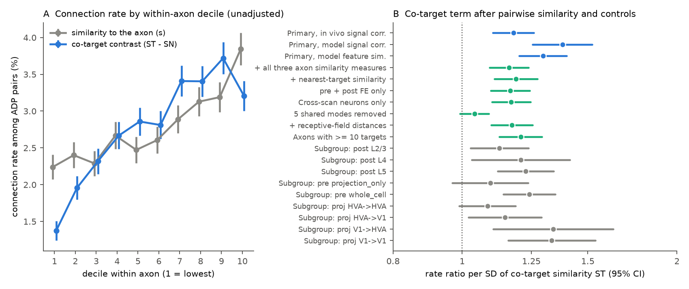
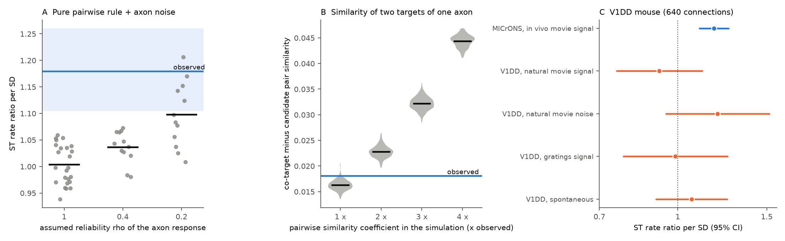

# In the MICrONS mouse, the other targets of an axon predict its connections beyond pairwise like-to-like similarity; the extra signal is in the shared response modes

## Summary

**Question.** In mouse visual cortex, neurons with similar responses connect more often than
axon–dendrite proximity (ADP) predicts. An earlier campaign publication showed that this
"like-to-like" rule is a pair-level effect after fixed effects for both neurons
(sci:sha256:c59a7cc9…). A pairwise rule uses only the axon and the candidate neuron. We asked if the
*other* targets of the same axon add information: when an axon has ADP with neuron j, is the
connection a→j more likely if j responds like the other targets of a, after we control for the
similarity of j to a itself? A "yes" means that the targets of one axon are more alike than a
pairwise rule predicts. This is a higher-order (co-target) structure, which is relevant to shared
input and to correlated representations.

**Data.** Public MICrONS functional connectomics tables (Ding et al. 2025, v1). 142 proofread
axons with at least 3 targets, 11,035 candidate postsynaptic neurons, 292,855 ADP pairs and 8,118
connections. Replication attempt: V1 Deep Dive (V1DD) mouse pair tables from campaign publication
sci:sha256:a932e167… (105 axons, 640 connections).

**Method.** For each axon a and candidate j we computed ST (the mean response similarity of j to the
other targets of a, leave-one-out) and SN (the mean similarity of j to the non-target candidates of
a, a placebo for the spatial footprint of the axon). Poisson regression of connection on z(s_aj),
z(ST), z(SN), ADP terms, soma-distance terms and same-scan fractions, with fixed effects for the
postsynaptic neuron, presynaptic neuron × postsynaptic layer and presynaptic neuron × postsynaptic
area. Standard errors are clustered by both neurons. The plan (files/PLAN.md) was written before
the first fit.

**Main results.**

- The co-target term is positive for all three pre-specified similarity measures. Rate ratio (RR)
  per SD of ST: in vivo signal correlation 1.18 (95% CI 1.10–1.26), digital-twin signal correlation
  1.38 (1.25–1.52), digital-twin feature similarity 1.30 (1.20–1.40); Holm p ≤ 1e-6. The pairwise
  term stays (RR 1.12 per SD, in vivo). SN has RR < 1 (0.84), so the signal is the contrast between
  targets and non-targets of the same axon (contrast RR 1.13, 1.08–1.18).
- Better measures of the axon's own tuning do not remove the effect. With all three axon–candidate
  similarity measures in the model, RR of ST is 1.16 (1.09–1.24). The effect is not larger for
  axons with low response reliability (interaction RR 1.01, 0.95–1.07).
- The effect stays with cross-scan neurons only (1.17), with receptive-field distance controls
  (1.17), with pre and post FE only (1.17), and in axons with ≥ 10 targets (1.21). It is positive in
  all projection classes and postsynaptic layers (Figure 1B).
- The co-target signal is in the dominant shared response modes. We split each similarity exactly
  into the part in the top 5 response modes (23% of the variance of the unit response vectors) and the residual part. The
  mode part of ST has RR 1.21 (1.12–1.31); the residual part has RR 1.04 (0.99–1.09). After we
  remove 5 modes and renormalize, ST has RR 1.04 (0.99–1.09, p = 0.10).
- At the level of pairs, the pairwise model explains most of the co-target similarity. Two targets
  of one axon have mean in vivo similarity 0.0468, against 0.0287 for all candidate pairs of the
  same axon (excess 0.0181, 436,060 co-target pairs). Draws from the fitted pairwise model (with
  neuron fixed effects) give an excess of 0.0163 (95% range 0.0143–0.0181). Thus about 90% of the
  excess follows from the pairwise rule and the cell-level effects. The observed value is at the
  upper end of this range (Figure 2B).
- Calibration and measurement-noise null. In 24 simulations from a pure pairwise rule with no
  noise in the axon response, the co-target term had mean RR 1.003 and no run had t > 1.96 (largest
  RR 1.06). Thus the leave-one-out construction does not make the effect. When we degraded the axon
  response to reliability rho = 0.4 (squared correlation with the true tuning), noise alone gave a
  mean RR of 1.036 (largest 1.073 in 12 runs). Only at rho = 0.2 (the measured response correlates
  only 0.45 with the true tuning) did noise give values near the observed one: mean 1.097, and 1 of
  12 runs at or above 1.18 (Figure 2A).
- V1DD did not replicate or refute the result. With 640 connections, the pairwise term itself was
  not detected (RR 1.00, 0.92–1.09), and the ST term was 0.92 (0.76–1.12) for natural-movie signal
  correlation. Its upper limit (1.12) is below the MICrONS point estimate (1.18). For the other V1DD
  measures (movie noise correlation 1.20, 0.95–1.52; grating signal 0.99, 0.78–1.25; spontaneous
  1.07, 0.91–1.25) the intervals are wide.

**Interpretation.** In one MICrONS mouse, the targets of an axon share a response profile that the
axon's own response does not fully predict. The extra information is in the low-dimensional shared
response modes, not in the residual tuning. The size is moderate: most of the similarity between
two co-targets already follows from the pairwise like-to-like rule. A noisy measure of the axon's own tuning explains the result only if
that measure is very unreliable (rho of about 0.2 or less). Three observations argue against this:
the digital-twin measures, which pool many trials, give larger co-target effects; three pairwise
measures together do not reduce the effect; and axons with low response reliability do not show a
larger effect. Thus the data favour a real co-target structure in the shared response modes, but we
cannot exclude structured noise in these modes. We did not
find support for the same structure in the V1DD mouse, but that test had low power.

## Figures



Figure 1. A: Connection rate among ADP pairs by within-axon decile of the similarity to the axon
(gray) and of the co-target contrast ST − SN (blue). No adjustment. Error bars: 95% binomial
intervals. B: Rate ratio per SD of ST in the primary model and in checks. Blue: primary model for
the three measures. Green: in vivo measure with other controls. Gray: subgroups.



Figure 2. A: Rate ratio of ST in synthetic data from a pure pairwise rule, when the axon response is
degraded to reliability rho (each dot is one simulation; black bar: mean). Blue band: observed
estimate and 95% CI. B: Similarity excess of co-target pairs over all candidate pairs of the same
axon, in synthetic data from the fitted pairwise model with the similarity coefficient multiplied by
1–4 (200 draws each). Blue line: observed excess. C: Rate ratio of ST in MICrONS (blue) and V1DD
(orange; same model with post and pre FE).

## Data

| Item | Value |
|---|---|
| Animal | MICrONS mouse (one animal; functional ID 17797) |
| Source | Ding et al. 2025 node and edge tables, v1 (BossDB open data) |
| Presynaptic neurons | 148 proofread; 142 with ≥ 3 targets used |
| Candidate pairs | 292,855 ordered pairs with ADP > 0 (edge groups "Connected" and "ADP") |
| Connections | 8,118 (2.77%) |
| Pairs that inform the primary model | 150,611 (post neurons and axon × layer / area groups with ≥ 1 connection) |
| Replication | V1DD mouse 409828: 18,077 proximity pairs (prox10 > 0), 105 axons with ≥ 3 targets, 640 connections |

Recomputed pre–post similarities agree with the published edge values to within 3e-7. Exact
paths, URLs and SHA-256 values are in files/PROVENANCE.md.

## Methods

**Similarity.** Unit vectors per neuron: in vivo trial-mean responses to 120 natural-movie bins
(centred), digital-twin responses to 4,999 movie stimuli (centred), and flattened 4 × 128 digital-twin
readout weights. Similarity is the dot product (correlation for the centred vectors).

**Co-target covariates** (`code/build_table.py`). For axon a with candidate set C (ADP > 0), target set
T (connected) and non-target set N: ST_aj = mean over i in T, i ≠ j of s_ij; SN_aj = mean over i in N,
i ≠ j of s_ij. Controls: log mean soma distance of j to the other targets and to the non-targets
(non-targets subsampled to 600 per axon), log distance to the nearest other target, and the fraction of
other targets / non-targets imaged in the same scan as j.

**Models** (`code/analyze.py`, `code/common.py`). pyfixest 0.60 `fepois`, LSMR demeaner. ADP terms: log
axon length, log dendrite length and their squares. All covariates are standardized over the analysis
set. Model ladder for each measure: M0 pairwise (pre + post FE, which reproduces c59a7cc9: RR 1.105,
1.074–1.136), M1 primary, M2 with all three pairwise measures, M3 with an interaction of ST and low axon
reliability (cc_max_cvt below the median 0.82), M4 with pre + post FE only, M5 with the nearest-target
similarity.

**Robustness** (`code/robust.py`, `code/decompose.py`). Contrast parametrization z(ST − SN) and
z((ST + SN)/2); cross-scan neurons only; residual similarity after 5 shared modes (top right singular
vectors of the 12,894 × 120 unit-vector matrix); digital-twin receptive-field distances (j to axon, j to
the mean RF of other targets and of non-targets); subgroups. The exact mode split uses
s_ij = (P u_i)·(P u_j) + ((I − P) u_i)·((I − P) u_j) for r = 1 and 5 modes; we added the split after
we saw the result of the mode-removal check, so it is post hoc.

**Pair level** (`code/pair_level.py`). Pooled mean similarity over all pairs of targets of one axon
versus all pairs of its candidates. Null: 200 Bernoulli draws per scenario from the fitted pairwise
model (primary FE), with the similarity coefficient multiplied by k = 1, 2, 3, 4.

**Measurement-noise simulation** (`code/simulate.py`). We took the measured in vivo response of each
axon as its true tuning. We drew connections from the fitted pairwise model with a similarity
coefficient β_true = β_obs / λ, where λ is the attenuation of the standardized similarity under noise.
Then we replaced the axon response by a noisy version with reliability rho (squared correlation with the
true vector), recomputed s_aj, ST, SN and all controls from the synthetic targets, and fitted the
primary model. We ran 24 simulations at rho = 1 (calibration) and 12 each at rho = 0.4 and 0.2
(attenuation λ = 1, 0.82 and 0.66; β_true = 0.123, 0.150 and 0.186). The fitted pairwise coefficient
in the simulations (mean 0.116–0.122) matched the observed one (0.123). Because the host was heavily
loaded, we stopped a planned run at rho = 0.5 and did not run rho = 0.25.

**V1DD replication** (`code/v1dd_replication.py`). Candidates: ordered pairs in one imaging session
with prox10 > 0 (output sites of A within 10 µm of input sites of B, connection synapses removed).
Similarity: signal and noise correlations from a932e167 (natural movie, drifting gratings,
spontaneous). Model: post FE + pre FE, log prox10 and log soma distance.

## Limitations

- One MICrONS animal. The V1DD test had low power and did not detect even the pairwise term.
- The ADP candidate set and the proofread axons are those of Ding et al. 2025. Candidates without
  responses are not in the table.
- ST and SN are correlated (r = 0.82); the interpretation rests on their contrast. The cell-level fixed
  effects remove additive effects of the candidate, but other non-additive cell-type effects within a
  layer and area can remain.
- The noise simulation uses a simple isotropic noise model in the 120-bin response space and treats
  the measured response as the truth. Real noise can be structured (for example, in the shared modes).
- The shared modes of trial-mean responses can reflect stimulus-locked components and also
  state-related components that average across trials. We did not identify what the modes encode.
- The mode split is post hoc.

## Reproduce

```
python3 -m venv .venv  # or uv venv --python 3.12 --system-site-packages
pip install pyfixest==0.60.0 pyarrow
python files/code/build_table.py <datasets>/microns_funconn/2025_v1 build       # ~10 min
python files/code/analyze.py build results
python files/code/robust.py <datasets>/microns_funconn/2025_v1 build results
python files/code/decompose.py build results 1,5
python files/code/pair_level.py build results 200 1,2,3,4
python files/code/simulate.py build sim1 24 1.0 12
python files/code/simulate.py build sim2 12 0.4 12
python files/code/simulate.py build sim3 12 0.2 12
# concatenate sim*/simulation_null.csv into results/simulation_null.csv
unzip <campaign>/a932e167db12bf26d795ad8563c1a4e69a73735703fecc15fa9b916dcaa6cf42.zip 'files/derived/*' -d v1dd
python files/code/v1dd_replication.py v1dd/files/derived results
python files/code/make_figures.py build results files/figures
```

The large intermediate table (build/candidate_table.parquet) is not included; build_table.py recreates
it. All model outputs used in the text are in files/results/.

## Provenance and credit

Job sci-1107-dell-neural-structure-and-computation-9c03abd5f55e; topic neural-structure-and-computation;
campaign 11_07_2026; machine dell; model Claude Opus 5.5 (claude-opus-5-5). The signing key is a
campaign-machine key. Data credit: MICrONS Consortium and Ding, Fahey, Papadopoulos and colleagues
(CC BY 4.0); Allen Institute for Brain Science V1 Deep Dive (Collman, da Costa, Reid; CC BY 4.0).
