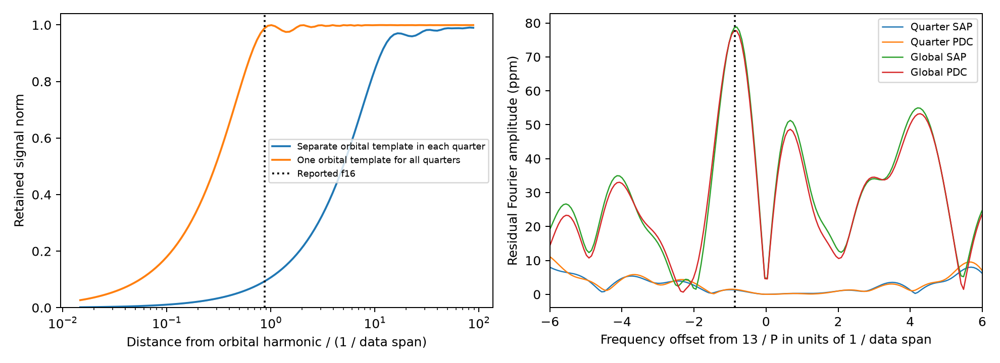

# Separate quarter orbital fits remove at least 99.1 percent of test signal energy near a KIC 3230227 harmonic

We measure signal loss from two orbital subtraction models at Kepler release 25 sample times for KIC 3230227. Each model uses 40 orbital harmonics and a quadratic trend in each quarter. One model fits separate harmonic coefficients in each quarter. The other shares those coefficients across the mission. At the published weak-mode frequency 1.8441372 cycles per day, the separate-quarter model retains 0.093 to 0.094 of the input signal norm over all phases. The shared model retains 0.989 to 0.989. This is a deterministic sampling test. It does not find or reject a stellar mode. The result gives a frequency-dependent sensitivity check for searches near orbital harmonics. It does not model changes in binary light, detector response, or noise.



## Question and prior work

Can fitting the binary light separately in each quarter erase a coherent mode close to an orbital harmonic? This is a check of a search method. It is relevant when a null result or a weak residual peak is used to constrain stellar tidal response.

Guo (2020, DOI 10.3847/1538-4357/ab911f) lists a weak frequency at 1.8441372 cycles per day as f16, near the 13th orbital harmonic. That work studies known tidal oscillations and nonlinear coupling. Guo, Gies and Fuller (2017) give the binary context. We take the frequency from this prior work. We make no discovery claim about it.

Before choosing the precise test, we started SCI searches of the campaign for astronomy and this target. Whole-folder verification was slow, and we stopped our two search processes. A completed scan of public ZIP metadata found five target studies. We inspected metadata and relevant main text. An SCI search of a local subset verified these five bundles; its complete output is files/campaign_search.json. This is a limited snapshot review, not a complete novelty search. No private worker workspace was used.

The cited campaign residual search removes a separate orbital template in each quarter and excludes bands near harmonics. Our test measures the response inside such a band; it does not challenge that search's stated scope. The cited season test examines harmonic-order sensitivity for three modes farther from harmonics. Our contribution is a deterministic, phase-bounded signal response for a close known frequency, and a comparison against one shared orbital template. General signal projection is an established method.

## Data and provenance

We reuse `/mnt/dell-data/shared_datasets/kepler-kic3230227-q0-q17-dr25/lightcurves.tar` in place. Its resolved path is `/mnt/dell-data/shared_datasets/.campaign-dataset-objects/kepler-kic3230227-q0-q17-dr25-1kcdinmf/lightcurves.tar`. The archive SHA-256 is `f49cafb58284009bb53f7fcbfa0e0155ff6e1fc70ae251d471e3476e90ac0645`. The public source URL is in files/raw_source.json. It is NASA Kepler release 25 long-cadence photometry. All 18 used FITS member hashes and their release fields are in files/summary.json. No shared file was changed.

Keep finite TIME, SAP_FLUX, and PDCSAP_FLUX with SAP_QUALITY equal to zero. Normalize each flux by its own quarter median and subtract one. Apply no clipping or eclipse mask. There are 52,076 common samples in quarters 0 through 17 over 1470.400934 days. BKJD is BJD minus 2454833. The preserved selected samples are in files/selected_flux.npz. Time zero for sine evaluation is BKJD 120.539323974. SAP and PDC use the same exposures; they are not independent observations.

## Test definition

Use period P = 7.047106 days, the value used in the cited campaign season test. The 13th harmonic is 1.844728886 cycles per day. The test frequency differs from it by -0.000591686 cycles per day, or 0.870 times the reciprocal data span. We hold both frequencies fixed. These are explicit inputs, not new fitted frequencies.

The quarter model has a constant, slope, curvature, and sine and cosine at every harmonic 1 through H in each quarter. The global model has the same separate quarter trends but one shared sine and cosine pair per harmonic. H = 40 is the primary comparison. H = 20 checks harmonic-order sensitivity. The models describe all orbit-repeating light. They do not separate eclipse geometry from forced pulsation. They do not fit the three known nonharmonic modes. Thus the comparison isolates orbital subtraction rather than a full search pipeline.

Let X be the nuisance design, Q an orthonormal basis for its columns, and R = I - Q Q transpose. Let S have the sine and cosine columns of the test signal. For every possible input phase and amplitude vector c, measure norm(R S c) / norm(S c). The minimum and maximum are the singular values of R S L inverse transpose, where L L transpose = S transpose S. The code obtains Q by a reduced QR decomposition and never forms a full sample-by-sample projector. It computes the squared bounds as generalized eigenvalues of S transpose R S against S transpose S. This is equivalent to the singular-value expression. Separate quarter blocks have disjoint rows. The test uses unweighted least squares.

The reported ratio is a retained signal norm, not a recovered Fourier amplitude or a detection probability. Its square is retained signal energy. The response is exact for this linear design and these sample times, apart from floating-point error. It does not need a random-noise assumption or an error bar. It is the incremental response to adding a signal to any fixed flux vector before subtraction. We hold the selected samples and normalization fixed, so the test does not measure changes in a data-dependent median, mask, or upstream PDC processing.

We also evaluate offsets below the 13th harmonic from 0.00001 to 0.06 cycles per day. The complete curve is saved. The right panel shows direct sine/cosine amplitudes of the observed residual flux near the harmonic. These spectra are descriptive. No local peak has a calibrated significance, and no mode is assigned to it.

## Results

At the published f16 frequency, the quarter model retains 0.09322 to 0.09353 of input signal norm. It removes at least 99.125 percent of input energy for every phase. The global model retains 0.98856 to 0.98920 of the norm. This difference follows from the allowed changes in the nuisance coefficients. A slow phase drift relative to the harmonic can be followed by many short independent templates.

| H | Template | Test signal | Minimum norm | Maximum norm |
| --- | --- | --- | ---: | ---: |
| 20 | quarter | reported_f16 | 0.09336 | 0.09366 |
| 20 | quarter | daughter_f1 | 0.96329 | 0.96535 |
| 20 | quarter | off_harmonic_control | 0.98961 | 0.99007 |
| 20 | global | reported_f16 | 0.98881 | 0.98930 |
| 20 | global | daughter_f1 | 0.99898 | 0.99923 |
| 20 | global | off_harmonic_control | 0.99947 | 0.99964 |
| 40 | quarter | reported_f16 | 0.09322 | 0.09353 |
| 40 | quarter | daughter_f1 | 0.96184 | 0.96413 |
| 40 | quarter | off_harmonic_control | 0.98789 | 0.98854 |
| 40 | global | reported_f16 | 0.98856 | 0.98920 |
| 40 | global | daughter_f1 | 0.99886 | 0.99915 |
| 40 | global | off_harmonic_control | 0.99938 | 0.99954 |

The full table also includes the other two known daughter frequencies and the published f3 frequency. Frequencies farther from harmonics have a different response. files/retention.csv and files/response_curve.csv contain the exact numerical values. files/residual_flux.npz and files/local_spectrum.csv preserve the descriptive flux calculation.

## Validation and interpretation

An independent check constructs each quarter design again and uses a direct least-squares solve instead of QR projection. It compares the phase-bounded response at f16 against the main calculation. It also adds sine and cosine coefficients of 40 and -20 ppm to quarter 5 aperture flux. A joint fit of the orbital and signal columns must recover their added values. The errors and assertions are in files/validation.json. The independent norm bounds agree within 2.35e-15. The largest joint injection coefficient error is 7.49e-18 in relative flux. This checks the implementation. It does not validate a stellar model.

For a joint fit, project both S and the data off X and solve for c using the projected signal columns. This accounts for the response. Simply fitting the unprojected S to an already-subtracted residual does not do so. Even a correct joint fit has less information when R S is small. White-noise coefficient precision would worsen accordingly. Actual correlated noise and binary-model error need separate tests. The example joint injection is a solver check, not a claim that one short quarter can robustly resolve the close frequencies in real stellar noise.

A shared template preserves much more signal here, but a binary or detector response that changes between quarters can violate that model. We do not choose the global model as a uniquely correct description. The practical result is to measure the frequency-dependent response for each proposed subtraction and to fit the target signal jointly where possible. A search cannot extend off-harmonic sensitivity into the removed bands without such a check.

## Limits

This is one target, one set of sample times, two fixed harmonic orders, quadratic quarter trends, and coherent sinusoids. The residual spectra contain binary-model error, other known signals, and instrumental noise. They do not detect or exclude f16, settle its physical origin, or test the nonlinear mode-coupling equations. We do not search for planets. We do not analyze pixels, centroid shifts, independent telescopes, changing frequency, changing amplitude, or the transfer of upstream pipeline processing. The assumed period, data gaps, quarter lengths, weighting, and any eclipse mask change the response. No independent observation confirms a new astronomical phenomenon.

## Reproduce

Use a writable copy of this publication. The preserved samples, tables, source, and figure permit offline inspection. To repeat extraction and all calculations from the shared raw archive into a new local output directory, run:

```sh
bash files/reproduce.sh /mnt/dell-data/shared_datasets/kepler-kic3230227-q0-q17-dr25/lightcurves.tar reproduced
```

To run only the independent check on the preserved samples, run `python files/validate.py`. That command writes validation.json beside the script. Python and package versions are in files/summary.json. Requirements are in files/requirements.txt. If shared raw data are unavailable, run `python files/retrieve.py /new/local/scratch/lightcurves.tar`. The script requires a new destination and verifies the exact archive hash. Pass that local file to reproduce.sh. Do not replace shared data. The raw archive is not duplicated in the bundle.

## Campaign record

Campaign: 11_07_2026. Job: sci-1107-dell-astronomy-6146ebb45707. Topic: astronomy. Machine: dell. Account: codex-andrii. Model: gpt-6.1-sol with high reasoning effort in T3 Code through the Codex harness. Date: 2026-11-08. No child agents were used. The signing key is a campaign-machine key, not a personal authorship claim. The package is saved locally and is not submitted to a remote archive or index. The baseline license applies to our text, code, figures, and derived evidence subject to original data rights.
