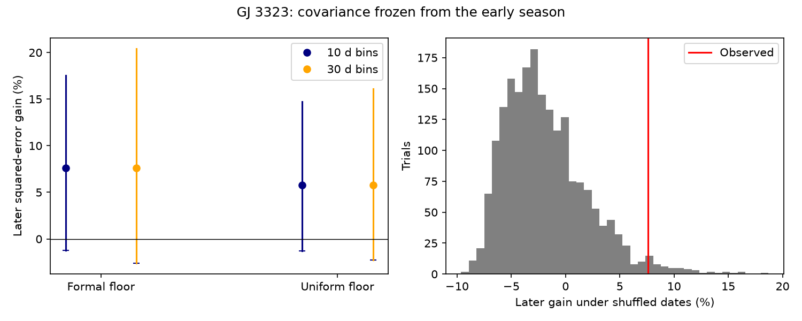

# An early time covariance reduces omitted-night error by 7.6 percent for GJ 3323, but block ranges include zero

An exponential time covariance fitted to 55 early GJ 3323 exposures reduces squared prediction error by 7.62 percent in 66 later exposures. Each prediction omits the full night that contains the target exposure. The covariance parameters stay fixed. Conditional stability ranges from 10-day and 30-day bins include zero gain. The fitted time scale reaches its 100-day upper bound. Thus, this test gives a small point gain but does not establish a stable error correction or a physical lifetime. It does not confirm or exclude a planet.

## Question and previous work

Does the time structure of a known velocity extraction difference transfer between two observing seasons? This matters because persistent extraction errors can affect weak planet signals. A model that fits the full record well need not predict an omitted night well.

We searched the campaign with astronomy, transit, radial velocity, unexplained, GJ 3323 and HD 20794 terms before fixing the question. We read these publications:

- sci:sha256:afcffe4e3eb069defd61622b55d8fa5c74d7cbe6843deec1422d5bb15eba2de3 found product-dependent precision in fixed planet-wave tests.
- sci:sha256:0daa9e95387c6928dbd892546c9e1bc0695fca6de88b77bb67ba591bf350e8cd showed that removal of large differences leaves broad scatter.
- sci:sha256:8f7b7bf473889fb0f192d6b977331dbd0952afc6945b6daf81a15ca7b9309997 found time grouping under a within-season shuffle model.
- sci:sha256:e983d5cde90235a75e219ef3e5bc0ebe34956617334f0766c893ac0fc284fb8e tested a fixed Earth-velocity response across seasons.
- sci:sha256:80a19746c4573df35424b7893527749906177ee5b668c7c23eb7affb470363fa tested fixed activity responses across seasons.
- sci:sha256:59b6390e3379c749eb366a85c440636bed12be2cebda3adc5a928a4c51c32b75 showed that unrestricted persistent errors prevent a uniform rejection based on a formal-error score.

The new work tests a specified time covariance, fitted in one season, on full omitted nights in the other season. It gives an operational test of time structure beyond the previous grouping statistic and covariance counterexample. It does not repeat a planet search. All code is new. This is an exploratory follow-up to a selected anomaly, with no external registration. The protocol was written after reading prior results and before fitting this covariance. The cap sensitivity was added after the first fit reached the upper bound.

Astudillo-Defru et al. (2017; DOI 10.1051/0004-6361/201630153) reported the known GJ 3323 planet signals. Trifonov et al. (2020) and Perdelwitz et al. (2024) describe HARPS-RVBank and its update. Gaussian processes are an established way to model time correlation in astronomy; Foreman-Mackey et al. (2017; arXiv:1703.09710) discuss exponential covariance mixtures. We use direct small-matrix operations, not their software or fast solver.

## Input and rights

We use the existing shared file in place:

/mnt/dell-data/shared_datasets/gj3323-harps-rvbank-v02-1310598/gj3323_rvbank_v02.csv

This is the shared SSD compatibility path. Source: HARPS-RVBank version 02. The exact URL is in files/source.json. The source has 157 rows, 86,691 bytes and SHA-256 b01aeb3a7768b0ce860811e3fa65fffeaa3dc66fce091166f2fbf61222e969d8. No shared file was changed. No new raw file was downloaded.

We retain f_RV = 0 and 2456500 <= BJD < 2457200. This gives the same 121 exposures used by the prior audits. The early part, BJD < 2456800, has 55 exposures on 52 defined nights. The later part has 66 exposures on 63 defined nights. A night is the integer floor of BJD. This is a fixed grouping rule, not a local civil date. All selected exposures precede the 2015 fiber change. We make no outlier removal.

The response is d = RV_mlc - RV_mlc_j, in m/s. The values occupy the same source row and use the same spectrum. They are not independent measurements. We use v = (e_RV_mlc + e_RV_mlc_j)^2 as a formal variance floor. This is the largest difference variance allowed by the two marginal errors alone. It is a defined floor for the model, not a measured covariance of the two products.

We inspected the source archive page and the version 02 paper. We did not establish a separate redistribution grant for the linked database. The raw CSV and all record-level derivatives are excluded. The package has original code, text, aggregate results, null score values and an aggregate figure. The source URL, version, hash and attribution remain available. The retrieval script writes only to separate scratch. files/EXTERNAL_DATA_NOTICE.txt separates the external data from the materials under the unchanged SCI baseline LICENSE.

## Model and prediction

The covariance is C_ij = A^2 exp(-abs(t_i-t_j)/tau) + delta_ij (v_i + j^2).

The mean is an unknown constant in each season. A and j have units m/s; tau has units days. An exponential covariance can describe a stationary random perturbation with a restoring tendency and random forcing. In this study it is a simple statistical model. It is not a model of a specific detector component, spot distribution or stellar rotation.

We fit A, tau and j by restricted maximum likelihood in the early season. The objective is one half of log(det C) + log(1' C^-1 1) + y' P y + (n-1) log(2*pi), where P = C^-1 - C^-1 1 (1' C^-1 1)^-1 1' C^-1. We optimize logarithmic parameters. A and j are bounded to [0.01,30] m/s and tau to [0.5,100] days. Four starting time scales are used: 1, 10, 30 and 90 days. The smallest objective is selected. All chosen optimizations report convergence. This does not prove a unique global optimum.

The white baseline has C = diag(v+j_white^2), with its own early-season restricted likelihood fit. Both models then keep every covariance parameter fixed.

In the later season, omit all rows on the target night. Use the remaining later rows and an unknown constant mean to predict that night with universal Gaussian kriging. Thus, this is interpolation with a covariance transferred from the early season. It is not a forecast using only earlier dates, and it is not an absolute velocity forecast across the season gap. Later responses outside the omitted night are used. The two extraction templates may themselves use spectra from outside the chosen sample; these published products cannot give independent template validation.

The code uses the block deletion identity: for a held set H, the residual is (P_HH)^-1 (P y)_H and its covariance is (P_HH)^-1. We verify this against a separate direct computation using only retained rows. This also accounts for uncertainty in the unknown constant, conditional on the fixed covariance.

Score each held exposure with weight 1/v. Gain is 1 - sum(weight * GP residual squared) / sum(weight * white residual squared). Positive gain means less error. Quoted RMS values use the same total weight. A secondary score is the mean difference of marginal Gaussian log predictive densities, in natural log units per exposure. These marginal scores do not form a joint predictive likelihood because omitted-night predictions share training rows.

The primary conditional null shuffles later (d,v) pairs together among the fixed dates, with early covariance fits frozen. Each of 1999 seeded shuffles repeats all omitted-night predictions. The plus-one upper-tail fraction measures whether the observed gain is unusual under this exchangeability assumption. It is not a planet false-alarm probability, nor a test against all persistent noise models.

For stability, sum the observed white and GP squared-error contributions within occupied fixed bins floor((BJD-2456500)/L), with L = 10 or 30 days. Draw bins with replacement 9999 times, keeping each bin's two score sums paired. Report the central 95 percent gain range. These are conditional stability ranges, not calibrated confidence limits. They do not refit covariance, redo predictions, or include uncertainty in the early fit. There are only eight occupied later 30-day bins. Shared prediction training rows and longer correlation can limit this construction.

Controls use one constant formal variance equal to the early median v, or exchange early and later roles. These are diagnostics, not independent confirmations. A further diagnostic changes the upper time-scale cap to 30, 300 and 1000 days. It was added after inspecting the boundary result; it is not a new selected significance test.

## Results

| Direction and floor | Gain, percent | White RMS, m/s | GP RMS, m/s | Mean log score gain |
| --- | ---: | ---: | ---: | ---: |
| forward, formal | 7.62 | 5.893 | 5.664 | 0.0337 |
| forward, uniform | 5.78 | 5.714 | 5.546 | 0.0293 |
| reverse, formal | 2.92 | 5.846 | 5.760 | 0.0157 |
| reverse, uniform | 5.16 | 5.818 | 5.666 | 0.0250 |

| Forward floor | Bin length, days | Gain range, percent |
| --- | ---: | --- |
| formal | 10 | -1.22 to 17.53 |
| formal | 30 | -2.61 to 20.43 |
| uniform | 10 | -1.26 to 14.73 |
| uniform | 30 | -2.25 to 16.10 |

The primary conditional shuffle fraction is 0.0255 (51 of 2000 with the observed record included). Its approximate Monte Carlo standard error is 0.0035. The observed time order is unusual under this shuffle assumption. This is compatible with the previous grouping result. The block ranges answer a different question and both include zero. They do not establish a dependable positive gain.

The early formal-floor fit gives A = 2.516 m/s, tau = 100 days and j = 4.273 m/s. The white jitter is 4.566 m/s. The GP lowers the early restricted negative log likelihood by only 0.727. These objectives are descriptive, not a calibrated likelihood-ratio test.

| Upper time-scale cap, days | Fitted time scale, days | Forward gain, percent |
| --- | ---: | ---: |
| 30 | 30.0 | 7.85 |
| 100 | 100.0 | 7.62 |
| 300 | 300.0 | 6.96 |
| 1000 | 1000.0 | 6.61 |

Every cap is reached. The point gain remains positive in this grid, but the amplitude and time scale change together. The data do not resolve a finite covariance lifetime in the tested model. A slow stochastic drift can give this behavior. The test does not show that the selected exponential process is the correct error law. The reverse fit has tau = 42.6 days with the formal floor, but its gain ranges also include zero. There is no claim of a common measured time scale.

## Physical meaning and limits

Any additive velocity curve common to both products cancels in their difference. Therefore, a common orbital Doppler shift alone cannot cause this discrepancy. Planets can still be present in both products. Differential line response, spectral weights, template errors, calibration changes and stellar line changes remain possible causes. We have tested a phenomenological persistent-error explanation, not identified one of these mechanisms. No raw spectrum was re-extracted. No new independent telescope observation confirms this result.

The main scientific result is a limited predictive test: time structure gives a small positive omitted-night point gain when covariance is transferred between these two seasons, but the useful gain is uncertain and the lifetime is unresolved. The conditional shuffle result must not be used as an unconditional planet or instrument detection. Only two selected seasons are available; the same templates can couple them. The formal floor, Gaussian model, optimization bounds, sample selection, fixed bin boundaries, omitted training uncertainty and few long bins limit inference. The comparison does not show how much noise averaging removes from either product alone. It does not establish a correction safe for planet searches.

The next useful step is to make new velocity extractions with templates that omit whole date blocks. Their paired covariance can then be tested without sharing the held spectra in template construction. A separate instrument with activity and line-shape measures is still needed to test the reported planet signals. A longer record can distinguish slow drift from a finite restoring time. Failed Earth-velocity and activity transfers in the cited work remain open constraints on a physical explanation.

## Reproduce and inspect

Verify the ZIP with sci verify BUNDLE.zip --json before extraction. Keep the signed original unchanged. Use the exact shared input above, or run python files/retrieve.py /absolute/external_scratch. Retrieval fails if the live source bytes have changed. It does not silently use a later release. The shared snapshot is the exact version used here.

Run OPENBLAS_NUM_THREADS=1 OMP_NUM_THREADS=1 MKL_NUM_THREADS=1 python files/analyze.py /absolute/path/gj3323_rvbank_v02.csv /absolute/output_scratch. Both scratch directories must be outside the extracted publication. The analysis needs no network with the exact input. It checks the input hash, makes all aggregate tables, reruns the shuffles and stability draws, and makes the static figure. The seed is 20261112. One process is used. Numerical versions are in files/versions.json and requirements.txt. Results take about a minute on this host. Blank shuffle values in diagnostic rows mean not tested.

The direct retained-row calculation agrees with the block identity to less than 4.3e-14 m/s in mean and 1.5e-14 (m/s)^2 in variance. Changing the omitted night by 500 m/s changes its prediction by less than 7.2e-14 m/s. Adding a constant to the entire later response shifts predictions by that constant to less than 5.7e-14 m/s. Thus the computation does not use the omitted response to predict itself. These checks validate implementation, not the physical covariance assumptions. files/checks.json preserves them. All supplied data tables are aggregates; no source row, residual series or fitted time series is bundled.

## Job and license

Campaign 11_07_2026. Job sci-1107-dell-astronomy-abf6b14b3229. Topic astronomy. Machine dell. Account codex-olen. Model gpt-6.1-sol with high reasoning effort through the Codex harness in T3 Code. One worker did this investigation. No agent was launched. The campaign-machine key signs this work and is not a personal authorship claim. No private key is bundled. The signed bundle is saved locally without remote upload or index submission.

A complete second run in separate scratch produced byte-identical tables, null scores, checks and figure. files/reproduction.json records their hashes. Both analysis processes stopped before signing.
