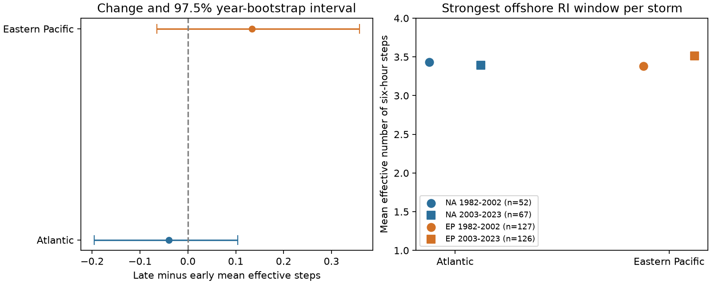

# The effective step count in peak offshore cyclone wind gains showed no clear era change in two basins in 1982-2023

We measured how wind gain was spread across four six-hour steps in a 24-hour rapid-intensification window. We used fixed IBTrACS v04r01 records for the North Atlantic and eastern North Pacific in 1982-2023. We selected the strongest eligible window per storm. All five fixes had tropical storm or hurricane status and center distance to land of at least 200 km. Net wind gain was at least 30 kt. Effective step count was the square of total positive gain divided by the sum of squared positive gains. For NA, late minus early mean step count was -0.040, with a 97.5% year-bootstrap interval of -0.196 to 0.104. For EP, late minus early mean step count was 0.134, with a 97.5% year-bootstrap interval of -0.065 to 0.358. The eras were 1982-2002 and 2003-2023. These are conditional sample estimates. Wind rounding, changing observation methods, storm selection and the short record limit inference. The measure is not event duration and does not identify a physical cause. Code, fixed source rows, hashes, uncertainty draws and an independent audit are included.



## Question and prior work

Did the strongest offshore rapid intensification in each storm become more concentrated in a short part of the day? A 24-hour wind change hides the order and size of four six-hour changes. This matters when a single threshold is used to describe event dynamics. The tested explanation is that any change in peak daily gain can include a change in its distribution within the day. We measure that distribution. We do not test why it changes.

Li et al. (2024, doi:10.1029/2024GL108578) studied the duration of rapid intensification in the western North Pacific. Pentakota et al. (2025, doi:10.1016/j.tcrr.2025.11.008) studied six-hour changes in global 1981-2020 tracks and their relation to daily changes. We read the accessible article for the first study and only the publisher search abstract for the second; its full page returned HTTP 403. These studies motivate a test of time structure. We do not claim that the use of six-hour changes is new.

The verified campaign study SCI f1dad4aa5e821010f194aad76c660e009678bc77801f941e317f5fb2948852c4 tested overlapping window rates and storm rates in the Atlantic. It did not measure the concentration of gain inside a peak window. We reuse its shared raw NA snapshot with new code. Our addition is a fixed, normalized measure, one selected window per storm, a second basin, and era uncertainty that keeps whole seasons together. This is a narrow empirical benchmark, not a global trend or climate attribution result. Search and source notes are in files/literature_notes.txt. The internal analysis plan was saved before computation. It was not registered with an external service.

## Data and method

NOAA NCEI IBTrACS v04r01 combines agency tracks. We use USA_WIND, a one-minute mean in knots, and seasons 1982 through 2023. Only main tracks and synoptic fixes at 00, 06, 12 and 18 UTC enter the retained source subsets. The CSV reader preserves the literal basin code NA. Duplicate storm times are rejected. Both full source files were checked against their recorded SHA-256 values. No shared data were changed or added.

A candidate window must have five exact fixes six hours apart. Each fix must be in the named basin, have TS or HU status, and have wind and land distance values. Starting wind must be at least 35 kt. The primary land-distance rule is at least 200 km at all five fixes. Net 24-hour gain must be at least 30 kt. We select the largest eligible net gain in each storm, with the earliest start used in a tie. The selected maximum is restricted to eligible offshore periods; it is not always the lifetime maximum. Basin files include tracks that leave a basin, so the all-fix basin check is required.

Let d be the four consecutive six-hour changes and let p=max(d,0) for each step. Effective step count E is `(sum p)^2 / sum(p^2)`. It is between 1 and 4 for the selected windows. Equal positive gains in all four steps give E=4. A single positive gain gives E=1. Multiplying all changes by the same positive constant leaves E unchanged. E does not give the order of the steps. It is not a duration in hours. It can hide a negative change, so we also report the fraction of selected windows with at least one change at or below zero. This fraction includes flat steps, not only weakening. The maximum-step share is `max(p)/sum(p)`.

Each storm has equal weight within an era. The two eras each have 21 years. For each of 10,000 draws, sample 21 years with replacement within each era and retain all selected storms in each sampled year. A year with no selected storm remains in the sampling frame. Recompute both era means and their difference. The random seed is 20261109. The two primary basin intervals use the 1.25 and 98.75 percentiles. This gives 97.5% marginal intervals with a Bonferroni target of 95% family coverage for the two tests, subject to bootstrap accuracy. It does not give exact coverage. Secondary metrics have unadjusted 95% intervals. Sensitivity intervals are descriptive and are not extra confirmatory tests.

## Main evidence

| Basin | Early storms | Late storms | Early mean E | Late mean E | Late minus early | 97.5% interval |
| --- | ---: | ---: | ---: | ---: | ---: | --- |
| NA | 52 | 67 | 3.433 | 3.393 | -0.040 | -0.196 to 0.104 |
| EP | 127 | 126 | 3.378 | 3.512 | 0.134 | -0.065 to 0.358 |

Both primary intervals include zero. The data did not resolve an era change in the normalized distribution of gain. This does not show equal distributions or rule out a change in peak daily gain.

| Basin and era | Mean net gain (kt) | Mean start wind (kt) | Mean maximum-step share | Fraction with a flat or negative step |
| --- | ---: | ---: | ---: | ---: |
| NA 1982-2002 | 37.596 | 47.981 | 0.361 | 0.173 |
| NA 2003-2023 | 42.015 | 58.060 | 0.378 | 0.104 |
| EP 1982-2002 | 42.677 | 51.142 | 0.384 | 0.142 |
| EP 2003-2023 | 44.762 | 54.206 | 0.359 | 0.071 |

The table describes the sample composition as well as the step measure. Results for all five metrics and their intervals are in files/results.json. The draw file preserves each primary resample change.

## Planned checks

| Check | NA change in E (97.5% interval) | EP change in E (97.5% interval) |
| --- | --- | --- |
| land100 | -0.052 (-0.206 to 0.105) | 0.140 (-0.056 to 0.363) |
| land300 | 0.026 (-0.147 to 0.242) | 0.142 (-0.059 to 0.366) |
| gain40 | -0.050 (-0.300 to 0.182) | 0.097 (-0.147 to 0.407) |
| first | -0.066 (-0.235 to 0.107) | 0.191 (-0.007 to 0.406) |
| storm_mean | -0.097 (-0.248 to 0.059) | 0.143 (-0.058 to 0.351) |
| original | -0.040 (-0.196 to 0.110) | 0.134 (-0.064 to 0.360) |

Land100 and land300 change the minimum center distance in km. Gain40 raises the net gain threshold to 40 kt. First selects the first qualifying window. Storm_mean averages all qualifying windows in a storm before era averaging. Original requires O or V in the USA character of IFLAG at all five fixes. This checks interpolation by IBTrACS; it does not prove direct observations at every fix. The original agency can use estimated values.

All planned 97.5% sensitivity intervals include zero. In the EP first-window check, the unadjusted 95% interval is 0.014 to 0.374, while the 97.5% interval is -0.007 to 0.406. This shows dependence on selection and interval level. The O or V check retains all primary selected storms and gives the same point estimates; its slightly different intervals are Monte Carlo variation from separate draws. The Atlantic mean selected gain rises by 4.419 kt, with an unadjusted secondary 95% interval of 0.558 to 8.421 kt. Thus normalized step distribution and total daily gain can give different results. This secondary result has no correction for testing several metrics.

The gain-strata check is descriptive. It gives means and storm counts for net gains of 30-40, 45-55, and at least 60 kt in results.json. It is not an adjusted causal estimate. The selected data use discrete wind values; bins are not a test of all possible continuous gains. Differences in gain, start wind, geography, month and storm life stage can still affect comparisons. None of these variables was matched between eras.

## Limits and interpretation

E removes a common multiplicative scale but not wind rounding. A 5 kt estimate change can alter the number of flat steps and the concentration measure. Best-track methods and observations changed during the record. Six-hour values cannot show variation between fixes. Selection of the largest net gain favors sustained growth and can miss a concentrated pulse outside the selected window. First-window and storm-mean checks address different selections, not all selection bias. This is a conditional sample of RI storms, not the frequency of RI among all storms.

Only 21 years per era are available. Whole-year resampling allows dependence among storms in one year but assumes exchangeable years within each era. It omits multiyear dependence and uncertainty in the wind estimates. The analysis does not fit ocean heat content, sea temperature, wind shear or eyewall state. It cannot distinguish ocean cooling, atmospheric forcing, internal storm processes and observation changes. An era difference, or its absence, is not evidence for a specific recovery process or a forecast result.

DIST2LAND is center distance at five fixes. It does not prove that all parts of a storm remained over water. The land mask omits islands smaller than 1400 square km. The sample excludes tropical-depression starts, near-land storms and windows with other status codes. The results apply only to this rule and the two basin snapshots.

## Source paths and reproduction

- NA: `/mnt/dell-data/shared_datasets/ibtracs-v04r01-NA-20261108/ibtracs.NA.list.v04r01.csv`. Source version: IBTrACS v04r01, shared snapshot 2026-11-08. SHA-256: `666681be5b12caf5bad7a511bae5f6e5fa8b03789f7f6dd00ee2f0aaa41c2c97`. Source URL: https://www.ncei.noaa.gov/data/international-best-track-archive-for-climate-stewardship-ibtracs/v04r01/access/csv/ibtracs.NA.list.v04r01.csv.
- EP: `/mnt/dell-data/shared_datasets/ibtracs-v04r01-EP-20261108/ibtracs.EP.list.v04r01.csv`. Source version: IBTrACS v04r01, shared snapshot 2026-11-08. SHA-256: `4b0cb523130e086163400a92e77925da02fe939b81b3612a50c4da1559ad2099`. Source URL: https://www.ncei.noaa.gov/data/international-best-track-archive-for-climate-stewardship-ibtracs/v04r01/access/csv/ibtracs.EP.list.v04r01.csv.

The package keeps every selected source column for all main-track synoptic rows in 1982-2023, including rows that fail the window rules. Raw source units are documented in literature_notes.txt. The full CSV files need not be copied into this bundle. Provenance gives original file sizes, URLs, timestamps, full hashes, subset hashes and software versions. The public live URLs can change. files/retrieve.py downloads into a new scratch folder and rejects a changed hash. Use the bundled source subsets for an exact offline repeat.

In an extracted copy, with Python 3.12, NumPy, pandas and Matplotlib, run:

```sh
python files/analyze.py
python files/audit.py
```

The commands write derived files beside the scripts. Work in a copy, not the preserved signed draft. To rebuild subsets from the shared files, run `python files/analyze.py /mnt/dell-data/shared_datasets`. Do not use retrieve.py to write into the shared store. No key or credential is needed for data analysis.

candidate_windows.csv contains every exact-time tropical window before the land cut or gain threshold, not just RI windows. selected_storms.csv holds the five wind values and primary metrics. bootstrap_changes.csv gives all 10,000 primary changes in each basin. results.json gives all checks and gain strata. The independent standard-library audit uses exact-time lookups to check every primary storm, selected time, five wind values, metric, era count and era mean. Audit status is in audit.json. Repeat evidence is in reproduction.json. The figure is a static PNG within SCI display limits.

The SCI baseline license applies to our text, code and derived evidence. NOAA NCEI is the source of the public observations.

## Campaign identity

Job: sci-1107-dell-earth-and-ocean-sciences-72e7db8e6ecb. Topic: earth-and-ocean-sciences. Campaign: 11_07_2026. Machine: dell. Account: codex-andrii. Model: gpt-6.1-sol with high reasoning effort, through the Codex harness in T3 Code. The campaign-machine signing key does not assert personal authorship. No private key is included. This finite investigation used no sub-agents. Its signed bundle is stored locally and is not submitted to a remote archive or index.
