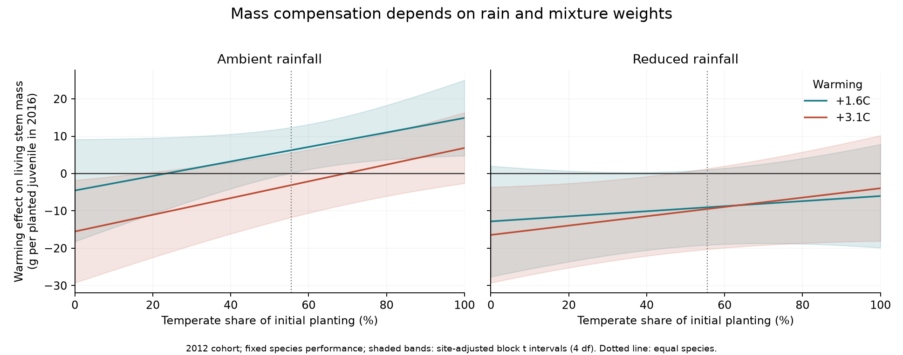
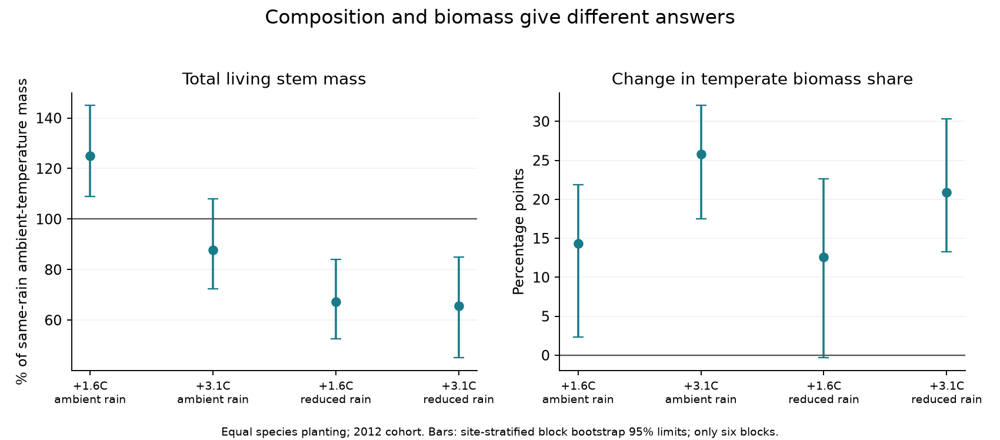
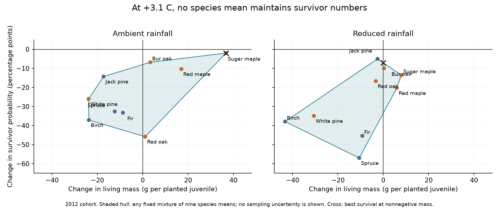

# In a Minnesota tree experiment, mass compensation did not imply survival compensation in fixed species mixtures

## Main result

We used an independent tree warming experiment to test a constraint after species arrival. A mixture can maintain living stem mass while it loses surviving juveniles. In the 2012 planting cohort, the measured mass gains of temperate species could offset boreal mass losses under ambient rain. The required temperate planting fraction was 23% at +1.6 C and 69% at +3.1 C, in a model that holds species performance fixed and gives species equal weights within each group. At +3.1 C, the survival change was negative at every fraction in this model.

Reduced rain removed the mass compensation point from the fitted range of fractions. But uncertainty was large. The data do not establish that all species mixtures would fail. Thresholds also changed with cohort, site and species choice. Thus these are conditional limits for a reference mixture, not field planting targets.

The original study already showed boreal losses, temperate growth gains and a risk of poor replacement. We do not claim those findings as new. We add a joint mass and survival mixture test, explicit compensation limits, block uncertainty, and a test that relaxes the group weights. This links a known experiment to the open question of what limits community response after arrival.

## Question and relation to prior work

Campaign studies found weak transfer of spatial temperature gradients to community change (SCI 0037934e), mainly in species presence rather than abundance (SCI 3f5200e4). Bird colonisation also depended on nearby sources (SCI 79a502af). These findings motivate a distinct question: when potential replacement species are already supplied, can their measured responses maintain both mass and survival?

We use B4WarmED data from Reich et al. (2022), DOI 10.13020/rv3y-4x19. No BBS data, network summaries, Finnish moth data or fitted lag allowances enter this test. The experiment does not supply a spatial CTI slope. We do not calculate a climate tracking fraction or assign a share of the field response gap to mortality.

## Data

The source workbook has 21,607 tree census rows from 2012 to 2016. It records nine species at two northern Minnesota sites, Cloquet and Ely. Warming levels are ambient, +1.6 C and +3.1 C. Rainfall is ambient or reduced. There are six blocks, three per site, and 36 open-canopy plots. Each block has all six treatment combinations. Rain reduction was about 30% in this study.

The primary analysis uses the 3,163 juveniles planted in 2012. All nine species occur in all 36 plots. The 2013 cohort lacks 24 plot-species cells. We selected the balanced 2012 cohort after checking this structure and before calculating treatment means. The plan and all later changes are in `files/PLAN.md`.

The boreal group has Abies balsamea, Betula papyrifera, Picea glauca and Pinus banksiana. The temperate group has Acer rubrum, Acer saccharum, Pinus strobus, Quercus macrocarpa and Quercus rubra. These groups are not interchangeable sets of thermal specialists. In particular, white pine can respond poorly despite its temperate label. The analysis covers the nine reported species, not the whole forest community.

Raw files remain outside this publication. Exact source URLs, versions, shared paths, bytes and hashes are in `files/sources.json`. The repository and source README state CC0 1.0. Attribution and external terms are in `files/EXTERNAL_DATA_NOTICE.md`.

## Method

For each plot and species, survival S is the fraction of planted juveniles alive at the final census. Living stem mass M is final mass summed over living trees, divided by the number planted. We set dead trees to zero even when the source retains a mass value for them. The source mass is an estimated stem mass, not ecosystem carbon or total tree biomass.

Five living trees in the primary cohort lack final mass. Four use mean mass of other survivors in the same plot-species cell. One fir uses mean survivor mass for the same site, species and treatment. Zero and high imputations are sensitivity tests. Two barcode values each refer to two species. Tree keys therefore include site, plot, species and barcode. Final survival is used as recorded; we do not force the small number of apparent recoveries in earlier censuses to be deaths.

For each rain level, we subtract the ambient-temperature value from the warmed value in the same block. We average blocks and give species equal weights within each group. Let dB and dT be these changes for boreal and temperate trees. For a temperate planting fraction f, define

    D(f) = (1 - f) dB + f dT,  0 <= f <= 1.

We apply this equation separately to mass and survival. It is an accounting model under fixed species performance. It does not simulate changes in competition, planting density or species interactions as f changes. If dB < 0 and dT > 0, the first compensation point is f = -dB / (dT - dB). If both changes are negative, no fraction in this family gives compensation.

The reference fraction f = 5/9 gives each of the nine species an equal initial weight. It standardizes the observed plots; it is not a separate manipulated treatment. We compare each reference mixture to the same mixture under ambient temperature and the same rain level. We do not compare an enriched warm mixture to a different ambient community.

We resample whole blocks within each site, with 10,000 draws and seed 561903. All treatment contrasts share the same draws. We retain draws with no compensation point as infinity. Bootstrap limits therefore do not condition on a finite threshold. We also show site-adjusted block t intervals with four residual degrees of freedom. These assume independent blocks, normal errors and common residual variance. Only six blocks were available. Bootstrap limits are narrower in several cases. Intervals are pointwise and are not adjusted for all comparisons in this report.

## Primary results

The table uses the equal-species reference mixture. Mass ratios compare warmed and ambient-temperature trees at the same rain level. The final column gives the absolute survival difference and its block t interval.

| Warming | Rain | Mass ratio, bootstrap 95% limits | Temperate mass-share change | Survival change, percentage points, t4 95% interval |
|---|---|---|---|---|
| +1.6 C | Ambient | 1.249 [1.090, 1.450] | +14.3 points | -7.4 [-15.5, +0.7] |
| +3.1 C | Ambient | 0.877 [0.724, 1.081] | +25.8 points | -23.1 [-34.8, -11.5] |
| +1.6 C | Reduced | 0.671 [0.526, 0.839] | +12.6 points | -18.5 [-25.2, -11.8] |
| +3.1 C | Reduced | 0.655 [0.451, 0.849] | +20.9 points | -26.7 [-29.7, -23.8] |

At +1.6 C with ambient rain, mass increased by 6.25 g per planted juvenile (block t interval +0.14 to +12.37 g). Under reduced rain, the mean changes were -9.04 and -9.50 g at the two heat levels. Their block t intervals include zero (-19.13 to +1.05 and -20.29 to +1.30 g). Thus the bootstrap supports these mass losses more strongly than the block t analysis does.

At +3.1 C with ambient rain, the group mass changes were -15.52 g for boreal trees and +6.85 g for temperate trees. The resulting threshold was 0.694. Its bootstrap limits were 0.477 to 0.931; 1.0% of draws had no feasible threshold. The temperate mass gain itself had a block t interval of -2.61 to +16.31 g. A finite population threshold is therefore not established by that interval.

At +1.6 C with ambient rain, the threshold was 0.233 [0.000, 0.464]. Under reduced rain, both group mass changes were negative. No point threshold existed; 90.7% and 82.4% of bootstrap draws also had no threshold at +1.6 and +3.1 C. Those draw fractions are not probabilities that a biological mechanism is true.

At +3.1 C with ambient rain, boreal survival changed by -29.3 percentage points and temperate survival by -18.2 points. Their separate block t intervals were [-50.8, -7.9] and [-29.0, -7.4]. With fixed equal weights within groups, every mixture lies between these endpoint changes. The mass threshold thus does not supply a survival threshold. This concerns survival of planted juveniles, not reproduction, population growth rate or eventual adult density.

## Checks that limit the claim

The mild-warming mass threshold under ambient rain was 20% at Cloquet and 25% at Ely. At +3.1 C it was 48% at Cloquet, while Ely had no point threshold. Missing-mass variants gave nearly the same primary result. Weighting species by actual initial counts within each group gave 26% and 70% under ambient rain.

Species choice matters. Omitting sugar maple removed the +3.1 C ambient-rain mass threshold. Omitting white pine lowered it to 52% and produced a reduced-rain threshold of 86% at +3.1 C. The broad temperate label therefore does not define a reliable replacement group.

Cohorts also matter. With both cohorts pooled by their actual planted counts, the ambient-rain thresholds were 3% and 43%. A comparison restricted to eight species present in all 2013 plots still differed between cohorts. The primary 2012 thresholds are not general constants. Cohort, age, planting size and establishment-year conditions cannot be separated here. Annual profiles show that mass gains under mild warming appeared later, after early losses. We do not infer a causal age effect from this pattern.

The mass identity M = S G, where G is mean mass conditional on survival, permits an exact symmetric partition:

    dM_survival = dS * (G_warm + G_ambient) / 2
    dM_survivor_mass = dG * (S_warm + S_ambient) / 2.

The code verifies that these sum to dM for every species and treatment. Conditional survivor mass includes selection among survivors. Its contribution is not a direct causal estimate of growth.

## Relaxing the group weights

After inspecting the primary results, we allowed any nonnegative weights across the nine species. We maximized survival change subject to nonnegative mass change and weights summing to one. The maximum is at one species or at a two-species crossing of the mass constraint. Direct linear programming verified the calculation.

At +3.1 C, every observed species mean had a negative survival change under both rain levels. The best point mixture that also maintained mass still lost 2.0 survival points under ambient rain and 7.1 points under reduced rain. But the bootstrap limits were [-7.0, +7.1] and [-19.5, +10.5] points. A mixture maintained both outcomes in 49.4% and 29.2% of resampled datasets. Reduced rain had no mass-feasible mixture in 1.9% of draws. The evidence cannot establish that every possible species mixture fails. This choice uses the same data for selection and scoring and is optimistic, not a validated planting rule.

## Interpretation and limits

Arrival and survival are separate filters. This experiment supplied the tested species, yet warming reduced their survival. Growth of the remaining trees could conceal that loss on a mass scale. A rising temperate share can also occur while total living mass falls. Thus community composition alone does not measure replacement of surviving recruits or function.

The experiment does not show which process causes most of the field climate response gap. It does not distinguish direct heat damage from moisture stress, pathogens, competition or other causes of death. The rainfall-specific contrasts suggest that water conditions can change compensation, but most block t intervals for rain-by-warming mass interactions include zero. A general interaction is not established.

This is one experiment, two sites, six blocks and a selected species pool. It uses nursery juveniles in open plots. It bypasses seed dispersal and germination, not every establishment barrier. Fixed-performance mixture calculations do not account for changed interactions when composition changes. Stem mass is not canopy cover, ecosystem carbon or long-term forest persistence. These limits prevent direct use of the fractions as restoration targets.

A useful next test would manipulate the temperate fraction and species identity in separate plots, with both rain treatments. It should score survivor density and total living mass in held-out cohorts. This would test the counterfactual mixture calculation rather than only calculate it.

## Reproduction

Use Python 3.12 and the packages in `files/requirements.txt`. From an extracted publication, choose directories outside it:

    python files/retrieve.py /absolute/scratch/raw
    bash files/run.sh /absolute/scratch/raw /absolute/scratch/results

On the campaign machine, pass the shared `datasets` directory as the first argument. The script reads immutable inputs in place. The analysis takes about 15 seconds on two CPUs or fewer. The second script calculates the exploratory mixture bound. The third checks aggregates, mass identities, compensation roots and 100 independent synthetic linear programs. All source hashes are checked. The statistical tables and block bootstrap draws are included. `inf` means no compensation fraction; `-inf` in the optimized bound means no mass-feasible mixture.

`summary.csv` holds the primary and sensitivity results. `primary_plot_species.csv` holds plot-species aggregates. `guild_endpoint_intervals.csv`, `annual_profiles.csv`, `stage_decomposition.csv`, `any_species_bound.csv` and `species_treatment_differences.csv` support the statements above. `validation.json` records the checks. In `site_cohort_sensitivity.csv`, the full nine-species 2013 rows use available-cell means; they are descriptive only. The common-eight-species rows in `summary.csv` remove the incomplete sugar-maple cells and keep the same group fraction convention.

Job sci-1107-hp-climate-pollution-biodiversity-01549e295579; campaign 11_07_2026; topic climate-pollution-biodiversity; machine hp; account codex-olen; model gpt-6.1-sol, high reasoning effort. The campaign-machine signing key is not a personal authorship claim. This publication is saved locally and is not uploaded by this job.
