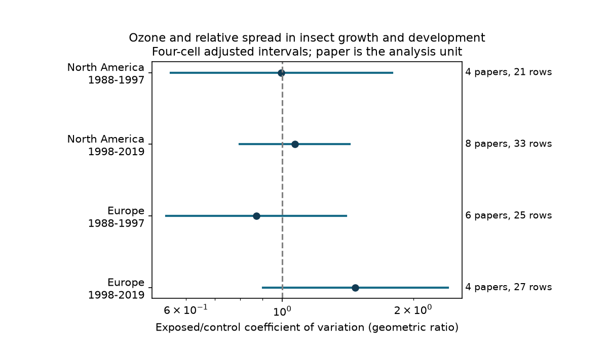

# Ozone gave no clear repeated change in relative growth and development spread in North American and European papers from 1988-2015

Elevated ozone did not give a clear repeated change in the relative spread of insect growth and development measures in this data extract. Across 24 papers and 114 selected records, the exposed/control coefficient-of-variation ratio was 1.042. Its conditional 95% interval was 0.919 to 1.181. All four region and period intervals included one after adjustment for four tests. This result does not establish no effect.

## Question and prior work

Does ozone exposure change variation in insect growth and development relative to the mean? A mean response can miss a change in the spread of responses. Such a change could affect the range of development outcomes. However, variation among experimental units is not proof of a change in seasonal timing, population stability or biodiversity.

Ryalls et al. (2024), DOI 10.1038/s41467-024-49729-5, synthesized mean invertebrate performance under air pollution. We use their public Supplementary Data 1. We do not reproduce their fitted meta-analysis or challenge their general conclusion about beneficial invertebrates. Their review searched through November 2022.

We searched the campaign for phenology, pollution biodiversity, weather birds, ozone warming, invertebrate, North Wales, dose ozone and ozone growth variability. We read the growth-intake, dose-shape, abundance-spread and mass-weight studies. The search was limited, not a systematic review. Related campaign studies are:

- sci:sha256:8909ba1f76168322c8164324ffa28e5723560d31ee64f068dd60f293d8fe6063 found sparse matched growth-intake evidence.
- sci:sha256:3720ac70a4cc8b5322cee10aeb98bad3396e7ee6b2a4975327699a01d44e519c tested monotone ozone dose curves.
- sci:sha256:7f684eef42694ca836930f255f2be1af163c5a247835880ca0f295ce564c0947 tested abundance dispersion, including a squared CV sensitivity test.
- sci:sha256:323d2324c2361a2e0f91bef221abdce3c82f21c399490311429f0b28283e084c tested paper weights for mean mass responses.

Our addition is a relative-spread test for growth rates, mass and development durations, with four region-period checks and explicit endpoint exclusions. We use the same source archive. This is not independent validation of that archive. We wrote new analysis code. This study addresses the air-pollution part of the objective. It does not test climate change or extreme weather interactions; the source has no common weather measures.

## Data and selection

The source workbook has 981 rows. We selected Pollutant exactly O3 and Performance2 exactly growth/development, initially 118 rows. We excluded two lipid-peroxidation rows and two nymphs-reaching-adulthood rows. These labels do not describe a growth rate, mass or duration. We used an exact label map, given in analyze.py, after removal of leading/trailing spaces and letter-case differences. We required positive means and SDs, and N greater than one. All 114 retained rows met these numeric conditions. There were 24 paper IDs, published in 1988-2019.

Mass includes mass, weight gain and stage-specific weight. Rate includes growth, relative growth rate and intrinsic rate of increase. Time includes development time and time to first reproduction. These are different biological quantities. We use a dimensionless spread measure and also report each endpoint class separately. We do not interpret a common mean ratio across classes as a performance index. No selection used the calculated response.

The source SD fields are Dev_c and Dev_e; the sample sizes are Nc and Ne. The source article says that some missing SDs were reconstructed by aggregation and four effect sizes had imputed SDs. We did not trace every selected SD to its primary table. A sample can describe plants, groups or other experimental units, rather than individual insects. Therefore the measured spread need not be individual growth variation. The stored errors are suitable for this exploratory diagnostic only under the assumption that the two treatment SDs measure comparable units.

We reused the shared file in place:

    /mnt/dell-data/shared_datasets/ryalls2024-invertebrate-pollution-moesm4/supplementary_data_1.xlsx

SHA-256:

    a81ed92c937fc7016708e46526940164626bdf8a7e6a3eb25d4afaae9b9d1436

The source URL, size, version and license evidence are in files/provenance.json. Raw source files and selected record tables are not bundled.

## Method

For each record, M is a positive treatment mean and S is its SD. Subscripts e and c refer to elevated and control ozone. We calculate:

    L = log(Se/Sc) - log(Me/Mc)
      = log[(Se/Me)/(Sc/Mc)].

We average L within each paper, then give each paper equal weight. The reported ratio is exp(mean paper L). One means no relative-spread change. Above one means greater SD relative to the mean under ozone. Common rescaling of an endpoint cancels. An increase can arise from lower means with unchanged SD; it need not mean a wider absolute distribution. CV becomes unstable near a zero mean. CV is not suitable for arbitrary additive changes of scale.

Rows share controls, outcomes and experimental units. They are not independent replicates. We therefore use paper averages, not row-level standard errors. Student t intervals across papers are conditional on independent, representative paper effects. Papers can share facilities, methods and research groups, so this assumption is not assured. These are descriptive uncertainty estimates, not guaranteed coverage for all insects or a formal population meta-analysis. We do not use inverse-variance weights.

The regional check uses USA plus Canada for North America, and Finland, Germany, Sweden, Switzerland and UK for Europe. Two Japanese papers enter the overall estimate but not the four-cell test because no earlier Asian sample is available. Each paper enters one cell. We split publication year at 1997 after inspecting coverage, before computing responses. This is an exploratory split, not a detected change point. The displayed bins are 1988-1997 and 1998-2019; the last European paper is from 2015 and the last North American paper is from 2012. Publication year is not exposure year.

Each cell uses a 98.75% t interval. Bonferroni gives conditional family-wise coverage of at least 95% for four cells under the interval assumptions. We also report marginal 95% intervals in results.json. We do not estimate a direct temporal or regional contrast. No causal time trend follows from these cells.

Sensitivity tests use within-paper medians, equal endpoint-class weights within papers, a sample-size screen of at least six units in each treatment, and the first-order SD log-bias adjustment 1/[2(Ne-1)] - 1/[2(Nc-1)]. This adjustment assumes a suitable SD sampling distribution. It does not fully remove bias in log means. These sensitivity intervals are marginal and exploratory.

## Results

| Region and publication period | Papers | Records | CV ratio | Four-cell adjusted interval |
| --- | ---: | ---: | ---: | --- |
| North America, 1988-1997 | 4 | 21 | 0.995 | 0.554-1.787 |
| North America, 1998-2019 | 8 | 33 | 1.068 | 0.798-1.428 |
| Europe, 1988-1997 | 6 | 25 | 0.871 | 0.540-1.403 |
| Europe, 1998-2019 | 4 | 27 | 1.473 | 0.902-2.405 |

Later European papers all had positive paper-average L. Their marginal 95% interval was 1.103-1.967. That interval did not retain separation from one after the four-test adjustment. Four papers with changing taxa and methods cannot establish a general later European response. The other cell estimates do not repeat a clear increase. The result is uncertainty, not evidence that ozone has no effect.

Of all 24 paper averages, 15 were above zero. A two-sided exact sign test gave P=0.307 under independent equal-probability signs. The overall mean ratio was 0.984 and the SD ratio was 1.025. Their marginal intervals were 0.864-1.120 and 0.903-1.163. Thus the small overall CV estimate does not hide a clear absolute-spread response in this sample.

| Sensitivity or endpoint class | Papers | Records | CV ratio | Marginal 95% interval |
| --- | ---: | ---: | ---: | --- |
| At least six units per treatment | 14 | 70 | 1.055 | 0.883-1.262 |
| First-order SD correction | 24 | 114 | 1.033 | 0.913-1.169 |
| Equal endpoint-class weights | 24 | 114 | 1.041 | 0.918-1.180 |
| Within-paper medians | 24 | 114 | 1.023 | 0.917-1.142 |
| Mass | 9 | 42 | 1.074 | 0.856-1.347 |
| Rate | 15 | 56 | 1.028 | 0.866-1.221 |
| Duration | 5 | 16 | 1.146 | 0.967-1.358 |

Endpoint-class paper counts overlap. All leave-one-paper-out overall estimates were between 1.016 and 1.077. None of their marginal 95% intervals excluded one. The sample-size screen changes paper and endpoint composition as well as precision; it is not a causal test of small-sample bias. Complete aggregate outputs are in results.json and cell_summary.csv.

## Observation bias and limits

Equal paper weights limit the effect of uneven record counts. Exact label selection prevents two visible endpoint mismatches. Separate endpoint-class and sample-size tests address some measurement differences. These steps do not remove selective publication, selective error reporting, source extraction errors or nonrandom selection of hosts and taxa. We did not audit every primary error definition, shared research facility or experimental unit. Paper IDs are not proof of independent experiments. The four region-period intervals may be too narrow if papers share important sources of error.

Different ozone concentrations, durations, host damage and insect exposure paths can change spread. No common measured temperature or moisture variable is available. The analysis cannot identify direct toxic effects, plant-mediated effects or interactions with warming. It cannot test species distributions, changes in abundance, or the timing of a field season. The small cell samples have limited power. A null interval is not evidence of ecological safety.

The useful next test would re-extract replicate-level growth and duration data with experimental-unit IDs, shared-control links, true SD definitions, exposure duration and measured temperature. Repeat a common design across independent sites and years. The later European estimate is a candidate for such a test, not a confirmed regional change. A primary-data audit of the error fields is needed before a stronger variance meta-analysis.

## Reproduce and inspect

Use Python 3.12 and files/requirements.txt. From the extracted publication, run:

    python files/retrieve.py /absolute/path/to/external_source
    python files/analyze.py --raw /absolute/path/to/external_source/supplementary_data_1.xlsx --out /absolute/path/to/reproduced --scratch /absolute/path/to/external_derived
    python files/validate.py /absolute/path/to/external_source/supplementary_data_1.xlsx /absolute/path/to/reproduced/results.json

On the campaign machine, reuse the shared path instead of downloading. Retrieval checks the exact hash and rejects changed bytes. All generated files must stay outside the signed publication. The code enforces this. The scratch output includes the selected records and paper-level audit values, so a reviewer can inspect every calculation after source retrieval. These external files can be regenerated and need not survive in this worktree.

A separate openpyxl parser and scalar formula reproduced the main result. A row-order shuffle gave the same estimate. The direct CV formula and difference-of-logs formula agreed within 4.5e-16. A second complete run reproduced the aggregate JSON and CSV byte for byte. Figure bytes can vary by plotting environment. These checks test code, not experimental validity. No source record table or article text is in this signed package. Attribution and external-data terms are in files/EXTERNAL_DATA_NOTICE.txt.

## Worker record

Job: sci-1107-dell-climate-pollution-biodiversity-1223bac81a91.
Topic: climate-pollution-biodiversity. Campaign: 11_07_2026.
Machine: dell. Account: codex-olen. Model: gpt-6.1-sol, high reasoning effort.
Analysis date: 2026-11-12 UTC. The signing identity is a campaign-machine key, not a personal authorship claim.
