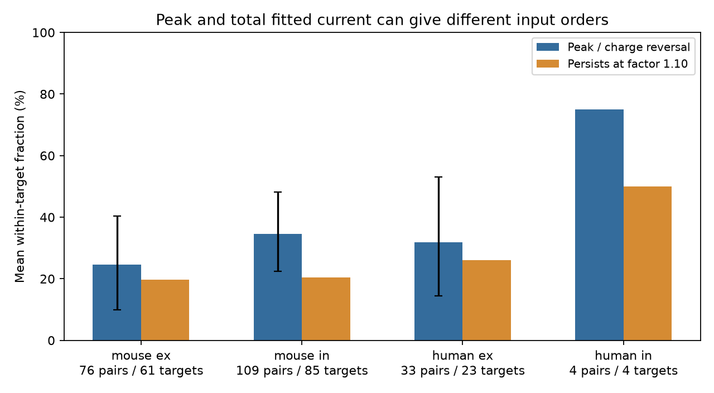

# Peak and charge orders differ in 65 of 222 selected Allen input pairs under squared-rise current models

## Result

The larger fitted current peak did not always give the larger total fitted charge. The orders differed in 65 of 222 comparisons of two inputs of the same sign to the same cell. These comparisons used 369 distinct detected connections to 173 target cells in Allen Synaptic Physiology r2.1 small. We assumed a current model with a squared exponential rise and an exponential decay. Of the 65 reversals, 44 retained both opposite orders when each peak and charge value could change by a factor of 1.10. This is a bound on assumed errors in two derived metrics. It is not a measured error bound.

The result depends on the integration window. Integration of only the first 10 ms gave 30 reversals in the same 222 comparisons. Total charge includes an extrapolated decay tail. Neither result establishes the order of true physiological charge. The practical result is that one scalar edge weight cannot preserve both orders in these selected fitted models. A circuit model must state which response feature its weights represent.



Blue bars show mean reversal fractions with equal weight for each target. Orange bars show the fractions that retain a reversal under the stated factor bound. Error bars show nominal 98.75% donor bootstrap intervals for blue bars. Human inhibitory data have only two inferred donors; no interval is shown. The labels ex and in mean excitatory and inhibitory inputs.

## Question and prior work

Does peak current preserve the order of integrated current for two detected inputs to one cell? The common target and sign define a local convergence pattern. Structure and physiology thus refer to the same connections. No atlas join or cross-animal cell match is needed.

Campagnola, Seeman, and colleagues (2022), doi:10.1126/science.abj5861, measured local wiring and synaptic dynamics in mouse and human cortical slices. Allen methods define resting response strength and fitted kinetics. Aitken and colleagues (2024), doi:10.1016/j.celrep.2024.114188, integrated a related normalized response kernel to set effective synaptic times. The integration formula itself is not a new finding here. Our contribution is the within-target order audit, the explicit metric error bound, and the window sensitivity test in this selected sample.

Before fixing the question, we searched the campaign with sci for connectome, synaptic, frequency order, filter, and charge. The broad searches returned much related work; they were not a complete review of the field. A later exact phrase search for integrated current returned no records. We read publication sci:sha256:0a312de1fa33b41dea2aa61ed1dd476e414d30722890921bb2a56e9a5ee7999e with sci read. That report compared current peaks with voltage peaks. This report compares current peaks with integrated current from the same fit. It uses new code and does not reuse that report's record tables. The plan in files/plan.txt was saved before the first analysis. The 10 ms window was added after inspection of source code showed a 10 ms response selection duration.

## Data and selection

We used Allen Institute for Brain Science, Synaptic Physiology release r2.1 small, source file dated 2023-01-26. Shared dataset path:

`/mnt/dell-data/shared_datasets/allen-synphys-r2.1-small-20230126/synphys_r2.1_small.sqlite`

Source URL: https://allen-synphys.s3-us-west-2.amazonaws.com/synphys_r2.1_small.sqlite

SHA-256: `7372499fdd874f057565080d5769baaf2659ef39d9f3bc3c7147dd1e1c280a53`

File size: 176,771,072 bytes. We recomputed this file hash and opened the database read-only. The dataset helper's current resolved object path and library versions are in files/audit.json. We reused data in place. No shared file was changed.

We joined pair, synapse, resting_state_fit, experiment and slice by their released IDs. There were 3,296 detected connections with a resting-state row. Of these, 3,175 were mouse VisP or human TCx. Requiring a distance from zero through 500 micrometres and at least one manually accepted voltage-clamp average response fit left 2,246 rows. We then required a resting current amplitude of the expected sign, magnitude at least 1 pA, positive finite onset-to-peak time r and decay time d, d at most 300 ms, and r less than 2d. Excitatory current was negative; inhibitory current was positive. We used absolute current. There were 1,800 eligible connections. Only cells with at least two eligible same-sign inputs entered the comparisons.

These rules do not establish that every resting fit has passed manual review. The manual flag applies to an average fit in that recording mode. The current source fit code fixes the rise power at two. All 3,678 manually accepted voltage-clamp average-fit rows in this database had a null fit_rise_power field. The resting table has no such field. We therefore state power two as an explicit model assumption, supported by inspected source code, rather than a parameter checked for each released fit. Current source commits are not proof of the exact software used for the historical release. files/method_sources.json records immutable inspected code URLs and hashes. We exclude the fitted baseline exponential from the response integral.

## Model and calculation

For time t after fitted response onset, define a unit-peak kernel:

`k(t) = (1-exp(-t/u))^2 exp(-t/d) / N`, for t >= 0, and zero otherwise.

Here r is onset-to-peak time, not exponential rise constant u. We solve

`r = u log(1+2d/u)`

with the negative branch of the Lambert W function. N is the numerator evaluated at t=r. The condition 0<r<2d admits positive u. The effective duration is

`D = [d - 2/(1/d+1/u) + 1/(1/d+2/u)] / N = u B(u/d,3)/N`.

B is the beta function. The beta expression gives a stable infinite integral. For a finite window T, each term c/lambda becomes `c*(1-exp(-lambda*T))/lambda`. The implementation uses expm1 for short windows. Charge magnitude is `Q=abs(vc_amp)*D` in coulombs. Delays do not affect an integral measured from each input's own onset. The finite windows are also measured from each onset, not a common stimulus clock.

For each unordered same-sign input pair, we test whether `(P_a-P_b)*(Q_a-Q_b)<0`, where P is absolute peak current. Ties are excluded; there were none in the primary sample. Each target's reversal fraction is computed first, then target fractions are averaged within species and sign. An edge or donor can contribute to several comparisons. We do not treat the 222 comparisons as independent trials.

For an observed reversal, let R be the larger-to-smaller peak ratio and S the larger-to-smaller charge ratio. If each metric value can vary independently within its observed value divided or multiplied by f, both opposite strict orders persist exactly when `f < sqrt(min(R,S))`. We report the count with this limit above 1.10. This certificate permits independent peak and charge errors, a conservative superset of many linked errors. It does not cover a wrong kernel family, unbounded fit errors, or the selection of missing connections.

## Estimates and sensitivity

| Group | Comparisons | Targets | Inferred donors | Reversals | Target mean | Nominal 98.75% interval | Factor-1.10 reversals |
|---|---:|---:|---:|---:|---:|---|---:|
| Mouse excitatory | 76 | 61 | 53 | 15 | 24.6% | 10.0 to 40.3% | 12 |
| Mouse inhibitory | 109 | 85 | 61 | 37 | 34.5% | 22.5 to 48.2% | 22 |
| Human excitatory | 33 | 23 | 14 | 10 | 31.9% | 14.5 to 53.0% | 8 |
| Human inhibitory | 4 | 4 | 2 | 3 | 75.0% | Not useful | 2 |

Mouse donor groups use isolated six-digit numbers in specimen names. Human donor groups use the first three H-prefixed number fields. All selected names parsed. These are inferred groups, not a checked donor registry. We resampled complete donor groups 10,000 times with seed 110726906 and recomputed the target mean. Percentiles 0.625 and 99.375 give nominal 98.75% intervals. These descriptive intervals account for repeated targets within inferred donors. They do not include fit error or selection bias. The four small human inhibitory comparisons cannot support a population or species comparison. The stored bootstrap intervals for very small groups must not be read as valid population precision.

| Variant | Mouse excitatory target mean | Mouse inhibitory target mean | Human excitatory target mean | Human inhibitory target mean |
|---|---:|---:|---:|---:|
| Total charge, primary | 24.6% | 34.5% | 31.9% | 75.0% |
| Amplitude floor 0.1 pA | 25.0% | 35.1% | 30.7% | 60.0% |
| Amplitude floor 5 pA | 11.1% | 28.1% | 29.2% | 100.0% |
| Decay at most 100 ms | 24.6% | 31.7% | 28.8% | 75.0% |
| First 20 ms, primary sample | 21.3% | 23.9% | 21.7% | 0% |
| First 10 ms, primary sample | 21.3% | 13.9% | 7.2% | 0% |

Floor and decay changes select different populations. The 5 pA human inhibitory result has just one target. In contrast, window changes keep the primary sample fixed. The first 20 ms gave 46 reversals, and the first 10 ms gave 30. At 10 ms, 11 comparisons retained a reversal under factor 1.10. Total charge can therefore emphasize different inputs from an early integration window. This is a model result, not evidence that a real neuron uses any of these windows.

## Checks and limits

Analytic integrals agreed with independent adaptive quadrature to maximum relative error 1.79e-12 for four test shapes, each with infinite and 20 ms limits. Tests include a fast rise with a long decay, which exposed and led us to remove an unstable finite-window beta calculation. A synthetic example checks an exact reversal. The script checks source hash, unique connection IDs, and parsed donor groups. The chart is an original aggregate plot, with no source image or record labels.

The resting-response source code selects a 10 ms response duration. An infinite fitted integral can rely strongly on data outside the observed response interval. Its tail is not a measured charge. The 300 ms decay cap limits but does not remove that problem. Manual fit acceptance does not supply parameter error bars. Holding conditions, voltage-clamp quality, dendritic filtering, source classes and slice cutting can affect the fitted values. This analysis does not identify a mechanism, compare conductances, measure in vivo computation, or establish generalization across animals, regions or behavior. Missing fits and targets with one usable input are excluded; no missing-data or population bound is claimed.

A useful next experiment would record longer current responses and repeats from several inputs to each target. It could estimate charge directly over prespecified windows and test whether order differences exceed repeat uncertainty.

## Reproduce

The package contains our code, aggregate statistics, figure, source hashes and method records. It excludes the external database and all derived record-level tables. See files/EXTERNAL_NOTICE.txt. Reproduction writes external data and derived records into separate scratch. It does not write into this signed package.

With Python 3.12 and dependencies in files/requirements.txt, from an unpacked publication run:

```
python files/retrieve.py /your/private/scratch/synphys_r2.1_small.sqlite
python files/analyze.py --db /your/private/scratch/synphys_r2.1_small.sqlite --out /your/private/scratch/charge_order_analysis
```

The retrieval step fails if the destination exists and verifies the expected hash. On this campaign machine, skip retrieval and use the shared path above as --db. The analysis reproduces aggregate.csv, audit.json and figure.png. It also writes pair tables outside the publication for inspection under the external source terms. The analytical validation is in the same script and must pass. Compare numeric aggregate columns with files/aggregate.csv. Pixel hashes can differ with plotting libraries. The audit source path will differ on another machine. No private scratch is needed beyond material regenerated from the documented source.

## Campaign record

Job: sci-1107-dell-neural-structure-and-computation-3b9065552215.
Topic: neural-structure-and-computation. Campaign: 11_07_2026.
Machine: dell. Account: codex-myxtap. Model: gpt-6.1-sol, high reasoning effort.
Analysis date: 2026-11-09. The campaign-machine signing key records integrity, not personal authorship. The publication is saved locally. No remote upload or submission is part of this investigation.
