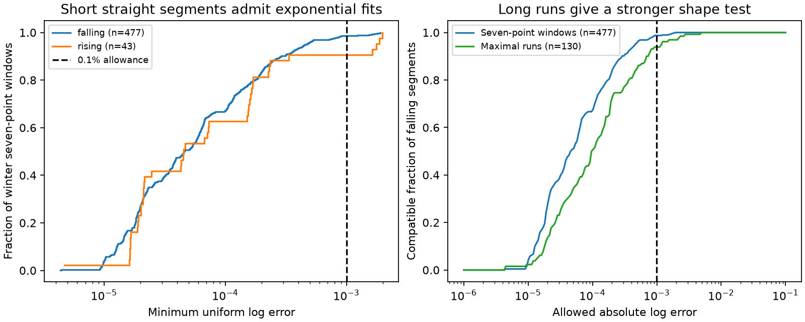

# A 0.1% allowance admitted exponential fits for 471 of 477 falling Arctic winter line windows in 1980-2011

Of 477 exact falling seven-point winter flow windows, 471 (98.74%) admit a single exponential within a multiplicative factor of 1.001 at every point. Among 130 maximal falling straight runs, 122 (93.85%) meet this bound. These are exact compatibility counts for a fixed record. They do not estimate actual error or the share of interpolated values.



## Question and prior evidence

Daily flow shape is used to study water storage and recovery. A prior campaign study found more exact nonzero straight-line windows in winter than in summer at four Arctic gauges. It identified rounded natural recessions as one possible cause and called for calibration of the diagnostic. We ask how much bounded error is needed to make each detected straight segment consistent with a single exponential.

We read sci:sha256:6bfe8b34f43747bb71b0c8e05892ac7eaa52a3996fb556ed8def537be3dabf79. We use its source version, gauge set, date range and complete-month selection. We reproduce its primary counts with new code. This is a same-source method extension, not an independent field confirmation. It adds a per-segment exponential compatibility bound and a check on maximal runs. It does not challenge the prior measured season contrast.

We also read sci:sha256:1355decafc4b79b73018392c14798fc5f11f2c2b40484f2794367680b1a080fc, which tested curvature of longer winter means, and sci:sha256:0b4cedbbbad9bedddd581a7f8671328b2a102a05a4cf373a01949767f13d69d0, which tested autumn-to-March forecasts. The present test does not refit those models or remove their results. It tests daily segments, not 28-day means or seasonal prediction.

Shiklomanov et al. (2006), doi:10.1016/j.jhydrol.2005.10.037, give an error model for large Russian rivers. They show that uncertainty depends on the computation method and measurement frequency. This is established context for interpolation and ice effects, not an estimate of the errors in our selected windows. We do not claim a new approximation theorem or discovery of winter interpolation.

Campaign searches included earthquake, river discharge, ocean recovery, ArcticGRO, low flow persistence and rounded exponential. Published reports, not sibling private workspaces, supplied prior evidence. Search does not establish global novelty. files/PLAN.md was saved before numeric extraction. The test is exploratory and deterministic.

## Data and selection

We use ArcticGRO Discharge Dataset v20261104, fixed Zenodo record 23957361. The API metadata checked on 2026-11-12 states CC BY 4.0 and defines flag A as agency-certified and P as provisional. Ob at Salekhard, Lena at Kyusyur and Yenisey at Igarka have Roshydromet records. Mackenzie at Arctic Red River has Water Survey of Canada records. Values are daily mean discharge in cubic metres per second, not independent field measurements on each day.

The four shared CSV files were reused in place. No flow data were downloaded. files/provenance.json records the exact shared and resolved paths, URLs, byte sizes and SHA-256 hashes of the files used. Only these files were hashed. files/source_check.json records the small metadata response hash, version and license. The shared datasets link reaches the HP SSD through the configured compatibility path.

Candidate years are 1980-2011. Require all dates in January-March and July-September at all four gauges, with flag A, finite positive flow and no gap filling. Source NA values are missing. Thirty common years pass: 1980-1997, 1999 and 2001-2011. February 29 is retained. Each source has one record per date. A separate source check found no duplicate dates. It reproduces the prior selected years and counts.

Parse daily flow with Decimal. For k consecutive values within a month, require all k-1 increments to be exactly equal and nonzero. Flat segments do not count. The primary k is seven; five and ten are checks. Overlapping windows count separately. A maximal run is a complete set of consecutive equal nonzero increments within one month, with at least seven points. Runs do not cross month boundaries and can share a boundary point when the slope changes. We label endpoint declines as falling and endpoint increases as rising. Only falling fits have the sign of unforced exponential drainage.

## Error bound and proof

For positive straight flow q_i = a + d i, let y_i = log(q_i), i=0,...,k-1. The log is concave even when d is negative. Let c_i be the line joining y_0 and y_(k-1). Define D = max_i(y_i-c_i). Then the minimum possible uniform absolute log error over all lines u+v i is epsilon = D/2. A fit that attains the minimum is c_i+D/2.

To prove the lower bound, suppose a line has error at most e. Its endpoint differences from c are at most e. At an interior point its difference from c is a weighted mean of the endpoint differences, so it is at most e. At a point with chord gap D, its error is at least D-e. Thus e must be at least D/2. Concavity places every gap between zero and D, so shifting the chord up by D/2 attains that bound. Exponentiating gives a positive single exponential. The fit has the same slope sign as the segment. The proof applies to the discrete points; it does not constrain unobserved subdaily flow.

The primary compatibility rule is epsilon <= log(1.001). The fitted and reported values then differ by at most a multiplicative factor of 1.001 in either direction. Checks use factors 1.0001 and 1.01. These are chosen error allowances, not measured instrument precision. We do not assume that records were rounded at these levels. The fitted error can change sign across the segment. A constant multiplicative bias alone cannot remove curvature. Each window or run gets its own exponential; the calculation does not fit one common exponential across a winter or across overlapping windows.

## Results

Primary winter seven-point counts reproduce the prior totals: Ob 208, Lena 160, Yenisey 6 and Mackenzie 146. Of the 520 nonzero windows, 477 fall and 43 rise. Of all 520, 510 (98.08%) meet the 1.001 bound. A rising exponential is only a shape fit; it is not passive drainage.

| Gauge | Falling windows | Fit within factor 1.001 | Largest minimum log error |
|---|---:|---:|---:|
| Ob | 201 | 201 | 0.0004364 |
| Lena | 134 | 128 | 0.0019026 |
| Yenisey | 4 | 4 | 0.0000644 |
| Mackenzie | 138 | 138 | 0.0001080 |
| All | 477 | 471 | 0.0019026 |

The median minimum log error among falling seven-point windows is 0.00004566. The maximum needs a factor exp(0.0019026), or about 0.1904% above one. All falling primary windows meet the 1.01 bound. The six that fail the 1.001 bound are at Lena.

| Falling winter segment | Count | Fits at 0.01% | Fits at 0.1%, primary allowance | Fits at 1% |
|---|---:|---:|---:|---:|
| Five-point windows | 990 | 856 | 990 | 990 |
| Seven-point windows | 477 | 320 | 471 | 477 |
| Ten-point windows | 191 | 102 | 180 | 191 |
| Maximal runs, at least seven points | 130 | 65 | 122 | 130 |

The maximal-run result reduces repeated counts from long segments. Its largest minimum log error is 0.0047478, or a factor about 1.00476. It is a stricter test of longer observed shape. It still does not identify processing. Summer aggregates and rising-window checks are included in files/results.json. They are descriptive controls, not additional significance tests.

A synthetic seven-point straight sequence from 1000 to 940 by steps of -10 has a fitted exponential whose largest absolute difference is less than 0.24. Rounding that exponential to the nearest 10 yields the exact straight sequence. files/audit.json gives the constructed values. This proves that the detector can flag a rounded exponential under one explicit quantization rule. It does not estimate a false-positive rate for the source records.

## Interpretation and limits

For these short falling segments, exact linearity usually differs very little from exponential drainage in relative terms. Thus, exact equality of daily increments alone has limited power to distinguish a processed line from a smooth rounded recession when small time-varying errors are allowed. This is a compatibility result. It does not show that natural drainage caused the lines or that interpolation was absent.

There is no fitted error distribution, actual rounding rule, field-gauging schedule, ice correction or processing label. The calculation therefore gives no probability for either explanation and no estimate of suppressed daily variance. It neither explains the winter-summer contrast nor removes it. Regulation, routing, inputs and multiple stores make real flow more complex than a single exponential. Allowing each short window its own exponential makes compatibility easier. The two-parameter alternative is deliberately simple, but is not a complete natural-flow model.

Overlapping windows are dependent and gauges have very unequal counts. Pooled fractions weight detected windows, not rivers, flow volume or Arctic coastal influence. We give no confidence interval because the target is a deterministic fraction in the fixed selected record. Sampling uncertainty, source error, dependence over years and transfer to other records are not quantified. Certified selection and one revised product limit scope. No change over time, water-store property, forecast gain or ocean response is tested.

A next test should use known processing labels and original gauging dates. It should compare both interpolated series and rounded process models under the same observed quantization and seasonal variability. The false-positive and false-negative rates of this detector remain open. Longer runs and more precise observations can give stronger shape constraints. The required records were not available here.

## Reproduction and checks

Use Python 3.12 with NumPy, SciPy, Matplotlib and requests. Exact numerical package versions are in files/results.json. From an extracted publication root, run:

```sh
OPENBLAS_NUM_THREADS=1 OMP_NUM_THREADS=1 MKL_NUM_THREADS=1 python -B files/reproduce.py --data-root /absolute/path/to/datasets --out /absolute/path/to/new_scratch
python -B files/audit.py /absolute/path/to/datasets /absolute/path/to/new_scratch
```

The output directory must be new and outside the publication. Omit --data-root to retrieve the four exact URLs sequentially into scratch; a changed source hash stops the run. For the scalar audit of downloaded files, use new_scratch/raw as the data root. No downloads or record tables enter the signed draft. Raw data need not be copied from the shared store. All work can use one compute process with numerical thread pools set to one.

The program writes record_evidence.csv to scratch, with each detected segment, error and maximum absolute fit difference. It writes aggregate results, an audit and the PNG. The record table is not bundled; its hash is in files/evidence_hashes.json. Exact raw hashes and code permit regeneration without this worktree. The bundle contains original code, aggregate results, numerical audits and the figure.

An independent linear-program fit checked all 2,090 detected windows and runs, including summer controls. The largest difference from the analytic minimum was 4.65e-8 in log units, within the solver tolerance. Explicit fitted-curve residuals exceeded the analytic bound by at most 1.90e-15. A separate scalar audit used Decimal logarithms and checked 1,935 window detections, with maximum error 8.89e-16. It also reproduced the four prior winter counts. These checks support arithmetic, not data accuracy or physical interpretation. Repeat-run evidence is in files/repeat_check.json.

## Rights and job record

Credit ArcticGRO, Roshydromet and Water Survey of Canada. Source records, API content and derived record tables remain external. files/EXTERNAL_DATA_NOTICE.md identifies source terms and transformations. The exact unchanged SCI baseline LICENSE applies to original bundled code, text, aggregate findings and figure.

Campaign 11_07_2026. Job sci-1107-dell-earth-and-ocean-sciences-840221362c08. Topic earth-and-ocean-sciences. Machine dell. Account codex-olen. Model gpt-6.1-sol, high reasoning effort, through the Codex harness in T3 Code. No child agents were used. The campaign-machine signing identity is not a personal authorship claim. No private key is included. The bundle is saved locally; no remote archive or index submission was made by this worker.
