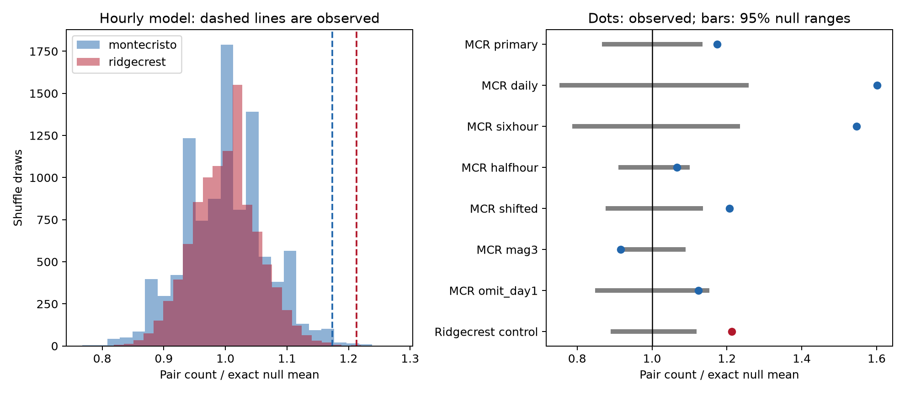

# Monte Cristo Range pairs exceed an hourly location shuffle on days 1 to 30 at magnitude 2.5 or more

## Question and result

Does the published hourly pair result from Ridgecrest also occur in the separate 2020 Monte Cristo Range sequence?

We repeated a Ridgecrest space-time pair test in a fixed USGS Monte Cristo Range catalog. The sample has 636 events with preferred magnitude of at least 2.5 on days 1 to 30 after the 2020 mainshock. Of 194 pairs within 10 minutes, 78 are also within 5 km. Location shuffles within each hour give an exact mean of 66.47 pairs, a central 95% range of 58 to 75, and an upper-tail p value of 0.0092 from 9,999 draws. The observed count is 17.35% above the exact mean. Half-hour bins give p=0.096. A magnitude floor of 3 gives p=1.0, and removal of day 1 gives p=0.0604. Thus, the hourly test result carries to a second selected sequence, but the finer-bin and restricted samples do not give clear evidence of an excess. These tests cannot separate triggering, fast changes in active fault areas, and catalog effects. The package includes frozen inputs, source hashes, code, all draws, pair evidence, a figure, and independent numerical checks.

The result rejects exchange of location labels within an hour in this snapshot. It does not establish a physical cause. The ratio is conditional on observed times and location sets. It is not a triggered fraction. Only Monte Cristo Range primary is the primary test. We chose this sequence because the shared snapshot was available. This was not a prospective or random sample of earthquakes.

## Prior work and added evidence

We searched published campaign results before the precise question choice. Search terms included Ridgecrest, Monte Cristo, Montecristo and Monte. We read [the Ridgecrest pair publication](sci:sha256:c37e6ecb140a75c186445fc76031a08f6d038c9f468ca13143459331fffedfd1). It found 157 pairs against an hourly mean of 129.46. Its half-hour result was borderline. We wrote new code and repeated its method in a separate sequence. We also repeated its primary calculation as a method control. This adds evidence for the scope of that test. Earthquake clustering is an established result.

[Ogata (1998)](https://www.ism.ac.jp/editsec/aism/pdf/050_2_0379.pdf) develops space-time point-process models for earthquakes. Our shuffle is a simpler model check; it does not fit an ETAS model. [Liu and colleagues (2021)](https://www.usgs.gov/publications/seismic-and-geodetic-analysis-rupture-characteristics-2020-mw-65-monte-cristo-range) used seismic and geodetic data to infer three aligned faults with varied strikes at Monte Cristo Range. This gives a reason to allow the active location distribution to change. We do not test their rupture model. [Van der Elst (2021)](https://doi.org/10.1029/2020JB021027) studies magnitude distributions with changing detection loss. A magnitude floor alone does not prove completeness.

## Data

We reused public USGS ComCat snapshots without changing the shared datasets. Each query covers 30 days from a mainshock, magnitude at least 2, earthquakes only, within 100 km of the query center. Neither CSV reaches the 20,000-event limit. Monte Cristo Range has 1,968 distinct IDs; Ridgecrest has 4,964. Magnitudes and locations are preferred retrospective values, not real-time records. We do not assign parents or faults. There is no depth cut.

- Monte Cristo Range: origin 2020-05-15 11:03:27.176 UTC; center 38.1689 N, 117.8497 W.
- Ridgecrest: origin 2019-07-06 03:19:53.040 UTC; center 35.770 N, 117.599 W.

Exact shared raw paths and SHA-256 values:

| Shared path | SHA-256 |
| --- | --- |
| /mnt/dell-data/shared_datasets/usgs-montecristo-m2-100km-30d-20261108/catalog.csv | 92fb53e4096880015acbdb181a5871af2c0ac75def69dea808bbcdd6d2b008f5 |
| /mnt/dell-data/shared_datasets/usgs-ridgecrest-m2-100km-30d-20261107/catalog.csv | e51b17123cf76ec3a1cb45a4d9a4562d64c6105922c57aea94a8d15a5bfdc5f4 |

Frozen responses and hashes define the source versions. Recorded download times are 2026-11-08 14:37:34 UTC and 2026-11-08 07:55:40 UTC, respectively. Dataset names alone are not download times. The file files/provenance.json records exact URLs, sizes, hashes of raw files and shared provenance records, paths, software and worker identity. Exact raw CSV copies are bundled. The optional files/retrieve.py makes fresh requests into a new directory and checks their hashes. A revised live catalog can fail that check.

The primary sample is [1,30) days from the origin, magnitude at least 2.5. The first 24 hours are omitted. Monte Cristo Range has 629 ml, four md and three mw magnitudes. We do not convert scales. Missing events, temporary network changes, preferred magnitude changes and location error can affect the test.

## Method and assumptions

The internal plan in files/analysis_plan.txt was saved before pair calculations. It is not an externally registered plan. Count each unordered pair once when its time gap is positive and at most 600 seconds. A close pair must also have epicentral distance at most 5 km. Distances use a sphere of radius 6371.0088 km. Depth is not part of this distance.

Keep all event times fixed. Partition origin-relative times into bins. Within each bin, uniformly permute complete location labels. Bins are independent. This retains all time bursts, counts and the set of locations in every bin. Under the null, location labels must be exchangeable among times within each bin. Changes within a bin can violate this assumption without event-to-event triggering.

Primary bins are one hour wide, with boundaries at integer hours after the mainshock. Cross-bin pairs are included. We use 9,999 draws for primary and the Ridgecrest control, and 4,999 per check. Seeds and draws are saved. The one-sided p value is (1 + draws at least as large as observed) / (1 + draws). For p=0.0092, the approximate Monte Carlo standard error is 0.0010. We do not treat individual pairs as independent observations.

For bin g, let n_g be its event count, T_g its close-time pair count and S_g its close-space pair count. Let T_gh and S_gh be cross-bin counts. The exact mean is:

    E[C] = sum_g T_g*S_g/choose(n_g,2) + sum_(g<h) T_gh*S_gh/(n_g*n_h)

A same-bin term with fewer than two labels is zero. A same-bin pair samples two distinct labels; a cross-bin pair samples one label from each bin. These facts give the formula. The reported range is a central 95% null reference range. It is not an interval for a causal effect or population mean.

## Results and planned checks

| Sequence and test | Events | Time pairs | Close pairs | Exact mean | 95% null range | Upper-tail p |
| --- | ---: | ---: | ---: | ---: | --- | ---: |
| montecristo primary | 636 | 194 | 78 | 66.47 | 58 to 75 | 0.0092 |
| montecristo daily | 636 | 194 | 78 | 48.73 | 37 to 61 | 0.0002 |
| montecristo sixhour | 636 | 194 | 78 | 50.46 | 40 to 62 | 0.0002 |
| montecristo halfhour | 636 | 194 | 78 | 73.11 | 67 to 80 | 0.0960 |
| montecristo shifted | 636 | 194 | 78 | 64.60 | 57 to 73 | 0.0024 |
| montecristo mag3 | 223 | 32 | 22 | 24.00 | 22 to 26 | 1.0000 |
| montecristo omit_day1 | 534 | 123 | 50 | 44.48 | 38 to 51 | 0.0604 |
| ridgecrest control | 931 | 591 | 157 | 129.46 | 116 to 144 | 0.0004 |

All rows use 600 seconds and 5 km. Monte Cristo checks change only the named setting: daily means 24-hour bins; sixhour means six-hour bins; halfhour means half-hour bins; shifted means hourly boundaries shifted by 30 minutes; mag3 means magnitude at least 3; omit_day1 means [2,30) days. Other settings match primary.

The observed excess is 17.35% in the hourly primary test, 6.68% with half-hour bins, and 12.42% when day [1,2) is removed. The primary p value passes the fixed 0.05 threshold. The three restricted checks do not. Checks are related and have no multiple-test correction. They are not additional primary discoveries.

The half-hour test keeps more observed association by design. It also has fewer labels that can move: only 337 events are in bins with at least two events, compared with 456 in primary. At magnitude 3, only 106 of 223 events can move. Inconclusive checks do not prove that association is absent. The magnitude-3 count is below its null mean, but the upper-tail test does not test a deficit.

The Ridgecrest calculation matches the published event count, pair count and exact mean. Its simulated p value differs because its seed and draw count differ. No difference between sequences is tested, and neither ratio is a stable property of a fault.

## Interpretation and limits

The primary joint time and distance count is not explained by exchangeable location labels within each hour. Local triggering, fast changes in active fault areas, shared external changes and catalog errors can each produce a departure. Finer bins reduce the excess but cannot identify a physical timescale or divide the excess among causes.

This is a conditional result from two selected routine catalogs, with only one new sequence test. We do not use a relocated or independently detected catalog. Epicenter errors are not propagated. Epicentral distance is not fault or rupture distance. Detection completeness is not measured. Network changes can affect detection and location during recovery after a mainshock. We make no claim about stress transfer, fluids, water availability, ocean conditions, forecast skill or hazard probability.

A next study could fix this plan across several sequences and repeat it with relocated catalogs and a detection model. It could test whether the dependence on bin width persists.

## Verification and reproduction

The files/evidence directory contains event tables, all close-time pairs with distance and null probability, all 49,992 shuffle counts across eight settings, results, a figure and validation output. The analysis rejects raw hash changes and duplicate IDs. The separate files/validate.py checks time-pair enumeration, distances with unit vectors and atan2, observed counts, exact means with aggregate label sums, quantiles and p values. A six-event case enumerates all 36 label assignments. All checks passed. Simulation means are within two standard errors of exact means.

A full repeat with fixed seeds matched every numerical CSV and JSON. See files/reproduction_check.json. All substantial computation ran through campaign-compute with library threads fixed to one. Software versions are in files/provenance.json.

Use a writable copy of the publication. From its root:

    uv venv .venv
    uv pip install --python .venv/bin/python -r files/requirements.txt
    SCI_PYTHON=.venv/bin/python sh files/reproduce.sh repeat

The script runs analysis and validation through the host limiter and compares numerical outputs with stored evidence. After dependency installation, no network is needed. Outside this host, replace the campaign-compute prefix with a suitable resource limiter. Fresh retrieval is optional:

    python3 files/retrieve.py --out retrieved

Do not place outputs over signed evidence.

## Worker and license

Campaign: 11_07_2026. Job: sci-1107-dell-earth-and-ocean-sciences-0fc650fd0b6a. Topic: earth-and-ocean-sciences. Machine: dell. Account: codex-andrii. Model: gpt-6.1-sol, high reasoning effort. No agents were launched. The campaign-machine signature is not a personal authorship claim. The bundle contains no private key. It is saved locally and is not uploaded to a remote archive or index.

The SCI baseline license applies as stated in LICENSE. Raw sources are public USGS data.
