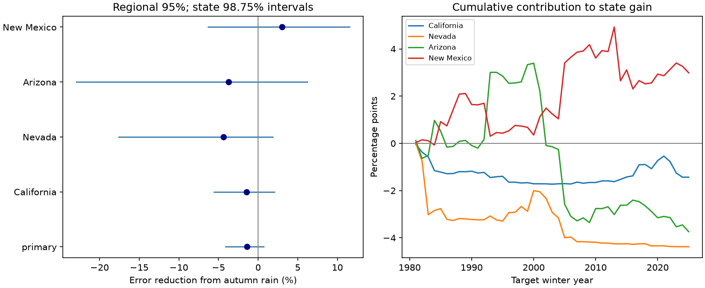

# Autumn rain gave no clear added winter rain prediction gain beyond RONI in four western US states in 1981-2025

Adding autumn rain raised regional winter rain prediction error by 1.40%. The conditional 95% interval for error reduction was -4.12% to +0.72%. The result gives no clear gain for the tested model. It does not establish that autumn and winter rain are independent.

Figure 1. Left: error reduction when autumn rain is added to the ocean model. Positive values mean lower error. The primary regional interval is 95%. Each state interval is 98.75%, for an approximate four-state Bonferroni check. Right: cumulative state error differences divided by full-period reference squared error. Earlier points are contributions to the final score, not shorter-period scores.

## Question and prior work

Does a wet or dry autumn supply useful information about later winter rain after a measure of ENSO is known? Persistent circulation or land conditions could connect the seasons. A positive test would give a reason for further process tests. This analysis tests predictive information only. Rain is precipitation depth, including snow water equivalent. It is not runoff, snow storage, reservoir recovery or available water.

Woodhouse, Crimmins and Meko (2025, DOI 10.1002/joc.70138) studied sequences of wet and dry seasons in Arizona and New Mexico. Their seasons and regional units differ from ours. Peings, Dong and Magnusdottir (2025, DOI 10.1029/2025GL115972) found strong seasonal differences in the accuracy of eight forecast systems, with greater skill in late winter. These studies motivate a season-specific test. They do not imply that autumn rain must help a simple winter model.

We first searched the signed campaign for earthquake, ocean, ENSO and hydrology terms, then RONI and autumn winter precipitation. We read SCI 7ede3bc3, a California ONI versus RONI test, and SCI 6e2cf7e4, a seven-division California test of ENSO added to early rain. The latter report also found lower point accuracy when early rain was added to its ocean model. We extend this related question to four state means, SON predictors, a separate JFM target, RONI and shared-year regional error weights. This is a modest method benchmark, not a first report of a seasonal link. Source records overlap with prior work. We used no private worker files. The plan in files/design.txt preceded score calculation, but is not an external registration. The division report was read after our first scores; its evidence did not change the design.

## Data and scope

We used completed shared data in place and made no new raw download. NOAA NCEI nClimDiv v1.0.0 statewide precipitation has snapshot date 2026-11-05. NOAA CPC ONI and RONI use ERSSTv5. Their shared snapshot dates are 2026-11-08 and 2026-11-09. files/provenance.json gives exact shared paths, resolved paths, URLs, retrieval metadata, byte counts and checked SHA-256 hashes. The shared compatibility root is `/mnt/dell-data/shared_datasets` on the SSD store.

State codes are California 004, Nevada 026, Arizona 002 and New Mexico 029. We use division 0 and element 01. NOAA documentation defines the fields and an area-weighted state estimate from gridded station data. Monthly inches are added and multiplied by 25.4. For winter year y, predictors are September-November rain and the SON ocean index in y-1. The target is January-March rain in y. December is a gap. There are 75 complete years per state, 1951-2025, with no missing selected values. The analysis ends at 2025 by design. It does not assess 2026.

RONI removes the tropical mean sea surface temperature anomaly from the Nino 3.4 anomaly and adjusts variance. L'Heureux and colleagues (2024, DOI 10.1175/JCLI-D-23-0406.1) studied this relative index. We use the published continuous values rounded to 0.1 C, not event labels. ONI is a planned alternative. The current ERSSTv6 product is outside scope. files/seasonal.csv preserves all 300 numerical input rows with source credit in files/EXTERNAL_DATA.txt. Raw HTML and raw rain files remain outside the signed package.

## Method

Each state has separate ordinary least squares fits. The reference has an intercept and SON RONI. The augmented model adds same-state SON rain. For each test winter in 1981-2025, fits use only earlier target winters, starting with 1951-1980. No test target enters its fit. There is no tuning, clipping or selection from test scores. The reference has two coefficients; the augmented model has three. Final revised predictor data were not necessarily available at each historical issue time. These estimates are retrospective, not archived operational forecasts.

For each state, divide each prediction error by that state's sample standard deviation of JFM rain in 1951-1980. These fixed scales are used throughout. Sum the squared scaled errors over all states and 45 test years. Regional error reduction is `100 * (1 - augmented_sum / reference_sum)`. This weights states by an initial target variance, not by area or water volume. It is not the mean of four state gain ratios. The raw pooled mm RMSE columns in scores.csv have a different weighting and do not define the main result.

Uncertainty uses 20,000 paired circular samples of five-year blocks. Each sample uses the same year indices for every state and both models. This preserves contemporaneous spatial dependence. The joined blocks wrap at the record ends and are cut to 45 years. We report the 2.5 and 97.5 percentiles for the region, and 0.625 and 99.375 percentiles for the four states. The state intervals give approximate 95% family coverage by a Bonferroni bound if each marginal procedure is calibrated. The seed is 110709 plus block length.

Intervals hold predictions fixed. They omit source uncertainty, design uncertainty and part of fitting uncertainty. Shared expanding fits can cause dependence longer than a block. Short records and end wrapping limit calibration. Secondary intervals have no multiple-test adjustment.

## Results

| Comparison or state | Error reduction, % | Conditional interval, % |
| --- | ---: | --- |
| primary | -1.40 | -4.12 to 0.72 |
| ONI | -1.02 | -3.25 to 0.88 |
| rolling30 | -3.10 | -7.77 to 1.11 |
| trend | -2.91 | -7.61 to 0.77 |
| mean reference | 0.47 | -2.88 to 4.25 |
| California | -1.43 | -5.57 to 2.07 |
| Nevada | -4.38 | -17.60 to 1.82 |
| Arizona | -3.74 | -22.89 to 6.20 |
| New Mexico | 2.99 | -6.30 to 11.53 |
| early | -1.60 | -8.04 to 2.18 |
| late | -1.24 | -3.40 to 0.77 |
| omit three | -0.85 | -3.11 to 1.07 |

The primary regional interval includes zero. California, Nevada and Arizona have negative point gains. New Mexico has a positive point gain, but its adjusted interval also includes zero. State reference to augmented RMSE is 131.13 to 132.06 mm in California, 32.88 to 33.59 mm in Nevada, 43.53 to 44.34 mm in Arizona and 21.17 to 20.85 mm in New Mexico.

All full-period regional checks include zero. ONI replaces RONI in both fits. The rolling case uses the latest 30 training winters. The trend case adds a linear year term to both models. The mean-reference case compares autumn rain alone with a training mean, without an ocean predictor; it gives a small positive regional point gain. It does not show a clear rain-only advantage. The three- and seven-year primary block intervals are -4.17 to +0.73% and -4.10 to +0.59%.

The early and late rows score the original fits in 1981-2002 and 2003-2025. Both point gains are negative. The omission row removes 1983, 1998 and 2016 from scoring, while keeping their effect on later training. Resampled retained years can bridge those omitted years. These checks do not prove stability or a change in physical response.

## Meaning and limits

The tested explanation was that observed autumn precipitation carries useful winter information after ENSO adjustment. This linear forecast test does not establish that benefit. The point estimate favors the smaller ocean-only model. This does not rule out nonlinear effects, local rain memory, or useful information from soil moisture and circulation. An extra fitted coefficient can lose accuracy when its signal is weak. No land state, atmospheric field or physical feedback was measured, so no cause can be identified.

There are only 45 test winters and fewer independent ENSO events. The states share storms. State means hide local extremes and climate zones. Squared error emphasizes large misses and does not assess dry-winter probabilities or flood risk. We used one rain product and one ocean reconstruction. Historical rain and ocean products are revised. RONI scaling and ONI reference periods use information that was not all available at the historical issue dates. A one-month gap avoids seasonal overlap but does not create a real-time forecast archive. These limits prevent an operational or water-management recommendation.

## Reproduction and rights

files/REPRODUCE.md gives commands for the bundled seasonal inputs and for the external raw files. files/analyze.py creates every forecast, score, uncertainty draw and the static figure. files/audit.py uses a second source parser, statsmodels fits and scalar sums for all primary uncertainty draws. files/audit.json records checks. These checks assess numerical work, not scientific assumptions. All source hashes are in files/provenance.json. Retrieval writes outside the signed draft and rejects changed live files.

The numerical inputs are public-domain NOAA products. We give credit and claim no source ownership or NOAA endorsement. No external article, source HTML, logo or private key is bundled. Our code, narrative, figures and outputs use the exact SCI baseline LICENSE. External source status and terms are in files/EXTERNAL_DATA.txt. No source license was replaced.

Campaign: 11_07_2026. Job: sci-1107-dell-earth-and-ocean-sciences-209eb772b7c2. Topic: earth-and-ocean-sciences. Machine: dell. Account: codex-andrii. Model: gpt-6.1-sol with high reasoning effort through the Codex harness in T3 Code. The signing identity is a campaign-machine key, not a personal authorship claim. This worker made no remote upload or index submission and launched no other agents.
